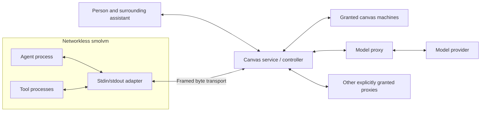

# Canvas: a go-between for people, agents, and machines

Concept draft, not an implementation or a claim that the isolation described
here has already been verified. This experiment may grow alongside MicroWasm,
the document-driven workflows, and the Macchiato machine work.

## The idea

A go-between that a person, their assistant, and an isolated AI agent can use
to exchange selected information and capabilities. Its easiest useful form could
be a glorified clipboard: put something here, choose who gets it, and receive
something back. A fully connected agent environment is not the entry requirement.

The canvas can grow beyond visual objects to contain running machines,
proxies, documents, editors, resources, and connections between them. A machine
may have a visual surface, or it may do useful work without displaying anything.

The canvas is both a place to work and a view of the composition that makes the
work possible. A proxy is a real component on the canvas, not an invisible
permission granted to everything on the page. An agent is another participant
with explicitly granted capabilities, not the owner of the entire canvas.

The surrounding assistant could use a canvas tool/bridge while a separate agent
runs in an isolated environment. That environment may already have networking
and its own model connection. Alternatively, a networkless smolvm can obtain
even that connection through the go-between. These are distinct useful setups,
not a requirement that everyone adopt the more restrictive one.

With a live integration, participants work with the same authoritative canvas
state, subject to their own grants. With manual handoffs, they exchange explicit
snapshots instead. Neither needs to operate exclusively through screenshots or
simulated mouse input. Human interaction remains first-class.

## Start as a glorified clipboard

The early audience includes security-conscious and DIY developers who keep an
agent client off their main machine. They may run it in a disposable VM,
container, or another computer. They want to give it a particular document,
selected files, a result, or one credential without exposing their home directory,
browser profile, environment, SSH agent, or collection of host secrets.

The main-machine side could be an ordinary browser page. There need not be an
installed agent client, a daemon with broad host access, automatic clipboard
monitoring, or a filesystem mirror. A small bridge can run on the isolated side;
manual copy and paste should remain a useful path without any bridge at all.

A first handoff can be deliberately simple:

1. Paste text or select a file into a holding area.
2. See what is included, select its recipient, and explicitly hand it over.
3. Receive a result in a separate area, with its source and purpose visible.
4. Inspect it before copying it out, saving it, or applying it to another object.

Pasting into a holding area need not immediately send content to the agent or
model. There is no implicit clipboard history, synchronization of unrelated
content, or broadcast to every participant. Returned text is data, not an
instruction to execute it on the main machine. Text exchange needs no special
OS clipboard permission beyond the user's ordinary paste/copy actions.

Cards and connections can make these handoffs easier to inspect and repeat, but
the initial value is the selective exchange, not an elaborate canvas UI.

## Isolated agents and selected secrets

An isolated agent can have outbound networking while lacking access to the
main machine's secrets. For this setup, the go-between does not need to carry
all network traffic or replace the agent's existing model connection. Its job
is to supply just the resources and credentials the user chooses.

There are two different handoffs, and the UI should distinguish them:

- **Deliver a secret:** give a selected credential to the selected agent or tool
  environment. This is useful with existing clients that expect a key. The agent
  can read and potentially retain or transmit it; removal from the canvas cannot
  recall a copy. Expiry or provider-side rotation/revocation handles that case.
- **Grant use without delivery:** keep the key at a proxy and give the agent a
  bounded service handle. The proxy injects the credential for approved requests.
  This needs more integration, but avoids exposing the key bytes to the agent.

Neither mode implies importing all host credentials. Secret payloads should be
separate from ordinary shared notes, conversation content, exports, and activity
logs. A secret handoff can record who received which grant without recording
the value. Retention and persistence need explicit treatment; do not promise
secure erasure merely because an item was dismissed. Putting a key in a model
prompt is not the default way to configure a tool.

The stronger networkless setup below is another possible deployment. It is not
literally air-gapped when stdin/stdout carries live messages to external services;
its property is no direct guest network access and explicitly mediated traffic.

## What can be on it

- A document or note, including a document that defines a runnable program.
- An editor and the source or resource set it is allowed to change.
- A Wasm machine with a live visual surface, such as a game or document renderer.
- A headless machine, such as a compiler, syntax highlighter, or transformation.
- A proxy that grants a particular external service, not arbitrary networking.
- An agent session, with its conversation, pending work, and granted tools.
- A process running inside a smolvm, including its lifecycle and output streams.
- An artifact, immutable input snapshot, or reusable result of a computation.

Cards, windows, and spatial positions are views of these objects. Moving a card
does not change its authority. A connection is not merely a line in a drawing:
it names an actual permitted route between ports. Creating a proposed connection
does not activate new authority until the controller accepts it.

A component does not imply a crate, a separate process, or a VM. Components can
be small programs composed into a machine. Use a distinct execution boundary
where its capabilities, lifetime, or failure isolation need one.

## Shared access without shared authority

For the connected composition, the canvas service owns identities, component descriptions, revisions, and
accepted changes. Participants can receive a scoped snapshot and subscribe to
subsequent changes. They can propose or apply operations within their grants:
create a note, edit a source document, move a surface, invoke a machine, connect
existing ports, or inspect a result.

An edit carries the revision it was based on. A conflicting edit produces a
visible conflict rather than silently replacing another participant's work.
Changes record their author and originating machine. Views and source edits can
be reversible; external effects such as an uploaded file are not made reversible
just because the corresponding canvas operation can be undone.

Seeing an object need not grant the ability to read all its inputs, change it,
invoke it, or inspect its credentials. The user controls which authority can be
delegated. An agent may arrange or propose a proxy, but cannot grant itself the
right to use that proxy or broaden its destination scope.

## A networkless smolvm can still run a connected agent

In this optional setup, the VM has no network interface or other ungranted network path. Programs
inside it exchange all external requests and results through their standard
input and output. This includes the agent's model-provider connection: the agent
does not need a network stack or provider credential of its own.

An agent request travels out over stdout. The controller checks its grant,
dispatches it to the model proxy, and sends response chunks back over stdin.
Tool calls can use the same route to reach other canvas machines. The model
stream, tool replies, cancellation, and canvas changes can be multiplexed without
giving the guest a socket.

Stdin/stdout is the process-facing interface, not a claim that a VM automatically
shares host pipes. The VM supervisor must carry those bytes over an explicit
host/guest transport, for example a serial or virtio-serial channel. The exact
smolvm integration needs a small proof before choosing the transport. It must
not quietly substitute a guest TCP connection or expose a host control socket.

Existing agents may need a transport adapter or a small provider facade to use
this connection. A local HTTP server inside the guest is not a prerequisite.
For a process with an existing stdout protocol, an adapter can wrap that
protocol; ordinary tool stdout is payload, not automatically a privileged call.

## The pipe is a transport, not permission

Start with a small framed protocol: a channel/request identifier, message kind,
and byte length, followed by payload bytes. It must handle frames split across
reads and several frames arriving in one read. Do not base framing on lines:
source files, images, model streams, and Wasm are all legitimate payloads.

The exact encoding remains open. JSON-shaped values plus byte arrays, or the
existing compact reader/writer approach, are candidates. Avoid base64 for binary
payloads merely to move them through the pipe. This is not a reason to freeze
another large ABI before the first example.

- Stdout of the adapter is framed protocol only. Diagnostics use stderr.
- Guest process identity comes from the supervisor, not a claimed sender field.
- Requests name granted handles, not arbitrary host objects or host commands.
- Each connection has bounded frames, queues, in-flight work, and cancellation.
- Large outputs stream with backpressure; a blocked model stream must not prevent
  cancellation or stopping a tool. Scheduling belongs to the controller.
- EOF and process failure terminate the affected requests. A restart cannot reuse
  an old session's handles or accidentally receive its delayed replies.
- Stderr and tool output are inert data. Recording their contents is a separate
  retention decision, not an excuse to log keys or entire private documents.

The VM supervisor also controls resource budgets, process creation, inherited
file descriptors, environment, and filesystem mounts. No NIC is not sufficient
if a guest inherits a host socket or another unrestricted communication channel.

## Proxies as visible machines

A model proxy can hold the provider key outside the VM, select allowed models,
bound requests, and return streaming responses. The agent gets a model service,
not a credential-bearing generic fetch.

A storage proxy could accept a request for a relative path and operation, check
the granted storage zone and prefix, and inject its credential only at the
approved destination. Redirects must not carry the credential elsewhere. A
document-fetching proxy could be read-only and entirely separate from uploads.

The canvas can show each proxy's purpose, owner, scope, connections, activity,
and stop/revoke controls without exposing its secrets. The proxy's enforcement
lives outside the requesting guest. Drawing or modifying a visual proxy node
must never be enough to replace that enforcement.

No network in the VM means no *ambient* network access, not zero possible data
egress. Sending a prompt to a model is intentional egress. A permitted proxy
can still transmit sensitive content within its scope, so its scope, accessible
inputs, provider, and approval policy matter. Untrusted instructions in canvas
documents or model responses cannot change those grants.

## Machine host, controller, and presentation

The machine host supplies bounded execution and devices. The controller creates
machines, grants handles, routes messages, and manages their lifetimes. Canvas
application code owns the workspace presentation and interaction. Do not grow
the host into a canvas-specific application framework.

Browser Wasm machines can use the existing synchronous bridge where appropriate;
a pipe-connected VM is asynchronous. Share service concepts without pretending
these transports have identical scheduling or latency. A proxy may run as a
host service or in a separately bounded machine, according to its trust needs.

Guest visual surfaces use the controlled DOM/CSS/SVG path. A canvas preview must
not bypass containment by inserting raw guest HTML, active resource URLs, or
navigation targets into the surrounding page. Machine output and logs do not
become trusted instructions just because they are displayed beside a chat.

The canvas need not preserve a live runtime for every object. A stopped machine
can remain as source, settings, connections, and explicit checkpoints. Removing
or stopping one revokes its routes; replacing one does not reset the whole canvas.

## A first experiment

Begin with a clipboard-like exchange to an already isolated agent:

1. Provide one source document, leaving unrelated host files inaccessible.
2. Let the agent return a proposed change and a rendered result to the canvas.
   Review them before applying or copying anything back.
3. Demonstrate a separate selected-secret handoff using a disposable test
   credential, without copying it into ordinary notes or the model conversation.
4. Show that other canvas items, recipients, and host credentials are not included
   implicitly. Test reconnects and stale recipients so a retry cannot redirect
   a secret to a different agent session.

This first version need not implement model proxying, live collaboration,
machine orchestration, or a VM supervisor to be useful.

## A follow-on networkless experiment

Use the document workflow to explore the fuller machine composition:

1. Place a Markdown document, Rust highlighter, layout renderer, and output
   surface on the canvas. Their source and relationships are inspectable.
2. Connect a networkless agent process through the framed stdin/stdout route.
   Begin with a deterministic model-proxy fixture; real provider access is an
   explicit grant, not part of booting the agent.
3. Grant it one source document and invocation of the rendering workflow. Let
   it make an edit and return a rendered result alongside the human's view.
4. Add a narrow model-proxy grant and demonstrate a real streamed exchange with
   no provider key or direct network connection inside the VM.
5. Make a concurrent human edit, revoke a grant mid-request, and stop/restart
   the agent. Conflicts, cancellation, and obsolete replies should be visible
   and handled without corrupting the shared canvas.

Before calling that boundary working, test denied destinations and operations,
forged handles, oversized/truncated frames, output flooding, unexpected child
processes, and attempts to access host files or sockets. Verify direct network
attempts fail while the explicitly proxied model stream still works. An actual
smolvm run, not only a fake pipe pair, is needed for that claim.

## Decisions still open

- The smallest useful manual exchange UI and optional isolated-side adapter.
- How recipient identity and secret delivery are confirmed without requiring a
  privileged client on the main machine.
- Exact smolvm supervisor and host/guest byte transport.
- Agent implementation and how little adaptation its provider transport needs.
- Which canvas operations initially require confirmation rather than a standing
  grant, especially external writes and creation of new runnable machines.
- Persistence of source, layout, sessions, logs, and checkpoints. Do not assume
  a database, complete transcript retention, or serialization of live handles.
- How much wiring is spatial, and how to inspect the same composition as a
  readable document without maintaining a second source of truth.

Related work: [document workflows](../workflow/README.md),
[MicroWasm](../microwasm/README.md),
[machine host](../wasm-web-machine/README.md), and
[agent/tooling machines](../../docs/javascript-tooling-machines.md).
