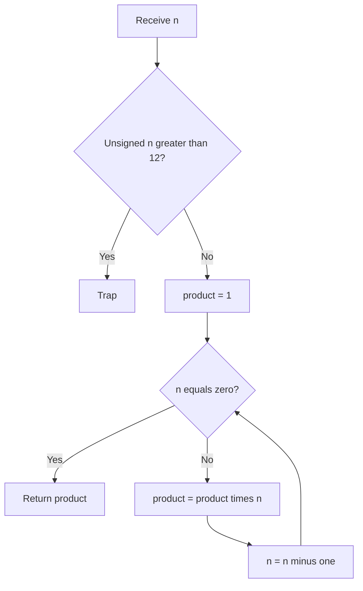

# Factorial

Multiply the positive integers up to `n`. This version accepts `0 ≤ n ≤ 12`,
so the mathematical result fits in a signed 32-bit integer. Inputs outside
that range trap rather than wrapping or iterating for billions of steps.
In particular, `0! = 1`: the accumulator is already the answer before the
first multiplication.

## Pseudocode

```text
factorial(n):
    if u32(n) > 12: trap
    product = 1
    while n != 0:
        product *= n
        n -= 1
    return product
```

## Flowchart



## Describe the function

The file begins with the Wasm magic and version. The type section describes
one function taking and returning an `i32` (`7f`). The function section assigns
that type to function zero. Neither section contains executable instructions.

`[microwasm]`

- header: `00 61 73 6d 01 00 00 00` — Magic and binary version 1.
- type-section: `01 {{size:type-payload}}` — Section ID and payload byte length.
  - type-payload: `{{count:types}}` — Number of function types.
    - types:
      - unary-i32: `60 01 7f 01 7f` — One i32 parameter and one i32 result.
- function-section: `03 {{size:function-payload}}`
  - function-payload: `{{count:function-types}}`
    - function-types:
      - factorial-type: `00` — Function zero uses type zero.

## Give the host a name to call

The export name is nine UTF-8 bytes: `factorial`. The trailing `00 00` means
“function export, function index zero.” It does not execute the function.

`[microwasm]`

- export-section: `07 {{size:export-payload}}`
  - export-payload: `{{count:exports}}`
    - exports:
      - factorial-export: `09 66 61 63 74 6f 72 69 61 6c 00 00`

## Implement the loop

Local zero is the parameter `n`. Local one is `product`; its declaration is
one group containing one `i32`. There is no implicit accumulator: every
arithmetic instruction consumes values from Wasm's operand stack, and
`local.set` stores its result for the next iteration.

The outer `block` is an exit target. Inside it, `loop` is the repetition target.
At the zero test, branch depth one exits the outer block; at the bottom,
branch depth zero goes back to the loop. `40` gives each block no result type.

`[microwasm]`

- code-section: `0a {{size:code-payload}}`
  - code-payload: `{{count:bodies}}`
    - bodies:
      - factorial-function: `{{size:factorial-body}}`
        - factorial-body: `01 01 7f` — One local group: one i32.
          - bound: `20 00 41 0c 4b` — local.get n; i32.const 12; i32.gt_u.
          - reject: `04 40` — If out of range, execute unreachable.
            - trap: `00`
            - reject-end: `0b`
          - initialize: `41 01 21 01` — product = 1.
          - exit-block: `02 40`
            - repeat: `03 40`
              - zero-test: `20 00 45 0d 01` — If n is zero, branch out.
              - multiply: `20 01 20 00 6c 21 01` — product *= n.
              - decrement: `20 00 41 01 6b 21 00` — n -= 1.
              - again: `0c 00` — Repeat.
              - loop-end: `0b`
            - block-end: `0b`
          - result: `20 01` — Leave product on the operand stack.
          - function-end: `0b`

## Check the result

`factorial(0) = 1`, `factorial(1) = 1`, `factorial(5) = 120`, and
`factorial(12) = 479001600`. Negative inputs and `13` trap. Tests cover every
accepted input, rather than just the familiar `5!` example.
