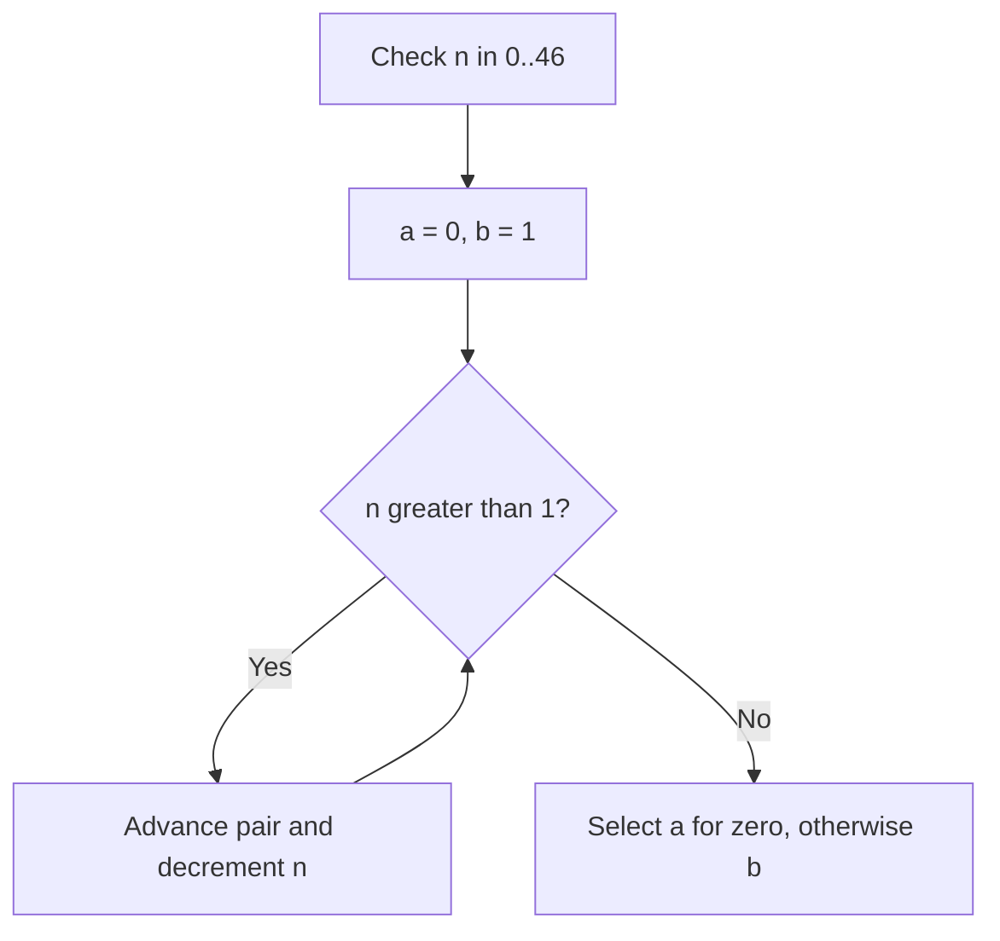

# Fibonacci

Start with the adjacent values 0 and 1. Advance the pair, rather than making
recursive calls. Accept `0..46`; the result then fits in signed i32. Stopping
at the final pair avoids computing the overflowing next Fibonacci number.

## Algorithm

```text
run(n):
    if u32(n) > 46: trap
    a = 0; b = 1
    while n > 1:
        next = a + b
        a = b; b = next
        n -= 1
    return b if n else a
```



## Describe and expose the function

The single type is `i32 -> i32`. Function zero uses it and is exported as
`run`. The type count and section sizes are bookkeeping, not instructions.

`[microwasm]`

- header: `0061736d 01000000`
- types-section: `01 {{size:types}}`
  - types: `{{count:type-items}}`
    - type-items:
      - signature: `60 01 7f 01 7f`
- functions-section: `03 {{size:functions}}`
  - functions: `01 00`
- exports-section: `07 {{size:exports}}`
  - exports: `01 03 72756e 00 00`

## Advance a pair on the operand stack

Parameter 0 is n; locals 1, 2, 3 are a, b, next. Locals start at zero.
`select` (`1b`) consumes b, a, and n, choosing b when n is nonzero.

`[microwasm]`

- code-section: `0a {{size:code}}`
  - code: `01 {{size:body}}`
    - body: `01 03 7f` — Three i32 locals.
      - bounds: `20 00 41 2e 4b 04 40 00 0b`
      - initial-b: `41 01 21 02`
      - exit: `02 40`
        - loop: `03 40`
          - finished: `20 00 41 01 4d 0d 01` — n <=u 1.
          - next: `20 01 20 02 6a 21 03`
          - advance: `20 02 21 01 20 03 21 02`
          - decrement: `20 00 41 01 6b 21 00`
          - repeat: `0c 00 0b`
        - exit-end: `0b`
      - result: `20 02 20 01 20 00 1b 0b`

Check every input from 0 through 46 against a pair-based oracle. In particular,
0 gives 0, 2 gives 1, and 46 gives 1836311903. Negative inputs and 47 trap.
