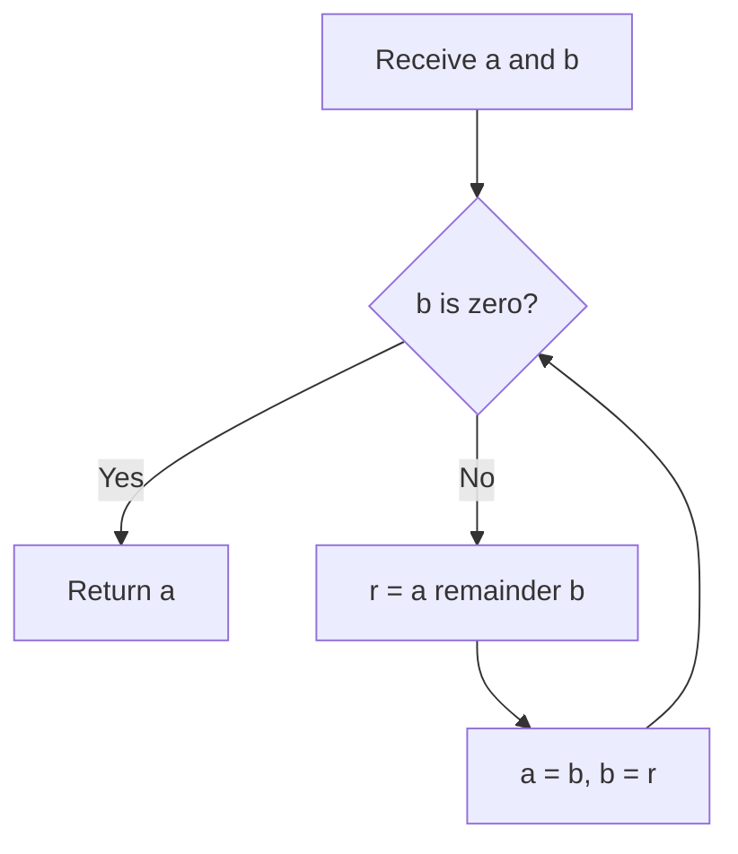

# Greatest common divisor

Euclid's algorithm replaces a pair with the divisor and remainder. The divisor
is checked before the remainder instruction, so `(0, 0)` returns zero without
a division-by-zero trap. Values are unsigned i32; a JavaScript caller uses
`>>> 0` to interpret results with the high bit set.

```text
run(a, b):
    while b != 0:
        a, b = b, a % b
    return a
```



## Function and export sections

`60 02 7f 7f 01 7f` describes two i32 inputs and one i32 output. Local
indices 0 and 1 therefore already belong to the parameters.

`[microwasm]`

- header: `0061736d 01000000`
- type-section: `01 {{size:types}}`
  - types: `01 60 02 7f 7f 01 7f`
- function-section: `03 {{size:functions}}`
  - functions: `01 00`
- export-section: `07 {{size:exports}}`
  - exports: `01 03 72756e 00 00`

## Remainders and reassignment

Local 2 holds r while a is overwritten. `70` is `i32.rem_u`. The outer
block provides the loop's exit target at depth one.

`[microwasm]`

- code-section: `0a {{size:code}}`
  - code: `01 {{size:body}}`
    - body: `01 01 7f`
      - exit: `02 40`
        - loop: `03 40`
          - finished: `20 01 45 0d 01`
          - remainder: `20 00 20 01 70 21 02`
          - rotate: `20 01 21 00 20 02 21 01`
          - repeat: `0c 00 0b`
        - exit-end: `0b`
      - result: `20 00 0b`

Check zeros, coprime pairs, equal inputs, and values above signed i32 max.
For example, `(48, 18)` yields 6 and `(4294967295, 15)` yields 15.
