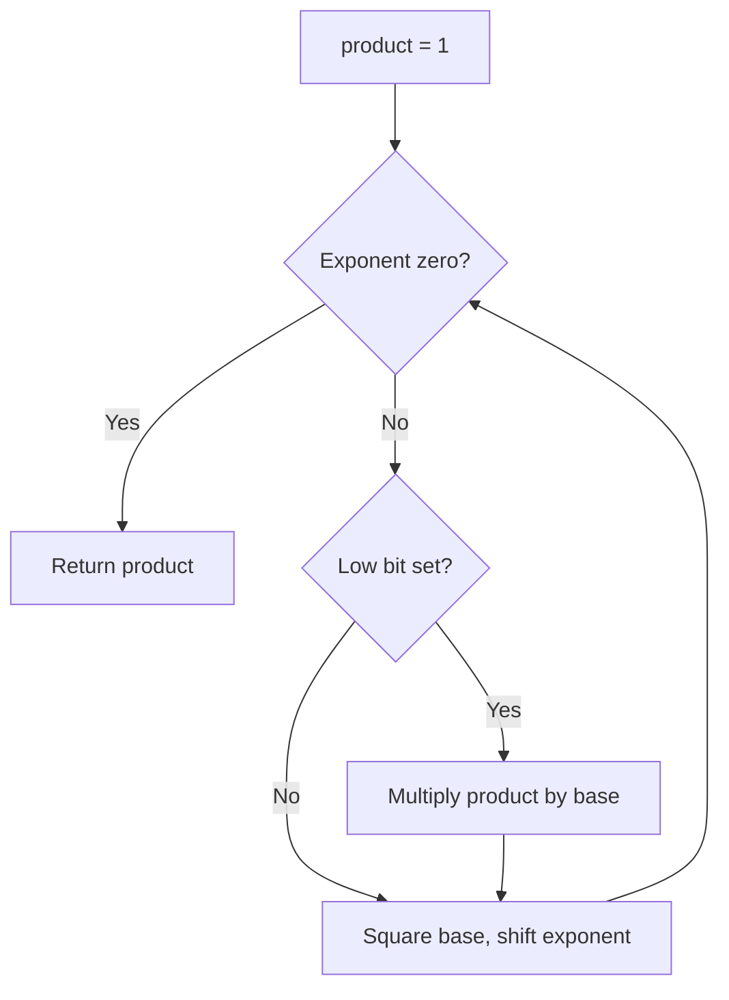

# Integer power by squaring

Compute a power modulo `2^32`. Overflow is deliberately wrapping, unlike the
bounded factorial example. The exponent is unsigned, so even its maximum
value takes at most 32 iterations. Define `0^0` as 1 for this algorithm.

```text
run(base, exponent):
    product = 1
    while exponent != 0:
        if exponent & 1: product *= base
        base *= base
        exponent >>= 1  // unsigned shift
    return product
```



## Describe the call

Two parameters occupy locals 0 and 1; product will be local 2. The host sees
the same `run` export as in the other numeric examples.

`[microwasm]`

- header: `0061736d 01000000`
- type-section: `01 {{size:types}}`
  - types: `01 60 02 7f 7f 01 7f`
- function-section: `03 {{size:functions}}`
  - functions: `01 00`
- export-section: `07 {{size:exports}}`
  - exports: `01 03 72756e 00 00`

## Consume one exponent bit per loop

`71` is bitwise AND; `76` is unsigned right shift. Multiplication (`6c`)
discards high bits. No divide, recursion, or temporary memory is necessary.

`[microwasm]`

- code-section: `0a {{size:code}}`
  - code: `01 {{size:body}}`
    - body: `01 01 7f`
      - initialize: `41 01 21 02`
      - exit: `02 40`
        - loop: `03 40`
          - finished: `20 01 45 0d 01`
          - odd: `20 01 41 01 71 04 40`
            - multiply: `20 02 20 00 6c 21 02`
            - odd-end: `0b`
          - square: `20 00 20 00 6c 21 00`
          - shift: `20 01 41 01 76 21 01`
          - repeat: `0c 00 0b`
        - exit-end: `0b`
      - result: `20 02 0b`

Check powers that fit, powers that wrap, and exponents 0 and `0xffffffff`.
The tests use BigInt arithmetic as an independent modulo-32-bit oracle.
