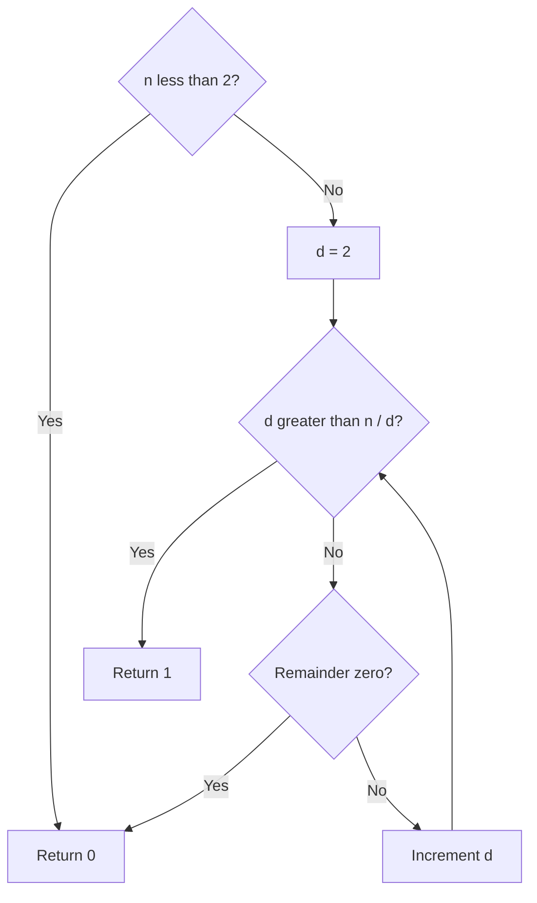

# Trial-division prime test

Return 1 for a prime unsigned i32 and 0 otherwise. Test divisors only while
`d <= n / d`: this is the square-root cutoff without overflowing `d * d`.
It is intentionally trial division, not a fast general-purpose prime library.

```text
run(n):
    if n < 2: return 0
    d = 2
    while d <= n / d:
        if n remainder d == 0: return 0
        d += 1
    return 1
```



## Module envelope

The result is an ordinary i32 used as a Boolean. No new type encoding is
needed. Only local 1, the candidate divisor, is allocated.

<!-- microwasm:start -->
- header: `0061736d 01000000`
- type-section: `01 {{size:types}}`
  - types: `01 60 01 7f 01 7f`
- function-section: `03 {{size:functions}}`
  - functions: `01 00`
- export-section: `07 {{size:exports}}`
  - exports: `01 03 72756e 00 00`
<!-- microwasm:end -->

## Early returns and a safe cutoff

`0f` returns from the function; it is different from branching out of the
loop's block. `6e` divides unsigned and `70` takes the unsigned remainder.
The divisor starts at 2 and cannot reach zero, so both operations are safe.

<!-- microwasm:start -->
- code-section: `0a {{size:code}}`
  - code: `01 {{size:body}}`
    - body: `01 01 7f`
      - small: `20 00 41 02 49 04 40 41 00 0f 0b`
      - initialize: `41 02 21 01`
      - exit: `02 40`
        - loop: `03 40`
          - cutoff: `20 01 20 00 20 01 6e 4b 0d 01`
          - divides: `20 00 20 01 70 45 04 40`
            - composite: `41 00 0f 0b`
          - increment: `20 01 41 01 6a 21 01`
          - repeat: `0c 00 0b`
        - exit-end: `0b`
      - prime: `41 01 0b`
<!-- microwasm:end -->

Check small primes, 0 and 1, perfect squares, and the prime 4294967291 near
the unsigned limit. Perfect squares catch an incorrect strict cutoff.
