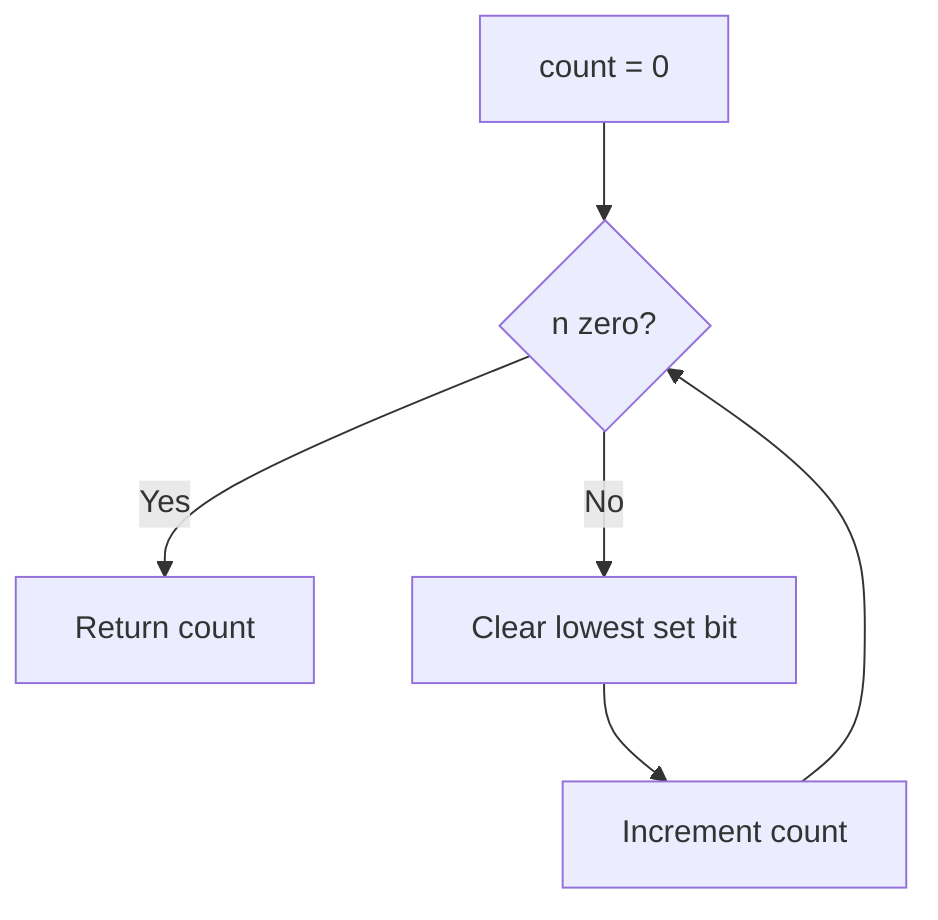

# Count set bits

Clear the lowest set bit with `n & (n - 1)`. Each iteration counts one bit,
not one position; zero needs no iterations. All 32-bit patterns are valid.
Wasm also has `i32.popcnt` (`69`); this longer example deliberately exposes
the bit-clearing algorithm rather than hiding it in that one instruction.

```text
run(n):
    count = 0
    while n != 0:
        n = n & (n - 1)
        count += 1
    return count
```



## One argument, one result

The accumulator is local 1. i32 subtraction wraps, but is only performed on
a nonzero input here. Bitwise operations do not depend on signedness.

<!-- microwasm:start -->
- header: `0061736d 01000000`
- type-section: `01 {{size:types}}`
  - types: `01 60 01 7f 01 7f`
- function-section: `03 {{size:functions}}`
  - functions: `01 00`
- export-section: `07 {{size:exports}}`
  - exports: `01 03 72756e 00 00`
<!-- microwasm:end -->

## Bit-clearing loop

`local.tee` is unnecessary here: n is stored for the next iteration, then
tested at its top. Two gets of n put the operands for AND on the stack.

<!-- microwasm:start -->
- code-section: `0a {{size:code}}`
  - code: `01 {{size:body}}`
    - body: `01 01 7f`
      - exit: `02 40`
        - loop: `03 40`
          - finished: `20 00 45 0d 01`
          - clear-bit: `20 00 20 00 41 01 6b 71 21 00`
          - count-bit: `20 01 41 01 6a 21 01`
          - repeat: `0c 00 0b`
        - exit-end: `0b`
      - result: `20 01 0b`
<!-- microwasm:end -->

Check zero, each single bit, alternating bit patterns, and all bits set.
The maximum result is 32; tests compare against a separate shift-based count.
