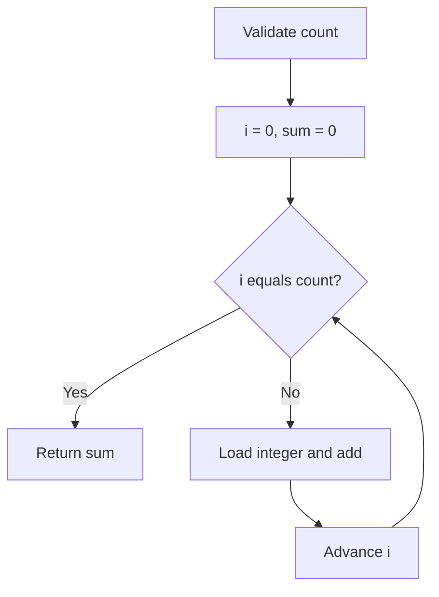

# Sum an integer array

The host writes little-endian i32 values at memory offset zero. `run(count)`
returns their sum modulo `2^32`. Memory is one fixed 65536-byte page, so at
most 16384 integers fit. Negative counts also fail the unsigned bound check.

```text
run(count):
    if unsigned(count) > 16384: trap
    i = 0; sum = 0
    while i < count:
        sum += load_i32(i * 4)
        i += 1
    return sum
```



## Add an exported memory

Memory section 5 contains a vector of one memory. `01 01 01` is a limits
record with minimum and maximum both one page; it does not mean one byte.
Export kind `02` selects memory rather than a function.

<!-- microwasm:start -->
- header: `0061736d 01000000`
- type-section: `01 {{size:types}}`
  - types: `01 60 01 7f 01 7f`
- function-section: `03 {{size:functions}}`
  - functions: `01 00`
- memory-section: `05 {{size:memories}}`
  - memories: `01 01 01 01`
- export-section: `07 {{size:exports}}`
  - exports: `02 03 72756e 00 00 06 6d656d6f7279 02 00`
<!-- microwasm:end -->

## Addressing is byte-based

Local 0 is count, 1 is i, and 2 is sum. The address is `i << 2`. `28 02 00`
is i32.load with alignment exponent 2 and offset 0. The alignment is a hint,
not a check that would reject an unaligned address. The count check prevents
address arithmetic from wrapping around and reading unrelated positions.

<!-- microwasm:start -->
- code-section: `0a {{size:code}}`
  - code: `01 {{size:body}}`
    - body: `01 02 7f`
      - bounds: `20 00 41 808001 4b 04 40 00 0b`
      - exit: `02 40`
        - loop: `03 40`
          - finished: `20 01 20 00 4f 0d 01`
          - add: `20 02 20 01 41 02 74 28 02 00 6a 21 02`
          - advance: `20 01 41 01 6a 21 01`
          - repeat: `0c 00 0b`
        - exit-end: `0b`
      - result: `20 02 0b`
<!-- microwasm:end -->

Check the empty sum, signed values, wrapping sums, and a completely full page.
The function does not modify the input memory.
