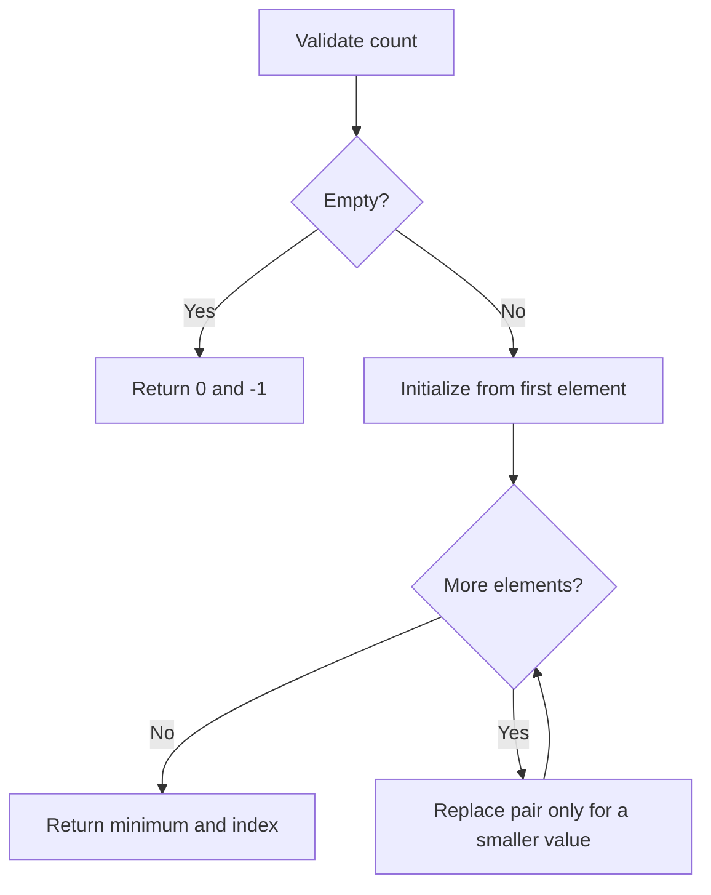

# Minimum and its index

Find the first occurrence of the smallest signed i32. This demonstrates
multiple results: JavaScript receives `[minimum, index]`. For an empty array,
return `[0, -1]`; the index, not the minimum value, signals absence.

```text
run(count):
    if unsigned(count) > 16384: trap
    if count == 0: return (0, -1)
    minimum = load_i32(0); index = 0; i = 1
    while i < count:
        value = load_i32(i * 4)
        if value < minimum: minimum = value; index = i
        i += 1
    return (minimum, index)
```



## A two-value result vector

The type's result vector is `02 7f 7f`. Both values must be on the operand
stack in that order at every return. Memory and its exported name are the
same as in the sum example.

`[microwasm]`

- header: `0061736d 01000000`
- type-section: `01 {{size:types}}`
  - types: `01 60 01 7f 02 7f 7f`
- function-section: `03 {{size:functions}}`
  - functions: `01 00`
- memory-section: `05 {{size:memories}}`
  - memories: `01 01 01 01`
- export-section: `07 {{size:exports}}`
  - exports: `02 03 72756e 00 00 06 6d656d6f7279 02 00`

## Compare signed values, preserve the first tie

Locals are count 0, i 1, minimum 2, index 3, value 4. `48` is signed less
than, whereas the count bounds use unsigned comparisons. `41 7f` pushes -1:
constant immediates use signed LEB128, not the section-length encoding.

`[microwasm]`

- code-section: `0a {{size:code}}`
  - code: `01 {{size:body}}`
    - body: `01 04 7f`
      - bounds: `20 00 41 808001 4b 04 40 00 0b`
      - empty: `20 00 45 04 40 41 00 41 7f 0f 0b`
      - initial-min: `41 00 28 02 00 21 02`
      - initial-index: `41 01 21 01`
      - exit: `02 40`
        - loop: `03 40`
          - finished: `20 01 20 00 4f 0d 01`
          - load: `20 01 41 02 74 28 02 00 21 04`
          - smaller: `20 04 20 02 48 04 40`
            - replace: `20 04 21 02 20 01 21 03 0b`
          - advance: `20 01 41 01 6a 21 01`
          - repeat: `0c 00 0b`
        - exit-end: `0b`
      - result: `20 02 20 03 0b`

Tests include repeated minima, signed extremes, empty and singleton arrays.
