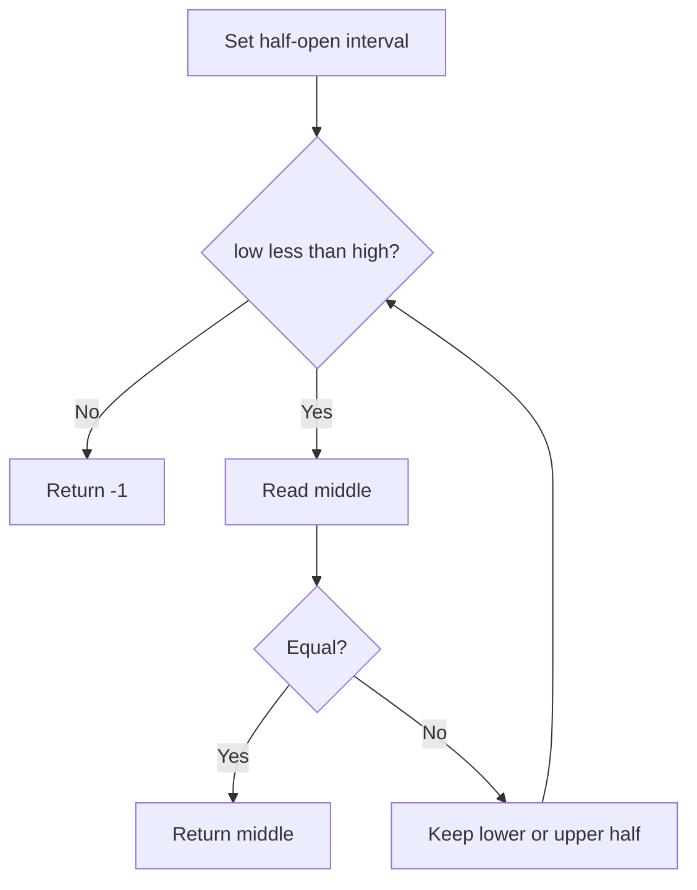

# Binary search

Search a sorted signed-i32 array at offset zero. `run(count, target)` returns
an index or -1. With duplicates, any matching index is acceptable. Sorting is
a caller precondition; the function checks the count, not the entire array.

```text
run(count, target):
    if unsigned(count) > 16384: trap
    low = 0; high = count
    while low < high:
        middle = low + ((high - low) >> 1)
        value = load_i32(middle * 4)
        if value == target: return middle
        if value < target: low = middle + 1
        else: high = middle
    return -1
```



## The two-argument signature

The search range is half-open: high may equal count but is never loaded.
Keeping indices bounded also makes the middle calculation safe.

<!-- microwasm:start -->
- header: `0061736d 01000000`
- type-section: `01 {{size:types}}`
  - types: `01 60 02 7f 7f 01 7f`
- function-section: `03 {{size:functions}}`
  - functions: `01 00`
- memory-section: `05 {{size:memories}}`
  - memories: `01 01 01 01`
- export-section: `07 {{size:exports}}`
  - exports: `02 03 72756e 00 00 06 6d656d6f7279 02 00`
<!-- microwasm:end -->

## Halve the interval

Parameters count and target occupy 0 and 1; low, high, middle, value occupy
2 through 5. `05` separates the two arms of an if. Every non-returning arm
makes the interval strictly smaller, including when it contains one item.

<!-- microwasm:start -->
- code-section: `0a {{size:code}}`
  - code: `01 {{size:body}}`
    - body: `01 04 7f`
      - bounds: `20 00 41 808001 4b 04 40 00 0b`
      - high: `20 00 21 03`
      - exit: `02 40`
        - loop: `03 40`
          - empty: `20 02 20 03 4f 0d 01`
          - middle: `20 02 20 03 20 02 6b 41 01 76 6a 21 04`
          - value: `20 04 41 02 74 28 02 00 21 05`
          - found: `20 05 20 01 46 04 40 20 04 0f 0b`
          - upper-half: `20 05 20 01 48 04 40`
            - low: `20 04 41 01 6a 21 02`
            - else: `05`
            - lower-half: `20 04 21 03 0b`
          - repeat: `0c 00 0b`
        - exit-end: `0b`
      - missing: `41 7f 0b`
<!-- microwasm:end -->

Check both ends, misses inside and outside the range, duplicates, and emptiness.
