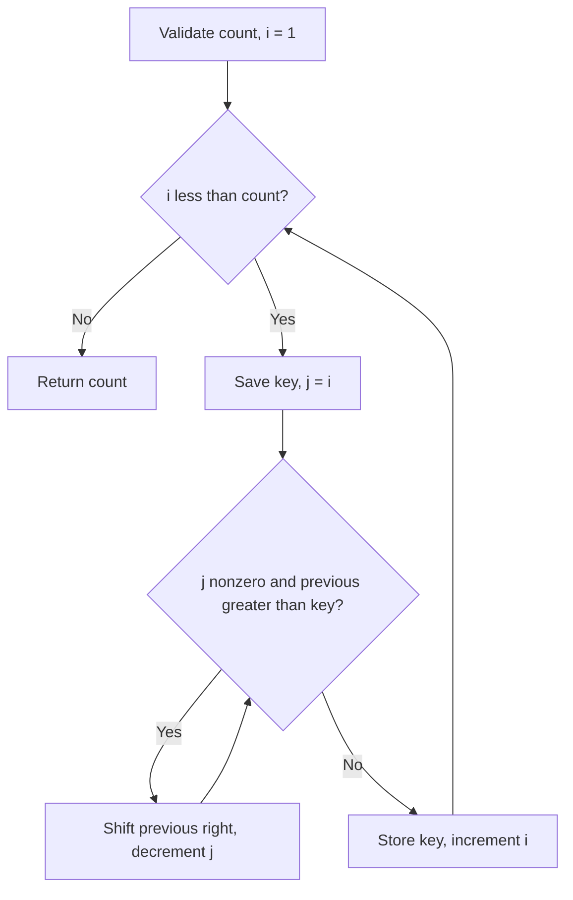

# In-place insertion sort

Sort signed i32 values in the exported page. Return the count for convenience.
This is stable insertion sort: equal values are not shifted. It uses constant
extra storage but quadratic time, so the tests use small arrays plus bounds
checks rather than treating it as a high-volume sorting implementation.

```text
run(count):
    if unsigned(count) > 16384: trap
    for i from 1 while i < count:
        key = load_i32(i * 4)
        j = i
        while j != 0:
            previous = load_i32((j - 1) * 4)
            if previous <= key: break
            store_i32(j * 4, previous)
            j -= 1
        store_i32(j * 4, key)
    return count
```



## A writable memory, no new imports

`i32.store` is opcode `36`. The host does not perform swaps or comparisons;
all mutation takes place in the module's memory.

`[microwasm]`

- header: `0061736d 01000000`
- type-section: `01 {{size:types}}`
  - types: `01 60 01 7f 01 7f`
- function-section: `03 {{size:functions}}`
  - functions: `01 00`
- memory-section: `05 {{size:memories}}`
  - memories: `01 01 01 01`
- export-section: `07 {{size:exports}}`
  - exports: `02 03 72756e 00 00 06 6d656d6f7279 02 00`

## Nested loops have separate exit targets

Locals 1..4 are i, j, key, previous. The inner loop checks j before loading
j-1. Each loop has its own enclosing block: `br_if 1` exits the nearest
pair, not the entire function. End bytes are written explicitly, too.

`[microwasm]`

- code-section: `0a {{size:code}}`
  - code: `01 {{size:body}}`
    - body: `01 04 7f`
      - bounds: `20 00 41 808001 4b 04 40 00 0b`
      - initialize: `41 01 21 01`
      - outer-exit: `02 40`
        - outer-loop: `03 40`
          - finished: `20 01 20 00 4f 0d 01`
          - key: `20 01 41 02 74 28 02 00 21 03`
          - j: `20 01 21 02`
          - inner-exit: `02 40`
            - inner-loop: `03 40`
              - start-reached: `20 02 45 0d 01`
              - previous: `20 02 41 01 6b 41 02 74 28 02 00 22 04`
              - in-order: `20 03 4c 0d 01`
              - shift: `20 02 41 02 74 20 04 36 02 00`
              - decrement: `20 02 41 01 6b 21 02`
              - inner-repeat: `0c 00 0b`
            - inner-end: `0b`
          - insert: `20 02 41 02 74 20 03 36 02 00`
          - advance: `20 01 41 01 6a 21 01`
          - outer-repeat: `0c 00 0b`
        - outer-end: `0b`
      - result: `20 00 0b`

Compare the resulting bytes with a signed numeric sort, including empty,
reverse-sorted and duplicate-rich arrays. A sentinel after the array must stay
unchanged: checking the return value alone would miss an out-of-range store.
