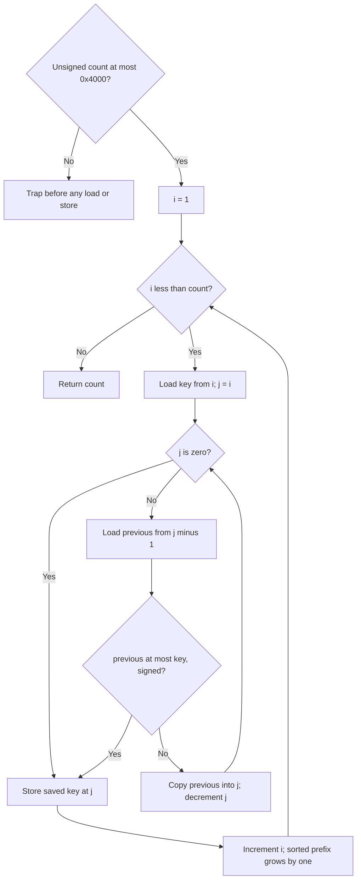

# In-place insertion sort

Sort signed i32 values in the exported page. Return the count for convenience.
This is stable insertion sort: equal values are not shifted. It uses constant
extra storage but quadratic time, so the tests use small arrays plus bounds
checks rather than treating it as a high-volume sorting implementation.

```text
run(count):
    if u32(count) > 0x4000: trap
    for i in 1..<count:
        key = load_i32(i << 2)
        j = i
        while j != 0:
            previous = load_i32((j - 1) << 2)
            if previous <= key: break
            store_i32(j << 2, previous)
            j -= 1
        store_i32(j << 2, key)
    return count
```



## A writable memory, no new imports

`i32.store` is opcode `36`. The host does not perform swaps or comparisons;
all mutation takes place in the module's memory.

`[microwasm]`

- header: `0061736d 01000000`
- type-section: `01 {{size:types}}`
  - types: `01 60 01 7f 01 7f`
- function-section: `03 {{size:functions}}`
  - functions: `01 00`
- memory-section: `05 {{size:memories}}`
  - memories: `01 01 01 01`
- export-section: `07 {{size:exports}}`
  - exports: `02 03 72756e 00 00 06 6d656d6f7279 02 00`

## Nested loops have separate exit targets

Locals 1..4 are i, j, key, previous. The inner loop checks j before loading
j-1. Each loop has its own enclosing block: `br_if 1` exits the nearest
pair, not the entire function. End bytes are written explicitly, too.

### A moving hole, not a sequence of swaps

At the start of an outer iteration, indices below i are sorted. `key` saves
the value at i before any store can overwrite it. The inner loop moves a
logical hole left through that sorted prefix; the hole still contains old
bytes, but they are no longer the value that must be preserved there.

For `[2, 5, 8, 3]` at i = 3:

| Inner step | j | Saved key | Memory after the step | Meaning |
| --- | --- | --- | --- | --- |
| Start | 3 | 3 | `[2, 5, 8, 3]` | Hole at 3; prefix `[2, 5, 8]` sorted |
| Shift 8 | 2 | 3 | `[2, 5, 8, 8]` | Duplicate 8 is temporary; hole at 2 |
| Shift 5 | 1 | 3 | `[2, 5, 5, 8]` | Hole at 1; key still only needed from its local |
| Read 2 | 1 | 3 | `[2, 5, 5, 8]` | 2 is at most 3; leave inner loop without shifting |
| Insert | 1 | 3 | `[2, 3, 5, 8]` | Fill hole, then advance outer i |

The two inner exits have different reasons but the same destination:

- `start-reached` exits before attempting index -1. This happens when the
  key is smaller than every item in the prefix.
- `in-order` exits after a valid load. It leaves j immediately after the
  last value that is at most the key. Equality takes this exit too, which
  keeps earlier equal values before the inserted one and makes the sort stable.

Both reach `insert`, not `result`. Only `finished`, in the outer loop,
reaches the result without inserting. `inner-repeat` and `outer-repeat`
both encode `br 0`, but refer to different nearest loops. No branch crosses
from the inner loop directly to the next outer iteration.

### One small stack-saving instruction

`previous` ends with `local.tee 4` (`22 04`). This saves the loaded value and
also leaves it on the operand stack. `in-order` then pushes key and performs
the signed less-than-or-equal comparison. If shifting is needed, `shift`
reloads previous from local 4 alongside the destination address. There is
only one memory load of that predecessor per inner iteration.

Each shift decreases j, and each insertion increases i, so both loops make
progress. Sorted input takes one predecessor comparison per outer iteration;
reverse order repeatedly moves the hole to zero. This accounts for the
linear best case and quadratic worst case without treating the inner scan
as constant-time work.

`[microwasm]`

- code-section: `0a {{size:code}}`
  - code: `01 {{size:body}}`
    - body: `01 04 7f`
      - bounds: `20 00 41 808001 4b 04 40 00 0b`
      - initialize: `41 01 21 01`
      - outer-exit: `02 40`
        - outer-loop: `03 40`
          - finished: `20 01 20 00 4f 0d 01`
          - key: `20 01 41 02 74 28 02 00 21 03`
          - j: `20 01 21 02`
          - inner-exit: `02 40`
            - inner-loop: `03 40`
              - start-reached: `20 02 45 0d 01`
              - previous: `20 02 41 01 6b 41 02 74 28 02 00 22 04`
              - in-order: `20 03 4c 0d 01`
              - shift: `20 02 41 02 74 20 04 36 02 00`
              - decrement: `20 02 41 01 6b 21 02`
              - inner-repeat: `0c 00 0b`
            - inner-end: `0b`
          - insert: `20 02 41 02 74 20 03 36 02 00`
          - advance: `20 01 41 01 6a 21 01`
          - outer-repeat: `0c 00 0b`
        - outer-end: `0b`
      - result: `20 00 0b`

Compare the resulting bytes with a signed numeric sort, including empty,
reverse-sorted and duplicate-rich arrays. A sentinel after the array must stay
unchanged: checking the return value alone would miss an out-of-range store.
