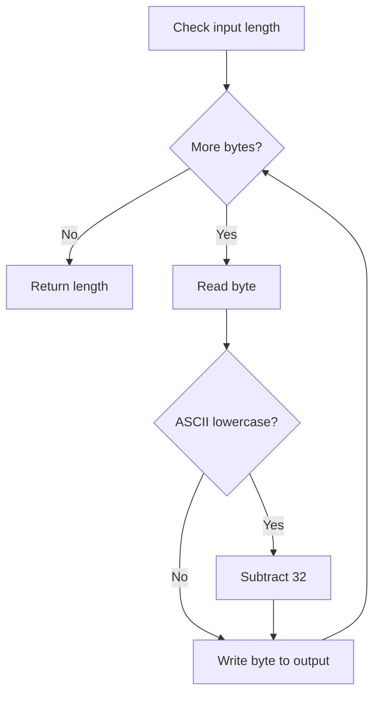

# ASCII uppercase filter

Input occupies `[0, length)` in a two-page memory; output starts at 65536.
`run(length)` returns the output length. At most 65536 input bytes are allowed.
Only ASCII a–z change. Other bytes, including UTF-8 multibyte sequences, pass
through unchanged: this is not Unicode case conversion.

```text
run(length):
    if u32(length) > 0x10000: trap
    for i in 0..<length:
        c = load_byte(i)
        if 'a' <= c <= 'z': c -= 0x20
        store_byte(0x10000 + i, c)
    return length
```



## Two disjoint buffers

The memory limits are now `01 02 02`. The input is immutable; using a
separate output makes this convention reusable for expanding filters later.

`[microwasm]`

- header: `0061736d 01000000`
- type-section: `01 {{size:types}}`
  - types: `01 60 01 7f 01 7f`
- function-section: `03 {{size:functions}}`
  - functions: `01 00`
- memory-section: `05 {{size:memories}}`
  - memories: `01 01 02 02`
- export-section: `07 {{size:exports}}`
  - exports: `02 03 72756e 00 00 06 6d656d6f7279 02 00`

## Unsigned byte loads

Local 1 is i, 2 is c. `2d 00 00` loads an unsigned byte; `3a 00 00` stores
the low byte of an i32. Constants 97 and 122 need two signed-LEB bytes:
`e1 00` and `fa 00`, since a one-byte encoding would look negative.

`[microwasm]`

- code-section: `0a {{size:code}}`
  - code: `01 {{size:body}}`
    - body: `01 02 7f`
      - bounds: `20 00 41 808004 4b 04 40 00 0b`
      - exit: `02 40`
        - loop: `03 40`
          - finished: `20 01 20 00 4f 0d 01`
          - read: `20 01 2d 00 00 21 02`
          - lowercase: `20 02 41 e100 4f 20 02 41 fa00 4d 71 04 40`
            - uppercase: `20 02 41 20 6b 21 02 0b`
          - write: `41 808004 20 01 6a 20 02 3a 00 00`
          - advance: `20 01 41 01 6a 21 01`
          - repeat: `0c 00 0b`
        - exit-end: `0b`
      - result: `20 00 0b`

Test all 256 possible byte values, an empty input, a full input page, and
repeated calls with shorter data. Returned lengths exclude stale output.
