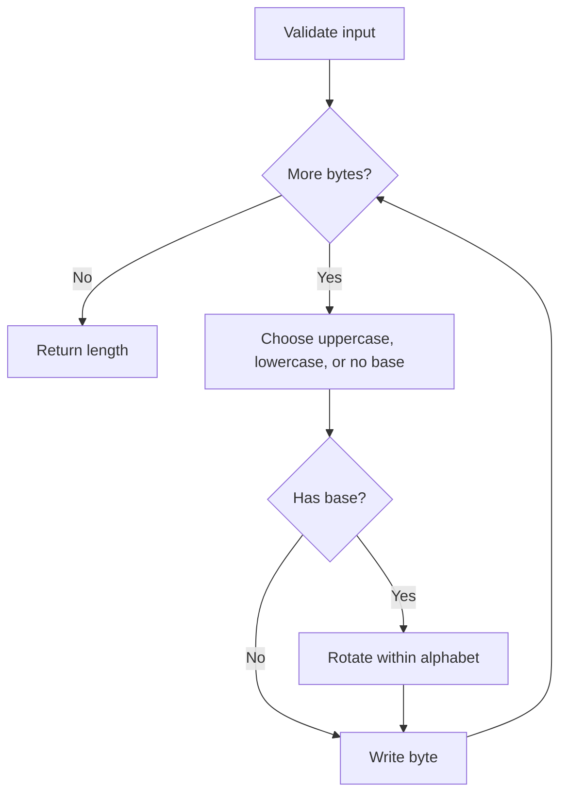

# ROT13

Rotate ASCII letters by 13, leaving every other byte alone. Running the filter
twice recovers the original bytes. Use the same two-page, input-at-zero and
output-at-65536 ABI as uppercase, with a maximum length of 65536.

```text
run(length):
    check length <= 65536
    for each byte c:
        base = 0
        if 65 <= c <= 90: base = 65
        if 97 <= c <= 122: base = 97
        if base != 0: c = base + ((c - base + 13) remainder 26)
        write c
    return length
```



## Reuse the buffer interface, not generated instruction templates

The bytes of this envelope are deliberately visible again. Changing its
signature or memory does not require changing a hidden assembler macro.

`[microwasm]`

- header: `0061736d 01000000`
- type-section: `01 {{size:types}}`
  - types: `01 60 01 7f 01 7f`
- function-section: `03 {{size:functions}}`
  - functions: `01 00`
- memory-section: `05 {{size:memories}}`
  - memories: `01 01 02 02`
- export-section: `07 {{size:exports}}`
  - exports: `02 03 72756e 00 00 06 6d656d6f7279 02 00`

## Reset the base for every character

Locals i, c, base occupy 1, 2, 3. Without resetting base, punctuation after
a letter would be rotated too. That is why tests mix letters and punctuation
rather than only checking an alphabet.

`[microwasm]`

- code-section: `0a {{size:code}}`
  - code: `01 {{size:body}}`
    - body: `01 03 7f`
      - bounds: `20 00 41 808004 4b 04 40 00 0b`
      - exit: `02 40`
        - loop: `03 40`
          - finished: `20 01 20 00 4f 0d 01`
          - read: `20 01 2d 00 00 21 02 41 00 21 03`
          - upper: `20 02 41 c100 4f 20 02 41 da00 4d 71 04 40`
            - upper-base: `41 c100 21 03 0b`
          - lower: `20 02 41 e100 4f 20 02 41 fa00 4d 71 04 40`
            - lower-base: `41 e100 21 03 0b`
          - letter: `20 03 04 40`
            - rotate: `20 03 20 02 20 03 6b 41 0d 6a 41 1a 70 6a 21 02 0b`
          - write: `41 808004 20 01 6a 20 02 3a 00 00`
          - advance: `20 01 41 01 6a 21 01`
          - repeat: `0c 00 0b`
        - exit-end: `0b`
      - result: `20 00 0b`

Check the known phrase `Hello, World!` and the involution property over all
byte values. This is an encoding toy, not encryption.
