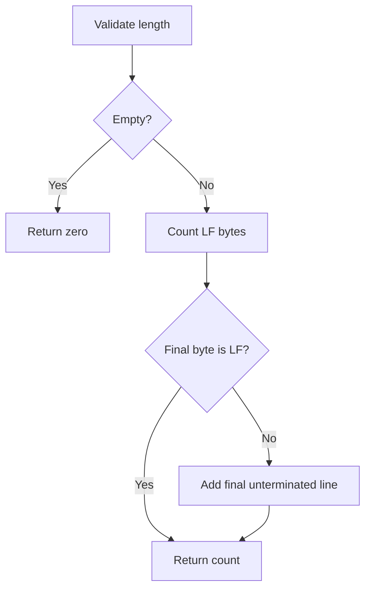

# Count text lines

Count LF-terminated lines plus a final unterminated line. Empty input has zero
lines; `a\n` has one, not two. CRLF works because LF is counted; a bare CR is
an ordinary byte. This explicit convention avoids platform-dependent results.
The one-page input has at most 65536 bytes and is never modified.

```text
run(length):
    check length <= 65536
    if length == 0: return 0
    count = 0
    for each byte c:
        if c == 10: count += 1
    if final byte != 10: count += 1
    return count
```



## Describe the reader

The result needs no output buffer, so memory can stay at one page.

<!-- microwasm:start -->
- header: `0061736d 01000000`
- type-section: `01 {{size:types}}`
  - types: `01 60 01 7f 01 7f`
- function-section: `03 {{size:functions}}`
  - functions: `01 00`
- memory-section: `05 {{size:memories}}`
  - memories: `01 01 01 01`
- export-section: `07 {{size:exports}}`
  - exports: `02 03 72756e 00 00 06 6d656d6f7279 02 00`
<!-- microwasm:end -->

## Keep the final byte in a local

Locals i, count, c are 1..3. Early return on emptiness makes c meaningful at
the end. `i32.eq` produces 0 or 1, which can be added directly to count.

<!-- microwasm:start -->
- code-section: `0a {{size:code}}`
  - code: `01 {{size:body}}`
    - body: `01 03 7f`
      - bounds: `20 00 41 808004 4b 04 40 00 0b`
      - empty: `20 00 45 04 40 41 00 0f 0b`
      - exit: `02 40`
        - loop: `03 40`
          - finished: `20 01 20 00 4f 0d 01`
          - read: `20 01 2d 00 00 21 03`
          - count-lf: `20 02 20 03 41 0a 46 6a 21 02`
          - advance: `20 01 41 01 6a 21 01`
          - repeat: `0c 00 0b`
        - exit-end: `0b`
      - final-line: `20 02 20 03 41 0a 47 6a 0b`
<!-- microwasm:end -->

Check emptiness, final LF, consecutive LFs, CRLF, and a full page of LFs.
