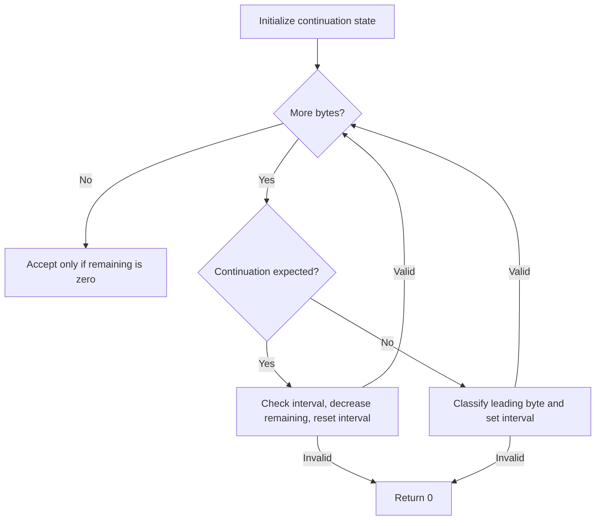

# Validate UTF-8

Return 1 for well-formed UTF-8, 0 for malformed bytes. Reject overlong
encodings, surrogate code points, values above U+10FFFF, stray continuation
bytes and truncation. The input is one page, at offset zero. A length greater
than 65536 traps; a malformed encoding returns a normal Boolean result.

```text
remaining = 0; low = 0x80; high = 0xbf
for c in input[0..<length]:
    if remaining:
        if c < low || c > high: return 0
        remaining -= 1; low = 0x80; high = 0xbf
    else if c < 0x80: continue
    else if 0xc2 <= c <= 0xdf: remaining = 1
    else if 0xe0 <= c <= 0xef:
        remaining = 2
        if c == 0xe0: low = 0xa0
        if c == 0xed: high = 0x9f
    else if 0xf0 <= c <= 0xf4:
        remaining = 3
        if c == 0xf0: low = 0x90
        if c == 0xf4: high = 0x8f
    else: return 0
return remaining == 0
```



## State fits in locals

The decoder need not construct a Unicode scalar: restricting the first
continuation byte excludes the invalid scalar ranges. Locals 1..5 hold i,
remaining, low, high, c. No data section or host text decoder is involved.

`[microwasm]`

- header: `0061736d 01000000`
- type-section: `01 {{size:types}}`
  - types: `01 60 01 7f 01 7f`
- function-section: `03 {{size:functions}}`
  - functions: `01 00`
- memory-section: `05 {{size:memories}}`
  - memories: `01 01 01 01`
- export-section: `07 {{size:exports}}`
  - exports: `02 03 72756e 00 00 06 6d656d6f7279 02 00`

## Nested decisions become nested ifs

There is no character-class opcode here. Each range check is two unsigned
comparisons joined with AND (`71`), or an out-of-range pair joined with OR
(`72`). The nesting below mirrors the state diagram and makes each else
(`05`) and end (`0b`) visible.

`[microwasm]`

- code-section: `0a {{size:code}}`
  - code: `01 {{size:body}}`
    - body: `01 05 7f`
      - bounds: `20 00 41 808004 4b 04 40 00 0b`
      - range: `41 8001 21 03 41 bf01 21 04`
      - exit: `02 40`
        - loop: `03 40`
          - finished: `20 01 20 00 4f 0d 01`
          - read: `20 01 2d 00 00 21 05`
          - continuation: `20 02 04 40`
            - reject-range: `20 05 20 03 49 20 05 20 04 4b 72 04 40 41 00 0f 0b`
            - consume: `20 02 41 01 6b 21 02 41 8001 21 03 41 bf01 21 04`
            - lead-else: `05`
            - non-ascii: `20 05 41 8001 4f 04 40`
              - two-byte: `20 05 41 c201 4f 20 05 41 df01 4d 71 04 40`
                - need-one: `41 01 21 02`
                - three-else: `05`
                - three-byte: `20 05 41 e001 4f 20 05 41 ef01 4d 71 04 40`
                  - need-two: `41 02 21 02`
                  - no-overlong: `20 05 41 e001 46 04 40 41 a001 21 03 0b`
                  - no-surrogate: `20 05 41 ed01 46 04 40 41 9f01 21 04 0b`
                  - four-else: `05`
                  - four-byte: `20 05 41 f001 4f 20 05 41 f401 4d 71 04 40`
                    - need-three: `41 03 21 02`
                    - no-overlong-four: `20 05 41 f001 46 04 40 41 9001 21 03 0b`
                    - max-scalar: `20 05 41 f401 46 04 40 41 8f01 21 04 0b`
                    - invalid-lead: `05 41 00 0f 0b`
                  - three-end: `0b`
                - two-end: `0b`
              - non-ascii-end: `0b`
            - continuation-end: `0b`
          - advance: `20 01 41 01 6a 21 01`
          - repeat: `0c 00 0b`
        - exit-end: `0b`
      - complete: `20 02 45 0b`

Tests compare boundary sequences and deterministic random byte strings with
a fatal UTF-8 TextDecoder. That decoder is a test oracle, not an import.
