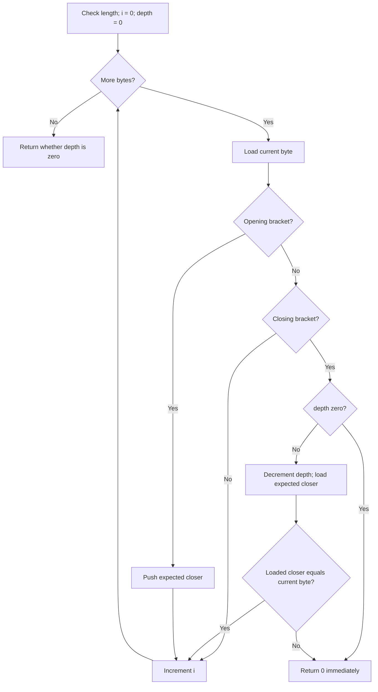

# Balanced brackets with a memory stack

Recognize balanced `()`, `[]`, and `{}`; ignore all other bytes. This is not a
JavaScript parser: brackets in quotes or comments still count. The input is
at zero, maximum 65536 bytes; a stack of expected closing bytes occupies the
second page. Maximum depth cannot exceed input length, so the stack fits.

```text
depth = 0
for c in input[0..<length]:
    if c in ('(', '[', '{'):
        expected = c + (1 if c == '(' else 2)
        stack[depth++] = expected
    else if c in (')', ']', '}'):
        if depth == 0: return 0
        if stack[--depth] != c: return 0
return depth == 0
```



## The stack contains obligations, not opening bytes

`push` stores the byte that must eventually close the new group. The stack
therefore contains `)` for `(`, `]` for `[` and `}` for `{`. A closing byte
needs only one comparison; it does not run through another bracket-kind
dispatch. The `select` in `push` chooses the ASCII delta: 1 for a parenthesis,
2 for the other two kinds. Both candidate deltas are constants, not branches.

| Input byte in `([)]` | i | Depth before | Active stack before | Operation |
| --- | --- | --- | --- | --- |
| `(` | 0 | 0 | empty | Store `)` at scratch[0]; depth becomes 1 |
| `[` | 1 | 1 | `)` | Store `]` at scratch[1]; depth becomes 2 |
| `)` | 2 | 2 | `) ]` | Pop expected `]`; mismatch returns 0 |

The final `]` is never read. By contrast, `([])` pops `]`, then `)`, and
reaches EOF at depth zero. An opening-only input such as `((` reaches EOF
normally but returns 0 because obligations remain. A first byte of `)`
returns 0 at `underflow`, before subtracting depth or reading scratch.
These are three distinct rejection paths.

### Loop invariant and scratch lifetime

At `finished`, `i` counts consumed bytes. The active scratch prefix
`[65536, 65536 + depth)` lists their still-unmatched closing obligations,
with the newest at its end. Bytes beyond that prefix may be stale; they
are never used until a push overwrites them. Returning 0 does not clear
scratch, nor does a successful return need to: locals reset on the next call.

Every non-returning path reaches `advance` exactly once, including ignored
non-bracket bytes. It consumes one input byte and `repeat` targets the
outer loop. `finished` uses `br_if 1` to exit the loop's enclosing block
and evaluate `empty-stack`; the two invalid-closing paths instead use
`return` directly. A length above 65536 traps at `bounds`, which is a
caller-bound violation rather than the ordinary false result for bad brackets.

Before processing a byte, depth cannot exceed i. At the last possible push,
i is at most 65535, so its destination is at most 131071: the last byte of
the second page. That input bound is also the stack-capacity proof; no
separate per-push capacity check is needed.

## Expose the input and scratch memory

The host writes only input; stale stack bytes from earlier calls are harmless
because depth starts at zero. The call returns a Boolean, not the stack.

`[microwasm]`

- header: `0061736d 01000000`
- type-section: `01 {{size:types}}`
  - types: `01 60 01 7f 01 7f`
- function-section: `03 {{size:functions}}`
  - functions: `01 00`
- memory-section: `05 {{size:memories}}`
  - memories: `01 01 02 02`
- export-section: `07 {{size:exports}}`
  - exports: `02 03 72756e 00 00 06 6d656d6f7279 02 00`

## Three kinds, one-byte entries

Locals 1..3 are i, depth, c. For an opening byte, `select` chooses a delta
of 1 or 2, based on whether c is `(`. Closing checks happen before a stack
load, preventing underflow even for a first byte of `)`.

`[microwasm]`

- code-section: `0a {{size:code}}`
  - code: `01 {{size:body}}`
    - body: `01 03 7f`
      - bounds: `20 00 41 808004 4b 04 40 00 0b`
      - exit: `02 40`
        - loop: `03 40`
          - finished: `20 01 20 00 4f 0d 01`
          - read: `20 01 2d 00 00 21 03`
          - opening: `20 03 41 28 46 20 03 41 db00 46 72 20 03 41 fb00 46 72 04 40`
            - push: `41 808004 20 02 6a 20 03 41 01 41 02 20 03 41 28 46 1b 6a 3a 00 00`
            - deeper: `20 02 41 01 6a 21 02`
            - closing-else: `05`
            - closing: `20 03 41 29 46 20 03 41 dd00 46 72 20 03 41 fd00 46 72 04 40`
              - underflow: `20 02 45 04 40 41 00 0f 0b`
              - pop: `20 02 41 01 6b 21 02`
              - mismatch: `41 808004 20 02 6a 2d 00 00 20 03 47 04 40 41 00 0f 0b`
              - closing-end: `0b`
            - opening-end: `0b`
          - advance: `20 01 41 01 6a 21 01`
          - repeat: `0c 00 0b`
        - exit-end: `0b`
      - empty-stack: `20 02 45 0b`

Check `([{}])`, `([)]`, unmatched openings and closings, and deep nesting.
Depth is a runtime value, not a fixed number of statically nested blocks.
