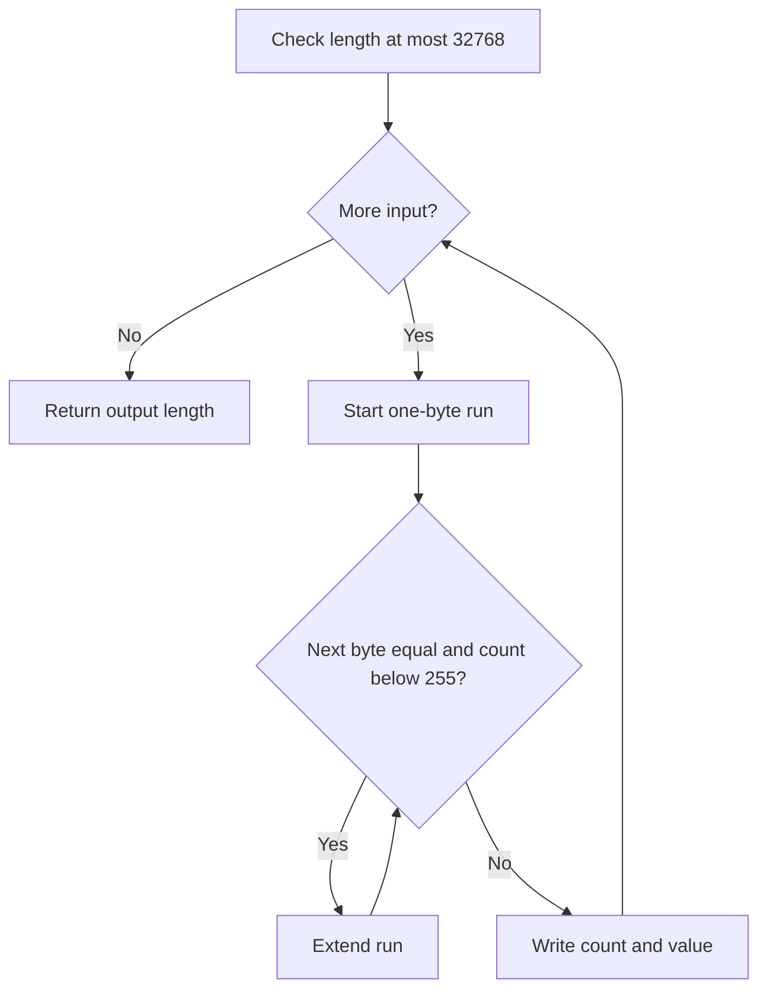

# Run-length encoding

Encode bytes as pairs `(count, value)`, each one byte. Counts are 1..255;
longer runs split into multiple pairs. This is a deliberately small binary
format, not a text encoding. Input is at zero; output is at 65536. Limit input
to 32768 bytes, so even all-distinct bytes fit in the output page.

```text
i = 0; out = 0
while i < length:
    value = input[i++]; count = 1
    while i < length and count < 255 and input[i] == value:
        i += 1; count += 1
    output[out++] = count
    output[out++] = value
return out
```



## Binary buffers

There are no imports and no text conversion. The host may display the output
as hex, but that display is separate from the compression algorithm.

`[microwasm]`

- header: `0061736d 01000000`
- type-section: `01 {{size:types}}`
  - types: `01 60 01 7f 01 7f`
- function-section: `03 {{size:functions}}`
  - functions: `01 00`
- memory-section: `05 {{size:memories}}`
  - memories: `01 01 02 02`
- export-section: `07 {{size:exports}}`
  - exports: `02 03 72756e 00 00 06 6d656d6f7279 02 00`

## Extend a run only after checking the input bound

Locals 1..4 are i, out, value, count. The inner exit tests are separate:
Wasm's bitwise AND is not short-circuit evaluation and must not be used to
guard a potentially invalid load. No extra read occurs at the end of input.

`[microwasm]`

- code-section: `0a {{size:code}}`
  - code: `01 {{size:body}}`
    - body: `01 04 7f`
      - bounds: `20 00 41 808002 4b 04 40 00 0b`
      - outer-exit: `02 40`
        - outer-loop: `03 40`
          - finished: `20 01 20 00 4f 0d 01`
          - first: `20 01 2d 00 00 21 03 41 01 21 04`
          - consume-first: `20 01 41 01 6a 21 01`
          - inner-exit: `02 40`
            - inner-loop: `03 40`
              - input-end: `20 01 20 00 4f 0d 01`
              - run-full: `20 04 41 ff01 46 0d 01`
              - different: `20 01 2d 00 00 20 03 47 0d 01`
              - extend: `20 01 41 01 6a 21 01 20 04 41 01 6a 21 04`
              - inner-repeat: `0c 00 0b`
            - inner-end: `0b`
          - write-count: `41 808004 20 02 6a 20 04 3a 00 00`
          - write-value: `41 808004 20 02 6a 20 03 3a 00 01`
          - advance-output: `20 02 41 02 6a 21 02`
          - outer-repeat: `0c 00 0b`
        - outer-end: `0b`
      - result: `20 02 0b`

Check runs of 1, 255, 256 and 32768 bytes, alternating values, and emptiness.
The next example decodes this exact pair format.
