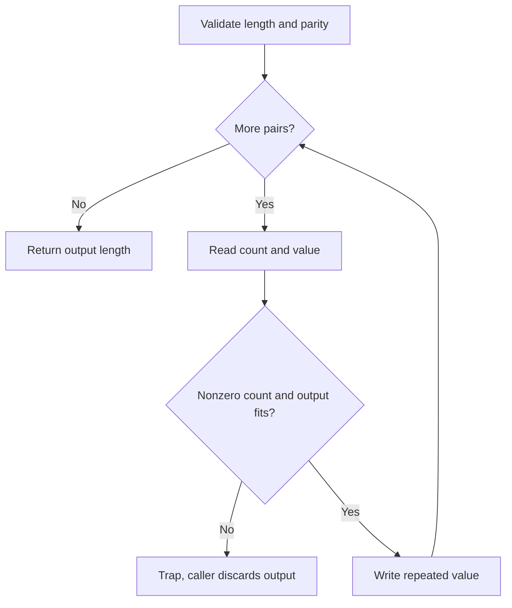

# Run-length decoding

Decode `(count, value)` byte pairs into the second page. Input may use the
whole first page but must have even length and no zero counts. A pair that
would exceed 65536 output bytes traps **before that pair is written**. Earlier
pairs may have been written; after any trap the caller discards the output.

```text
check length <= 65536 and length is even
i = 0; out = 0
while i < length:
    count = input[i]; value = input[i + 1]
    if count == 0 or out + count > 65536: trap
    repeat count times: output[out++] = value
    i += 2
return out
```



## Same buffer ABI, different capacity bound

The maximum input size alone cannot bound decoded output. Capacity is checked
per run, using bounded nonnegative integers so addition cannot wrap.

<!-- microwasm:start -->
- header: `0061736d 01000000`
- type-section: `01 {{size:types}}`
  - types: `01 60 01 7f 01 7f`
- function-section: `03 {{size:functions}}`
  - functions: `01 00`
- memory-section: `05 {{size:memories}}`
  - memories: `01 01 02 02`
- export-section: `07 {{size:exports}}`
  - exports: `02 03 72756e 00 00 06 6d656d6f7279 02 00`
<!-- microwasm:end -->

## Countdown inside an input loop

Locals 1..4 are i, out, count, value. The inner loop decrements count and
advances out. There is no need for a separate repetition index.

<!-- microwasm:start -->
- code-section: `0a {{size:code}}`
  - code: `01 {{size:body}}`
    - body: `01 04 7f`
      - bounds: `20 00 41 808004 4b 20 00 41 01 71 72 04 40 00 0b`
      - outer-exit: `02 40`
        - outer-loop: `03 40`
          - finished: `20 01 20 00 4f 0d 01`
          - pair: `20 01 2d 00 00 21 03 20 01 2d 00 01 21 04`
          - invalid-count: `20 03 45 04 40 00 0b`
          - capacity: `20 02 20 03 6a 41 808004 4b 04 40 00 0b`
          - repeat-value: `03 40`
            - write: `41 808004 20 02 6a 20 04 3a 00 00`
            - advance: `20 02 41 01 6a 21 02`
            - countdown: `20 03 41 01 6b 22 03 0d 00 0b`
          - next-pair: `20 01 41 02 6a 21 01`
          - outer-repeat: `0c 00 0b`
        - outer-end: `0b`
      - result: `20 02 0b`
<!-- microwasm:end -->

Check exact-capacity output, one-byte overflow, odd input and zero count.
Round-trip mixed inputs through the encoder and decoder, not a JS decoder.
