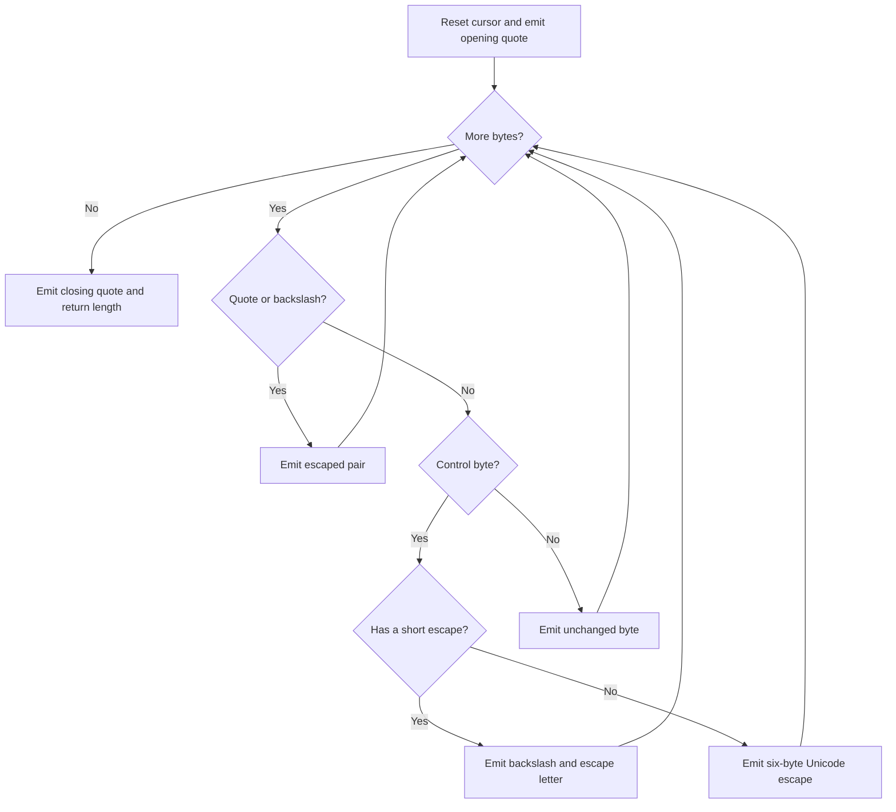

# Escape a JSON string

Turn UTF-8 input into one quoted JSON string at output offset 65536. Escape
quotes, backslashes and all control bytes below 32; preserve other bytes.
Use the short escapes `\b`, `\t`, `\n`, `\f`, and `\r` where available;
only the other control bytes need `\u00xx`.
Well-formed UTF-8 is a caller precondition (example 14 can validate it).
This does not parse JSON or HTML, and does not make HTML embedding safe.

```text
run(length):
    check length <= 65536
    output_cursor = 65536
    emit('"')
    for each byte c:
        if c is '"' or '\\': emit('\\'); emit(c)
        else if c < 32:
            short = {8: 'b', 9: 't', 10: 'n', 12: 'f', 13: 'r'}.get(c, 0)
            emit('\\')
            if short: emit(short)
            else:
                emit('u'); emit('0'); emit('0')
                emit(hex(c >> 4)); emit(hex(c & 15))
        else: emit(c)
    emit('"')
    return output_cursor - 65536
emit(byte):
    if output_cursor >= 131072: trap
    memory[output_cursor++] = byte
```



## Add a helper and a private mutable global

Function 0 is `run(i32) -> i32`; function 1 is `emit(i32) -> void`.
Global 0 is the output cursor, initialized to 65536 and reset on every call.
Only run and memory are exported. Capacity failure traps; partial output must
be discarded, and a subsequent call can still succeed.

`[microwasm]`

- header: `0061736d 01000000`
- type-section: `01 {{size:types}}`
  - types: `02 60 01 7f 01 7f 60 01 7f 00`
- function-section: `03 {{size:functions}}`
  - functions: `02 00 01`
- memory-section: `05 {{size:memories}}`
  - memories: `01 01 02 02`
- global-section: `06 {{size:globals}}`
  - globals: `01 7f 01 41 808004 0b`
- export-section: `07 {{size:exports}}`
  - exports: `02 03 72756e 00 00 06 6d656d6f7279 02 00`

## Rendering escapes

Locals 1..3 are i, c, and scratch (short-escape letter or low nibble).
Five explicit comparisons select the familiar short escapes; there is no
host-side escaping or hidden lookup table. Only control bytes reach the six-byte
escape branch, so the high nibble is 0 or 1. The low nibble needs a decimal
or hexadecimal letter: add 48 below 10, otherwise 87. Even fixed characters
are real `i32.const` instructions followed by calls to emit.

`[microwasm]`

- code-section: `0a {{size:code}}`
  - code: `{{count:bodies}}`
    - bodies:
      - run-function: `{{size:run-body}}`
        - run-body: `01 03 7f`
          - bounds: `20 00 41 808004 4b 04 40 00 0b`
          - reset: `41 808004 24 00 41 22 10 01`
          - exit: `02 40`
            - loop: `03 40`
              - finished: `20 01 20 00 4f 0d 01`
              - read: `20 01 2d 00 00 21 02`
              - pair: `20 02 41 22 46 20 02 41 dc00 46 72 04 40`
                - escaped-pair: `41 dc00 10 01 20 02 10 01`
                - control-else: `05`
                - control: `20 02 41 20 49 04 40`
                  - reset-short: `41 00 21 03`
                  - backspace: `20 02 41 08 46 04 40 41 e200 21 03 0b`
                  - tab: `20 02 41 09 46 04 40 41 f400 21 03 0b`
                  - newline: `20 02 41 0a 46 04 40 41 ee00 21 03 0b`
                  - form-feed: `20 02 41 0c 46 04 40 41 e600 21 03 0b`
                  - carriage-return: `20 02 41 0d 46 04 40 41 f200 21 03 0b`
                  - backslash: `41 dc00 10 01`
                  - short: `20 03 04 40`
                    - letter: `20 03 10 01`
                    - unicode-else: `05`
                    - prefix: `41 f500 10 01 41 30 10 01 41 30 10 01`
                    - high-digit: `20 02 41 04 76 41 30 6a 10 01`
                    - low-nibble: `20 02 41 0f 71 21 03`
                    - low-digit: `20 03 41 30 41 d700 20 03 41 0a 49 1b 6a 10 01`
                    - short-end: `0b`
                  - plain: `05 20 02 10 01 0b`
                - pair-end: `0b`
              - advance: `20 01 41 01 6a 21 01`
              - repeat: `0c 00 0b`
            - exit-end: `0b`
          - result: `41 22 10 01 23 00 41 808004 6b 0b`
      - emit-function: `{{size:emit-body}}`
        - emit-body: `00`
          - capacity: `23 00 41 808008 4f 04 40 00 0b`
          - store: `23 00 20 00 3a 00 00`
          - advance-cursor: `23 00 41 01 6a 24 00 0b`

Parse the produced JSON in tests and compare the decoded value with the input.
Also check exact output bytes for controls, an exact-size output, overflow,
and a successful call immediately after an overflow trap.
