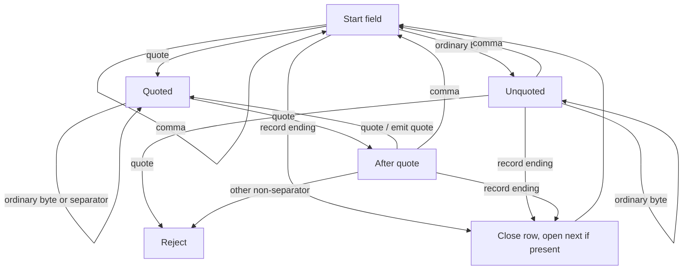

# CSV to JSON rows

Convert UTF-8 CSV into a JSON array of row arrays. Fields stay strings; the
first row is not interpreted as a header. This small dialect accepts commas,
LF or CRLF record endings, quoted fields, doubled quotes and embedded record
endings inside quotes. Quotes in unquoted fields, bare CR record endings and
characters after a closing quote are errors. No trimming or type inference.

Empty input becomes `[]`. A trailing record ending does not add an empty row;
a trailing comma does add an empty field. The input occupies up to 65536 bytes
at zero; output starts at 65536 with a one-page cap. Trap on invalid syntax or
output overflow; discard partial output. UTF-8 validity is a precondition.

## State machine before machine bytes

States are start=0, unquoted=1, quoted=2 and after-quote=3. A quote in state 3
means an escaped quote and resumes state 2. Delimiters in state 2 are data.

```text
emit '['
if empty: emit ']'; return
emit '[' and '"'
state = start; ended_row = false
for each byte c:
    if state == quoted:
        if c == '"': state = after_quote
        else: emit_json_character(c)
    else if state == after_quote and c == '"':
        emit_json_character(c); state = quoted
    else:
        if state == after_quote and c not in comma, LF, CR: trap
        if c == '"':
            if state != start: trap
            state = quoted
        else if c == ',':
            emit '"', ',', '"'; state = start
        else if c in LF, CR:
            if CR: require and consume following LF
            emit '"', ']'
            if more input: emit ',', '[', '"'
            else: ended_row = true
            state = start
        else:
            emit_json_character(c); state = unquoted
if state == quoted: trap
if not ended_row: emit '"', ']'
emit ']'
return output length
```



## Function signatures and shared output cursor

Functions 0, 1, 2 are run, emit, and escape. emit and escape share the
`i32 -> void` type. The output cursor is a private mutable global; helpers
are ordinary Wasm functions, not JavaScript imports. No JSON library is used
by the transformation. escape is the previous example's algorithm factored
into a byte-at-a-time helper.
It emits `\b`, `\t`, `\n`, `\f`, and `\r` for their respective controls,
reserving `\u00xx` for controls without a short JSON escape.

`[microwasm]`

- header: `0061736d 01000000`
- type-section: `01 {{size:types}}`
  - types: `02 60 01 7f 01 7f 60 01 7f 00`
- function-section: `03 {{size:functions}}`
  - functions: `03 00 01 01`
- memory-section: `05 {{size:memories}}`
  - memories: `01 01 02 02`
- global-section: `06 {{size:globals}}`
  - globals: `01 7f 01 41 808004 0b`
- export-section: `07 {{size:exports}}`
  - exports: `02 03 72756e 00 00 06 6d656d6f7279 02 00`

## Parse and render in one pass

run locals: length 0, i 1, c 2, state 3, ended-row 4. The code does not retain
a second parsed representation. There can still be partial output before a
syntax error, so a successful return is the only commit signal to the host.
The ASCII constants `[` and `]` require signed-LEB `db 00` and `dd 00`.

`[microwasm]`

- code-section: `0a {{size:code}}`
  - code: `{{count:bodies}}`
    - bodies:
      - run-function: `{{size:run-body}}`
        - run-body: `01 04 7f`
          - bounds: `20 00 41 808004 4b 04 40 00 0b`
          - reset: `41 808004 24 00 41 db00 10 01`
          - empty: `20 00 45 04 40 41 dd00 10 01 41 02 0f 0b`
          - first-field: `41 db00 10 01 41 22 10 01`
          - exit: `02 40`
            - loop: `03 40`
              - finished: `20 01 20 00 4f 0d 01`
              - read: `20 01 2d 00 00 21 02`
              - quoted: `20 03 41 02 46 04 40`
                - quote-in-quoted: `20 02 41 22 46 04 40`
                  - after-quote: `41 03 21 03`
                  - quoted-data: `05 20 02 10 02 0b`
                - outside-else: `05`
                - doubled: `20 03 41 03 46 20 02 41 22 46 71 04 40`
                  - escaped-quote: `20 02 10 02 41 02 21 03`
                  - delimiter-else: `05`
                  - closing-check: `20 03 41 03 46 04 40`
                    - allowed-separator: `20 02 41 2c 46 20 02 41 0a 46 72 20 02 41 0d 46 72 45`
                    - reject-after-quote: `04 40 00 0b 0b`
                  - opening-quote: `20 02 41 22 46 04 40`
                    - reject-mid-field: `20 03 04 40 00 0b`
                    - begin-quoted: `41 02 21 03`
                    - comma-else: `05`
                    - comma: `20 02 41 2c 46 04 40`
                      - next-field: `41 22 10 01 41 2c 10 01 41 22 10 01 41 00 21 03`
                      - newline-else: `05`
                      - newline: `20 02 41 0a 46 20 02 41 0d 46 72 04 40`
                        - cr: `20 02 41 0d 46 04 40`
                          - require-next: `20 01 41 01 6a 20 00 4f 04 40 00 0b`
                          - consume-lf: `20 01 41 01 6a 22 01 2d 00 00 41 0a 47 04 40 00 0b 0b`
                        - close-row: `41 22 10 01 41 dd00 10 01`
                        - more: `20 01 41 01 6a 20 00 49 04 40`
                          - next-row: `41 2c 10 01 41 db00 10 01 41 22 10 01`
                          - final-newline: `05 41 01 21 04 0b`
                        - reset-state: `41 00 21 03`
                        - ordinary: `05 20 02 10 02 41 01 21 03 0b`
                      - comma-end: `0b`
                    - opening-end: `0b`
                  - doubled-end: `0b`
                - quoted-end: `0b`
              - advance: `20 01 41 01 6a 21 01`
              - repeat: `0c 00 0b`
            - exit-end: `0b`
          - reject-unclosed: `20 03 41 02 46 04 40 00 0b`
          - close-final-row: `20 04 45 04 40 41 22 10 01 41 dd00 10 01 0b`
          - result: `41 dd00 10 01 23 00 41 808004 6b 0b`
      - emit-function: `{{size:emit-body}}`
        - emit-body: `00`
          - capacity: `23 00 41 808008 4f 04 40 00 0b`
          - store: `23 00 20 00 3a 00 00`
          - increment: `23 00 41 01 6a 24 00 0b`
      - escape-function: `{{size:escape-body}}`
        - escape-body: `01 01 7f`
          - pair: `20 00 41 22 46 20 00 41 dc00 46 72 04 40`
            - escaped-pair: `41 dc00 10 01 20 00 10 01`
            - control-else: `05`
            - control: `20 00 41 20 49 04 40`
              - reset-short: `41 00 21 01`
              - backspace: `20 00 41 08 46 04 40 41 e200 21 01 0b`
              - tab: `20 00 41 09 46 04 40 41 f400 21 01 0b`
              - newline-escape: `20 00 41 0a 46 04 40 41 ee00 21 01 0b`
              - form-feed: `20 00 41 0c 46 04 40 41 e600 21 01 0b`
              - carriage-return: `20 00 41 0d 46 04 40 41 f200 21 01 0b`
              - backslash: `41 dc00 10 01`
              - short: `20 01 04 40`
                - letter: `20 01 10 01`
                - unicode-else: `05`
                - prefix: `41 f500 10 01 41 30 10 01 41 30 10 01`
                - high: `20 00 41 04 76 41 30 6a 10 01`
                - low-nibble: `20 00 41 0f 71 21 01`
                - low: `20 01 41 30 41 d700 20 01 41 0a 49 1b 6a 10 01`
                - short-end: `0b`
              - plain: `05 20 00 10 01 0b`
            - pair-end: `0b`
          - escape-end: `0b`

The code vector contains three bodies; its placeholder counts these sibling
records, not their nested instruction groups. The emitter bounds each byte
write, and the escaping helper can call it several times for one input byte.

Tests include quoted commas, embedded CRLF, doubled quotes, empty cells,
trailing commas and record endings, malformed quoting, controls and Unicode.
JSON.parse is only used to check the emitted JSON; it does not do conversion.
