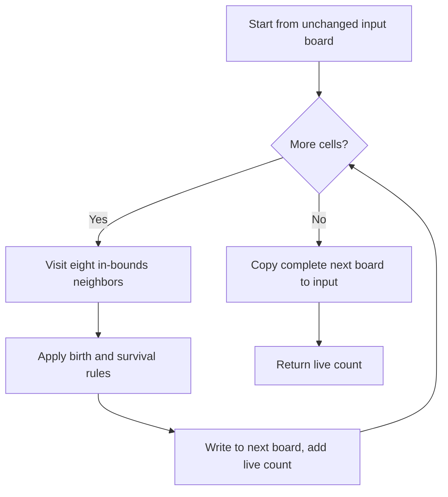

# Conway's Game of Life

Advance one generation on a 16×16 board. Each byte at offsets 0..255 is a
cell: zero is dead, nonzero is alive. Outside the board is permanently dead,
not wrapped around. The next generation uses bytes 256..511, then is copied
back. `run()` returns the new live-cell count. The host only schedules steps
and draws cells; it never computes neighbors or applies the rules.

The fixed board size keeps this first example about simultaneous updates and
nested iteration, not a configurable graphics framework. No memory above 511
is used. There is no data section: the host chooses the initial pattern.

## Work on a snapshot

```text
total = 0
for i from 0 to 255:
    x = i & 15; y = i >> 4
    neighbors = 0
    for dy from -1 to 1:
        for dx from -1 to 1:
            if dx == 0 and dy == 0: skip
            nx = x + dx; ny = y + dy
            if unsigned(nx) < 16 and unsigned(ny) < 16:
                neighbors += input[ny * 16 + nx] != 0
    alive = neighbors == 3 or (neighbors == 2 and input[i] != 0)
    next[i] = alive
    total += alive
copy all next cells to input
return total
```



## No arguments, an integer result

The function type has an empty parameter vector and one i32 result. Every
local is therefore declared explicitly; there are no parameter-local slots.

`[microwasm]`

- header: `0061736d 01000000`
- type-section: `01 {{size:types}}`
  - types: `01 60 00 01 7f`
- function-section: `03 {{size:functions}}`
  - functions: `01 00`
- memory-section: `05 {{size:memories}}`
  - memories: `01 01 01 01`
- export-section: `07 {{size:exports}}`
  - exports: `02 03 72756e 00 00 06 6d656d6f7279 02 00`

## Count, decide, then commit

Locals are i=0, x=1, y=2, dx=3, dy=4, nx=5, ny=6, neighbors=7,
alive=8, total=9. Negative neighbor coordinates become large unsigned values,
so the `<u 16` tests reject both negative and too-large coordinates.

The offset in `2d 00 8002` or `3a 00 8002` is unsigned LEB128 for 256;
unlike `i32.const` it is an unsigned memory immediate. `eqz; eqz` normalizes
any nonzero input cell to 1 before counting it.

`[microwasm]`

- code-section: `0a {{size:code}}`
  - code: `01 {{size:body}}`
    - body: `01 0a 7f`
      - cells-exit: `02 40`
        - cells-loop: `03 40`
          - finished: `20 00 41 8002 4f 0d 01`
          - coordinates: `20 00 41 0f 71 21 01 20 00 41 04 76 21 02`
          - initialize-neighbors: `41 00 21 07 41 7f 21 04`
          - rows-loop: `03 40`
            - reset-dx: `41 7f 21 03`
            - columns-loop: `03 40`
              - not-self: `20 03 20 04 72 04 40`
                - neighbor-position: `20 01 20 03 6a 21 05 20 02 20 04 6a 21 06`
                - in-bounds: `20 05 41 10 49 20 06 41 10 49 71 04 40`
                  - count: `20 07 20 06 41 04 74 20 05 6a 2d 00 00 45 45 6a 21 07 0b`
                - not-self-end: `0b`
              - next-column: `20 03 41 01 6a 22 03 41 01 4c 0d 00 0b`
            - next-row: `20 04 41 01 6a 22 04 41 01 4c 0d 00 0b`
          - rule: `20 07 41 03 46 20 07 41 02 46 20 00 2d 00 00 45 45 71 72 21 08`
          - write-next: `20 00 20 08 3a 00 8002`
          - total: `20 09 20 08 6a 21 09`
          - next-cell: `20 00 41 01 6a 21 00`
          - cells-repeat: `0c 00 0b`
        - cells-end: `0b`
      - reset-i: `41 00 21 00`
      - copy-loop: `03 40`
        - copy-byte: `20 00 20 00 2d 00 8002 3a 00 00`
        - copy-next: `20 00 41 01 6a 22 00 41 8002 49 0d 00 0b`
      - result: `20 09 0b`

Check a still-life block, a blinker over two generations, a glider over four,
edge cells, and randomized boards over several generations. Compare all 256
cells, not just the returned population: different boards can have the same
population. A sentinel above the scratch board must remain unchanged.
