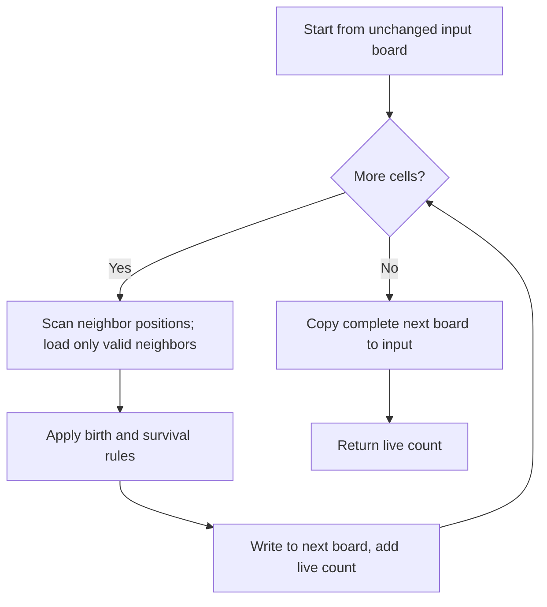
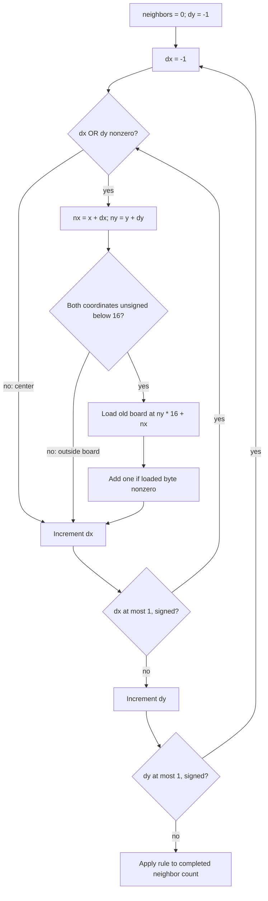

# Conway's Game of Life

Advance one generation on a 16×16 board. Each byte at offsets 0..255 is a
cell: zero is dead, nonzero is alive. Outside the board is permanently dead,
not wrapped around. The next generation uses bytes 256..511, then is copied
back. `run()` returns the new live-cell count. The host only schedules steps
and draws cells; it never computes neighbors or applies the rules.

The fixed board size keeps this first example about simultaneous updates and
nested iteration, not a configurable graphics framework. No memory above 511
is used. There is no data section: the host chooses the initial pattern.

## Work on a snapshot

```text
total = 0
for i in 0..<0x100:
    x = i & 0x0f; y = i >> 4
    neighbors = 0
    for dy in -1..=1:
        for dx in -1..=1:
            if (dx | dy) == 0: continue
            nx = x + dx; ny = y + dy
            if u32(nx) < 0x10 && u32(ny) < 0x10:
                neighbors += input[(ny << 4) + nx] != 0
    alive = neighbors == 3 || (neighbors == 2 && input[i] != 0)
    next[i] = alive
    total += alive
input[0..<0x100] = next[0..<0x100]
return total
```



That is the generation-level view. The work inside `C` is two loops, with
two distinct reasons to skip a neighbor. The copy phase is a third loop;
it must not be moved inside the cell loop.

## Inside one cell: nine positions, at most eight loads

`coordinates` derives `(x, y)` from `i`. `initialize-neighbors` clears the
count and sets `dy = -1`; `reset-dx` sets `dx = -1` on every row, not just
once for the cell.



There are nine coordinate visits even at a corner. The center skips the
coordinate calculation and load; out-of-board coordinates skip only the
load. All paths reach `next-column`, so neither skip can stall the loop.
For the top-left cell, the only loaded positions are `(1, 0)`, `(0, 1)` and
`(1, 1)`. There is no wrap from the left edge to the previous row.

The signedness is intentional: `nx = -1` fails the unsigned bounds test,
but `dx = -1` belongs in a signed loop over -1, 0, 1. The `count` load is
inside the bounds `if`; checking after loading would already be too late.

| Byte-list label | State change | What remains unchanged |
| --- | --- | --- |
| `initialize-neighbors` | Clear count; start first neighbor row | Cell index and old board |
| `reset-dx` | Start first column of each neighbor row | Accumulated count from earlier rows |
| `count` | Add normalized old cell value to count | Both board buffers |
| `next-column` | Increment dx, then repeat while at most 1 | dy and current cell |
| `next-row` | Increment dy, then repeat while at most 1 | Current cell and accumulated count |
| `write-next` | Write one normalized 0/1 at 256 + i | Entire old board |
| `next-cell` | Increment i | Finished next-board prefix and live total |

### Rule evaluation has no branch

`rule` computes two conditions and combines them with integer AND/OR:
birth-or-survival at three neighbors, or survival at two with a live old cell.
Both comparisons and the old-cell load execute; this is not short-circuit
control flow. Each comparison returns 0/1, so the stored byte and count
increment are already normalized.

| Neighbors | Old cell zero | Old cell nonzero |
| --- | --- | --- |
| 2 | Store 0 | Store 1 |
| 3 | Store 1 | Store 1 |
| Any other count | Store 0 | Store 0 |

The `eqz; eqz` sequence also normalizes neighbor bytes. A cell whose byte is
255 contributes one neighbor, not 255.

### Why the delayed copy matters: a blinker trace

Place live cells at `(7, 8)`, `(8, 8)` and `(9, 8)`. In row-major order:

| Cell visited | Old value | Old-board neighbor count | Next value |
| --- | --- | --- | --- |
| `(8, 7)` | 0 | 3 | 1: birth above the row |
| `(7, 8)` | 1 | 1 | 0: left end dies |
| `(8, 8)` | 1 | 2 | 1: center survives |
| `(9, 8)` | 1 | 1 | 0: right end dies |
| `(8, 9)` | 0 | 3 | 1: birth below the row |

When the left end is examined, the new cell above it has already been
written to scratch. It must not count as an old neighbor. Otherwise this
very first generation would depend on scan order.

`finished` leaves the cell loop at `i = 256`; only then does `reset-i` start
the copy. `copy-loop` loads scratch at `256 + i`, stores input at `i`, and
repeats through byte 255. This loop has a post-test because its length is
fixed and nonzero. Its addresses never overlap: the last destination is
255 and the first source is 256. `total` was computed before the copy and
is returned unchanged.

### Three loop backs with the same branch depth

`next-column`, `next-row` and `copy-next` each use `br_if 0`, but target
different labels. At `next-column`, both neighbor `if`s have ended, so the
nearest label is `columns-loop`. At `next-row`, that column loop has ended,
so it is `rows-loop`. During copying it is `copy-loop`.
The shared depth does not imply shared state or a shared destination.

## No arguments, an integer result

The function type has an empty parameter vector and one i32 result. Every
local is therefore declared explicitly; there are no parameter-local slots.

`[microwasm]`

- header: `0061736d 01000000`
- type-section: `01 {{size:types}}`
  - types: `01 60 00 01 7f`
- function-section: `03 {{size:functions}}`
  - functions: `01 00`
- memory-section: `05 {{size:memories}}`
  - memories: `01 01 01 01`
- export-section: `07 {{size:exports}}`
  - exports: `02 03 72756e 00 00 06 6d656d6f7279 02 00`

## Count, decide, then commit

Locals are i=0, x=1, y=2, dx=3, dy=4, nx=5, ny=6, neighbors=7,
alive=8, total=9. Negative neighbor coordinates become large unsigned values,
so the `<u 16` tests reject both negative and too-large coordinates.

The offset in `2d 00 8002` or `3a 00 8002` is unsigned LEB128 for 256;
unlike `i32.const` it is an unsigned memory immediate. `eqz; eqz` normalizes
any nonzero input cell to 1 before counting it.

`[microwasm]`

- code-section: `0a {{size:code}}`
  - code: `01 {{size:body}}`
    - body: `01 0a 7f`
      - cells-exit: `02 40`
        - cells-loop: `03 40`
          - finished: `20 00 41 8002 4f 0d 01`
          - coordinates: `20 00 41 0f 71 21 01 20 00 41 04 76 21 02`
          - initialize-neighbors: `41 00 21 07 41 7f 21 04`
          - rows-loop: `03 40`
            - reset-dx: `41 7f 21 03`
            - columns-loop: `03 40`
              - not-self: `20 03 20 04 72 04 40`
                - neighbor-position: `20 01 20 03 6a 21 05 20 02 20 04 6a 21 06`
                - in-bounds: `20 05 41 10 49 20 06 41 10 49 71 04 40`
                  - count: `20 07 20 06 41 04 74 20 05 6a 2d 00 00 45 45 6a 21 07 0b`
                - not-self-end: `0b`
              - next-column: `20 03 41 01 6a 22 03 41 01 4c 0d 00 0b`
            - next-row: `20 04 41 01 6a 22 04 41 01 4c 0d 00 0b`
          - rule: `20 07 41 03 46 20 07 41 02 46 20 00 2d 00 00 45 45 71 72 21 08`
          - write-next: `20 00 20 08 3a 00 8002`
          - total: `20 09 20 08 6a 21 09`
          - next-cell: `20 00 41 01 6a 21 00`
          - cells-repeat: `0c 00 0b`
        - cells-end: `0b`
      - reset-i: `41 00 21 00`
      - copy-loop: `03 40`
        - copy-byte: `20 00 20 00 2d 00 8002 3a 00 00`
        - copy-next: `20 00 41 01 6a 22 00 41 8002 49 0d 00 0b`
      - result: `20 09 0b`

Check a still-life block, a blinker over two generations, a glider over four,
edge cells, and randomized boards over several generations. Compare all 256
cells, not just the returned population: different boards can have the same
population. A sentinel above the scratch board must remain unchanged.
