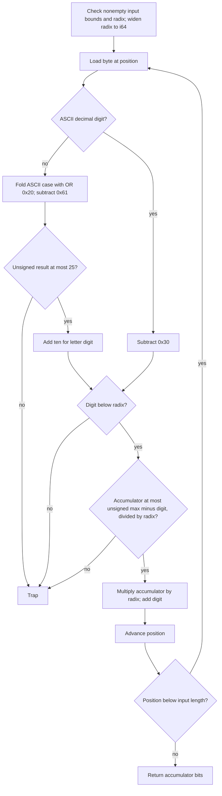
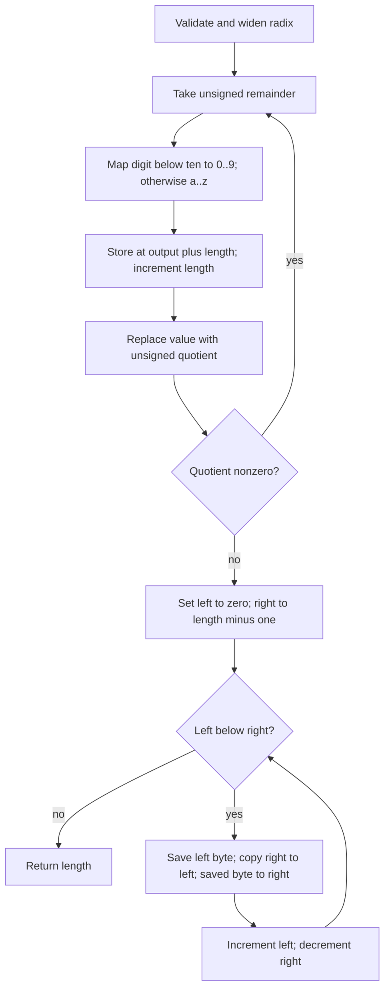

# Exact unsigned integer parsing and formatting

This first number primitive uses unsigned 64-bit arithmetic and bases 2..36.
It is a building block, not yet JSON floating-point or JavaScript `Number`
conversion. In particular it rejects overflow instead of rounding it.

`parse(length, radix)` reads exactly `length` bytes at memory zero and returns
an i64 bit pattern. Empty input, non-digits, radix outside 2..36 and overflow
trap. ASCII uppercase and lowercase letters have the same value. Signs,
spaces and radix prefixes belong to the higher-level parser, not this helper.

`format(value, radix)` interprets all 64 bits as unsigned, writes lowercase
digits at `0x10000`, and returns the byte length. Zero is `0`. It uses at most
64 bytes and no terminator. The fixed memory has two 64 KiB pages.

JavaScript callers pass/receive BigInt for i64 and use `BigInt.asUintN(64, x)`
on the returned bit pattern. Host number/string conversion is test-oracle
code only; the implementation below contains every arithmetic operation.

## Patterns: checked accumulation and reversed digits

```text
parse(length, radix):
    require 0 < length <= 0x10000 and 2 <= radix <= 36
    n = 0
    for p in 0..<length:
        digit = decode_ascii_digit(memory[p])
        require digit < radix
        require n <= (0xffffffffffffffff - digit) / radix
        n = n * radix + digit
    return n

format(n, radix):
    require 2 <= radix <= 36
    length = 0
    do:
        digit = n % radix
        memory[0x10000 + length++] = digit < 10 ? digit + '0' : digit + 'a' - 10
        n /= radix
    while n != 0
    reverse memory[0x10000 ..< 0x10000 + length]
    return length
```

The pre-multiply overflow test avoids wrapped multiplication. Formatting
emits least-significant digits first, then reverses the short span in place.
Neither direction allocates or requires a logarithm or a digits table.

### Inside `parse`: classify before accumulating



The range checks use unsigned subtraction/comparison. A byte below `0x30`
wraps to a large value when subtracting `0x30`, so it cannot accidentally
pass the decimal range check. Case folding alone would accept punctuation
near the letters; the subsequent `0..25` check is essential.

Let `M = 2^64 - 1`, `n` be the existing accumulator and `d` the digit. With
radix `r > 0`, the needed condition `n*r+d <= M` is exactly
`n <= floor((M-d)/r)`. Here `M-d` cannot underflow, because `d < r <= 36`.
The subtraction and division are safe **before** the multiplication. Testing
the product afterward would be too late: an i64 multiply wraps without trapping.
The byte `42 7f` pushes the all-one i64 pattern; unsigned operations interpret
that pattern as `M`, even though its signed literal spelling is minus one.

The loop invariant is that accumulator-local 4 is the exact value of bytes
`[0, position)`, and all of them were valid digits in this radix. On a trap
there is no partially returned value and no memory write. Repeated leading
zeros are accepted by this primitive; JSON's leading-zero rule lives elsewhere.

### Inside `format`: two loops, two different invariants



The extraction loop always runs once. That gives zero its one digit and means
`length - 1` is safe before the reversal. After extracting `k` digits, the
buffer holds the lowest `k` base-r digits in reverse order; the working value
holds the still-unwritten higher digits. In base two, at most 64 iterations
exhaust an unsigned i64. Every larger radix needs no more space, so the output
region is safe without an individual bounds branch for each store.

For decimal 120, the first loop writes `0`, `2`, `1`. Reversal swaps positions
0 and 2, then stops when both pointers reach 1. During reversal, bytes outside
`[left, right]` already have their final positions. The middle byte of an odd
length needs no move. The formatter's digit local becomes the saved swap byte;
there is no second temporary buffer.

## Module and signatures

Type 0 is `(i32, i32) -> i64`. Type 1 is `(i64, i32) -> i32`.

`[microwasm]`

- uint-header: `0061736d 01000000`
- uint-type-section: `01 {{size:uint-types}}`
  - uint-types: `02 60 02 7f 7f 01 7e 60 02 7e 7f 01 7f`
- uint-function-section: `03 {{size:uint-functions}}`
  - uint-functions: `02 00 01`
- uint-memory-section: `05 {{size:uint-memories}}`
  - uint-memories: `01 01 02 02`
- uint-export-section: `07 {{size:uint-exports}}`
  - uint-exports: `03 05 7061727365 00 00 06 666f726d6174 00 01 06 6d656d6f7279 02 00`
- uint-code-section: `0a {{size:uint-code}}`
  - uint-code: `02`
    - uint-parse-record: `{{size:uint-parse-body}}`
      - uint-parse-body: `02 02 7f 02 7e`
        - uint-parse-bounds: `20 00 45 20 00 41 808004 4b 72 04 40 00 0b`
        - uint-parse-radix: `20 01 41 02 49 20 01 41 24 4b 72 04 40 00 0b`
        - uint-parse-base: `20 01 ad 21 05`
        - uint-parse-loop: `03 40`
          - uint-parse-byte: `20 02 2d 00 00 21 03`
          - uint-parse-decimal: `20 03 41 30 6b 41 09 4d 04 40 20 03 41 30 6b 21 03`
          - uint-parse-letter: `05 20 03 41 20 72 41 e100 6b 21 03`
          - uint-parse-letter-bound: `20 03 41 19 4b 04 40 00 0b`
          - uint-parse-letter-value: `20 03 41 0a 6a 21 03 0b`
          - uint-parse-digit-bound: `20 03 20 01 4f 04 40 00 0b`
          - uint-parse-overflow: `20 04 42 7f 20 03 ad 7d 20 05 80 56 04 40 00 0b`
          - uint-parse-accumulate: `20 04 20 05 7e 20 03 ad 7c 21 04`
          - uint-parse-advance: `20 02 41 01 6a 22 02 20 00 49 0d 00 0b`
        - uint-parse-result: `20 04 0b`
    - uint-format-record: `{{size:uint-format-body}}`
      - uint-format-body: `02 04 7f 01 7e`
        - uint-format-radix: `20 01 41 02 49 20 01 41 24 4b 72 04 40 00 0b`
        - uint-format-base: `20 01 ad 21 06`
        - uint-format-loop: `03 40`
          - uint-format-digit: `20 00 20 06 82 a7 21 03`
          - uint-format-ascii: `20 03 41 0a 49 04 7f 20 03 41 30 6a 05 20 03 41 d700 6a 0b 21 03`
          - uint-format-write: `41 808004 20 02 6a 20 03 3a 00 00`
          - uint-format-count: `20 02 41 01 6a 21 02`
          - uint-format-divide: `20 00 20 06 80 22 00 42 00 52 0d 00 0b`
        - uint-format-right: `20 02 41 01 6b 21 05`
        - uint-format-exit: `02 40`
          - uint-format-reverse: `03 40`
            - uint-format-done: `20 04 20 05 4f 0d 01`
            - uint-format-save: `41 808004 20 04 6a 2d 00 00 21 03`
            - uint-format-left: `41 808004 20 04 6a 41 808004 20 05 6a 2d 00 00 3a 00 00`
            - uint-format-right-byte: `41 808004 20 05 6a 20 03 3a 00 00`
            - uint-format-inward: `20 04 41 01 6a 21 04 20 05 41 01 6b 21 05 0c 00 0b`
          - uint-format-reverse-end: `0b`
        - uint-format-result: `20 02 0b`

Parse locals: length 0, radix 1, position 2, digit 3, accumulator 4, base 5.
Format locals: value 0, radix 1, length 2, digit/temp 3, left 4, right 5,
base 6. The two i64 locals in the parser and the single i64 base in the
formatter are declared separately from their i32 indices and counters.
