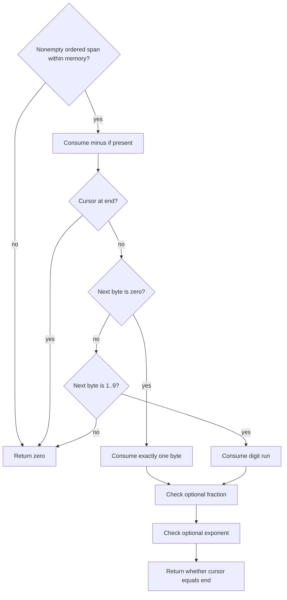
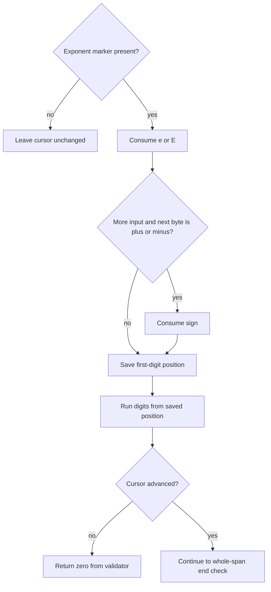

# Strict JSON number syntax

This is the lexical part of JSON number parsing. `valid(start, end)` returns
one when the entire input span follows JSON's number grammar, otherwise zero.
It does not convert to binary64 or round the value. Keeping the original
decimal bytes is useful when converting structured data between formats:
`1.2300e+50` need not lose precision or be reformatted incidentally.

The span must lie in the first 64 KiB of exported memory. Empty, reversed and
out-of-bounds spans return zero. The module has four fixed memory pages so a
calling Microwasm tool can import this memory for input, output and scratch.
The scanners have no imports or allocations. `validMemory(start, end)` has
the same grammar but accepts any span within all four memory pages. It is
used when another Wasm tool has decoded a value into scratch memory; `valid`
keeps its original first-page restriction.

Accepted examples include `0`, `-0`, `123`, `-12.5`, `1e9`, `1E-9` and `1e+9`.
Rejected examples include `+1`, `01`, `.5`, `1.`, `1e`, `NaN`, `Infinity`,
hexadecimal prefixes, surrounding whitespace and separators such as `_`.
`1e9999` is valid syntax; overflow during later binary64 conversion is a
separate concern. This is not the more permissive JavaScript `parseFloat`.

## Pattern: advance over one digit run

`digits(start, end)` returns the first non-digit position or end. The caller
checks whether it advanced when at least one digit is required. This avoids
duplicating separate integer, fraction and exponent loops.

```text
digits(p, end):
    while p < end and u32(memory[p] - '0') <= 9: p += 1
    return p

valid(start, end):
    if start >= end or end > 0x10000: return 0
    p = start
    if memory[p] == '-': p += 1
    if p == end: return 0
    if memory[p] == '0': p += 1
    else:
        if memory[p] not in '1'..='9': return 0
        p = digits(p, end)
    if p < end and memory[p] == '.':
        first = p + 1; p = digits(first, end)
        if p == first: return 0
    if p < end and (memory[p] | 0x20) == 'e':
        p += 1
        if p < end and memory[p] in ['+', '-']: p += 1
        first = p; p = digits(first, end)
        if p == first: return 0
    return p == end
```

### Inside `validMemory`: zero is deliberately not a digit run



The single-zero branch leaves a second digit unconsumed. On `01`, neither
the fraction nor exponent branch claims that `1`, and the final end check
fails. On `0.1`, the dot branch does claim the next byte, so the number is
accepted. There is no separate scan looking for a forbidden leading zero.
The minus-only input fails before the next memory load; a leading plus is
never consumed and fails the `1..9` test.

### Fraction and exponent: optional marker, mandatory following digits

| Stage | Marker/sign consumed | Saved position | Failure condition |
| --- | --- | --- | --- |
| Fraction | Dot, only if present before end | Immediately after dot | `digits` returns that same position |
| Exponent | `e` or `E`, then optional plus/minus | Immediately after optional sign | `digits` returns that same position |
| End check | Nothing | No new saved position | Any byte remains unconsumed |

Each optional stage checks for remaining input before loading its marker.
Only recognizing the marker enters the stage; the absence of a marker leaves
the cursor untouched. Once entered, it cannot silently back out if its digit
run is empty. Thus `1e+` is rejected, not shortened to `1`.



### Inside `digits`: retain the first non-digit

At the top of each iteration, position is at most end and everything already
passed was an ASCII digit. Check the bound before loading. Subtract `0x30`
from the byte and compare the result to nine **unsigned**. A result above
nine exits the enclosing block without incrementing position; an accepted
digit increments it and repeats. The result is the first non-digit position,
not one past it. This lets fraction/exponent markers remain for their callers.

No numeric accumulator exists here, so a long exponent such as `1e9999`
cannot overflow this scanner. “First digit” in local 3 is a byte offset,
not a digit value. That local is briefly reused for the optional exponent
sign byte, then overwritten with the start offset before calling `digits`.

For `-12.50e+3`, position advances to 1 after the minus, 3 after integer
digits, 6 after fraction digits, and 9 after exponent digits: exactly end.
For `1.e2`, it stops immediately after the dot when `digits` makes no progress;
the exponent branch is never reached. For `1e2x`, the exponent succeeds but
leaves `x`, so the final end comparison returns zero.

## The module

All functions have type `(i32, i32) -> i32`. Function 1 is `validMemory`,
function 2 is the first-page `valid` wrapper, and function 0
is also exported as `digits` for other parsers. `digits` is a low-level scan:
its caller must provide `0 <= start <= end <= 0x40000`. Unlike `valid`, it
does not check that precondition itself.

`[microwasm]`

- jn-header: `0061736d 01000000`
- jn-type-section: `01 {{size:jn-types}}`
  - jn-types: `01 60 02 7f 7f 01 7f`
- jn-function-section: `03 {{size:jn-functions}}`
  - jn-functions: `03 00 00 00`
- jn-memory-section: `05 {{size:jn-memories}}`
  - jn-memories: `01 01 04 04`
- jn-export-section: `07 {{size:jn-exports}}`
  - jn-exports: `04 05 76616c6964 00 02 06 646967697473 00 00 06 6d656d6f7279 02 00 0b 76616c69644d656d6f7279 00 01`
- jn-code-section: `0a {{size:jn-code}}`
  - jn-code: `03`
    - jn-digits-record: `{{size:jn-digits-body}}`
      - jn-digits-body: `00`
        - jn-digits-exit: `02 40`
          - jn-digits-loop: `03 40`
            - jn-digits-bound: `20 00 20 01 4f 0d 01`
            - jn-digits-byte: `20 00 2d 00 00 41 30 6b 41 09 4b 0d 01`
            - jn-digits-next: `20 00 41 01 6a 21 00 0c 00 0b`
          - jn-digits-end: `0b`
        - jn-digits-result: `20 00 0b`
    - jn-valid-record: `{{size:jn-valid-body}}`
      - jn-valid-body: `01 02 7f`
        - jn-valid-bounds: `20 00 20 01 4f 20 01 41 808010 4b 72 04 40 41 00 0f 0b`
        - jn-valid-start: `20 00 21 02`
        - jn-valid-sign: `20 02 2d 00 00 41 2d 46 04 40 20 02 41 01 6a 21 02 0b`
        - jn-valid-after-sign: `20 02 20 01 46 04 40 41 00 0f 0b`
        - jn-valid-zero: `20 02 2d 00 00 41 30 46 04 40 20 02 41 01 6a 21 02`
        - jn-valid-nonzero: `05 20 02 2d 00 00 41 31 6b 41 08 4b 04 40 41 00 0f 0b`
        - jn-valid-integer: `20 02 20 01 10 00 21 02 0b`
        - jn-fraction-room: `20 02 20 01 49 04 40`
          - jn-fraction-dot: `20 02 2d 00 00 41 2e 46 04 40`
            - jn-fraction-start: `20 02 41 01 6a 22 03 20 01 10 00 21 02`
            - jn-fraction-empty: `20 02 20 03 46 04 40 41 00 0f 0b 0b 0b`
        - jn-exponent-room: `20 02 20 01 49 04 40`
          - jn-exponent-marker: `20 02 2d 00 00 41 20 72 41 e500 46 04 40`
            - jn-exponent-next: `20 02 41 01 6a 21 02`
            - jn-exponent-sign-room: `20 02 20 01 49 04 40`
              - jn-exponent-sign-byte: `20 02 2d 00 00 21 03`
              - jn-exponent-sign: `20 03 41 2b 46 20 03 41 2d 46 72 04 40 20 02 41 01 6a 21 02 0b 0b`
            - jn-exponent-digits: `20 02 21 03 20 02 20 01 10 00 21 02`
            - jn-exponent-empty: `20 02 20 03 46 04 40 41 00 0f 0b 0b 0b`
        - jn-valid-result: `20 02 20 01 46 0b`
    - jn-page-record: `{{size:jn-page-body}}`
      - jn-page-body: `00 20 01 41 808004 4b 04 40 41 00 0f 0b 20 00 20 01 10 01 0b`

Validator locals are start 0, end 1, position 2, and temporary/first-digit 3.
Only bytes `0x30..0x39` are digits; there is no locale-dependent classification.
