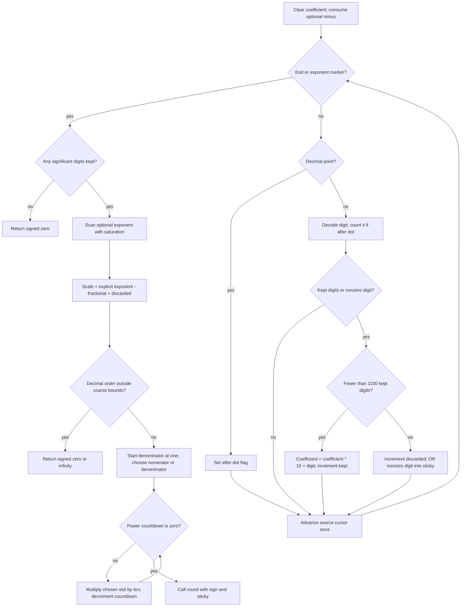
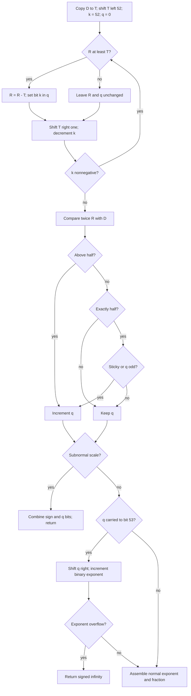

# JSON decimal text to correctly rounded binary64

`parse(start, end)` validates a complete JSON number and returns an f64.
Invalid syntax or an input span outside the first 64 KiB traps. The result
uses nearest-even rounding, preserves negative zero, and allows overflow to
signed infinity, like JavaScript's JSON parser. Syntax and numeric conversion
are separate: `1e9999` is a number token even though binary64 cannot hold it.

The module imports the [number scanner](02-json-number.md) as `n` and
[multiword arithmetic](03-multiword.md) as `b`, with the same memory. These
are direct Wasm-to-Wasm calls. There is no floating-point arithmetic during
decimal accumulation or rounding, and no host parsing function.

## Decimal accumulation and bounded significant digits

The coefficient is accumulated in slot 0. Decimal places and the explicit
exponent determine a power of ten. Positive powers multiply the numerator;
negative powers multiply denominator slot 1, initially one.

Keep the first 1100 significant digits. Discarded digits adjust the decimal
exponent and set a sticky flag if any is nonzero. This is not an approximate
floating-point accumulation: every binary64 rounding midpoint has a finite
decimal expansion with at most 768 significant digits. Its most demanding
form is an integer of at most 54 bits divided by 2^1075. Multiplying by 5^1075
gives at most 768 decimal digits. Therefore the finer 1100-digit truncation
interval cannot cross a rounding midpoint in its interior; only an exact
midpoint needs the sticky flag to distinguish a value just above it.

Leading zeros are not significant. All fractional digits still count toward
the decimal exponent. This also handles a long run of leading fractional
zeros or trailing significant zeros without filling the scratch slots.
Explicit exponents saturate at one million, far beyond what 64 KiB of input
digits could counterbalance. Decimal magnitude rejects obvious overflow and
underflow before constructing large powers of ten.

## Pattern: quotient, remainder, and one rounding decision

The binary exponent is found from the numerator and denominator bit lengths,
then corrected by one comparison. Scale the ratio to an integer significand:
52 fractional bits for normal numbers, or units of 2^-1074 for subnormals.
Shifted-denominator subtraction extracts at most 53 bits. Slot 2 holds the
shifted denominator; slot 0 becomes the remainder.

```text
round(sign, sticky):
    exponent = floor(log2(numerator / denominator))  // exact bit comparisons
    scale ratio by 2^(52 - exponent), or 2^1074 for subnormals
    quotient, remainder = exact integer division
    comparison = compare(2 * remainder, denominator)
    if comparison > 0 or (comparison == 0 and (sticky or quotient is odd)):
        quotient += 1
    handle significand carry and the normal/subnormal boundary
    assemble the sign, exponent and fraction bits; reinterpret as f64
```

### Inside decimal: which bytes change which state?

`parse` validates first; `decimal` then walks an already valid token. In the
byte list, this conversion still has the historical `jf-parse-body` label.
The public validator is `jf-strict-body`. The distinction matters: the loop
below is not independently deciding whether a byte is legal number syntax.



Every coefficient byte reaches `jf-coefficient-next` exactly once, except an
exponent marker: `jf-coefficient-exponent` exits with the cursor still on it.
The exponent stage consumes that marker itself. A point changes a flag but
does not count as a fractional digit. A leading fractional zero counts toward
scale but not toward the 1100-digit budget. After significance begins, zeros
do count toward that budget. Once full, even a discarded zero increments the
discard count; only a nonzero discarded digit changes sticky.

For `-0.001250e+2`, the state at these boundaries is:

| Just consumed | Coefficient | Fractional digits | Kept digits | Next action |
| --- | --- | --- | --- | --- |
| `-0.` | 0 | 0 | 0 | Read fractional digits |
| First two fractional zeros | 0 | 2 | 0 | Still skip leading zeros |
| `1250` | 1250 | 6 | 4 | Leave coefficient loop at `e` |
| `e+2` | 1250 | 6 | 4 | Compute scale `2 - 6 + 0 = -4` |

`jf-power-direction` selects denominator slot 1. Four passes through
`jf-power-multiply` make it 10000; slot 0 remains 1250. The ratio is 0.125,
with the minus retained separately until the result bits are assembled.
The source cursor never rewinds and no decimal substring is copied.

### Inside round: one quotient bit per subtraction opportunity

First, bit lengths give a tentative binary exponent. The comparison in
`jf-round-correct-positive` or `jf-round-correct-negative` either keeps it or
decrements it once; this is not a logarithm approximation loop. Scaling then
changes slot 0 or slot 1, so the quotient fits the intended significand.

The division loop has three pieces of persistent state: remainder `R` in
slot 0, denominator `D` in slot 1, and trial divisor `T` in slot 2. Local 5
is the bit index `k`; local 6 is the initially zero u64 quotient `q`.



At each comparison, `T = D * 2^k`. Subtracting it sets precisely that
quotient bit; skipping it leaves that bit zero. The original scaled numerator
equals `q * D + R` throughout. After 53 comparisons, `R < D`, which is why
one comparison of `2 * R` with `D` suffices for rounding. The final shift of
slot 2 is harmless: it is not used by the remainder comparison.

For input `1.5`, decimal accumulation gives `N = 15`, `D = 10`.
Scaling shifts the numerator to `15 * 2^52`, keeping `D = 10`; this code
does not reduce the fraction first. At `k = 52`, subtracting `10 * 2^52`
leaves `R = 5 * 2^52` and sets bit 52. At `k = 51`, subtracting
`10 * 2^51` leaves zero and sets bit 51. Every remaining comparison fails.
The zero remainder leaves `q = 3 * 2^51` unchanged; no carry is needed.

The exact-half branch is different: `jf-round-up-test` keeps an even `q`
but increments an odd one, unless sticky says the discarded decimal suffix
puts the true input above the midpoint. Subnormal results return directly
at `jf-round-subnormal-result`: a rounded `q` of `2^52` already has the bit
pattern of the smallest normal, so that boundary needs no separate repair.

This entry point remains strict JSON parsing. The more permissive
[integer-prefix](07-parse-integer.md) and [decimal-prefix](08-parse-float.md)
parsers reuse its arithmetic without weakening that grammar.
[Shortest decimal formatting](06-shortest-decimal.md) uses the strict parser
to test candidate strings. The implementation is deliberately general before
introducing short-decimal fast paths.

## Module and imports

Function imports are valid 0, set 1, copy 2, muladd 3, shl 4, shr 5, cmp 6,
sub 7, bits 8. Defined functions are special 9, round 10, decimal 11, parse 12.
Types 0..4 describe the existing integer helper signatures; type 5 is
`(i32, i32) -> f64` and is shared by the three local functions.

The shared `round(sign, sticky)` helper is also exported for other numeric
parsers. Its caller supplies positive normalized numerator/denominator values
in multiword slots 0/1; sign and sticky are Boolean i32 values. It consumes
slots 0..2. Zero must be handled by the caller, before this positive-ratio
operation. This is an arithmetic interface, not another text parser.

`decimal(start, end)` is the low-level conversion step, after a caller has
validated the decimal grammar. It checks span bounds but assumes its contents
are an optional minus, decimal coefficient and optional complete exponent.
It permits leading zeros, `.5` and `1.` so that `parseFloat` can reuse it
without rewriting or copying a token. Public `parse` still enforces strict
JSON syntax before calling it. Do not pass unvalidated text to `decimal`.

`[microwasm]`

- jf-header: `0061736d 01000000`
- jf-type-section: `01 {{size:jf-types}}`
  - jf-types: `06 60 02 7f 7f 01 7f 60 02 7f 7f 00 60 03 7f 7f 7f 00 60 01 7f 00 60 01 7f 01 7f 60 02 7f 7f 01 7c`
- jf-import-section: `02 {{size:jf-imports}}`
  - jf-imports: `0a`
    - jf-import-valid: `01 6e 05 76616c6964 00 00`
    - jf-import-memory: `01 6e 06 6d656d6f7279 02 01 04 04`
    - jf-import-set: `01 62 03 736574 00 01`
    - jf-import-copy: `01 62 04 636f7079 00 01`
    - jf-import-muladd: `01 62 06 6d756c616464 00 02`
    - jf-import-shl: `01 62 03 73686c 00 01`
    - jf-import-shr: `01 62 03 736872 00 03`
    - jf-import-cmp: `01 62 03 636d70 00 00`
    - jf-import-sub: `01 62 03 737562 00 01`
    - jf-import-bits: `01 62 04 62697473 00 04`
- jf-function-section: `03 {{size:jf-functions}}`
  - jf-functions: `04 05 05 05 05`
- jf-export-section: `07 {{size:jf-exports}}`
  - jf-exports: `04 05 7061727365 00 0c 05 726f756e64 00 0a 07 646563696d616c 00 0b 06 6d656d6f7279 02 00`
- jf-code-section: `0a {{size:jf-code}}`
  - jf-code: `04`
    - jf-special-record: `{{size:jf-special-body}}`
      - jf-special-body: `00`
        - jf-special-bits: `20 00 ad 42 3f 86 20 01 ad 42 34 86 84 bf 0b`
    - jf-round-record: `{{size:jf-round-body}}`
      - jf-round-body: `02 04 7f 02 7e`
        - jf-round-exponent: `41 00 10 08 41 01 10 08 6b 21 02`
        - jf-round-positive: `20 02 41 00 4e 04 40`
          - jf-round-scaled-denominator: `41 02 41 01 10 02 41 02 20 02 10 04`
          - jf-round-correct-positive: `41 00 41 02 10 06 41 00 48 04 40 20 02 41 01 6b 21 02 0b`
          - jf-round-negative: `05`
          - jf-round-scaled-numerator: `41 02 41 00 10 02 41 02 41 00 20 02 6b 10 04`
          - jf-round-correct-negative: `41 02 41 01 10 06 41 00 48 04 40 20 02 41 01 6b 21 02 0b 0b`
        - jf-round-overflow: `20 02 41 ff07 4a 04 40 20 00 41 ff0f 10 09 0f 0b`
        - jf-round-underflow: `20 02 41 cd77 48 04 40 20 00 41 00 10 09 0f 0b`
        - jf-round-subnormal-scale: `20 02 41 8278 48 04 7f 41 b208 05 41 34 20 02 6b 0b 21 03`
        - jf-round-scale-direction: `20 03 41 00 4e 04 40 41 00 20 03 10 04 05 41 01 41 00 20 03 6b 10 04 0b`
        - jf-round-divisor: `41 02 41 01 10 02 41 02 41 34 10 04 41 34 21 05`
        - jf-round-divide-loop: `03 40`
          - jf-round-divide-compare: `41 00 41 02 10 06 41 00 4e 04 40`
            - jf-round-divide-subtract: `41 00 41 02 10 07`
            - jf-round-divide-bit: `20 06 42 01 20 05 ad 86 84 21 06 0b`
          - jf-round-divide-shift: `41 02 10 05`
          - jf-round-divide-next: `20 05 41 01 6b 22 05 41 00 4e 0d 00 0b`
        - jf-round-remainder: `41 00 41 01 10 04 41 00 41 01 10 06 21 04`
        - jf-round-up-test: `20 04 41 00 4a 20 04 45 20 01 20 06 42 01 83 a7 72 71 72 04 40`
          - jf-round-up: `20 06 42 01 7c 21 06 0b`
        - jf-round-sign: `20 00 ad 42 3f 86 21 07`
        - jf-round-subnormal-result: `20 02 41 8278 48 04 40 20 07 20 06 84 bf 0f 0b`
        - jf-round-carry-test: `20 06 42 01 42 35 86 51 04 40`
          - jf-round-carry: `20 06 42 01 88 21 06 20 02 41 01 6a 21 02 0b`
        - jf-round-carry-overflow: `20 02 41 ff07 4a 04 40 20 00 41 ff0f 10 09 0f 0b`
        - jf-round-normal-result: `20 07 20 02 41 ff07 6a ad 42 34 86 84 20 06 42 01 42 34 86 7d 84 bf 0b`
    - jf-parse-record: `{{size:jf-parse-body}}`
      - jf-parse-body: `01 0c 7f`
        - jf-decimal-bounds: `20 00 20 01 4f 20 01 41 808004 4b 72 04 40 00 0b`
        - jf-parse-clear: `41 00 41 00 10 01`
        - jf-parse-position: `20 00 21 02`
        - jf-parse-sign: `20 02 2d 00 00 41 2d 46 04 40 41 01 21 03 20 02 41 01 6a 21 02 0b`
        - jf-coefficient-exit: `02 40`
          - jf-coefficient-loop: `03 40`
            - jf-coefficient-bound: `20 02 20 01 4f 0d 01`
            - jf-coefficient-byte: `20 02 2d 00 00 21 0b`
            - jf-coefficient-exponent: `20 0b 41 20 72 41 e500 46 0d 01`
            - jf-coefficient-dot: `20 0b 41 2e 46 04 40 41 01 21 05`
            - jf-coefficient-digit: `05 20 0b 41 30 6b 21 0b`
            - jf-coefficient-fraction: `20 05 04 40 20 04 41 01 6a 21 04 0b`
            - jf-coefficient-significant: `20 06 20 0b 72 04 40`
              - jf-coefficient-room: `20 06 41 cc08 49 04 40`
                - jf-coefficient-append: `41 00 41 0a 20 0b 10 03 20 06 41 01 6a 21 06`
                - jf-coefficient-discard: `05 20 07 41 01 6a 21 07 20 08 20 0b 45 45 72 21 08 0b 0b 0b`
            - jf-coefficient-next: `20 02 41 01 6a 21 02 0c 00 0b`
          - jf-coefficient-end: `0b`
        - jf-parse-zero: `20 06 45 04 40 20 03 41 00 10 09 0f 0b`
        - jf-exponent-present: `20 02 20 01 49 04 40`
          - jf-exponent-next: `20 02 41 01 6a 21 02`
          - jf-exponent-sign-byte: `20 02 2d 00 00 21 0b`
          - jf-exponent-minus: `20 0b 41 2d 46 21 0a`
          - jf-exponent-sign: `20 0a 20 0b 41 2b 46 72 04 40 20 02 41 01 6a 21 02 0b`
          - jf-exponent-loop: `03 40`
            - jf-exponent-room: `20 09 41 c0843d 49 04 40`
              - jf-exponent-digit: `20 09 41 0a 6c 20 02 2d 00 00 41 30 6b 6a 21 09`
              - jf-exponent-cap: `20 09 41 c0843d 4b 04 40 41 c0843d 21 09 0b 0b`
            - jf-exponent-advance: `20 02 41 01 6a 22 02 20 01 49 0d 00 0b`
          - jf-exponent-negate: `20 0a 04 40 41 00 20 09 6b 21 09 0b 0b`
        - jf-decimal-scale: `20 09 20 04 6b 20 07 6a 21 0c`
        - jf-decimal-order: `20 06 20 0c 6a 21 0d`
        - jf-decimal-overflow: `20 0d 41 b502 4a 04 40 20 03 41 ff0f 10 09 0f 0b`
        - jf-decimal-underflow: `20 0d 41 bd7d 48 04 40 20 03 41 00 10 09 0f 0b`
        - jf-denominator-one: `41 01 41 01 10 01`
        - jf-power-direction: `20 0c 41 00 48 04 40 41 01 21 0d 41 00 20 0c 6b 21 0c 05 41 00 21 0d 0b`
        - jf-power-exit: `02 40`
          - jf-power-loop: `03 40`
            - jf-power-bound: `20 0c 45 0d 01`
            - jf-power-multiply: `20 0d 41 0a 41 00 10 03`
            - jf-power-next: `20 0c 41 01 6b 21 0c 0c 00 0b`
          - jf-power-end: `0b`
        - jf-parse-round: `20 03 20 08 10 0a 0b`
    - jf-strict-record: `{{size:jf-strict-body}}`
      - jf-strict-body: `00`
        - jf-strict-validate: `20 00 20 01 10 00 45 04 40 00 0b`
        - jf-strict-convert: `20 00 20 01 10 0b 0b`

Round locals: sign/sticky 0/1; exponent 2, scale 3, comparison 4, bit index 5;
u64 quotient 6 and result bits 7. Parse locals: start/end 0/1, position 2,
sign 3, fractional digits 4, after-dot flag 5, kept digits 6, discarded digits
7, sticky 8, explicit exponent 9, exponent sign 10, byte/digit 11, scale 12,
order/slot 13.
