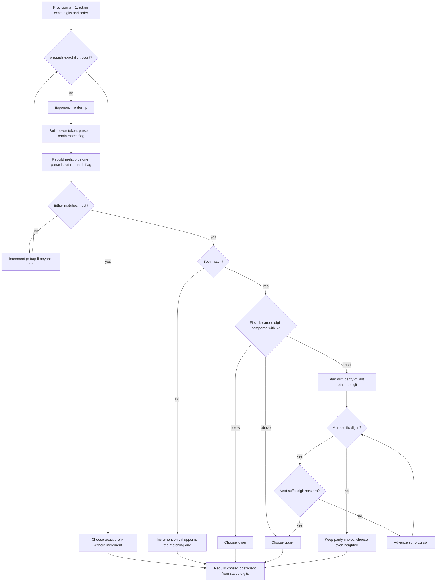
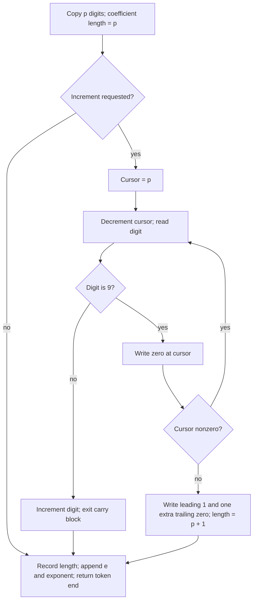

# Shortest finite binary64 decimal strings

`format(value)` writes the shortest round-tripping decimal at `0x10000` and
returns its length. This is the finite-number spelling used by JavaScript's
decimal `Number.toString()` and JSON serialization: `-0` becomes `0`, ordinary
notation covers `1e-6` through values below `1e21`, and scientific notation
uses a lowercase `e` and an explicit positive exponent sign. NaN and infinities
trap; a JSON or JavaScript API wrapper must choose its own nonfinite behavior.

Imports are `d.format` from [exact decimal expansion](05-exact-decimal.md)
and `f.parse`/`f.memory` from [JSON decimal parsing](04-json-binary64.md).
Both dependencies must use the same multiword module and memory. The host
only links these Wasm exports; it does not select digits or convert numbers.

## Pattern: two neighbors on an increasingly fine decimal grid

Start with the exact decimal digits. For each precision from one through
seventeen significant digits, try the decimal immediately below the value and
the one immediately above it. Keep the first precision where either candidate
parses back to the input binary64. If both do, select the nearer decimal; at
an exact tie, select the even last digit.

Testing both neighbors matters at powers of two, where the rounding interval
is asymmetric. Merely rounding to each decimal precision and testing that one
candidate is not sufficient. The exact expansion also makes decimal-distance
comparison a digit comparison, with no intermediate floating-point rounding.

```text
format(value):
    exact = exact_decimal(abs(value))
    if value == 0: return "0"
    digits, order = remove_point_and_leading_zeros(exact)
    for precision in 1..=17:
        if precision == digits.length: choose exact prefix; break
        exponent = order - precision
        lower = integer(prefix(digits, precision)) * 10^exponent
        upper = (integer(prefix(digits, precision)) + 1) * 10^exponent
        test each using the Wasm decimal parser
        if either round-trips:
            choose the valid one, or nearest with even-digit ties
            break
    account for a carry into another decimal position
    remove trailing coefficient zeros
    render coefficient, decimal point and exponent using the notation rules
```

The choice follows the closest/even guideline in
[ECMAScript Number::toString](https://tc39.es/ecma262/multipage/ecmascript-data-types-and-values.html#sec-numeric-types-number-tostring).
This reference implementation favors reuse and inspectable reasoning over a
fast cached-power algorithm. It can call the parser up to 34 times. It is not
a claim to match the throughput of a browser's native conversion routine.

Exact digits are copied to `0x30000` (at most 768 bytes), outside the parser's
multiword slots. Short exponent digits use `0x30400`. Candidate tokens use
the start of memory. Thus formatting overwrites input space, unlike the exact
expansion primitive; preserve an input document elsewhere before calling it.
Final output is at most 25 bytes. The shared memory remains fixed at 256 KiB.

## Inside format: search state survives destructive candidate tests

The exact formatter initially writes at `0x10000`. Before trying any
candidates, `sd-format-copy-loop` copies its digits, without the point, to
`0x30000`. That is the stable source for every trial: the decimal parser may
overwrite its scratch slots, and the next trial overwrites the previous
candidate at address zero. Neither overwrites the saved exact digits.

`order` is the point position relative to the first significant digit, not
the scientific exponent. For `0.00125`, it is -2; for `125`, it is 3.
`sd-format-order` corrects for the point byte when the first significant
digit occurs after it. Removing the point must not accidentally count that
byte as a leading zero.

### The precision loop and its half-way suffix scan



`sd-format-test-lower` saves its Boolean before the upper test replaces the
token. `sd-format-chosen` must build the selected candidate again: memory
still contains the upper candidate, even when lower won. This is why the
increment flag is retained instead of treating the last parsed buffer as
the answer.

Only `sd-format-both` compares decimal distances. If one neighbor fails to
round-trip, closeness cannot make it eligible. If both succeed, a discarded
suffix beginning with 4 lies below half, and one beginning with 6 lies above.
A suffix beginning with 5 needs the inner `sd-format-tail-loop`: `5000`
is an exact tie, whereas `5001` must choose upper. The loop stops at the
first nonzero byte; otherwise it advances to the end and keeps the parity
choice made by `sd-format-even`.

For the binary64 value normally written `0.1`, the exact saved expansion
starts with `10000000000000000555...`, and order is zero. At precision one,
the two candidates are `1e-1` and `2e-1`. Only the first parses back to the
input, so the search ends immediately. It does not output the lengthy exact
expansion and does not inspect its half-way suffix.

### Inside candidate: carry moves right to left, copying moves left to right

`candidate(p, increment, exponent)` first copies exactly `p` saved digits
to address zero. The source index increases during that copy. If increment
is requested, a separate cursor starts at `p` and moves backward *before*
each digit access. The candidate's coefficient length initially equals `p`.



For prefix `1299`, upper becomes `1300`: two zero writes, then the 2 becomes
3 and `sd-candidate-no-carry` exits the enclosing carry block. For `999`,
all three positions become zero before `sd-candidate-leading-carry` writes
`1000`. The fourth byte is within the candidate buffer, not the saved source.
There is no backward read at index -1: when the cursor reaches zero on a 9,
the loop falls through to leading carry instead of repeating.

### Finishing does not restart the search

After rebuilding the winner, `sd-format-carry-order` adds the extra
coefficient length to order. Then `sd-format-trim-loop` removes trailing
zeros from the *length*, keeping at least one digit; it does not move bytes
or alter order. Thus a carry from a three-digit prefix to `1000` can leave
coefficient `1` with the corrected order still intact.

Let `n` be the trimmed coefficient length and `k` the corrected order.
The final branches are independent of how many candidate tests were needed:

| Condition | Output construction | Byte-list branch |
| --- | --- | --- |
| `0 < k <= 21`, `n <= k` | All digits, then `k - n` zeros | `sd-format-integral` |
| `0 < k <= 21`, `n > k` | First `k` digits, point, remaining digits | `sd-format-mixed` |
| `-6 < k <= 0` | `0.`, then `-k` zeros, then digits | `sd-format-small` |
| Otherwise | First digit, optional fractional digits, `e`, exponent `k - 1` | `sd-format-scientific` |

For example, `k = -5` produces ordinary `0.000001` for coefficient `1`;
`k = -6` produces `1e-7`. The two zero-padding loops consume a countdown.
`span` instead advances a start offset up to an exclusive end. Exponent
formatting stores remainders in reverse order, then counts backward to emit
them; even exponent zero goes through the digit loop once.

## Module and helpers

Imports: parse 0, exact format 1. Functions: emit 2, exponent 3, candidate 4,
span 5, format 6. Global 0 is the current output pointer. Global 1 records
the candidate's coefficient length, including any leading carry digit.

`[microwasm]`

- sd-header: `0061736d 01000000`
- sd-type-section: `01 {{size:sd-types}}`
  - sd-types: `05 60 02 7f 7f 01 7c 60 01 7c 01 7f 60 01 7f 00 60 02 7f 7f 00 60 03 7f 7f 7f 01 7f`
- sd-import-section: `02 {{size:sd-imports}}`
  - sd-imports: `03`
    - sd-import-memory: `01 66 06 6d656d6f7279 02 01 04 04`
    - sd-import-parse: `01 66 05 7061727365 00 00`
    - sd-import-exact: `01 64 06 666f726d6174 00 01`
- sd-function-section: `03 {{size:sd-functions}}`
  - sd-functions: `05 02 03 04 03 01`
- sd-global-section: `06 {{size:sd-globals}}`
  - sd-globals: `02 7f 01 41 00 0b 7f 01 41 00 0b`
- sd-export-section: `07 {{size:sd-exports}}`
  - sd-exports: `02 06 666f726d6174 00 06 06 6d656d6f7279 02 00`
- sd-code-section: `0a {{size:sd-code}}`
  - sd-code: `05`
    - sd-emit-record: `{{size:sd-emit-body}}`
      - sd-emit-body: `00`
        - sd-emit-byte: `23 00 20 00 3a 00 00`
        - sd-emit-next: `23 00 41 01 6a 24 00 0b`
    - sd-exponent-record: `{{size:sd-exponent-body}}`
      - sd-exponent-body: `01 01 7f`
        - sd-exponent-negative: `20 00 41 00 48 04 40 41 2d 10 02 41 00 20 00 6b 21 00`
        - sd-exponent-positive: `05 20 01 04 40 41 2b 10 02 0b 0b`
        - sd-exponent-digits: `03 40`
          - sd-exponent-digit: `41 80880c 20 02 6a 20 00 41 0a 70 41 30 6a 3a 00 00`
          - sd-exponent-next: `20 02 41 01 6a 21 02 20 00 41 0a 6e 22 00 0d 00 0b`
        - sd-exponent-reverse: `03 40`
          - sd-exponent-previous: `20 02 41 01 6b 21 02`
          - sd-exponent-emit: `41 80880c 20 02 6a 2d 00 00 10 02`
          - sd-exponent-bound: `20 02 0d 00 0b 0b`
    - sd-candidate-record: `{{size:sd-candidate-body}}`
      - sd-candidate-body: `01 03 7f`
        - sd-candidate-length: `20 00 21 04`
        - sd-candidate-copy: `03 40`
          - sd-candidate-copy-byte: `20 03 41 80800c 20 03 6a 2d 00 00 3a 00 00`
          - sd-candidate-copy-next: `20 03 41 01 6a 22 03 20 00 49 0d 00 0b`
        - sd-candidate-increment: `20 01 04 40 20 00 21 03`
          - sd-candidate-carry-exit: `02 40`
            - sd-candidate-carry-loop: `03 40`
              - sd-candidate-carry-position: `20 03 41 01 6b 22 03 2d 00 00 21 05`
              - sd-candidate-no-carry: `20 05 41 39 47 04 40 20 03 20 05 41 01 6a 3a 00 00 0c 02 0b`
              - sd-candidate-carry-zero: `20 03 41 30 3a 00 00`
              - sd-candidate-carry-next: `20 03 0d 00 0b`
            - sd-candidate-leading-carry: `41 00 41 31 3a 00 00 20 00 41 30 3a 00 00 20 04 41 01 6a 21 04`
            - sd-candidate-carry-end: `0b 0b`
        - sd-candidate-pointers: `20 04 24 01 20 04 24 00`
        - sd-candidate-exponent: `41 e500 10 02 20 02 41 00 10 03`
        - sd-candidate-end: `23 00 0b`
    - sd-span-record: `{{size:sd-span-body}}`
      - sd-span-body: `00`
        - sd-span-exit: `02 40`
          - sd-span-loop: `03 40`
            - sd-span-bound: `20 00 20 01 4f 0d 01`
            - sd-span-byte: `20 00 2d 00 00 10 02`
            - sd-span-next: `20 00 41 01 6a 21 00 0c 00 0b`
          - sd-span-end: `0b 0b`
    - sd-format-record: `{{size:sd-format-body}}`
      - sd-format-body: `02 0d 7f 01 7c`
        - sd-format-exact: `20 00 99 22 0e 10 01 21 01`
        - sd-format-zero: `20 0e 44 0000000000000000 61 04 40 41 01 0f 0b`
        - sd-format-default-point: `20 01 21 03`
        - sd-format-find-point-exit: `02 40`
          - sd-format-find-point-loop: `03 40`
            - sd-format-find-point-bound: `20 02 20 01 4f 0d 01`
            - sd-format-find-point-byte: `41 808004 20 02 6a 2d 00 00 41 2e 46 04 40 20 02 21 03 0c 02 0b`
            - sd-format-find-point-next: `20 02 41 01 6a 21 02 0c 00 0b`
          - sd-format-find-point-end: `0b`
        - sd-format-leading-loop: `03 40`
          - sd-format-leading-byte: `41 808004 20 04 6a 2d 00 00 21 0d`
          - sd-format-leading-test: `20 0d 41 30 46 20 0d 41 2e 46 72 04 40 20 04 41 01 6a 21 04 0c 01 0b 0b`
        - sd-format-order: `20 03 20 04 6b 20 04 20 03 4b 6a 21 06`
        - sd-format-copy-start: `20 04 21 02`
        - sd-format-copy-loop: `03 40`
          - sd-format-copy-byte: `41 808004 20 02 6a 2d 00 00 21 0d`
          - sd-format-copy-digit: `20 0d 41 2e 47 04 40 41 80800c 20 05 6a 20 0d 3a 00 00 20 05 41 01 6a 21 05 0b`
          - sd-format-copy-next: `20 02 41 01 6a 22 02 20 01 49 0d 00 0b`
        - sd-format-first-precision: `41 01 21 07`
        - sd-format-search-exit: `02 40`
          - sd-format-search-loop: `03 40`
            - sd-format-exact-prefix: `20 07 20 05 46 04 40 41 00 21 0b 0c 02 0b`
            - sd-format-search-exponent: `20 06 20 07 6b 21 08`
            - sd-format-test-lower: `41 00 20 07 41 00 20 08 10 04 10 00 20 0e 61 21 09`
            - sd-format-test-upper: `41 00 20 07 41 01 20 08 10 04 10 00 20 0e 61 21 0a`
            - sd-format-found: `20 09 20 0a 72 04 40`
              - sd-format-only-upper: `20 09 45 21 0b`
              - sd-format-both: `20 09 20 0a 71 04 40`
                - sd-format-next-digit: `41 80800c 20 07 6a 2d 00 00 21 0d`
                - sd-format-above-half: `20 0d 41 35 4b 21 0b`
                - sd-format-at-half: `20 0d 41 35 46 04 40`
                  - sd-format-even: `41 80800c 20 07 6a 41 01 6b 2d 00 00 41 01 71 21 0b`
                  - sd-format-tail-start: `20 07 41 01 6a 21 0c`
                  - sd-format-tail-exit: `02 40`
                    - sd-format-tail-loop: `03 40`
                      - sd-format-tail-bound: `20 0c 20 05 4f 0d 01`
                      - sd-format-tail-nonzero: `41 80800c 20 0c 6a 2d 00 00 41 30 47 04 40 41 01 21 0b 0c 02 0b`
                      - sd-format-tail-next: `20 0c 41 01 6a 21 0c 0c 00 0b`
                    - sd-format-tail-end: `0b 0b 0b`
              - sd-format-found-exit: `0c 02 0b`
            - sd-format-more-precision: `20 07 41 01 6a 22 07 41 11 4b 04 40 00 0b 0c 00 0b`
          - sd-format-search-end: `0b`
        - sd-format-chosen: `20 07 20 0b 20 06 20 07 6b 10 04 1a`
        - sd-format-carry-order: `23 01 21 01 20 06 20 01 20 07 6b 6a 21 06`
        - sd-format-trim-exit: `02 40`
          - sd-format-trim-loop: `03 40`
            - sd-format-trim-one: `20 01 41 01 4d 0d 01`
            - sd-format-trim-byte: `20 01 41 01 6b 2d 00 00 41 30 47 0d 01`
            - sd-format-trim-next: `20 01 41 01 6b 21 01 0c 00 0b`
          - sd-format-trim-end: `0b`
        - sd-format-output: `41 808004 24 00`
        - sd-format-sign: `20 00 44 0000000000000000 63 04 40 41 2d 10 02 0b`
        - sd-format-ordinary: `20 06 41 00 4a 20 06 41 15 4c 71 04 40`
          - sd-format-integral: `20 01 20 06 4d 04 40`
            - sd-format-integral-digits: `41 00 20 01 10 05 20 06 20 01 6b 21 0c`
            - sd-format-integral-zeros-exit: `02 40`
              - sd-format-integral-zeros-loop: `03 40`
                - sd-format-integral-zeros-bound: `20 0c 45 0d 01`
                - sd-format-integral-zero: `41 30 10 02`
                - sd-format-integral-zeros-next: `20 0c 41 01 6b 21 0c 0c 00 0b`
              - sd-format-integral-zeros-end: `0b`
            - sd-format-mixed: `05 41 00 20 06 10 05 41 2e 10 02 20 06 20 01 10 05 0b`
          - sd-format-other: `05`
          - sd-format-small: `20 06 41 00 4c 20 06 41 7a 4a 71 04 40`
            - sd-format-small-leading: `41 30 10 02 41 2e 10 02 41 00 20 06 6b 21 0c`
            - sd-format-small-zeros-exit: `02 40`
              - sd-format-small-zeros-loop: `03 40`
                - sd-format-small-zeros-bound: `20 0c 45 0d 01`
                - sd-format-small-zero: `41 30 10 02`
                - sd-format-small-zeros-next: `20 0c 41 01 6b 21 0c 0c 00 0b`
              - sd-format-small-zeros-end: `0b`
            - sd-format-small-digits: `41 00 20 01 10 05`
            - sd-format-scientific: `05`
            - sd-format-scientific-first: `41 00 41 01 10 05`
            - sd-format-scientific-rest: `20 01 41 01 4b 04 40 41 2e 10 02 41 01 20 01 10 05 0b`
            - sd-format-scientific-exponent: `41 e500 10 02 20 06 41 01 6b 41 01 10 03 0b 0b`
        - sd-format-length: `23 00 41 808004 6b 0b`

Format locals: value 0; exact length 1, scan index 2, point offset 3, first
significant offset 4, digit count 5, decimal order 6, precision 7, candidate
exponent 8, lower/upper match flags 9/10, increment flag 11, tail/countdown 12,
byte 13; f64 absolute value 14. Helpers do not call back into the host.
