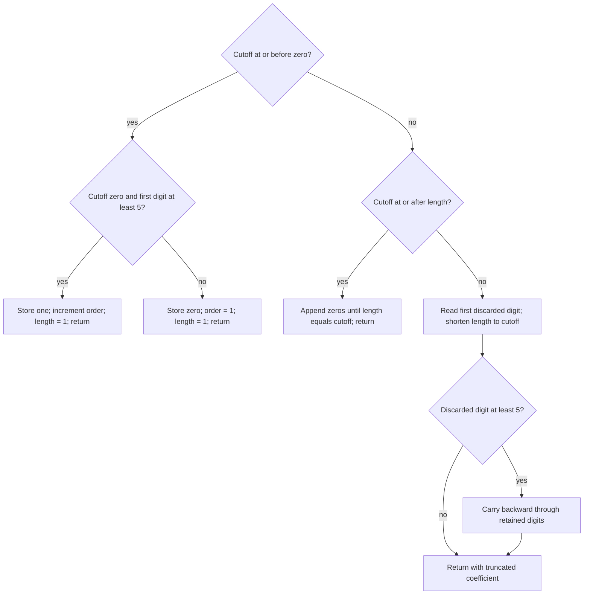

# Fixed, exponential and significant-digit formatting

These byte interfaces implement the numeric behavior of JavaScript's decimal
precision methods. Each writes at `0x10000` and returns the byte length:

- `fixed(value, digits)` corresponds to `toFixed(digits)`, for 0..100 places.
  Pass zero for an omitted argument. Magnitudes at least 1e21 use the ordinary
  number string instead, even when more fractional places were requested.
- `exponential(value, digits)` corresponds to `toExponential(digits)`, for
  0..100 fractional places in the significand.
- `exponentialShortest(value)` corresponds to `toExponential()` with no
  argument. It uses the shortest coefficient, always in exponential notation.
- `precision(value, digits)` corresponds to `toPrecision(digits)`, for 1..100
  significant digits. For an omitted argument, use the radix formatter's
  `format(value, 10)` directly, as the JavaScript method does.

Arguments are already f64/i32; object coercion and conversion of an arbitrary
JavaScript precision argument are outside this ABI. Invalid counts trap.
`fixed` checks the count before handling nonfinite values. `exponential` and
`precision` handle nonfinite values before checking the count, matching the
method-specific ordering. They emit `NaN` or signed `Infinity`, not JSON null.

The algorithms follow [ECMAScript Number precision methods](https://tc39.es/ecma262/multipage/numbers-and-dates.html#sec-number.prototype.tofixed).
Negative zero itself loses its sign, but a negative nonzero number that rounds
to zero retains it: `fixed(-0.001, 2)` is `-0.00`. Requested zeros are retained.

## Pattern: exact digits, one cutoff, then layout

The [exact decimal formatter](05-exact-decimal.md) supplies all the actual
binary64 digits. Normalize them into an unsigned coefficient and a decimal
point position. A requested count determines where to round that coefficient.
The first discarded digit decides: 5 or greater increments the retained
prefix. This is magnitude-half-up, not the even-digit tie rule of shortest
formatting. No multiply-by-10 floating-point rounding is used.

```text
fixed(value, places):
    handle count errors, nonfinite values and magnitude >= 1e21
    normalize exact_decimal(abs(value)) into digits and order
    round at order + places significant positions
    emit sign from the original nonzero value
    emit integer digits or '0', then exactly places fractional digits

precision(value, count):
    handle nonfinite values and count errors
    normalize exact_decimal(abs(value))
    round to count significant digits, preserving zeros
    use scientific notation if order > count or order < -5
    otherwise emit ordinary notation with count significant digits
```

Rounding can carry into a new decimal position. A cutoff before the first
significant digit can instead yield zero, or one at the requested decimal
place. These are explicit cases rather than treating a negative cutoff as an
array index. Rendering a span outside the saved coefficient emits zeros;
this handles both leading fractional and requested trailing zeros.

The normalization helper also accepts the exponent notation produced by the
[shortest radix formatter](09-radix-format.md). This lets omitted-argument
exponential output reuse the shortest decimal selection without duplicating
that algorithm. Only that entry point strips trailing coefficient zeros.

## Inside normalize: separate source position from decimal position

`pf-normalize-loop` reads the dependency's output at `0x10000` and copies
digits into `0x30000`. The source cursor advances past every digit and point;
the coefficient length advances only when a digit is retained. No output
rendering happens yet.

| State | Owner | Meaning |
| --- | --- | --- |
| Scan index, local 1 | Normalize | Next source byte; never an output position |
| After-point flag, local 2 | Normalize | Stops counting integer places after the point |
| Leading-zero count, local 3 | Normalize | Discarded zeros before the first nonzero digit, on either side of the point |
| Order, global 1 | Normalize, then round | Number of coefficient places before the decimal point |
| Coefficient length, global 2 | Normalize, then round | Number of stored ASCII digits, including zeros after the first nonzero digit |

Before seeing the point, every digit increments order, including discarded
zeros. After the scan, subtract the count of discarded leading zeros.
Thus `0.00125` first counts one integer place and three leading zeros;
the result is coefficient `125`, order minus two. It is not order minus
three: scientific notation uses `order - 1` as its exponent.

The exponent branch owns the rest of the source. At
`pf-normalize-exponent-loop`, accumulate decimal exponent digits, then add
or subtract that magnitude from order and exit the outer scan. For
`1.25e+3`, the coefficient remains `125` but order becomes four.
This helper consumes trusted formatter output, not arbitrary user text;
the loop is not a replacement for a validating exponent parser.

When all digits were zero, `pf-normalize-zero` replaces the empty result
with one stored zero and order one. Later code never has to interpret a
zero-length coefficient as the number zero.

## Inside round: three cutoff regions before any carry

The cutoff is a count of retained significant digits, not a source offset.
`fixed` passes `order + places`; exponential passes `places + 1`;
precision passes its requested count directly. Only fixed can put the
cutoff before the first significant digit.



`pf-round-up-test` reads the discarded digit before setting the new length.
Bytes beyond that length can remain in scratch memory; they no longer
belong to the coefficient. This is a span change, not a memory clearing pass.

### Carry: the ordinary exit skips the leading-carry repair

`pf-round-carry-loop` decrements its index before reading a retained digit.
If incrementing it gives at most ASCII `9`, write the new digit and branch
out of the carry block. If it overflows, write `0` and continue left.
Falling through at index zero means every retained digit overflowed.
Only then does `pf-round-carry-leading` replace the first zero with `1`
and increment order.

For the intermediate coefficient `9995`, order one, cutoff three:

| Step | Retained coefficient | Carry index | Order |
| --- | --- | --- | --- |
| Discarded 5 requests rounding up | `999` | 3 | 1 |
| Increment last 9 | `990` | 2 | 1 |
| Increment next 9 | `900` | 1 | 1 |
| Increment first 9 | `000` | 0 | 1 |
| Leading-carry repair | `100` | 0 | 2 |

The significant count stays three, so scientific rendering gives `1.00e+1`.
This is a trace of an intermediate digit sequence, not a claim that the
JavaScript literal `9.995` has exactly those decimal digits in binary64.

At `pf-round-no-carry`, `br 2` exits the enclosing carry block, skipping
the leading repair. At `pf-round-carry-zero`, `br_if 0` repeats the loop
only while the index is nonzero. Confusing the two exits would increase
order on ordinary increments as well as all-nine carries.

### Before the first digit: no negative array index

The exact binary64 value `0.0625` normalizes to `625` at order minus one.
With one fractional place, cutoff is zero: the first discarded digit is
6, so round stores `1` and changes order to zero. Fixed layout emits `0.1`.
With zero fractional places, cutoff is minus one: the result is zero
regardless of that first digit. The rounding threshold lies a full decimal
place earlier. Neither branch reads memory using the negative cutoff.

The sign is applied later from the original argument. For `-0.0625` at
zero places this produces `-0`; actual negative zero does not satisfy the
less-than-zero test in `pf-begin-sign` and produces `0` instead.

## Inside span and layout: missing digits become zeros deliberately

`span(start, end)` iterates with signed positions, but compares a position
with coefficient length using an unsigned comparison before reading.
A negative position therefore fails the bounds test and emits ASCII `0`,
as does any position beyond the stored length. This one branch covers
leading fractional zeros and trailing requested zeros without reading
outside the coefficient. The loop's signed end check still ends the span.

For `fixed(0.03125, 4)`, normalization gives `3125`, order minus one.
Cutoff three rounds the retained digits to `313`. The fractional span
is positions minus one through two: zero, 3, 1, 3. Output is `0.0313`.
For precision formatting, the notation decision happens after rounding:
a carry can change order and therefore change which layout branch runs.

Explicit precision retains padding zeros. Only
`pf-shortest-trim-loop`, used by omitted-argument exponential formatting,
removes trailing coefficient zeros, stopping at one digit. Its output is
shortest selection in scientific layout, not another precision-rounding pass.

## Memory and imports

Import exact formatting as `d` and radix formatting as `r`, sharing memory.
Normalized ASCII digits use `0x30000..0x30300`; exponent scratch uses
`0x30400..0x30404`. Output needs at most 123 bytes for these entry points,
though the exact-format dependency temporarily writes up to 1077 bytes there.
The dependency may overwrite input space. No allocation or host conversion is
used. Helpers are private; their cutoffs and spans are bounded by the public
precision checks and finite binary64 limits.

## Module

Imports: exact 0, radix format 1. Functions: emit 2, span 3, exponent 4,
normalize 5, round 6, begin 7, scientific 8, fixed 9, exponential 10,
precision 11, exponentialShortest 12. Globals: output cursor 0, order 1,
coefficient length 2. Order is one plus the scientific exponent.

`[microwasm]`

- pf-header: `0061736d 01000000`
- pf-type-section: `01 {{size:pf-types}}`
  - pf-types: `06 60 01 7c 01 7f 60 02 7c 7f 01 7f 60 01 7f 00 60 02 7f 7f 00 60 01 7c 00 60 00 01 7f`
- pf-import-section: `02 {{size:pf-imports}}`
  - pf-imports: `03`
    - pf-import-memory: `01 72 06 6d656d6f7279 02 01 04 04`
    - pf-import-exact: `01 64 06 666f726d6174 00 00`
    - pf-import-radix: `01 72 06 666f726d6174 00 01`
- pf-function-section: `03 {{size:pf-functions}}`
  - pf-functions: `0b 02 03 02 02 02 04 05 01 01 01 00`
- pf-global-section: `06 {{size:pf-globals}}`
  - pf-globals: `03 7f 01 41 00 0b 7f 01 41 00 0b 7f 01 41 00 0b`
- pf-export-section: `07 {{size:pf-exports}}`
  - pf-exports: `05 05 6669786564 00 09 0b 6578706f6e656e7469616c 00 0a 09 707265636973696f6e 00 0b 13 6578706f6e656e7469616c53686f7274657374 00 0c 06 6d656d6f7279 02 00`
- pf-code-section: `0a {{size:pf-code}}`
  - pf-code: `0b`
    - pf-emit-record: `{{size:pf-emit-body}}`
      - pf-emit-body: `00`
        - pf-emit-byte: `23 00 20 00 3a 00 00 23 00 41 01 6a 24 00 0b`
    - pf-span-record: `{{size:pf-span-body}}`
      - pf-span-body: `00`
        - pf-span-exit: `02 40`
          - pf-span-loop: `03 40`
            - pf-span-bound: `20 00 20 01 4e 0d 01`
            - pf-span-digit: `20 00 23 02 49 04 7f 41 80800c 20 00 6a 2d 00 00 05 41 30 0b 10 02`
            - pf-span-next: `20 00 41 01 6a 21 00 0c 00 0b`
          - pf-span-end: `0b 0b`
    - pf-exponent-record: `{{size:pf-exponent-body}}`
      - pf-exponent-body: `01 01 7f`
        - pf-exponent-sign: `20 00 41 00 48 04 40 41 2d 10 02 41 00 20 00 6b 21 00 05 41 2b 10 02 0b`
        - pf-exponent-digits: `03 40`
          - pf-exponent-digit: `41 80880c 20 01 6a 20 00 41 0a 70 41 30 6a 3a 00 00`
          - pf-exponent-next: `20 01 41 01 6a 21 01 20 00 41 0a 6e 22 00 0d 00 0b`
        - pf-exponent-reverse: `03 40`
          - pf-exponent-previous: `20 01 41 01 6b 21 01 41 80880c 20 01 6a 2d 00 00 10 02`
          - pf-exponent-bound: `20 01 0d 00 0b 0b`
    - pf-normalize-record: `{{size:pf-normalize-body}}`
      - pf-normalize-body: `01 06 7f`
        - pf-normalize-reset: `41 00 24 01 41 00 24 02`
        - pf-normalize-exit: `02 40`
          - pf-normalize-loop: `03 40`
            - pf-normalize-bound: `20 01 20 00 4f 0d 01`
            - pf-normalize-byte: `41 808004 20 01 6a 2d 00 00 21 04`
            - pf-normalize-exponent: `20 04 41 e500 46 04 40`
              - pf-normalize-exponent-start: `20 01 41 01 6a 21 01 41 808004 20 01 6a 2d 00 00 21 04`
              - pf-normalize-exponent-negative: `20 04 41 2d 46 21 06`
              - pf-normalize-exponent-sign: `20 06 20 04 41 2b 46 72 04 40 20 01 41 01 6a 21 01 0b`
              - pf-normalize-exponent-loop: `03 40`
                - pf-normalize-exponent-digit: `20 05 41 0a 6c 41 808004 20 01 6a 2d 00 00 41 30 6b 6a 21 05`
                - pf-normalize-exponent-next: `20 01 41 01 6a 22 01 20 00 49 0d 00 0b`
              - pf-normalize-adjust-order: `23 01 20 06 04 7f 41 00 20 05 6b 05 20 05 0b 6a 24 01 0c 02 0b`
            - pf-normalize-point: `20 04 41 2e 46 04 40 41 01 21 02`
              - pf-normalize-digit: `05`
              - pf-normalize-integer-place: `20 02 45 04 40 23 01 41 01 6a 24 01 0b`
              - pf-normalize-significant: `23 02 20 04 41 30 47 72 04 40`
                - pf-normalize-copy: `41 80800c 23 02 6a 20 04 3a 00 00 23 02 41 01 6a 24 02`
                - pf-normalize-leading-zero: `05 20 03 41 01 6a 21 03 0b 0b`
            - pf-normalize-next: `20 01 41 01 6a 21 01 0c 00 0b`
          - pf-normalize-end: `0b`
        - pf-normalize-leading-places: `23 01 20 03 6b 24 01`
        - pf-normalize-zero: `23 02 45 04 40 41 80800c 41 30 3a 00 00 41 01 24 01 41 01 24 02 0b 0b`
    - pf-round-record: `{{size:pf-round-body}}`
      - pf-round-body: `01 02 7f`
        - pf-round-before-first: `20 00 41 00 4c 04 40`
          - pf-round-first-up: `20 00 45 41 80800c 2d 00 00 41 35 4f 71 04 40 41 80800c 41 31 3a 00 00 23 01 41 01 6a 24 01`
          - pf-round-to-zero: `05 41 80800c 41 30 3a 00 00 41 01 24 01 0b`
          - pf-round-first-result: `41 01 24 02 0f 0b`
        - pf-round-pad: `20 00 23 02 4f 04 40`
          - pf-round-pad-exit: `02 40`
            - pf-round-pad-loop: `03 40`
              - pf-round-pad-bound: `23 02 20 00 4f 0d 01`
              - pf-round-pad-byte: `41 80800c 23 02 6a 41 30 3a 00 00 23 02 41 01 6a 24 02 0c 00 0b`
            - pf-round-pad-end: `0b 0f 0b`
        - pf-round-up-test: `41 80800c 20 00 6a 2d 00 00 41 35 4f 21 02 20 00 24 02`
        - pf-round-increment: `20 02 04 40 20 00 21 01`
          - pf-round-carry-exit: `02 40`
            - pf-round-carry-loop: `03 40`
              - pf-round-previous: `20 01 41 01 6b 21 01`
              - pf-round-digit: `41 80800c 20 01 6a 2d 00 00 41 01 6a 21 02`
              - pf-round-no-carry: `20 02 41 39 4d 04 40 41 80800c 20 01 6a 20 02 3a 00 00 0c 02 0b`
              - pf-round-carry-zero: `41 80800c 20 01 6a 41 30 3a 00 00 20 01 0d 00 0b`
            - pf-round-carry-leading: `41 80800c 41 31 3a 00 00 23 01 41 01 6a 24 01 0b 0b 0b`
    - pf-begin-record: `{{size:pf-begin-body}}`
      - pf-begin-body: `00`
        - pf-begin-cursor: `41 808004 24 00`
        - pf-begin-sign: `20 00 44 0000000000000000 63 04 40 41 2d 10 02 0b 0b`
    - pf-scientific-record: `{{size:pf-scientific-body}}`
      - pf-scientific-body: `00`
        - pf-scientific-first: `41 00 41 01 10 03`
        - pf-scientific-rest: `23 02 41 01 4b 04 40 41 2e 10 02 41 01 23 02 10 03 0b`
        - pf-scientific-exponent: `41 e500 10 02 23 01 41 01 6b 10 04`
        - pf-scientific-length: `23 00 41 808004 6b 0b`
    - pf-fixed-record: `{{size:pf-fixed-body}}`
      - pf-fixed-body: `00`
        - pf-fixed-digits: `20 01 41 e400 4b 04 40 00 0b`
        - pf-fixed-nonfinite: `20 00 bd 42 34 88 a7 41 ff0f 71 41 ff0f 46`
        - pf-fixed-large: `20 00 99 44 50efe2d6e41a4b44 66 72 04 40 20 00 41 0a 10 01 0f 0b`
        - pf-fixed-prepare: `20 00 99 10 00 10 05`
        - pf-fixed-round: `23 01 20 01 6a 10 06 20 00 10 07`
        - pf-fixed-integer: `23 01 41 00 4a 04 40 41 00 23 01 10 03 05 41 30 10 02 0b`
        - pf-fixed-fraction: `20 01 04 40 41 2e 10 02 23 01 23 01 20 01 6a 10 03 0b`
        - pf-fixed-length: `23 00 41 808004 6b 0b`
    - pf-exponential-record: `{{size:pf-exponential-body}}`
      - pf-exponential-body: `00`
        - pf-exponential-nonfinite: `20 00 bd 42 34 88 a7 41 ff0f 71 41 ff0f 46 04 40 20 00 41 0a 10 01 0f 0b`
        - pf-exponential-digits: `20 01 41 e400 4b 04 40 00 0b`
        - pf-exponential-prepare: `20 00 99 10 00 10 05 20 01 41 01 6a 10 06`
        - pf-exponential-output: `20 00 10 07 10 08 0b`
    - pf-precision-record: `{{size:pf-precision-body}}`
      - pf-precision-body: `00`
        - pf-precision-nonfinite: `20 00 bd 42 34 88 a7 41 ff0f 71 41 ff0f 46 04 40 20 00 41 0a 10 01 0f 0b`
        - pf-precision-digits: `20 01 41 01 6b 41 e300 4b 04 40 00 0b`
        - pf-precision-prepare: `20 00 99 10 00 10 05 20 01 10 06 20 00 10 07`
        - pf-precision-scientific: `23 01 20 01 4a 23 01 41 7b 48 72 04 40 10 08 0f 0b`
        - pf-precision-integer: `23 01 41 00 4a 04 40 41 00 23 01 10 03 05 41 30 10 02 0b`
        - pf-precision-fraction: `20 01 23 01 4a 04 40 41 2e 10 02 23 01 20 01 10 03 0b`
        - pf-precision-length: `23 00 41 808004 6b 0b`
    - pf-shortest-record: `{{size:pf-shortest-body}}`
      - pf-shortest-body: `00`
        - pf-shortest-nonfinite: `20 00 bd 42 34 88 a7 41 ff0f 71 41 ff0f 46 04 40 20 00 41 0a 10 01 0f 0b`
        - pf-shortest-prepare: `20 00 99 41 0a 10 01 10 05`
        - pf-shortest-trim-exit: `02 40`
          - pf-shortest-trim-loop: `03 40`
            - pf-shortest-trim-one: `23 02 41 01 4d 0d 01`
            - pf-shortest-trim-byte: `41 80800c 23 02 6a 41 01 6b 2d 00 00 41 30 47 0d 01`
            - pf-shortest-trim-next: `23 02 41 01 6b 24 02 0c 00 0b`
          - pf-shortest-trim-end: `0b`
        - pf-shortest-output: `20 00 10 07 10 08 0b`

Normalize locals: length 0, scan index 1, after-point flag 2, leading-zero count
3, byte 4, exponent magnitude 5 and exponent sign 6. Round locals: cutoff 0,
carry index 1 and digit/round-up flag 2. Rendering uses signed span boundaries
but an unsigned bounds check before reading a coefficient digit.
