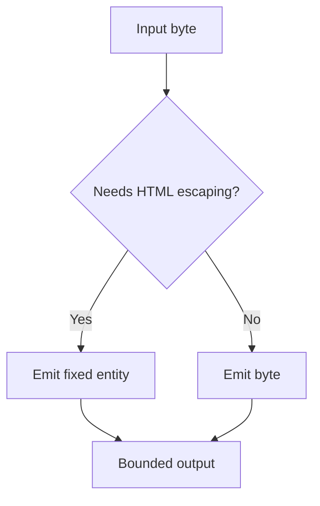

# Output primitives

[Module overview](00-module.md) · [Next: scanning patterns](02-scanning.md)

Three small functions carry the repeated output operations. Calls stay inside
Wasm; there is no host round trip per character. The output cursor is global 0.
`emit` checks the capacity; callers either supply fixed markup bytes or go
through `text`, which escapes input. No input byte is interpreted as HTML.

```text
emit(c):
    if cursor >= 0x100000: trap
    memory[cursor++] = c
text(c):
    if c == '&': literal(117)
    else if c == '<': literal(123)
    else if c == '>': literal(128)
    else if c == '"': literal(133)
    else: emit(c)
literal(offset):
    p = 0x100000 + offset
    while memory[p] != 0: emit(memory[p++])
```



## Function 0: emit

Parameter c is local 0. The store precedes the cursor increment. The bound is
the start of literal data, so writing output cannot overwrite the templates.

`[microwasm]`

- emit-record: `{{size:emit-body}}`
  - emit-body: `00`
    - emit-bound: `23 00 41 8080c000 4f 04 40 00 0b`
    - emit-byte: `23 00 20 00 3a 00 00`
    - emit-advance: `23 00 41 01 6a 24 00 0b`

## Function 1: escaped byte

Early returns keep the entity cases flat. Entity offsets refer to the
[visible literal table](05-data.md); they are not host-generated strings.
Escaping quotes here also makes this same primitive safe inside attributes.

`[microwasm]`

- text-record: `{{size:text-body}}`
  - text-body: `00`
    - text-amp: `20 00 41 26 46 04 40 41 f500 10 02 0f 0b`
    - text-lt: `20 00 41 3c 46 04 40 41 fb00 10 02 0f 0b`
    - text-gt: `20 00 41 3e 46 04 40 41 8001 10 02 0f 0b`
    - text-quote: `20 00 41 22 46 04 40 41 8501 10 02 0f 0b`
    - text-ordinary: `20 00 10 00 0b`

## Function 2: fixed literal

Locals p=1 and c=2 walk a NUL-terminated literal. Only internal fixed offsets
call this function. The document's byte text is never used as a literal offset.

`[microwasm]`

- literal-record: `{{size:literal-body}}`
  - literal-body: `01 02 7f`
    - literal-start: `41 8080c000 20 00 6a 21 01`
    - literal-exit: `02 40`
      - literal-loop: `03 40`
        - literal-read: `20 01 2d 00 00 22 02 45 0d 01`
        - literal-emit: `20 02 10 00`
        - literal-next: `20 01 41 01 6a 21 01 0c 00 0b`
      - literal-done: `0b 0b`
