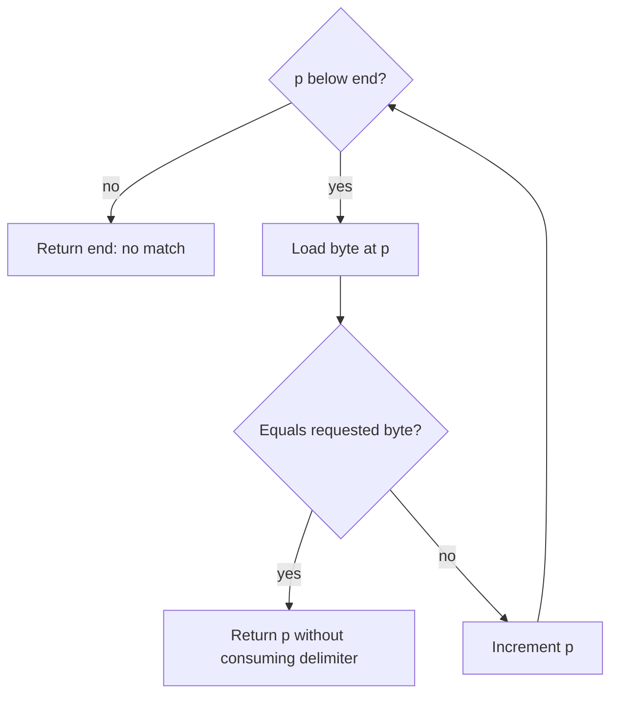

# Patterns: bounded scans and escaped spans

[Output primitives](01-output.md) · [Next: inline constructs](03-inline.md)

The same two loops recur in line scanning, inline code and links. Keeping them
as functions makes the actual byte lists easier to review. Neither helper
allocates memory, builds a token array or creates a parsed document tree.
All spans use half-open byte offsets, not Unicode character indices.

```text
find(p, end, byte):
    while p < end:
        if memory[p] == byte: return p
        p += 1
    return end
escaped(p, end):
    while p < end: text(memory[p++])
```

## Function 3: find

The end sentinel is also the not-found result. The loop checks the bound before
loading. Callers can distinguish a delimiter at the last byte from no delimiter
without an additional Boolean result. Parameters p, end, byte occupy 0..2.



There are two different exits. `find-bound` branches out of the loop's
enclosing block, reaching the final return of `end`. `find-match` returns
from the function immediately with `p`. A match at `end - 1` is valid; an
empty span never loads memory. The caller, not `find`, decides whether and
how far to advance beyond the delimiter it found.

`[microwasm]`

- find-record: `{{size:find-body}}`
  - find-body: `00`
    - find-exit: `02 40`
      - find-loop: `03 40`
        - find-bound: `20 00 20 01 4f 0d 01` — Leave the enclosing block on exhaustion, before any load.
        - find-match: `20 00 2d 00 00 20 02 46 04 40 20 00 0f 0b` — A match returns its position, not the position after it.
        - find-next: `20 00 41 01 6a 21 00 0c 00 0b` — Only a mismatch increments the local cursor and repeats.
      - find-done: `0b`
    - find-result: `20 01 0b`

## Function 4: escaped span

This is used for code fences, inline code, link labels and link destinations.
It shares the escaping policy instead of duplicating it at every call site.

This loop has no early match exit: while `p < end`, load one source byte,
call the escaped-byte writer, then increment `p`. The writer may emit several
bytes, so input and output positions do not advance together. For example,
an ampersand consumes one input byte and emits five bytes, `&amp;`.
Its output bound is enforced by the underlying writer, not by estimating
expansion here. Neither helper changes its caller's cursor local; callers
explicitly assign the span end after consuming it.

`[microwasm]`

- escaped-record: `{{size:escaped-body}}`
  - escaped-body: `00`
    - escaped-exit: `02 40`
      - escaped-loop: `03 40`
        - escaped-bound: `20 00 20 01 4f 0d 01`
        - escaped-byte: `20 00 2d 00 00 10 01`
        - escaped-next: `20 00 41 01 6a 21 00 0c 00 0b`
      - escaped-done: `0b 0b`

## Failed scans must still make progress

The inline parser consumes a scanned span even when it cannot recognize a
complete construct. If its terminator is missing, it emits the remainder
literally. This avoids repeatedly scanning the same suffix on malformed input
such as a long run of opening brackets. It is a deliberate partial-Markdown
rule, not a claim to implement CommonMark's delimiter algorithm.
