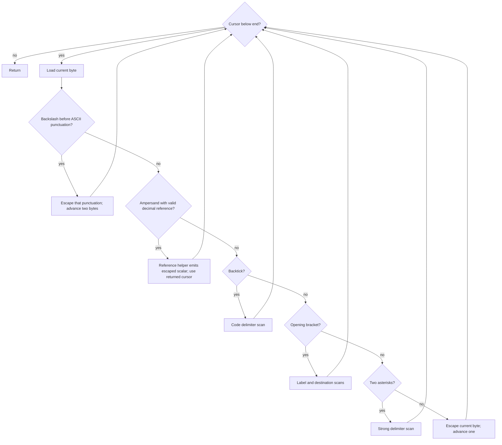
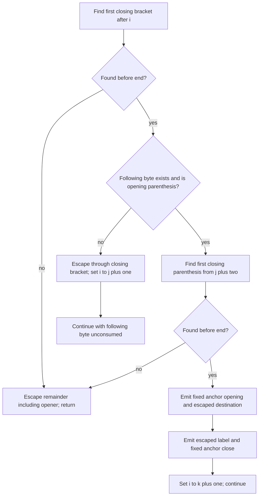

# Inline code, emphasis and links

[Scanning patterns](02-scanning.md) · [Next: block structure](04-blocks.md)

Function 5 scans one span. It recognizes punctuation escapes, decimal character
references, single-backtick code, double-asterisk strong emphasis and simple
links. Construct contents use the escaped-span helper, not recursive inline
parsing. Everything else goes through the escaped-byte helper. In particular,
`<script>` in Markdown is ordinary visible text.

## Inside the loop: ordered dispatch

These checks run in order. A successful branch assigns the next cursor and
branches back to the loop; it never falls through to escape the opener again.
An unrecognized opener reaches the ordinary-byte path unless a delimiter scan
has already examined a longer span.

The three delimiter-scan boxes below have their own return paths: if a closing
delimiter is absent, they escape the remaining span and return from `inline`.
They do not go around the outer loop again with the same opener.

| Local | Meaning while scanning | When it changes |
| --- | --- | --- |
| 0: start | Original span start | Never; copied into `i` once |
| 1: end | Exclusive source bound | Never |
| 2: i | First byte not yet consumed | At a successful construct, a literal fallback, or the ordinary-byte step |
| 3: c | Byte originally loaded at `i` | Once per outer iteration |
| 4: j | Escape byte, returned reference end, or first delimiter position | Reused by mutually exclusive branches |
| 5: k | Closing parenthesis position | Only during a possible link |

### Code: a closing backtick commits the span

Search from `i + 1` for the next backtick. If found at `j`, emit the fixed
`<code>` literal, escape `[i + 1, j)`, close the element, and set `i = j + 1`.
If not found, escape `[i, end)` including the opener and return. This parser
does not implement matching runs of backticks: adjacent ticks can therefore
describe an empty code span. Contents are not sent back through `inline`.

### Links: three separate decisions after the opening bracket

For `[a]x`, the non-link fallback consumes `[a]`, leaving `x` for the next
iteration. For `[a](unfinished`, the missing target close consumes the whole
remainder literally. These are different outcomes, not one generic “not a
link” branch. Searches do not balance nested brackets/parentheses, interpret
backslash escapes within the spans, or accept Markdown link titles.

The destination span is `[j + 2, k)` and the label span `[i + 1, j)`.
Their output order is reversed: the destination appears first in the anchor
attribute, followed by the label as element text. Only offsets are retained;
there is no copied label buffer.

### Strong: a first unmatched star is not skipped speculatively

After `**`, find the first next `*`. No star means escape the remainder and
return. If that star is followed by another `*`, emit strong markup around
the escaped interior and set `i = j + 2`. Otherwise escape through that first
single star, set `i = j + 1`, and continue. It does **not** keep searching for
a later pair, or recursively parse constructs within that failed span.

For `**a*b**`, the failed scan consumes `**a*` literally, leaving `b**` to
the outer loop. That limitation is deliberate in this partial renderer. It
also prevents each opening delimiter from rescanning the same long suffix.

### Why the branch depths differ

At `inline-strong-next`, the active labels from innermost to outermost are
the closing-star `if`, closing-room `if`, double-star `if`, opening-room `if`,
star `if`, outer `loop`, and outer exit `block`. `br 5` therefore repeats the
loop. At `inline-code-next`, there is only the code `if` inside that loop, so
`br 1` repeats it. Neither instruction means “skip five lines” or “return”.

The progress invariant is local to this function: every non-returning branch
sets `i` strictly beyond its old value. A failed scan consumes what it scanned
rather than restarting one byte later. Escaping can expand the output but
cannot advance `i`; the parser must make that assignment itself.

## Link output is inert

For a link, the destination is escaped inside `data-href`, followed by the
escaped label. No URL interpretation occurs in Wasm. The host's local-document
allowlist is a separate step. These examples stay inert without that step:

- [External example](https://example.com/)
- [Blocked scheme](javascript:evil)
- [Local pattern page](02-scanning.md)

`[microwasm]`

- inline-record: `{{size:inline-body}}`
  - inline-body: `01 04 7f`
    - inline-start: `20 00 21 02`
    - inline-exit: `02 40`
      - inline-loop: `03 40`
        - inline-bound: `20 02 20 01 4f 0d 01`
        - inline-read: `20 02 2d 00 00 21 03`
        - inline-backslash: `20 03 41 dc00 46 20 02 41 01 6a 20 01 49 71 04 40`
          - inline-backslash-next: `20 02 2d 00 01 21 04`
          - inline-backslash-punctuation: `20 04 41 21 6b 41 0e 4d 20 04 41 3a 6b 41 06 4d 72 20 04 41 db00 6b 41 05 4d 72 20 04 41 fb00 6b 41 03 4d 72 04 40`
            - inline-backslash-escaped: `20 04 10 01 20 02 41 02 6a 21 02 0c 02 0b 0b`
        - inline-entity: `20 03 41 26 46 04 40`
          - inline-entity-read: `20 02 20 01 10 0a 22 04 04 40 20 04 21 02 0c 02 0b 0b`
        - inline-code: `20 03 41 e000 46 04 40`
          - inline-code-find: `20 02 41 01 6a 20 01 41 e000 10 03 21 04`
          - inline-code-missing: `20 04 20 01 46 04 40 20 02 20 01 10 04 0f 0b` — No closer: escape the entire suffix once, then return.
          - inline-code-open: `41 3c 10 02`
          - inline-code-text: `20 02 41 01 6a 20 04 10 04`
          - inline-code-close: `41 c300 10 02`
          - inline-code-next: `20 04 41 01 6a 21 02 0c 01 0b`
        - inline-link: `20 03 41 db00 46 04 40`
          - inline-label-find: `20 02 41 01 6a 20 01 41 dd00 10 03 21 04`
          - inline-label-missing: `20 04 20 01 46 04 40 20 02 20 01 10 04 0f 0b`
          - inline-link-room: `20 04 41 01 6a 20 01 49 04 40`
            - inline-link-paren: `20 04 2d 00 01 41 28 46 04 40`
              - inline-target-find: `20 04 41 02 6a 20 01 41 29 10 03 21 05`
              - inline-target-missing: `20 05 20 01 46 04 40 20 02 20 01 10 04 0f 0b`
              - inline-link-open: `41 de00 10 02`
              - inline-link-target: `20 04 41 02 6a 20 05 10 04`
              - inline-link-label: `41 ed00 10 02 20 02 41 01 6a 20 04 10 04`
              - inline-link-close: `41 f000 10 02`
              - inline-link-next: `20 05 41 01 6a 21 02 0c 03 0b`
            - inline-link-room-end: `0b`
          - inline-not-link: `20 02 20 04 41 01 6a 10 04 20 04 41 01 6a 21 02 0c 01 0b` — Consume through the bracket, not the following non-parenthesis byte.
        - inline-star: `20 03 41 2a 46 04 40`
          - inline-star-room: `20 02 41 01 6a 20 01 49 04 40`
            - inline-double-star: `20 02 2d 00 01 41 2a 46 04 40`
              - inline-star-find: `20 02 41 02 6a 20 01 41 2a 10 03 21 04`
              - inline-star-missing: `20 04 20 01 46 04 40 20 02 20 01 10 04 0f 0b`
              - inline-close-room: `20 04 41 01 6a 20 01 49 04 40`
                - inline-close-star: `20 04 2d 00 01 41 2a 46 04 40`
                  - inline-strong-open: `41 cb00 10 02`
                  - inline-strong-text: `20 02 41 02 6a 20 04 10 04`
                  - inline-strong-close: `41 d400 10 02`
                  - inline-strong-next: `20 04 41 02 6a 21 02 0c 05 0b` — Consume both closing stars; depth 5 targets the outer input loop.
                - inline-close-room-end: `0b`
              - inline-not-strong: `20 02 20 04 41 01 6a 10 04 20 04 41 01 6a 21 02 0c 03 0b`
            - inline-star-room-end: `0b`
          - inline-star-end: `0b`
        - inline-plain: `20 03 10 01`
        - inline-next: `20 02 41 01 6a 21 02 0c 00 0b`
      - inline-done: `0b 0b`
