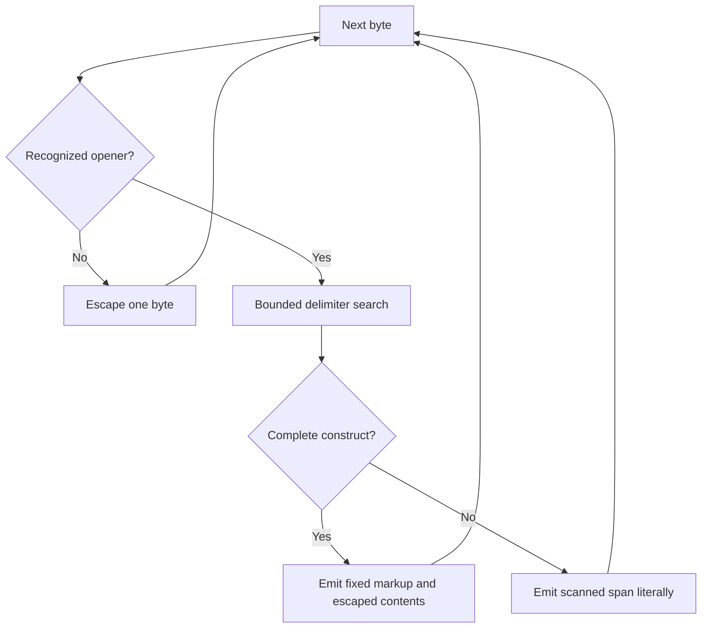

# Inline code, emphasis and links

[Scanning patterns](02-scanning.md) · [Next: block structure](04-blocks.md)

Function 5 scans one span. It recognizes single-backtick code, double-asterisk
strong emphasis and simple links. Their contents use the escaped-span helper,
not recursive inline parsing. Everything else goes through the escaped-byte
helper. In particular, `<script>` in Markdown is ordinary visible text.

```text
inline(start, end):
    i = start
    while i < end:
        if a complete `code`, **strong**, or [label](target) starts at i:
            emit fixed opening markup
            escaped(content_start, content_end)
            emit fixed closing markup
            i = end of construct
        else if a delimiter search has consumed a non-matching span:
            escaped(i, scanned_end); i = scanned_end
        else:
            text(memory[i++])
```



Locals are start=0, end=1, i=2, c=3, j=4, k=5. Each successful branch jumps
back to the outer loop. The branch depth counts the enclosing ifs as well as
the loop: that is why the nested strong-emphasis case uses depth 5.

## Link output is inert

For a link, the destination is escaped inside `data-href`, followed by the
escaped label. No URL interpretation occurs in Wasm. The host's local-document
allowlist is a separate step. These examples stay inert without that step:

- [External example](https://example.com/)
- [Blocked scheme](javascript:evil)
- [Local pattern page](02-scanning.md)

`[microwasm]`

- inline-record: `{{size:inline-body}}`
  - inline-body: `01 04 7f`
    - inline-start: `20 00 21 02`
    - inline-exit: `02 40`
      - inline-loop: `03 40`
        - inline-bound: `20 02 20 01 4f 0d 01`
        - inline-read: `20 02 2d 00 00 21 03`
        - inline-backslash: `20 03 41 dc00 46 20 02 41 01 6a 20 01 49 71 04 40`
          - inline-backslash-next: `20 02 2d 00 01 21 04`
          - inline-backslash-punctuation: `20 04 41 21 6b 41 0e 4d 20 04 41 3a 6b 41 06 4d 72 20 04 41 db00 6b 41 05 4d 72 20 04 41 fb00 6b 41 03 4d 72 04 40`
            - inline-backslash-escaped: `20 04 10 01 20 02 41 02 6a 21 02 0c 02 0b 0b`
        - inline-entity: `20 03 41 26 46 04 40`
          - inline-entity-read: `20 02 20 01 10 0a 22 04 04 40 20 04 21 02 0c 02 0b 0b`
        - inline-code: `20 03 41 e000 46 04 40`
          - inline-code-find: `20 02 41 01 6a 20 01 41 e000 10 03 21 04`
          - inline-code-missing: `20 04 20 01 46 04 40 20 02 20 01 10 04 0f 0b`
          - inline-code-open: `41 3c 10 02`
          - inline-code-text: `20 02 41 01 6a 20 04 10 04`
          - inline-code-close: `41 c300 10 02`
          - inline-code-next: `20 04 41 01 6a 21 02 0c 01 0b`
        - inline-link: `20 03 41 db00 46 04 40`
          - inline-label-find: `20 02 41 01 6a 20 01 41 dd00 10 03 21 04`
          - inline-label-missing: `20 04 20 01 46 04 40 20 02 20 01 10 04 0f 0b`
          - inline-link-room: `20 04 41 01 6a 20 01 49 04 40`
            - inline-link-paren: `20 04 2d 00 01 41 28 46 04 40`
              - inline-target-find: `20 04 41 02 6a 20 01 41 29 10 03 21 05`
              - inline-target-missing: `20 05 20 01 46 04 40 20 02 20 01 10 04 0f 0b`
              - inline-link-open: `41 de00 10 02`
              - inline-link-target: `20 04 41 02 6a 20 05 10 04`
              - inline-link-label: `41 ed00 10 02 20 02 41 01 6a 20 04 10 04`
              - inline-link-close: `41 f000 10 02`
              - inline-link-next: `20 05 41 01 6a 21 02 0c 03 0b`
            - inline-link-room-end: `0b`
          - inline-not-link: `20 02 20 04 41 01 6a 10 04 20 04 41 01 6a 21 02 0c 01 0b`
        - inline-star: `20 03 41 2a 46 04 40`
          - inline-star-room: `20 02 41 01 6a 20 01 49 04 40`
            - inline-double-star: `20 02 2d 00 01 41 2a 46 04 40`
              - inline-star-find: `20 02 41 02 6a 20 01 41 2a 10 03 21 04`
              - inline-star-missing: `20 04 20 01 46 04 40 20 02 20 01 10 04 0f 0b`
              - inline-close-room: `20 04 41 01 6a 20 01 49 04 40`
                - inline-close-star: `20 04 2d 00 01 41 2a 46 04 40`
                  - inline-strong-open: `41 cb00 10 02`
                  - inline-strong-text: `20 02 41 02 6a 20 04 10 04`
                  - inline-strong-close: `41 d400 10 02`
                  - inline-strong-next: `20 04 41 02 6a 21 02 0c 05 0b`
                - inline-close-room-end: `0b`
              - inline-not-strong: `20 02 20 04 41 01 6a 10 04 20 04 41 01 6a 21 02 0c 03 0b`
            - inline-star-room-end: `0b`
          - inline-star-end: `0b`
        - inline-plain: `20 03 10 01`
        - inline-next: `20 02 41 01 6a 21 02 0c 00 0b`
      - inline-done: `0b 0b`
