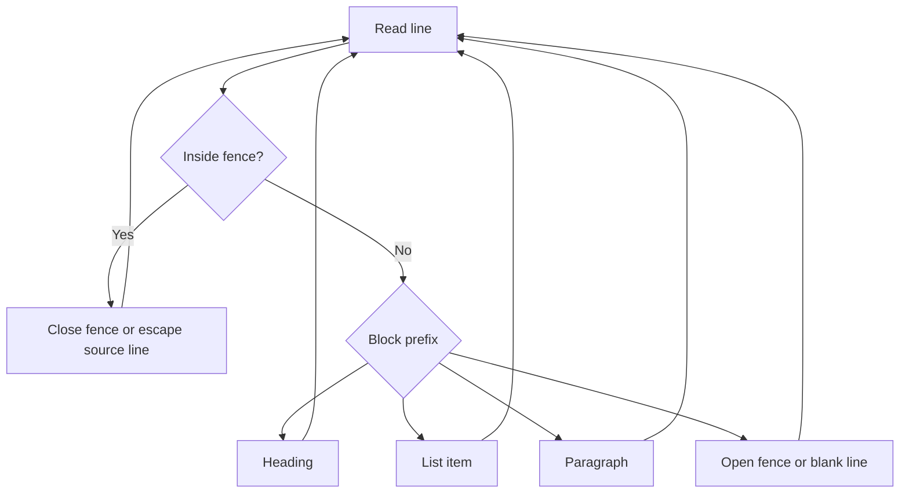

# Block structure and line state

[Inline constructs](03-inline.md) · [Next: literal data](05-data.md)

The block parser scans the input once, keeping only byte offsets and small
state values. It joins paragraph lines with spaces. Fences preserve line
breaks and bypass inline parsing; a Mermaid fence is displayed as source.
CRLF input is normalized to LF in fences. No token tree is retained.

## Pattern: closing nested lists

Every open list has one open item. Moving from depth 3 to depth 1 closes two
items and their lists; the caller then closes the previous depth-1 item before
opening its sibling. That invariant avoids a stack of per-level flags.

```text
close_lists(target):
    while list_depth > target:
        literal(27)  // </li>\n
        literal(15)  // </ul>\n
        list_depth -= 1
```

`[microwasm]`

- close-record: `{{size:close-body}}`
  - close-body: `00`
    - close-exit: `02 40`
      - close-loop: `03 40`
        - close-bound: `23 01 20 00 4d 0d 01`
        - close-tags: `41 1b 10 02 41 0f 10 02`
        - close-depth: `23 01 41 01 6b 24 01 0c 00 0b`
      - close-done: `0b 0b`

## Function 7: run

Locals: length 0, pos 1, end 2, start 3, fence-prefix 4, indent 5, target depth 6,
heading level 7, paragraph-open 8, fence-open 9, next-line 10.

```text
for each line [pos, end):
    next_line = position after LF, or length + 1 at EOF
    strip trailing CR from the span
    if fence_open:
        if line starts with ``` : close fence
        else: escaped(pos, end); emit('\n')
    else if blank: close paragraph
    else if line starts with ``` : close other blocks; open fence
    else if 1..6 hashes followed by space:
        close other blocks; emit heading with inline contents
    else if even indentation followed by '- ':
        close paragraph; adjust list depth; emit inline item
    else:
        close lists; open or continue paragraph; emit inline span
close paragraph, lists and any unterminated fence
return output length
```



Closing a paragraph appears at several transitions: test local 8, emit
literal 4, then clear local 8. It stays inline because the state is local and
the sequence is short; moving it into a helper would require another global
or an extra argument/result convention. The larger repeated scans use the
[shared helpers](02-scanning.md) instead.

`[microwasm]`

- run-record: `{{size:run-body}}`
  - run-body: `01 0a 7f`
    - run-bound: `20 00 41 808010 4b 04 40 00 0b`
    - run-reset: `41 808010 24 00 41 00 24 01`
    - run-exit: `02 40`
      - run-loop: `03 40`
        - run-finished: `20 01 20 00 4f 0d 01`
        - run-line: `20 01 20 00 41 0a 10 03 22 02 41 01 6a 21 0a 20 01 21 03`
        - run-cr-room: `20 02 20 01 4b 04 40`
          - run-cr: `20 02 41 01 6b 2d 00 00 41 0d 46 04 40 20 02 41 01 6b 21 02 0b 0b`
        - run-reset-fence-prefix: `41 00 21 04`
        - run-fence-room: `20 02 20 03 6b 41 03 4f 04 40`
          - run-fence-prefix: `20 03 2d 00 00 41 e000 46 20 03 2d 00 01 41 e000 46 71 20 03 2d 00 02 41 e000 46 71 21 04 0b`
        - run-in-fence: `20 09 04 40`
          - run-fence-close-test: `20 04 04 40`
            - run-fence-close: `41 2e 10 02 41 00 21 09`
            - run-fence-source: `05 20 03 20 02 10 04 41 0a 10 00 0b`
          - run-fence-next: `20 0a 21 01 0c 01 0b`
        - run-blank: `20 03 20 02 46 04 40`
          - run-blank-close-p: `20 08 04 40 41 04 10 02 41 00 21 08 0b`
          - run-blank-next: `20 0a 21 01 0c 01 0b`
        - run-open-fence: `20 04 04 40`
          - run-open-close-p: `20 08 04 40 41 04 10 02 41 00 21 08 0b`
          - run-open-pre: `41 00 10 06 41 22 10 02 41 01 21 09`
          - run-open-next: `20 0a 21 01 0c 01 0b`
        - run-heading-reset: `41 00 21 07`
        - run-hash-exit: `02 40`
          - run-hash-loop: `03 40`
            - run-hash-bound: `20 03 20 02 4f 20 07 41 06 4f 72 0d 01`
            - run-hash-byte: `20 03 2d 00 00 41 23 47 0d 01`
            - run-hash-next: `20 03 41 01 6a 21 03 20 07 41 01 6a 21 07 0c 00 0b`
          - run-hash-done: `0b`
        - run-heading: `20 07 04 40`
          - run-heading-room: `20 03 20 02 49 04 40`
            - run-heading-space: `20 03 2d 00 00 41 20 46 04 40`
              - run-heading-close-p: `20 08 04 40 41 04 10 02 41 00 21 08 0b`
              - run-heading-close-lists: `41 00 10 06`
              - run-heading-open-tag: `41 3c 10 00 41 e800 10 00 20 07 41 30 6a 10 00 41 3e 10 00`
              - run-heading-text: `20 03 41 01 6a 20 02 10 05`
              - run-heading-close-tag: `41 3c 10 00 41 2f 10 00 41 e800 10 00 20 07 41 30 6a 10 00 41 3e 10 00 41 0a 10 00`
              - run-heading-next: `20 0a 21 01 0c 03 0b`
            - run-heading-room-end: `0b`
          - run-heading-end: `0b`
        - run-indent-reset: `20 01 21 03 41 00 21 05`
        - run-indent-exit: `02 40`
          - run-indent-loop: `03 40`
            - run-indent-bound: `20 03 20 02 4f 0d 01`
            - run-indent-byte: `20 03 2d 00 00 41 20 47 0d 01`
            - run-indent-next: `20 03 41 01 6a 21 03 20 05 41 01 6a 21 05 0c 00 0b`
          - run-indent-done: `0b`
        - run-list-room: `20 03 41 01 6a 20 02 49 04 40`
          - run-list-marker: `20 03 2d 00 00 41 2d 46 20 03 2d 00 01 41 20 46 71 04 40`
            - run-list-close-p: `20 08 04 40 41 04 10 02 41 00 21 08 0b`
            - run-list-indent-check: `20 05 41 01 71 04 40 00 0b`
            - run-list-target: `20 05 41 01 76 41 01 6a 21 06`
            - run-list-deeper: `20 06 23 01 4b 04 40`
              - run-list-depth-check: `20 06 23 01 41 01 6a 47 04 40 00 0b`
              - run-list-open: `41 0a 10 02 41 16 10 02 20 06 24 01`
              - run-list-sibling: `05 20 06 10 06 41 1b 10 02 41 16 10 02 0b`
            - run-list-text: `20 03 41 02 6a 20 02 10 05`
            - run-list-next: `20 0a 21 01 0c 02 0b`
          - run-list-room-end: `0b`
        - run-prose-close-lists: `41 00 10 06`
        - run-paragraph: `20 08 04 40 41 20 10 00 05 41 00 10 02 41 01 21 08 0b`
        - run-prose: `20 01 20 02 10 05`
        - run-next: `20 0a 21 01 0c 00 0b`
      - run-done: `0b`
    - run-final-p: `20 08 04 40 41 04 10 02 0b`
    - run-final-lists: `41 00 10 06`
    - run-final-fence: `20 09 04 40 41 2e 10 02 0b`
    - run-result: `23 00 41 808010 6b 0b`
