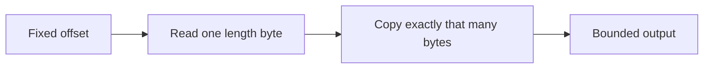

# Fixed HTML literals

[Block structure](04-blocks.md) · [Back to the module](00-module.md)

The literal writer takes an offset into this length-prefixed string table.
Each record starts with one unsigned 8-bit byte length, followed by its bytes.
Lengths are 0..255; zero means an empty string, not an end-of-table marker.
This is a small explicit-length format, not the WIT canonical string ABI.
The hex is the source of truth; the descriptions show each string's role and
offset. There is no generated or hidden HTML template. Input never supplies
one of these offsets.

```text
literal(offset):
    p = 0x100000 + offset
    remaining = memory[p++]
    while remaining > 0:
        emit(memory[p++]); remaining -= 1
```



The active data segment targets memory zero. Its offset expression is
`i32.const 0x100000; end`; both the section size and byte vector size are
resolved from visible lists. Decimal offsets below match the calls on the
[output](01-output.md), [inline](03-inline.md) and [block](04-blocks.md) pages.

`[microwasm]`

- md-data-section: `0b {{size:md-data}}`
  - md-data: `01 00 41 8080c000 0b {{size:md-literals}}`
    - md-literals:
      - html-p-open: `03 3c703e` — 0: `<p>`.
      - html-p-close: `05 3c2f703e0a` — 4: `</p>` and newline.
      - html-ul-open: `04 3c756c3e` — 10: `<ul>`.
      - html-ul-close: `06 3c2f756c3e0a` — 15: `</ul>` and newline.
      - html-li-open: `04 3c6c693e` — 22: `<li>`.
      - html-li-close: `06 3c2f6c693e0a` — 27: `</li>` and newline.
      - html-pre-open: `0b 3c7072653e3c636f64653e` — 34: `<pre><code>`.
      - html-pre-close: `0d 3c2f636f64653e3c2f7072653e` — 46: `</code></pre>`.
      - html-code-open: `06 3c636f64653e` — 60: `<code>`.
      - html-code-close: `07 3c2f636f64653e` — 67: `</code>`.
      - html-strong-open: `08 3c7374726f6e673e` — 75: `<strong>`.
      - html-strong-close: `09 3c2f7374726f6e673e` — 84: `</strong>`.
      - html-a-open: `0e 3c6120646174612d687265663d22` — 94: `<a data-href="`.
      - html-a-label: `02 223e` — 109: `">`.
      - html-a-close: `04 3c2f613e` — 112: `</a>`.
      - html-amp: `05 26616d703b` — 117: `&amp;`.
      - html-lt: `04 266c743b` — 123: `&lt;`.
      - html-gt: `04 2667743b` — 128: `&gt;`.
      - html-quote: `06 2671756f743b` — 133: `&quot;`.

Keeping this table separate makes repeated output patterns easy to audit.
The renderer does not pass through raw HTML found in a Markdown document.
