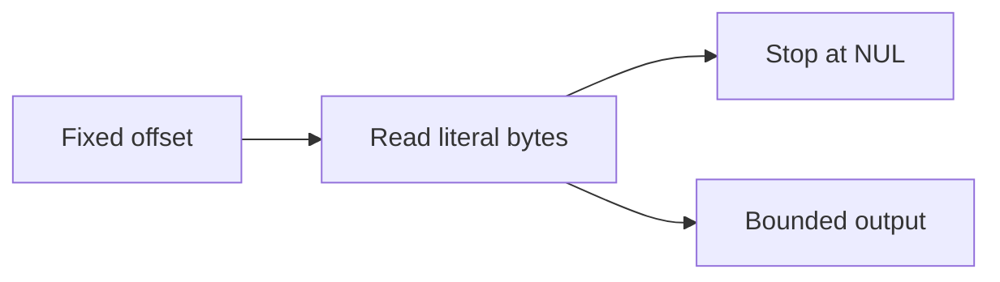

# Fixed HTML literals

[Block structure](04-blocks.md) · [Back to the module](00-module.md)

The literal writer takes an offset into this NUL-terminated string table.
The hex is the source of truth; the descriptions show each string's role and
offset. There is no generated or hidden HTML template. Input never supplies
one of these offsets.

```text
literal(offset):
    p = 0x100000 + offset
    while memory[p] != 0: emit(memory[p++])
```



The active data segment targets memory zero. Its offset expression is
`i32.const 0x100000; end`; both the section size and byte vector size are
resolved from visible lists. Decimal offsets below match the calls on the
[output](01-output.md), [inline](03-inline.md) and [block](04-blocks.md) pages.

`[microwasm]`

- md-data-section: `0b {{size:md-data}}`
  - md-data: `01 00 41 8080c000 0b {{size:md-literals}}`
    - md-literals:
      - html-p-open: `3c703e00` — 0: `<p>`.
      - html-p-close: `3c2f703e0a00` — 4: `</p>` and newline.
      - html-ul-open: `3c756c3e00` — 10: `<ul>`.
      - html-ul-close: `3c2f756c3e0a00` — 15: `</ul>` and newline.
      - html-li-open: `3c6c693e00` — 22: `<li>`.
      - html-li-close: `3c2f6c693e0a00` — 27: `</li>` and newline.
      - html-pre-open: `3c7072653e3c636f64653e00` — 34: `<pre><code>`.
      - html-pre-close: `3c2f636f64653e3c2f7072653e00` — 46: `</code></pre>`.
      - html-code-open: `3c636f64653e00` — 60: `<code>`.
      - html-code-close: `3c2f636f64653e00` — 67: `</code>`.
      - html-strong-open: `3c7374726f6e673e00` — 75: `<strong>`.
      - html-strong-close: `3c2f7374726f6e673e00` — 84: `</strong>`.
      - html-a-open: `3c6120646174612d687265663d2200` — 94: `<a data-href="`.
      - html-a-label: `223e00` — 109: `">`.
      - html-a-close: `3c2f613e00` — 112: `</a>`.
      - html-amp: `26616d703b00` — 117: `&amp;`.
      - html-lt: `266c743b00` — 123: `&lt;`.
      - html-gt: `2667743b00` — 128: `&gt;`.
      - html-quote: `2671756f743b00` — 133: `&quot;`.

Keeping this table separate makes repeated output patterns easy to audit.
The renderer does not pass through raw HTML found in a Markdown document.
