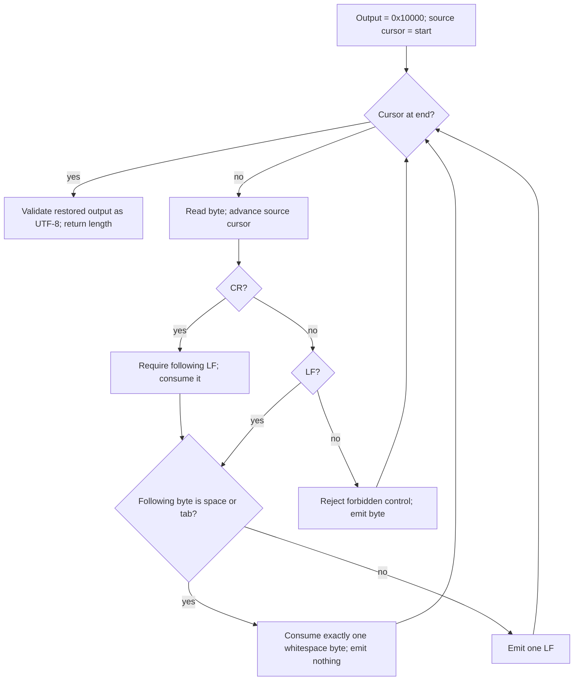
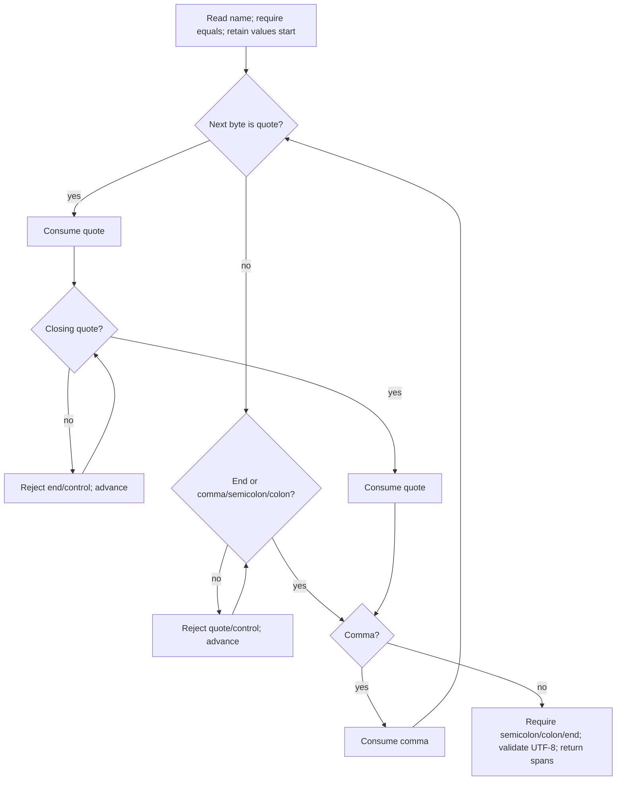

# iCalendar physical lines and content-line spans

This shared helper prepares the iCalendar agenda pair. It is not a counted
transformation, an event validator, or a recurrence/time-zone engine.
It imports only `n.memory` from the shared number scanner: four fixed pages.
All scanning and byte movement happen in Wasm.

The framing rules follow
[RFC 5545 section 3.1](https://www.rfc-editor.org/rfc/rfc5545.html#section-3.1).
A folded line break removes the break and exactly one following space or tab.
Unfolding precedes UTF-8 validation, including when a fold splits an encoded
character. As a Markdown-editing convenience, this helper also accepts LF
line endings; output from unfolding uses LF. Bare CR is rejected.

## Interfaces

- `unfold(start, end) -> length`: source is within the first 64 KiB; copy
  unfolded bytes to `0x10000`. Return their byte length. The source remains
  unchanged. No final newline is invented. Empty input is allowed here.
- `line(start, end) -> (nameEnd, parametersEnd, valueStart, valueEnd, next)`:
  read one already unfolded content line. The name starts at the supplied
  start; parameters occupy `nameEnd..<parametersEnd`, including their leading
  semicolons. `parametersEnd` points at the separating colon. Values are
  unmodified spans. `next` is after LF, or at end for an unterminated last line.
  At end of input, all five returned offsets equal end.
- `parameter(start, end) -> (nameEnd, valuesStart, valuesEnd)`:
  start points at a parameter name, after its semicolon. The equals sign is
  at nameEnd. Values retain quotes, commas and original spelling; valuesEnd
  points at the next semicolon/colon outside quotes, or at end.
- `nameEnd(start, end) -> offset`: require a nonempty ASCII token made from
  letters, digits and hyphens. Case is retained. This helper does not apply
  property-specific registered-name restrictions.
- `utf8(start, end)`: require valid UTF-8, trapping on malformed sequences.
  It checks encoding, not property semantics.

Read-only entry points accept spans through `0x30000`, so they can examine
either source or the unfolded buffer. All ends are exclusive. Out-of-range
spans trap rather than wrapping. No helper writes the fourth page.

Property/parameter controls are rejected except TAB. Parameter values may be
quoted and comma-separated; separators inside quotes are ordinary data.
Empty parameter values are lexically permitted. Backslash does not escape
a parameter quote. Property-value backslash escapes, RFC 6868 caret escapes,
case-insensitive name comparison and field-specific types belong to the
next layer; this helper retains the information needed for them.

## Inside unfold: advance the source, not the UTF-8 decoder

`cl-unfold-loop` has one source cursor. Each pass consumes a byte first.
On CR it additionally requires and consumes LF; on either accepted newline,
it examines the following byte without consuming ordinary content.

For physical bytes `41 0d 0a 20 20 42`, the output is `41 20 42`:
the first space is the fold marker, the second is content. For
`f0 9f 0d 0a 09 98 80`, removing the fold restores `f0 9f 98 80`
(U+1F600). Validating each physical line first would reject this recoverable
sequence. A malformed sequence that remains after unfolding still traps.
The byte copy cannot grow its input; output is at most 64 KiB.

## Inside parameter: quote state changes what ends a value

Each pass parses one value, then decides whether a comma introduces another.
A quoted value scans to a closing quote; the next byte must be a delimiter
or end. An unquoted value stops before a comma, semicolon or colon.
Neither branch consumes the semicolon/colon: that delimiter belongs to the
content-line parser.

For `CN="Doe, Jane";ROLE=REQ-PARTICIPANT:mailto:jane@example.com`,
the comma inside CN never reaches the outer comma decision.
`cl-parameter-tail` returns the semicolon's position. The line loop consumes
that semicolon and calls parameter again for ROLE, whose ending colon
becomes the property's separator. The later colon in `mailto:` is value
data; the line parser does not interpret it as another header.

## Inside line: delimiter ownership is explicit

The first scan finds LF or end. The name scanner then leaves its first
non-token byte unconsumed. Each parameter call advances the header cursor
to its next delimiter; a colon ends the header. Values are checked for
controls and UTF-8 but not split, decoded, fetched or interpreted.

The loop cannot return to the same parameter: it always consumes a semicolon,
a nonempty name and an equals sign before receiving the next delimiter.
A blank line has no property name and traps. `BEGIN` and `END` are ordinary
names at this layer; matching component boundaries is the agenda reader's job.

## A targeted SIMD fast path for ASCII

Inside the existing ASCII branch, when at least sixteen input bytes remain,
load one vector and test its byte sign bits. A zero `i8x16.bitmask` means all
sixteen bytes are ASCII, so advance sixteen bytes at once. Otherwise use the
existing scalar state machine. Short tails remain scalar too.

The remaining-length check precedes the load, including for unaligned spans.
Skipping is forbidden while a continuation is pending: ASCII in that state
is an encoding error, not a block that may be ignored. ASCII control bytes
remain valid encoding here; application-specific control rules belong to
callers, as before. SIMD changes no validation policy and writes no memory.

The [binary instruction definitions](https://webassembly.github.io/spec/core/binary/instructions.html)
encode `v128.load` as `fd 00` and `i8x16.bitmask` as `fd 64`. The load's two
zero immediates specify byte alignment and zero offset. This is a selective
bulk-scan optimization, not a SIMD rewrite of the parsers.

The private ASCII helper consumes consecutive complete ASCII vectors, then
returns the last consumed byte's position. If no vector is consumed, it
returns the original position, whose first byte the caller already checked.
The scalar loop's existing one-byte increment therefore works in both cases.
Keeping the vector loop in a separate function avoids enlarging the hot
Unicode state-machine path. No vector load is attempted for short tails.

`deno bench --allow-read=. utf8_bench.ts` compares this path with the same
validator with only the labeled call site removed. That scalar reference is
benchmark-only; there is no runtime feature detection or fallback build.

## Module

Functions: unfold 0, emit 1, utf8 2, nameEnd 3, parameter 4, line 5, range 6,
ASCII-block scan 7.
The sole global is the unfold output pointer. The UTF-8 state machine is the
same range-checking pattern as [example 14](../examples/14-utf8-validation.md),
adapted to explicit spans and a trapping validation entry point.

`[microwasm]`

- cl-header: `0061736d 01000000`
- cl-type-section: `01 {{size:cl-types}}`
  - cl-types: `05 60 02 7f 7f 01 7f 60 01 7f 00 60 02 7f 7f 00 60 02 7f 7f 03 7f 7f 7f 60 02 7f 7f 05 7f 7f 7f 7f 7f`
- cl-import-section: `02 {{size:cl-imports}}`
  - cl-imports: `01 01 6e 06 6d656d6f7279 02 01 04 04`
- cl-function-section: `03 {{size:cl-functions}}`
  - cl-functions: `08 00 01 02 00 03 04 02 00`
- cl-global-section: `06 {{size:cl-globals}}`
  - cl-globals: `01 7f 01 41 00 0b`
- cl-export-section: `07 {{size:cl-exports}}`
  - cl-exports: `06 06 756e666f6c64 00 00 04 75746638 00 02 07 6e616d65456e64 00 03 09 706172616d65746572 00 04 04 6c696e65 00 05 06 6d656d6f7279 02 00`
- cl-code-section: `0a {{size:cl-code}}`
  - cl-code: `08`
    - cl-unfold-record: `{{size:cl-unfold-body}}`
      - cl-unfold-body: `01 02 7f 20 00 20 01 10 06 20 01 41 808004 4b 04 40 00 0b 41 808004 24 00 02 40 03 40 20 00 20 01 4f 0d 01`
        - cl-unfold-read: `20 00 2d 00 00 21 02 20 00 41 01 6a 21 00`
        - cl-unfold-cr: `20 02 41 0d 46 04 40 20 00 20 01 4f 04 40 00 0b 20 00 2d 00 00 41 0a 47 04 40 00 0b 20 00 41 01 6a 21 00 41 0a 21 02 0b`
        - cl-unfold-newline: `20 02 41 0a 46 04 40 20 00 20 01 49 04 40 20 00 2d 00 00 21 03 20 03 41 20 46 20 03 41 09 46 72 04 40 20 00 41 01 6a 21 00 0c 03 0b 0b`
          - cl-unfold-ordinary: `05 20 02 41 20 49 20 02 41 09 47 71 20 02 41 ff00 46 72 04 40 00 0b 0b`
        - cl-unfold-emit: `20 02 10 01 0c 00 0b 0b`
        - cl-unfold-valid: `41 808004 23 00 10 02 23 00 41 808004 6b 0b`
    - cl-emit-record: `{{size:cl-emit-body}}`
      - cl-emit-body: `00 23 00 41 808008 4f 04 40 00 0b 23 00 20 00 3a 00 00 23 00 41 01 6a 24 00 0b`
    - cl-utf8-record: `{{size:cl-utf8-body}}`
      - cl-utf8-body: `01 04 7f 20 00 20 01 10 06 41 8001 21 03 41 bf01 21 04 02 40 03 40 20 00 20 01 4f 0d 01`
        - cl-utf8-read: `20 00 2d 00 00 21 05`
        - cl-utf8-continuation: `20 02 04 40 20 05 20 03 49 20 05 20 04 4b 72 04 40 00 0b 20 02 41 01 6b 21 02 41 8001 21 03 41 bf01 21 04`
        - cl-utf8-lead: `05 20 05 41 8001 4f 04 40`
          - cl-utf8-two: `20 05 41 c201 4f 20 05 41 df01 4d 71 04 40 41 01 21 02`
          - cl-utf8-three: `05 20 05 41 e001 4f 20 05 41 ef01 4d 71 04 40 41 02 21 02 20 05 41 e001 46 04 40 41 a001 21 03 0b 20 05 41 ed01 46 04 40 41 9f01 21 04 0b`
          - cl-utf8-four: `05 20 05 41 f001 4f 20 05 41 f401 4d 71 04 40 41 03 21 02 20 05 41 f001 46 04 40 41 9001 21 03 0b 20 05 41 f401 46 04 40 41 8f01 21 04 0b`
          - cl-utf8-invalid: `05 00 0b 0b 0b`
          - cl-utf8-ascii-block: `05 20 01 20 00 6b 41 10 4f 04 40 20 00 20 01 10 07 21 00 0b`
        - cl-utf8-class-end: `0b 0b`
        - cl-utf8-next: `20 00 41 01 6a 21 00 0c 00 0b 0b 20 02 04 40 00 0b 0b`
    - cl-name-record: `{{size:cl-name-body}}`
      - cl-name-body: `01 02 7f 20 00 20 01 10 06 20 00 21 02 02 40 03 40 20 02 20 01 4f 0d 01 20 02 2d 00 00 21 03`
        - cl-name-class: `20 03 41 30 4f 20 03 41 39 4d 71 20 03 41 20 72 41 e100 4f 20 03 41 20 72 41 fa00 4d 71 72 20 03 41 2d 46 72 45 0d 01`
        - cl-name-next: `20 02 41 01 6a 21 02 0c 00 0b 0b 20 02 20 00 46 04 40 00 0b 20 02 0b`
    - cl-parameter-record: `{{size:cl-parameter-body}}`
      - cl-parameter-body: `01 04 7f 20 00 20 01 10 03 21 02 20 02 20 01 4f 04 40 00 0b 20 02 2d 00 00 41 3d 47 04 40 00 0b 20 02 41 01 6a 22 03 21 04 02 40 03 40`
        - cl-parameter-is-quoted: `20 04 20 01 49 04 7f 20 04 2d 00 00 41 22 46 05 41 00 0b 04 40 20 04 41 01 6a 21 04`
          - cl-parameter-quoted-loop: `02 40 03 40 20 04 20 01 4f 04 40 00 0b 20 04 2d 00 00 21 05 20 04 41 01 6a 21 04 20 05 41 22 46 0d 01`
            - cl-parameter-quoted-control: `20 05 41 20 49 20 05 41 09 47 71 20 05 41 ff00 46 72 04 40 00 0b 0c 00 0b 0b`
          - cl-parameter-unquoted: `05 02 40 03 40 20 04 20 01 4f 0d 01 20 04 2d 00 00 21 05 20 05 41 2c 46 20 05 41 3b 46 72 20 05 41 3a 46 72 0d 01`
            - cl-parameter-plain-control: `20 05 41 22 46 20 05 41 20 49 20 05 41 09 47 71 72 20 05 41 ff00 46 72 04 40 00 0b`
            - cl-parameter-plain-next: `20 04 41 01 6a 21 04 0c 00 0b 0b 0b`
        - cl-parameter-tail: `20 04 20 01 4f 0d 01 20 04 2d 00 00 21 05 20 05 41 2c 46 04 40 20 04 41 01 6a 21 04 0c 01 0b`
        - cl-parameter-delimiter: `20 05 41 3b 46 20 05 41 3a 46 72 45 04 40 00 0b 0c 01 0b 0b`
        - cl-parameter-return: `20 03 20 04 10 02 20 02 20 03 20 04 0b`
    - cl-line-record: `{{size:cl-line-body}}`
      - cl-line-body: `01 07 7f 20 00 20 01 10 06 20 00 20 01 46 04 40 20 01 20 01 20 01 20 01 20 01 0f 0b 20 00 21 02 02 40 03 40 20 02 20 01 4f 0d 01 20 02 2d 00 00 41 0a 46 0d 01 20 02 41 01 6a 21 02 0c 00 0b 0b`
        - cl-line-next: `20 02 20 02 20 01 49 6a 21 06 20 00 20 02 10 03 22 03 21 04`
        - cl-line-header: `02 40 03 40 20 04 20 02 4f 04 40 00 0b 20 04 2d 00 00 21 08 20 08 41 3a 46 0d 01 20 08 41 3b 47 04 40 00 0b 20 04 41 01 6a 20 02 10 04 21 04 1a 1a 0c 00 0b 0b`
        - cl-line-value: `20 04 41 01 6a 22 05 21 07 02 40 03 40 20 07 20 02 4f 0d 01 20 07 2d 00 00 21 08 20 08 41 20 49 20 08 41 09 47 71 20 08 41 ff00 46 72 04 40 00 0b 20 07 41 01 6a 21 07 0c 00 0b 0b`
        - cl-line-return: `20 00 20 02 10 02 20 03 20 04 20 05 20 02 20 06 0b`
    - cl-range-record: `{{size:cl-range-body}}`
      - cl-range-body: `00 20 00 20 01 4b 20 01 41 80800c 4b 72 04 40 00 0b 0b`
    - cl-ascii-record: `{{size:cl-ascii-body}}`
      - cl-ascii-body: `01 01 7f 20 00 21 02 02 40 03 40 20 01 20 02 6b 41 10 49 0d 01 20 02 fd 00 00 00 fd 64 0d 01 20 02 41 10 6a 21 02 0c 00 0b 0b 20 02 20 00 47 04 40 20 02 41 01 6b 0f 0b 20 00 0b`
