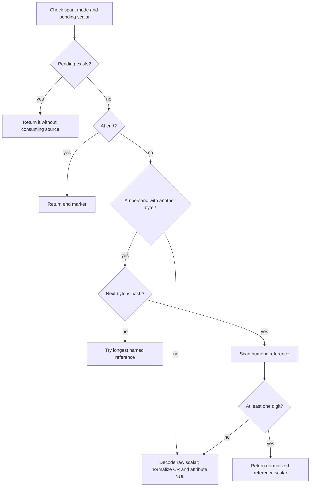
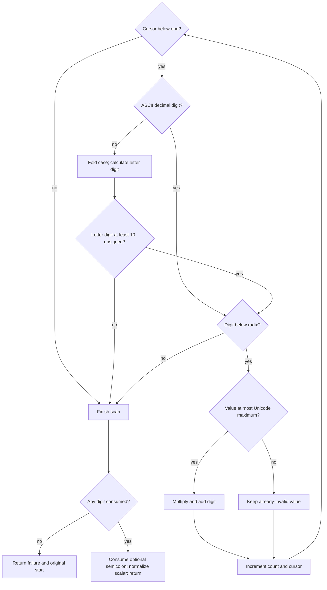

# HTML characters for bookmark imports

This shared Wasm module decodes text and attribute spans for the browser
bookmark converters. It is not another transformation and does not parse
tags, fetch resources, or construct a browser DOM. It borrows `k.memory` and
the JSON helper's UTF-8 decoder for non-ASCII input only.

`next(start, end, attribute, pending)` returns `(scalar, next, pending)`.
Start and end bound a UTF-8 span within the first 64 KiB. Attribute is 0 for
text or 1 for attribute data. Start with pending zero; pass returned pending
back on the next call. Some named references produce two scalars, so one is
returned immediately and the second is retained in that integer. End returns
`(-1, end, 0)`, after delivering any pending scalar. No memory is written.

Raw CRLF and CR become LF; raw NUL becomes U+FFFD in attributes and remains
scalar zero in ordinary text tokens. Unlike XML, attribute TAB
and LF do not become spaces. Malformed UTF-8 traps: encoding repair is not
part of this UTF-8-only helper. A character produced by a reference is not
fed back through raw line-ending normalization.

This is character tokenization, not HTML tree construction. In particular,
the HTML body tree builder discards a raw zero token; callers reproducing
body text must do that too. RCDATA such as a title instead replaces raw
zero. The helper exposes that zero so the caller can apply the appropriate
element context. A numeric reference to zero already returns U+FFFD.

The [HTML reference states](https://html.spec.whatwg.org/multipage/parsing.html#character-reference-state)
define the character-reference behavior. Names are case-sensitive and the
longest matching name wins. Historical names without semicolons are accepted,
except in attributes when followed by an ASCII letter, digit or equals sign.
Unknown names remain literal, beginning with the ampersand. Numeric references
accept decimal or hexadecimal digits and an optional semicolon. Invalid scalar
values become U+FFFD; the HTML C1 replacement table applies. Parse-error reporting
is omitted; it does not change the decoded scalar results.

## Inside `next`: separate raw input from reference results

The numeric scanner keeps its speculative cursor local. Without a digit it
returns a failure marker, and `next` consumes only the original ampersand.
The named scanner does the same on a miss or attribute ambiguity. Thus a
failure never skips a later ampersand or changes the meaning of the suffix.

## Inside the named lookup: bounded prefix search

The candidate scan reads at most 32 ASCII name bytes, including a possible
semicolon. It tries that longest prefix first, then shortens by one byte
until lookup succeeds or the span is empty. A binary search over 2,231 sorted
entries performs each lookup. Each comparison is bytewise and case-sensitive.
The table includes the historical semicolon-less aliases explicitly.

On a match, check the attribute exception before returning either scalar.
`&notit;` in text can match `not`; inside an attribute its following letter
prevents that match. `&notin;` uses its longer complete name in either context.
No match makes the next cursor equal to the name start, leaving all those
bytes for ordinary processing after the already-consumed ampersand.

The offset index uses u16 values relative to the records base. A record is
one u8 name length, exactly that many ASCII name bytes, and two little-endian
u32 scalars. A zero second scalar means no pending result. The public `lookup`
entry accepts a name without its initial ampersand and returns the record's
address or zero; the table must remain unchanged by callers.

## Inside numeric accumulation

- Optional `x` or `X` selects radix 16; otherwise radix 10.
- A recognized digit advances the cursor and increments the digit count.
  Accumulation is `value * radix + digit` only while the old value is at most
  `0x10ffff`. After exceeding that bound, retain the invalid value and keep
  scanning digits. Large inputs therefore cannot wrap into valid characters.
- A non-digit ends the scan. Consume one following semicolon if present.
- Zero, a surrogate, or a value beyond Unicode becomes U+FFFD. Values in
  `0x80..0x9f` use the fixed HTML replacement table; other scalars survive.

Digit classification has two bounds, not just a final comparison with the
radix. First try `byte - '0'` in the unsigned range 0..9. Otherwise fold
ASCII case and try `byte - 'a' + 10`, requiring at least 10 before testing
against the radix. Without that lower bound, `@` and the backtick can become
9 and accidentally enter the decimal path. The exhaustive byte tests cover
both punctuation and letters around these boundaries.

The early lower-bound branch has depth 2 because its `if` is inside the
loop and its exit block. It leaves that block, not the entire function;
`hc-numeric-empty` then decides whether the reference failed or merely ended.
For `&#12@;`, 12 is a successful numeric reference and `@;` remains literal.
For `&#@;`, no digit was consumed, so `next` emits only `&` and leaves `#@;`.

## Memory and signatures

Input: `[0, 65536)`. The helper does not use an output region or globals.
Index: `0x31000`, C1 replacements: `0x32800`, records: `0x33000`.
All table bytes fit in the existing four-page memory. Callers may use the
first 4 KiB of the fourth page for their own literals without overlap.

Import 0 is `k.next`. Definitions are next 1, raw 2, lookup 3, compare 4,
alphanumeric 5, numeric 6, named 7, span-check 8.

`[microwasm]`

- hc-header: `0061736d 01000000`
- hc-type-section: `01 {{size:hc-types}}`
  - hc-types: `07 60 03 7f 7f 7f 03 7f 7f 7f 60 04 7f 7f 7f 7f 03 7f 7f 7f 60 02 7f 7f 02 7f 7f 60 02 7f 7f 01 7f 60 03 7f 7f 7f 01 7f 60 01 7f 01 7f 60 02 7f 7f 00`
- hc-import-section: `02 {{size:hc-imports}}`
  - hc-imports: `02 01 6b 04 6e657874 00 00 01 6b 06 6d656d6f7279 02 01 04 04`
- hc-function-section: `03 {{size:hc-functions}}`
  - hc-functions: `08 01 02 03 04 05 02 00 06`
- hc-export-section: `07 {{size:hc-exports}}`
  - hc-exports: `03 04 6e657874 00 01 06 6c6f6f6b7570 00 03 06 6d656d6f7279 02 00`
- hc-code-section: `0a {{size:hc-code}}`
  - hc-code: `08`
    - hc-next-record: `{{size:hc-next-body}}`
      - hc-next-body: `01 02 7f`
        - hc-next-check: `20 00 20 01 10 08 20 02 41 01 4b 04 40 00 0b`
        - hc-next-pending: `20 03 04 40 20 03 41 ffffc300 4b 20 03 41 80b003 6b 41 ff0f 4d 72 04 40 00 0b 20 03 20 00 41 00 0f 0b`
        - hc-next-end: `20 00 20 01 46 04 40 41 7f 20 00 41 00 0f 0b`
        - hc-next-amp: `20 00 2d 00 00 41 26 46 20 00 41 01 6a 20 01 49 71 04 40`
          - hc-next-hash: `20 00 2d 00 01 41 23 46 04 40 20 00 41 02 6a 20 01 10 06 21 04 21 05 20 05 41 7f 47 04 40 20 05 20 04 41 00 0f 0b`
          - hc-next-name: `05 20 00 41 01 6a 20 01 20 02 10 07 0f 0b 0b`
        - hc-next-raw: `20 00 20 01 10 02 21 04 21 05 20 05 45 20 02 71 04 40 41 fdff03 21 05 0b 20 05 20 04 41 00 0b`
    - hc-raw-record: `{{size:hc-raw-body}}`
      - hc-raw-body: `01 03 7f 20 00 2d 00 00 21 02 20 02 41 8001 49 04 40 20 00 41 01 6a 21 00`
        - hc-raw-cr: `20 02 41 0d 46 04 40 20 00 20 01 49 04 40 20 00 2d 00 00 41 0a 46 04 40 20 00 41 01 6a 21 00 0b 0b 41 0a 20 00 0f 0b`
        - hc-raw-ascii: `20 02 20 00 0f 0b`
        - hc-raw-unicode: `20 00 20 01 41 00 10 00 21 04 21 03 21 02 20 04 04 40 20 02 41 80b003 6b 41 0a 74 20 04 41 80b803 6b 6a 41 808004 6a 21 02 0b 20 02 20 03 0b`
    - hc-lookup-record: `{{size:hc-lookup-body}}`
      - hc-lookup-body: `01 05 7f 20 00 20 01 10 08 41 b711 21 03 02 40 03 40 20 02 20 03 4f 0d 01`
        - hc-lookup-middle: `20 02 20 03 6a 41 01 76 21 04 41 80a00c 20 04 41 01 74 6a 2f 01 00 41 80e00c 6a 21 05`
        - hc-lookup-compare: `20 00 20 01 20 05 10 04 21 06 20 06 45 04 40 20 05 0f 0b`
        - hc-lookup-half: `20 06 41 00 48 04 40 20 04 21 03 05 20 04 41 01 6a 21 02 0b 0c 00 0b 0b 41 00 0b`
    - hc-compare-record: `{{size:hc-compare-body}}`
      - hc-compare-body: `01 03 7f 20 02 2d 00 00 21 03 20 02 41 01 6a 21 02 02 40 03 40 20 00 20 01 4f 20 03 45 72 0d 01`
        - hc-compare-byte: `20 00 2d 00 00 21 04 20 02 2d 00 00 21 05 20 04 20 05 47 04 40 20 04 20 05 49 04 7f 41 7f 05 41 01 0b 0f 0b`
        - hc-compare-next: `20 00 41 01 6a 21 00 20 02 41 01 6a 21 02 20 03 41 01 6b 21 03 0c 00 0b 0b`
        - hc-compare-length: `20 00 20 01 49 04 7f 41 01 05 20 03 04 7f 41 7f 05 41 00 0b 0b 0b`
    - hc-alnum-record: `{{size:hc-alnum-body}}`
      - hc-alnum-body: `00 20 00 41 30 6b 41 09 4d 20 00 41 20 72 41 e100 6b 41 19 4d 72 0b`
    - hc-numeric-record: `{{size:hc-numeric-body}}`
      - hc-numeric-body: `01 06 7f 20 00 21 02 41 0a 21 03`
        - hc-numeric-hex: `20 02 20 01 49 04 40 20 02 2d 00 00 41 20 72 41 f800 46 04 40 41 10 21 03 20 02 41 01 6a 21 02 0b 0b`
        - hc-numeric-exit: `02 40`
          - hc-numeric-loop: `03 40`
            - hc-numeric-bound: `20 02 20 01 4f 0d 01`
            - hc-numeric-digit: `20 02 2d 00 00 21 06 20 06 41 30 6b 21 07`
            - hc-numeric-letter: `20 07 41 09 4b 04 40 20 06 41 20 72 41 e100 6b 41 0a 6a 21 07`
              - hc-numeric-letter-low: `20 07 41 0a 49 0d 02 0b` — Only letters may produce digits 10 and above; punctuation before a is not a decimal digit.
            - hc-numeric-radix: `20 07 20 03 4f 0d 01`
          - hc-numeric-grow: `20 04 41 ffffc300 4d 04 40 20 04 20 03 6c 20 07 6a 21 04 0b 20 05 41 01 6a 21 05 20 02 41 01 6a 21 02 0c 00 0b 0b`
        - hc-numeric-empty: `20 05 45 04 40 41 7f 20 00 0f 0b`
        - hc-numeric-end: `20 02 20 01 49 04 40 20 02 2d 00 00 41 3b 46 04 40 20 02 41 01 6a 21 02 0b 0b`
        - hc-numeric-invalid: `20 04 45 20 04 41 ffffc300 4b 72 20 04 41 80b003 6b 41 ff0f 4d 72 04 40 41 fdff03 21 04 0b`
        - hc-numeric-c1: `20 04 41 8001 6b 41 1f 4d 04 40 20 04 41 8001 6b 41 02 74 41 80d00c 6a 28 02 00 21 04 0b 20 04 20 02 0b`
    - hc-named-record: `{{size:hc-named-body}}`
      - hc-named-body: `01 04 7f 20 00 21 03 02 40 03 40 20 03 20 01 4f 20 03 20 00 6b 41 20 4f 72 0d 01 20 03 2d 00 00 21 06`
        - hc-named-semicolon: `20 06 41 3b 46 04 40 20 03 41 01 6a 21 03 0c 02 0b`
        - hc-named-byte: `20 06 10 05 45 0d 01 20 03 41 01 6a 21 03 0c 00 0b 0b`
        - hc-named-search: `02 40 03 40 20 03 20 00 4d 0d 01 20 00 20 03 10 03 21 04 20 04 04 40`
          - hc-named-attribute: `20 02 20 03 41 01 6b 2d 00 00 41 3b 47 71 20 03 20 01 49 71 04 40 20 03 2d 00 00 21 06 20 06 10 05 20 06 41 3d 46 72 04 40 41 26 20 00 41 00 0f 0b 0b`
          - hc-named-result: `20 04 20 04 2d 00 00 6a 41 01 6a 21 05 20 05 28 00 00 20 03 20 05 28 00 04 0f 0b`
        - hc-named-shorter: `20 03 41 01 6b 21 03 0c 00 0b 0b 41 26 20 00 41 00 0b`
    - hc-span-record: `{{size:hc-span-body}}`
      - hc-span-body: `00 20 00 20 01 4b 20 01 41 808004 4b 72 04 40 00 0b 0b`

## Standard reference data

The following data is mechanically encoded from WHATWG's
[named character references JSON](https://html.spec.whatwg.org/entities.json),
retrieved 2026-09-15. The original UTF-8 bytes have SHA-256
`d741d877ac77c4194c4ad526b5b4a19aef8dfe411ab840a466891cdbb9f362e6`.
The encoding changes the representation, not the mappings. WHATWG is credited
for this data; see its [copyright policy](https://whatwg.org/ipr-policy#copyright).
The algorithm above is handwritten; this mechanical data encoding is not a
hidden compiler for it. Names and every byte remain visible in this document.

`[microwasm]`

- hc-data-section: `0b {{size:hc-data}}`
  - hc-data: `03`
    - hc-index-segment: `00 41 80a00c 0b {{size:hc-index}}`
      - hc-index:
        - hc-index-0: `00000e001d0029003600450055006500730082008f009c00ab00bb00ca00d900` — Entry offsets 0..15.
        - hc-index-1: `e600f50003011a0128013701450155016401740181018f01a201b001c001cd01` — Entry offsets 16..31.
        - hc-index-2: `de01f20100020d021b022a023802480256026302710281028e02ac02bd02cd02` — Entry offsets 32..47.
        - hc-index-3: `dc02ec02fb020c031a032b033e034b0358036b0380039403a903cb03ea030304` — Entry offsets 48..63.
        - hc-index-4: `12042204350445045e046c047f04a804b704c504d204e204ee0400050e051c05` — Entry offsets 64..79.
        - hc-index-5: `2a053a054805570567057405810590059d05b705cf05ef050906230634064b06` — Entry offsets 80..95.
        - hc-index-6: `5906660676068806a706ba06d306ec060a0721073e0760077e079807b007c707` — Entry offsets 96..111.
        - hc-index-7: `e207fd07100826084008530870088b08a308be08da08f3080f09200936094909` — Entry offsets 112..127.
        - hc-index-8: `57096709740980098d099c09ac09bc09ca09d909e609f409010a100a200a310a` — Entry offsets 128..143.
        - hc-index-9: `400a5a0a780a870a950aa60ab50ac90ade0aec0afa0a070b140b220b320b480b` — Entry offsets 144..159.
        - hc-index-10: `550b620b7d0b9c0baa0bba0bce0bdc0bea0bf50b010c100c200c300c400c4f0c` — Entry offsets 160..175.
        - hc-index-11: `5c0c6a0c770c830c910ca70cc10cdb0cf30c080d230d390d470d530d630d720d` — Entry offsets 176..191.
        - hc-index-12: `7f0d8e0d9b0db10dbf0dd70de50df50d0b0e1e0e2c0e3b0e490e580e680e760e` — Entry offsets 192..207.
        - hc-index-13: `850e920ea00ead0ebc0ecc0ed80ee70efb0e0c0f190f2b0f410f590f710f800f` — Entry offsets 208..223.
        - hc-index-14: `8e0f9c0faa0fba0fc90fd60fe40ff30f00100d101b1029103910481056106410` — Entry offsets 224..239.
        - hc-index-15: `7310831090109d10ab10b910c710d210de10ee10fe100c1120112e113e114e11` — Entry offsets 240..255.
        - hc-index-16: `5b11751188119e11bb11d011eb1106121e1239124c1264127d128e12a412bb12` — Entry offsets 256..271.
        - hc-index-17: `d112ea1205131f1338134e1367137b139213a513bd13d713ee13031415142d14` — Entry offsets 272..287.
        - hc-index-18: `40144d1459146d147d149414b014c814df14fb14131521153915521560156d15` — Entry offsets 288..303.
        - hc-index-19: `7d1589159615a315b815cb15d815eb15f9150716131621163116411651165e16` — Entry offsets 304..319.
        - hc-index-20: `7b169716b216d116ef16071718172517361750175e176b1781179417b217c617` — Entry offsets 320..335.
        - hc-index-21: `d817ef17021816182f184c1867187f189d18b618cf18e518fe181a1938194919` — Entry offsets 336..351.
        - hc-index-22: `5f1977198c19a719bd19de19f9190e1a281a471a621a7c1a991ab81ad11aef1a` — Entry offsets 352..367.
        - hc-index-23: `0a1b2a1b3d1b551b6a1b841ba31bbd1bd21bec1bfe1b151c301c471c5f1c6d1c` — Entry offsets 368..383.
        - hc-index-24: `7c1c8c1c981ca71cb61cc61cd41ce31cf01c001d0d1d1c1d2c1d3b1d4a1d5b1d` — Entry offsets 384..399.
        - hc-index-25: `691d871d9f1dab1db91dc81dd81de71df71d071e141e221e331e461e5b1e741e` — Entry offsets 400..415.
        - hc-index-26: `861e931ea01ead1eb91ecc1ee31ef11efd1e0f1f261f421f591f681f791f8d1f` — Entry offsets 416..431.
        - hc-index-27: `a31fb11fbe1fcb1fd91fe61ff41f022011201d202a203a204820562066207620` — Entry offsets 432..447.
        - hc-index-28: `862093209f20b720d320f120fe200b2126213a2151216e218421a021bc21d521` — Entry offsets 448..463.
        - hc-index-29: `f121052217222e2246225d2277229322ae22c822df22f9220e2326233a234823` — Entry offsets 464..479.
        - hc-index-30: `5e23732381238e23a323b323c123d123e123ed23fd230d241c24292436244e24` — Entry offsets 480..495.
        - hc-index-31: `66247f249524a424b924c724d524e5240125172532254a2567257c258a259825` — Entry offsets 496..511.
        - hc-index-32: `a525b525ca25dc25f3250f26262638264526522664267b268b269926a826b726` — Entry offsets 512..527.
        - hc-index-33: `c626d426e126ee26fe260e271b2728273b274a275e27712780279427ac27c027` — Entry offsets 528..543.
        - hc-index-34: `ce27e127ef27ff270e281e282c283e284d285d286b287a2887289728a428b328` — Entry offsets 544..559.
        - hc-index-35: `c328d228e428f8280e29282937294a295929672978298c29a629bb29d229e129` — Entry offsets 560..575.
        - hc-index-36: `f529062a1b2a332a4c2a5a2a6b2a7a2a882a982aa52ab32ac22ad02add2aec2a` — Entry offsets 576..591.
        - hc-index-37: `fc2a092b192b272b3c2b522b6d2b842b9b2ba82bb62bc42bd42be32bf22bff2b` — Entry offsets 592..607.
        - hc-index-38: `0d2c1b2c282c342c422c502c5e2c6c2c7a2c892c992ca82cb52cc22cd02cde2c` — Entry offsets 608..623.
        - hc-index-39: `ec2cfa2c0a2d1a2d272d352d4d2d5b2d682d762d842d932da32db32dbf2dcc2d` — Entry offsets 624..639.
        - hc-index-40: `d92de72df62d042e132e202e2e2e3d2e492e562e652e752e862e952ea42eb32e` — Entry offsets 640..655.
        - hc-index-41: `c22ece2edb2ee82ef82e062f182f262f332f412f502f602f722f842f962fa82f` — Entry offsets 656..671.
        - hc-index-42: `ba2fcc2fde2ff02fff2f1030223032304130523061306f307b3088309830a530` — Entry offsets 672..687.
        - hc-index-43: `b330c130d130e330f13000310e311b312a313b314a315a316731753187319631` — Entry offsets 688..703.
        - hc-index-44: `a431b631cb31de31ef31023212322232343242325432633270327f328f32a032` — Entry offsets 704..719.
        - hc-index-45: `b132c032d032de32ec32fd320a331a332b333b334c335e33713383339433ad33` — Entry offsets 720..735.
        - hc-index-46: `c433d633e633f83308341e3433344a34653480349c34ab34ba34c934d834e734` — Entry offsets 736..751.
        - hc-index-47: `f4340535133521352e353e354e355d356c357b358a359835a735b635c535d435` — Entry offsets 752..767.
        - hc-index-48: `e335f235013610361e362d363c364b365a366936783688369736a636b536c436` — Entry offsets 768..783.
        - hc-index-49: `d236e136f036ff360e372037313743375237613770377f378d379c37ab37ba37` — Entry offsets 784..799.
        - hc-index-50: `c937d837e737f7370638153825383338423850385f386d387c388e389c38ac38` — Entry offsets 800..815.
        - hc-index-51: `ba38c938d838e838f8380539153927393739473957396539743983399239a239` — Entry offsets 816..831.
        - hc-index-52: `b139c139d039df39f039fe390c3a1b3a2c3a393a473a5a3a673a753a843a973a` — Entry offsets 832..847.
        - hc-index-53: `a43ab13abf3acd3add3af63a103b223b343b483b5d3b723b803b923ba23bb33b` — Entry offsets 848..863.
        - hc-index-54: `c23bd43be33bf33b043c133c233c313c413c553c683c763c873c973ca53cb53c` — Entry offsets 864..879.
        - hc-index-55: `c23cd03ce03cef3cfe3c0c3d1a3d293d373d463d553d663d773d863d953da53d` — Entry offsets 880..895.
        - hc-index-56: `b63dc33dd53de53df53d053e143e223e323e433e583e6d3e7f3e933ea23eb23e` — Entry offsets 896..911.
        - hc-index-57: `ca3ee33ef23e013f133f223f323f403f4e3f5e3f6e3f7c3f8a3f993faa3fb93f` — Entry offsets 912..927.
        - hc-index-58: `c93fd63fe23ff33f024013401f402c403b404c405c406940784087409540a640` — Entry offsets 928..943.
        - hc-index-59: `bb40ca40d740e840f7400441134123413a414a4158416841784188419641a341` — Entry offsets 944..959.
        - hc-index-60: `b241c441d641e741fa41124225423d425642704282429242a242b042be42cc42` — Entry offsets 960..975.
        - hc-index-61: `dc42eb42f9420843174326433743454357436643744383439343a343b343c143` — Entry offsets 976..991.
        - hc-index-62: `cf43de43ee43fb4309441544244431443d444c445c446944794485449744a444` — Entry offsets 992..1007.
        - hc-index-63: `b144c144d044df44f1440145114521452f453c454a4559456745754585459445` — Entry offsets 1008..1023.
        - hc-index-64: `a245b345c245d245e345f24506461b462b463b464a465b466d467c468b469946` — Entry offsets 1024..1039.
        - hc-index-65: `a846b646c346cf46dc46e946f74605471347224737474d476447714781479147` — Entry offsets 1040..1055.
        - hc-index-66: `a047b047bd47cc47db47e947f847074815482348334841485048624871488148` — Entry offsets 1056..1071.
        - hc-index-67: `9148a048b048c048d048e048f04800490f491f492f493f494f495f496f497f49` — Entry offsets 1072..1087.
        - hc-index-68: `8e499d49ab49b749c449d449e349f349004a104a1f4a2c4a3a4a464a534a604a` — Entry offsets 1088..1103.
        - hc-index-69: `6e4a804a8d4a9c4aac4abd4acf4add4aed4afa4a064b134b224b304b3c4b494b` — Entry offsets 1104..1119.
        - hc-index-70: `564b634b704b7e4b904b9d4bab4bba4bc94bd74be64bf44b024c114c204c2b4c` — Entry offsets 1120..1135.
        - hc-index-71: `374c454c544c634c734c844c974ca74cb74cca4cde4cef4cff4c124d204d2e4d` — Entry offsets 1136..1151.
        - hc-index-72: `3e4d4c4d5c4d6c4d7a4d8b4d9a4da84db74dc74dda4dea4dfa4d074e194e2b4e` — Entry offsets 1152..1167.
        - hc-index-73: `3a4e4a4e614e794e874e974ea54eb54ec54ed54ee54ef44e044f104f1e4f2d4f` — Entry offsets 1168..1183.
        - hc-index-74: `3a4f484f564f654f724f7f4f8e4f9e4faa4fba4fc94fd94fe84ff74f06501550` — Entry offsets 1184..1199.
        - hc-index-75: `27503950485056506550715081509050a250b250bf50cf50e150f35005511651` — Entry offsets 1200..1215.
        - hc-index-76: `2451335141514f515e516d517d518b519951a851b951c851d851e751f3510352` — Entry offsets 1216..1231.
        - hc-index-77: `12521f522d523c52495256526552735281529152a052af52bf52cf52dc52e952` — Entry offsets 1232..1247.
        - hc-index-78: `f952075315532353315340534e535e536d53795386539453a453b653c653d653` — Entry offsets 1248..1263.
        - hc-index-79: `e453f353035410541e542d543b544a545b546b547b548b549b54ac54bc54c954` — Entry offsets 1264..1279.
        - hc-index-80: `d954e754f6540555145524553455435554556555755585559455a255af55bd55` — Entry offsets 1280..1295.
        - hc-index-81: `cc55dc55ed55ff550d5619562c5643565c5673568b56a356bc56d756f4560c57` — Entry offsets 1296..1311.
        - hc-index-82: `195726573457465753576257725783579557a357b357c757d857eb57ff571058` — Entry offsets 1312..1327.
        - hc-index-83: `2158315841584e585a586758765885589558a458b258be58cd58df58ef58fe58` — Entry offsets 1328..1343.
        - hc-index-84: `0e591e5932593f594d595f596c597a5989599859a759b659c559dc59f8590c5a` — Entry offsets 1344..1359.
        - hc-index-85: `245a3b5a535a625a705a805a915aa15ab15abe5acf5add5aeb5afb5a0a5b1c5b` — Entry offsets 1360..1375.
        - hc-index-86: `2b5b3b5b485b575b675b755b825b905b9f5bae5bbc5bcb5bdb5beb5bf65b025c` — Entry offsets 1376..1391.
        - hc-index-87: `105c1f5c2e5c3e5c4e5c5e5c6f5c7f5c8d5c9c5cab5cbd5cce5ce15cef5cfe5c` — Entry offsets 1392..1407.
        - hc-index-88: `0b5d195d275d355d465d535d635d775d8b5d9d5dad5dbd5dca5dd95df05dfd5d` — Entry offsets 1408..1423.
        - hc-index-89: `0a5e185e275e345e445e545e635e735e825e925ea25eb35ec15ecf5edf5eef5e` — Entry offsets 1424..1439.
        - hc-index-90: `fd5e095f175f275f335f455f545f615f6e5f7c5f905fa95fb65fc35fd15fe65f` — Entry offsets 1440..1455.
        - hc-index-91: `f65f066015602560336040604e605d606c607d608c609d60af60bc60ca60d960` — Entry offsets 1456..1471.
        - hc-index-92: `e960f76007611761266138614661536162616e617d618d619c61ad61bc61cc61` — Entry offsets 1472..1487.
        - hc-index-93: `dc61eb61fb610c62196226623362416250626362716280628d629b62aa62b962` — Entry offsets 1488..1503.
        - hc-index-94: `c862d462e162ef62fc620a631963266335634363506364637d638b639a63ad63` — Entry offsets 1504..1519.
        - hc-index-95: `bb63ca63d963e663f5630564136421642d643a64496459646b647c648d649e64` — Entry offsets 1520..1535.
        - hc-index-96: `ad64be64cf64e064ee6401651165206531653e654e655c656b657c658b659a65` — Entry offsets 1536..1551.
        - hc-index-97: `aa65ba65cf65de65ee65fb650b66196627663a66526660666f667f668e669d66` — Entry offsets 1552..1567.
        - hc-index-98: `ae66bf66cd66dc66eb66fc660f67236732674367516760676f6780679367a767` — Entry offsets 1568..1583.
        - hc-index-99: `b567c467d467e267f96712682a68446850685d686d687c688c689c68aa68ba68` — Entry offsets 1584..1599.
        - hc-index-100: `c868d668e768f7680569136924693469456954696369736982699369a369af69` — Entry offsets 1600..1615.
        - hc-index-101: `be69ce69dc69ea69f869076a146a236a336a416a4f6a5f6a6e6a7d6a8a6a986a` — Entry offsets 1616..1631.
        - hc-index-102: `a76ab76ac46ad36ae06aee6afd6a0c6b1d6b2c6b396b486b576b686b766b866b` — Entry offsets 1632..1647.
        - hc-index-103: `946ba26bb16bc06bcc6bdb6be86bf76b086c156c236c306c3e6c4e6c5c6c6d6c` — Entry offsets 1648..1663.
        - hc-index-104: `7a6c886c976ca76cb56cc46cd46ce46cf66c036d116d206d2d6d3a6d486d5a6d` — Entry offsets 1664..1679.
        - hc-index-105: `6a6d796d876d946da46db46dc46dd26de36df06dfd6d0b6e1b6e2a6e366e496e` — Entry offsets 1680..1695.
        - hc-index-106: `566e666e776e876e956ea76eb66ec76ed76ee76ef66e056f156f266f376f436f` — Entry offsets 1696..1711.
        - hc-index-107: `556f636f716f806f8c6f996fa76fb66fc36fd16fe56ffa6f0a701f7031704370` — Entry offsets 1712..1727.
        - hc-index-108: `54706370737081709070a070ae70c070d270e470f2700271117121712f713c71` — Entry offsets 1728..1743.
        - hc-index-109: `4c7159716771757185719371a871b971c871d971e671f4710372117221723072` — Entry offsets 1744..1759.
        - hc-index-110: `3e724c725c726b727d728b729a72a972b972c772d672e472f472037314732373` — Entry offsets 1760..1775.
        - hc-index-111: `3373437353736373747384739373a373b273c573d473e373f373037412742374` — Entry offsets 1776..1791.
        - hc-index-112: `347444745474637471747e748c749d74ac74bc74ca74d874e974fb740a751875` — Entry offsets 1792..1807.
        - hc-index-113: `24753175417551755e756d757c758c759975a775bb75d375ed7505761e763976` — Entry offsets 1808..1823.
        - hc-index-114: `53766c7685769376a976b876c776d476e476f876077716772577347743775177` — Entry offsets 1824..1839.
        - hc-index-115: `6177727780779077a277b177c177cf77dc77ea77f97709781978297837784678` — Entry offsets 1840..1855.
        - hc-index-116: `55786778787884789478a378af78bc78ca78da78e978f6780679157923793279` — Entry offsets 1856..1871.
        - hc-index-117: `42795479637970797e798d799c79ab79bb79ca79db79e879f679047a147a267a` — Entry offsets 1872..1887.
        - hc-index-118: `357a437a507a607a6f7a7f7a8d7a9f7ab67ac27acf7ade7aee7afe7a0b7b1b7b` — Entry offsets 1888..1903.
        - hc-index-119: `297b387b467b557b637b727b817b927ba37bb27bc97bd97beb7bf97b087c157c` — Entry offsets 1904..1919.
        - hc-index-120: `237c327c427c4f7c5d7c6d7c7b7c8b7c9e7cac7cbb7ccb7cda7cea7cf97c097d` — Entry offsets 1920..1935.
        - hc-index-121: `1b7d2f7d3e7d4e7d607d747d817d917da17daf7dbe7dcc7ddc7dec7dfc7d0a7e` — Entry offsets 1936..1951.
        - hc-index-122: `197e327e477e567e637e717e817e8f7ea07eb17ec07ecf7ee07ef17e017f137f` — Entry offsets 1952..1967.
        - hc-index-123: `267f397f4d7f5d7f6d7f7d7f8b7f9f7fb47fc47fd97feb7ffd7f0e801b802980` — Entry offsets 1968..1983.
        - hc-index-124: `3680448051805f806c807a8087809580a580b680c480d580e680f78008811981` — Entry offsets 1984..1999.
        - hc-index-125: `28813781488158816a817d819081a481b481c481d481e381f381028213822382` — Entry offsets 2000..2015.
        - hc-index-126: `3182408250825d826b827b828b829882a682b682c382d382e682f58207831783` — Entry offsets 2016..2031.
        - hc-index-127: `2c833e834e835d836d837b838a839983a783b683c683d883e883f68304841184` — Entry offsets 2032..2047.
        - hc-index-128: `218431843f8450845e846e847d848f84a584bb84d384e684fd84168526853485` — Entry offsets 2048..2063.
        - hc-index-129: `468557856685778589859785a585b485c485d385ed8508861686248633864386` — Entry offsets 2064..2079.
        - hc-index-130: `5186608670867e868d869a86a986b986c886d886e586f4860487138722873187` — Entry offsets 2080..2095.
        - hc-index-131: `418753876387728781878d879a87a987b787c887dd87f4870c881b8829883888` — Entry offsets 2096..2111.
        - hc-index-132: `49885d886d887f888f889e88ad88bb88ca88da88e888f7880689138921893289` — Entry offsets 2112..2127.
        - hc-index-133: `40894e895d896c897c899089a289b689c689d589e889f689068a188a2e8a458a` — Entry offsets 2128..2143.
        - hc-index-134: `5b8a728a848a9d8ab78ac48ad38ae08af08aff8a0f8b1f8b2d8b3a8b498b588b` — Entry offsets 2144..2159.
        - hc-index-135: `678b758b848b938ba18bb18bc18bd18be18bf28b018c118c208c308c408c4d8c` — Entry offsets 2160..2175.
        - hc-index-136: `5b8c678c738c838c918c9f8cae8cbc8ccb8cd88ce78cf68c028d118d208d2e8d` — Entry offsets 2176..2191.
        - hc-index-137: `3c8d4b8d598d698d798d888d978da58db58dc58dd48de28df28d018e118e1f8e` — Entry offsets 2192..2207.
        - hc-index-138: `2e8e3b8e478e548e618e6f8e7d8e8b8e998ea68eb48ec48ed48ee18eef8eff8e` — Entry offsets 2208..2223.
        - hc-index-139: `0d8f1a8f288f398f478f558f628f` — Entry offsets 2224..2230.
    - hc-c1-segment: `00 41 80d00c 0b {{size:hc-c1}}`
      - hc-c1: `ac200000810000001a200000920100001e200000262000002020000021200000c6020000302000006001000039200000520100008d0000007d0100008f0000009000000018200000192000001c2000001d200000222000001320000014200000dc02000022210000610100003a200000530100009d0000007e01000078010000`
    - hc-records-segment: `00 41 80e00c 0b {{size:hc-records}}`
      - hc-records:
        - hc-entity-0: `0541456c6967c600000000000000` — `&AElig`.
        - hc-entity-1: `0641456c69673bc600000000000000` — `&AElig;`.
        - hc-entity-2: `03414d502600000000000000` — `&AMP`.
        - hc-entity-3: `04414d503b2600000000000000` — `&AMP;`.
        - hc-entity-4: `06416163757465c100000000000000` — `&Aacute`.
        - hc-entity-5: `074161637574653bc100000000000000` — `&Aacute;`.
        - hc-entity-6: `074162726576653b0201000000000000` — `&Abreve;`.
        - hc-entity-7: `054163697263c200000000000000` — `&Acirc`.
        - hc-entity-8: `0641636972633bc200000000000000` — `&Acirc;`.
        - hc-entity-9: `044163793b1004000000000000` — `&Acy;`.
        - hc-entity-10: `044166723b04d5010000000000` — `&Afr;`.
        - hc-entity-11: `06416772617665c000000000000000` — `&Agrave`.
        - hc-entity-12: `074167726176653bc000000000000000` — `&Agrave;`.
        - hc-entity-13: `06416c7068613b9103000000000000` — `&Alpha;`.
        - hc-entity-14: `06416d6163723b0001000000000000` — `&Amacr;`.
        - hc-entity-15: `04416e643b532a000000000000` — `&And;`.
        - hc-entity-16: `06416f676f6e3b0401000000000000` — `&Aogon;`.
        - hc-entity-17: `05416f70663b38d5010000000000` — `&Aopf;`.
        - hc-entity-18: `0e4170706c7946756e6374696f6e3b6120000000000000` — `&ApplyFunction;`.
        - hc-entity-19: `054172696e67c500000000000000` — `&Aring`.
        - hc-entity-20: `064172696e673bc500000000000000` — `&Aring;`.
        - hc-entity-21: `05417363723b9cd4010000000000` — `&Ascr;`.
        - hc-entity-22: `0741737369676e3b5422000000000000` — `&Assign;`.
        - hc-entity-23: `064174696c6465c300000000000000` — `&Atilde`.
        - hc-entity-24: `074174696c64653bc300000000000000` — `&Atilde;`.
        - hc-entity-25: `0441756d6cc400000000000000` — `&Auml`.
        - hc-entity-26: `0541756d6c3bc400000000000000` — `&Auml;`.
        - hc-entity-27: `0a4261636b736c6173683b1622000000000000` — `&Backslash;`.
        - hc-entity-28: `05426172763be72a000000000000` — `&Barv;`.
        - hc-entity-29: `074261727765643b0623000000000000` — `&Barwed;`.
        - hc-entity-30: `044263793b1104000000000000` — `&Bcy;`.
        - hc-entity-31: `08426563617573653b3522000000000000` — `&Because;`.
        - hc-entity-32: `0b4265726e6f756c6c69733b2c21000000000000` — `&Bernoullis;`.
        - hc-entity-33: `05426574613b9203000000000000` — `&Beta;`.
        - hc-entity-34: `044266723b05d5010000000000` — `&Bfr;`.
        - hc-entity-35: `05426f70663b39d5010000000000` — `&Bopf;`.
        - hc-entity-36: `0642726576653bd802000000000000` — `&Breve;`.
        - hc-entity-37: `05427363723b2c21000000000000` — `&Bscr;`.
        - hc-entity-38: `0742756d7065713b4e22000000000000` — `&Bumpeq;`.
        - hc-entity-39: `05434863793b2704000000000000` — `&CHcy;`.
        - hc-entity-40: `04434f5059a900000000000000` — `&COPY`.
        - hc-entity-41: `05434f50593ba900000000000000` — `&COPY;`.
        - hc-entity-42: `074361637574653b0601000000000000` — `&Cacute;`.
        - hc-entity-43: `044361703bd222000000000000` — `&Cap;`.
        - hc-entity-44: `154361706974616c446966666572656e7469616c443b4521000000000000` — `&CapitalDifferentialD;`.
        - hc-entity-45: `084361796c6579733b2d21000000000000` — `&Cayleys;`.
        - hc-entity-46: `07436361726f6e3b0c01000000000000` — `&Ccaron;`.
        - hc-entity-47: `0643636564696cc700000000000000` — `&Ccedil`.
        - hc-entity-48: `0743636564696c3bc700000000000000` — `&Ccedil;`.
        - hc-entity-49: `0643636972633b0801000000000000` — `&Ccirc;`.
        - hc-entity-50: `0843636f6e696e743b3022000000000000` — `&Cconint;`.
        - hc-entity-51: `0543646f743b0a01000000000000` — `&Cdot;`.
        - hc-entity-52: `08436564696c6c613bb800000000000000` — `&Cedilla;`.
        - hc-entity-53: `0a43656e746572446f743bb700000000000000` — `&CenterDot;`.
        - hc-entity-54: `044366723b2d21000000000000` — `&Cfr;`.
        - hc-entity-55: `044368693ba703000000000000` — `&Chi;`.
        - hc-entity-56: `0a436972636c65446f743b9922000000000000` — `&CircleDot;`.
        - hc-entity-57: `0c436972636c654d696e75733b9622000000000000` — `&CircleMinus;`.
        - hc-entity-58: `0b436972636c65506c75733b9522000000000000` — `&CirclePlus;`.
        - hc-entity-59: `0c436972636c6554696d65733b9722000000000000` — `&CircleTimes;`.
        - hc-entity-60: `19436c6f636b77697365436f6e746f7572496e74656772616c3b3222000000000000` — `&ClockwiseContourIntegral;`.
        - hc-entity-61: `16436c6f73654375726c79446f75626c6551756f74653b1d20000000000000` — `&CloseCurlyDoubleQuote;`.
        - hc-entity-62: `10436c6f73654375726c7951756f74653b1920000000000000` — `&CloseCurlyQuote;`.
        - hc-entity-63: `06436f6c6f6e3b3722000000000000` — `&Colon;`.
        - hc-entity-64: `07436f6c6f6e653b742a000000000000` — `&Colone;`.
        - hc-entity-65: `0a436f6e677275656e743b6122000000000000` — `&Congruent;`.
        - hc-entity-66: `07436f6e696e743b2f22000000000000` — `&Conint;`.
        - hc-entity-67: `10436f6e746f7572496e74656772616c3b2e22000000000000` — `&ContourIntegral;`.
        - hc-entity-68: `05436f70663b0221000000000000` — `&Copf;`.
        - hc-entity-69: `0a436f70726f647563743b1022000000000000` — `&Coproduct;`.
        - hc-entity-70: `20436f756e746572436c6f636b77697365436f6e746f7572496e74656772616c3b3322000000000000` — `&CounterClockwiseContourIntegral;`.
        - hc-entity-71: `0643726f73733b2f2a000000000000` — `&Cross;`.
        - hc-entity-72: `05437363723b9ed4010000000000` — `&Cscr;`.
        - hc-entity-73: `044375703bd322000000000000` — `&Cup;`.
        - hc-entity-74: `074375704361703b4d22000000000000` — `&CupCap;`.
        - hc-entity-75: `0344443b4521000000000000` — `&DD;`.
        - hc-entity-76: `0944446f74726168643b1129000000000000` — `&DDotrahd;`.
        - hc-entity-77: `05444a63793b0204000000000000` — `&DJcy;`.
        - hc-entity-78: `05445363793b0504000000000000` — `&DScy;`.
        - hc-entity-79: `05445a63793b0f04000000000000` — `&DZcy;`.
        - hc-entity-80: `074461676765723b2120000000000000` — `&Dagger;`.
        - hc-entity-81: `05446172723ba121000000000000` — `&Darr;`.
        - hc-entity-82: `0644617368763be42a000000000000` — `&Dashv;`.
        - hc-entity-83: `07446361726f6e3b0e01000000000000` — `&Dcaron;`.
        - hc-entity-84: `044463793b1404000000000000` — `&Dcy;`.
        - hc-entity-85: `0444656c3b0722000000000000` — `&Del;`.
        - hc-entity-86: `0644656c74613b9403000000000000` — `&Delta;`.
        - hc-entity-87: `044466723b07d5010000000000` — `&Dfr;`.
        - hc-entity-88: `11446961637269746963616c41637574653bb400000000000000` — `&DiacriticalAcute;`.
        - hc-entity-89: `0f446961637269746963616c446f743bd902000000000000` — `&DiacriticalDot;`.
        - hc-entity-90: `17446961637269746963616c446f75626c6541637574653bdd02000000000000` — `&DiacriticalDoubleAcute;`.
        - hc-entity-91: `11446961637269746963616c47726176653b6000000000000000` — `&DiacriticalGrave;`.
        - hc-entity-92: `11446961637269746963616c54696c64653bdc02000000000000` — `&DiacriticalTilde;`.
        - hc-entity-93: `084469616d6f6e643bc422000000000000` — `&Diamond;`.
        - hc-entity-94: `0e446966666572656e7469616c443b4621000000000000` — `&DifferentialD;`.
        - hc-entity-95: `05446f70663b3bd5010000000000` — `&Dopf;`.
        - hc-entity-96: `04446f743ba800000000000000` — `&Dot;`.
        - hc-entity-97: `07446f74446f743bdc20000000000000` — `&DotDot;`.
        - hc-entity-98: `09446f74457175616c3b5022000000000000` — `&DotEqual;`.
        - hc-entity-99: `16446f75626c65436f6e746f7572496e74656772616c3b2f22000000000000` — `&DoubleContourIntegral;`.
        - hc-entity-100: `0a446f75626c65446f743ba800000000000000` — `&DoubleDot;`.
        - hc-entity-101: `10446f75626c65446f776e4172726f773bd321000000000000` — `&DoubleDownArrow;`.
        - hc-entity-102: `10446f75626c654c6566744172726f773bd021000000000000` — `&DoubleLeftArrow;`.
        - hc-entity-103: `15446f75626c654c65667452696768744172726f773bd421000000000000` — `&DoubleLeftRightArrow;`.
        - hc-entity-104: `0e446f75626c654c6566745465653be42a000000000000` — `&DoubleLeftTee;`.
        - hc-entity-105: `14446f75626c654c6f6e674c6566744172726f773bf827000000000000` — `&DoubleLongLeftArrow;`.
        - hc-entity-106: `19446f75626c654c6f6e674c65667452696768744172726f773bfa27000000000000` — `&DoubleLongLeftRightArrow;`.
        - hc-entity-107: `15446f75626c654c6f6e6752696768744172726f773bf927000000000000` — `&DoubleLongRightArrow;`.
        - hc-entity-108: `11446f75626c6552696768744172726f773bd221000000000000` — `&DoubleRightArrow;`.
        - hc-entity-109: `0f446f75626c6552696768745465653ba822000000000000` — `&DoubleRightTee;`.
        - hc-entity-110: `0e446f75626c6555704172726f773bd121000000000000` — `&DoubleUpArrow;`.
        - hc-entity-111: `12446f75626c655570446f776e4172726f773bd521000000000000` — `&DoubleUpDownArrow;`.
        - hc-entity-112: `12446f75626c65566572746963616c4261723b2522000000000000` — `&DoubleVerticalBar;`.
        - hc-entity-113: `0a446f776e4172726f773b9321000000000000` — `&DownArrow;`.
        - hc-entity-114: `0d446f776e4172726f774261723b1329000000000000` — `&DownArrowBar;`.
        - hc-entity-115: `11446f776e4172726f7755704172726f773bf521000000000000` — `&DownArrowUpArrow;`.
        - hc-entity-116: `0a446f776e42726576653b1103000000000000` — `&DownBreve;`.
        - hc-entity-117: `14446f776e4c6566745269676874566563746f723b5029000000000000` — `&DownLeftRightVector;`.
        - hc-entity-118: `12446f776e4c656674546565566563746f723b5e29000000000000` — `&DownLeftTeeVector;`.
        - hc-entity-119: `0f446f776e4c656674566563746f723bbd21000000000000` — `&DownLeftVector;`.
        - hc-entity-120: `12446f776e4c656674566563746f724261723b5629000000000000` — `&DownLeftVectorBar;`.
        - hc-entity-121: `13446f776e5269676874546565566563746f723b5f29000000000000` — `&DownRightTeeVector;`.
        - hc-entity-122: `10446f776e5269676874566563746f723bc121000000000000` — `&DownRightVector;`.
        - hc-entity-123: `13446f776e5269676874566563746f724261723b5729000000000000` — `&DownRightVectorBar;`.
        - hc-entity-124: `08446f776e5465653ba422000000000000` — `&DownTee;`.
        - hc-entity-125: `0d446f776e5465654172726f773ba721000000000000` — `&DownTeeArrow;`.
        - hc-entity-126: `0a446f776e6172726f773bd321000000000000` — `&Downarrow;`.
        - hc-entity-127: `05447363723b9fd4010000000000` — `&Dscr;`.
        - hc-entity-128: `07447374726f6b3b1001000000000000` — `&Dstrok;`.
        - hc-entity-129: `04454e473b4a01000000000000` — `&ENG;`.
        - hc-entity-130: `03455448d000000000000000` — `&ETH`.
        - hc-entity-131: `044554483bd000000000000000` — `&ETH;`.
        - hc-entity-132: `06456163757465c900000000000000` — `&Eacute`.
        - hc-entity-133: `074561637574653bc900000000000000` — `&Eacute;`.
        - hc-entity-134: `07456361726f6e3b1a01000000000000` — `&Ecaron;`.
        - hc-entity-135: `054563697263ca00000000000000` — `&Ecirc`.
        - hc-entity-136: `0645636972633bca00000000000000` — `&Ecirc;`.
        - hc-entity-137: `044563793b2d04000000000000` — `&Ecy;`.
        - hc-entity-138: `0545646f743b1601000000000000` — `&Edot;`.
        - hc-entity-139: `044566723b08d5010000000000` — `&Efr;`.
        - hc-entity-140: `06456772617665c800000000000000` — `&Egrave`.
        - hc-entity-141: `074567726176653bc800000000000000` — `&Egrave;`.
        - hc-entity-142: `08456c656d656e743b0822000000000000` — `&Element;`.
        - hc-entity-143: `06456d6163723b1201000000000000` — `&Emacr;`.
        - hc-entity-144: `11456d707479536d616c6c5371756172653bfb25000000000000` — `&EmptySmallSquare;`.
        - hc-entity-145: `15456d70747956657279536d616c6c5371756172653bab25000000000000` — `&EmptyVerySmallSquare;`.
        - hc-entity-146: `06456f676f6e3b1801000000000000` — `&Eogon;`.
        - hc-entity-147: `05456f70663b3cd5010000000000` — `&Eopf;`.
        - hc-entity-148: `08457073696c6f6e3b9503000000000000` — `&Epsilon;`.
        - hc-entity-149: `06457175616c3b752a000000000000` — `&Equal;`.
        - hc-entity-150: `0b457175616c54696c64653b4222000000000000` — `&EqualTilde;`.
        - hc-entity-151: `0c457175696c69627269756d3bcc21000000000000` — `&Equilibrium;`.
        - hc-entity-152: `05457363723b3021000000000000` — `&Escr;`.
        - hc-entity-153: `054573696d3b732a000000000000` — `&Esim;`.
        - hc-entity-154: `044574613b9703000000000000` — `&Eta;`.
        - hc-entity-155: `0445756d6ccb00000000000000` — `&Euml`.
        - hc-entity-156: `0545756d6c3bcb00000000000000` — `&Euml;`.
        - hc-entity-157: `074578697374733b0322000000000000` — `&Exists;`.
        - hc-entity-158: `0d4578706f6e656e7469616c453b4721000000000000` — `&ExponentialE;`.
        - hc-entity-159: `044663793b2404000000000000` — `&Fcy;`.
        - hc-entity-160: `044666723b09d5010000000000` — `&Ffr;`.
        - hc-entity-161: `1246696c6c6564536d616c6c5371756172653bfc25000000000000` — `&FilledSmallSquare;`.
        - hc-entity-162: `1646696c6c656456657279536d616c6c5371756172653baa25000000000000` — `&FilledVerySmallSquare;`.
        - hc-entity-163: `05466f70663b3dd5010000000000` — `&Fopf;`.
        - hc-entity-164: `07466f72416c6c3b0022000000000000` — `&ForAll;`.
        - hc-entity-165: `0b466f75726965727472663b3121000000000000` — `&Fouriertrf;`.
        - hc-entity-166: `05467363723b3121000000000000` — `&Fscr;`.
        - hc-entity-167: `05474a63793b0304000000000000` — `&GJcy;`.
        - hc-entity-168: `0247543e00000000000000` — `&GT`.
        - hc-entity-169: `0347543b3e00000000000000` — `&GT;`.
        - hc-entity-170: `0647616d6d613b9303000000000000` — `&Gamma;`.
        - hc-entity-171: `0747616d6d61643bdc03000000000000` — `&Gammad;`.
        - hc-entity-172: `074762726576653b1e01000000000000` — `&Gbreve;`.
        - hc-entity-173: `0747636564696c3b2201000000000000` — `&Gcedil;`.
        - hc-entity-174: `0647636972633b1c01000000000000` — `&Gcirc;`.
        - hc-entity-175: `044763793b1304000000000000` — `&Gcy;`.
        - hc-entity-176: `0547646f743b2001000000000000` — `&Gdot;`.
        - hc-entity-177: `044766723b0ad5010000000000` — `&Gfr;`.
        - hc-entity-178: `0347673bd922000000000000` — `&Gg;`.
        - hc-entity-179: `05476f70663b3ed5010000000000` — `&Gopf;`.
        - hc-entity-180: `0d47726561746572457175616c3b6522000000000000` — `&GreaterEqual;`.
        - hc-entity-181: `1147726561746572457175616c4c6573733bdb22000000000000` — `&GreaterEqualLess;`.
        - hc-entity-182: `114772656174657246756c6c457175616c3b6722000000000000` — `&GreaterFullEqual;`.
        - hc-entity-183: `0f47726561746572477265617465723ba22a000000000000` — `&GreaterGreater;`.
        - hc-entity-184: `0c477265617465724c6573733b7722000000000000` — `&GreaterLess;`.
        - hc-entity-185: `1247726561746572536c616e74457175616c3b7e2a000000000000` — `&GreaterSlantEqual;`.
        - hc-entity-186: `0d4772656174657254696c64653b7322000000000000` — `&GreaterTilde;`.
        - hc-entity-187: `05477363723ba2d4010000000000` — `&Gscr;`.
        - hc-entity-188: `0347743b6b22000000000000` — `&Gt;`.
        - hc-entity-189: `074841524463793b2a04000000000000` — `&HARDcy;`.
        - hc-entity-190: `06486163656b3bc702000000000000` — `&Hacek;`.
        - hc-entity-191: `044861743b5e00000000000000` — `&Hat;`.
        - hc-entity-192: `0648636972633b2401000000000000` — `&Hcirc;`.
        - hc-entity-193: `044866723b0c21000000000000` — `&Hfr;`.
        - hc-entity-194: `0d48696c6265727453706163653b0b21000000000000` — `&HilbertSpace;`.
        - hc-entity-195: `05486f70663b0d21000000000000` — `&Hopf;`.
        - hc-entity-196: `0f486f72697a6f6e74616c4c696e653b0025000000000000` — `&HorizontalLine;`.
        - hc-entity-197: `05487363723b0b21000000000000` — `&Hscr;`.
        - hc-entity-198: `07487374726f6b3b2601000000000000` — `&Hstrok;`.
        - hc-entity-199: `0d48756d70446f776e48756d703b4e22000000000000` — `&HumpDownHump;`.
        - hc-entity-200: `0a48756d70457175616c3b4f22000000000000` — `&HumpEqual;`.
        - hc-entity-201: `05494563793b1504000000000000` — `&IEcy;`.
        - hc-entity-202: `06494a6c69673b3201000000000000` — `&IJlig;`.
        - hc-entity-203: `05494f63793b0104000000000000` — `&IOcy;`.
        - hc-entity-204: `06496163757465cd00000000000000` — `&Iacute`.
        - hc-entity-205: `074961637574653bcd00000000000000` — `&Iacute;`.
        - hc-entity-206: `054963697263ce00000000000000` — `&Icirc`.
        - hc-entity-207: `0649636972633bce00000000000000` — `&Icirc;`.
        - hc-entity-208: `044963793b1804000000000000` — `&Icy;`.
        - hc-entity-209: `0549646f743b3001000000000000` — `&Idot;`.
        - hc-entity-210: `044966723b1121000000000000` — `&Ifr;`.
        - hc-entity-211: `06496772617665cc00000000000000` — `&Igrave`.
        - hc-entity-212: `074967726176653bcc00000000000000` — `&Igrave;`.
        - hc-entity-213: `03496d3b1121000000000000` — `&Im;`.
        - hc-entity-214: `06496d6163723b2a01000000000000` — `&Imacr;`.
        - hc-entity-215: `0b496d6167696e617279493b4821000000000000` — `&ImaginaryI;`.
        - hc-entity-216: `08496d706c6965733bd221000000000000` — `&Implies;`.
        - hc-entity-217: `04496e743b2c22000000000000` — `&Int;`.
        - hc-entity-218: `09496e74656772616c3b2b22000000000000` — `&Integral;`.
        - hc-entity-219: `0d496e74657273656374696f6e3bc222000000000000` — `&Intersection;`.
        - hc-entity-220: `0f496e76697369626c65436f6d6d613b6320000000000000` — `&InvisibleComma;`.
        - hc-entity-221: `0f496e76697369626c6554696d65733b6220000000000000` — `&InvisibleTimes;`.
        - hc-entity-222: `06496f676f6e3b2e01000000000000` — `&Iogon;`.
        - hc-entity-223: `05496f70663b40d5010000000000` — `&Iopf;`.
        - hc-entity-224: `05496f74613b9903000000000000` — `&Iota;`.
        - hc-entity-225: `05497363723b1021000000000000` — `&Iscr;`.
        - hc-entity-226: `074974696c64653b2801000000000000` — `&Itilde;`.
        - hc-entity-227: `0649756b63793b0604000000000000` — `&Iukcy;`.
        - hc-entity-228: `0449756d6ccf00000000000000` — `&Iuml`.
        - hc-entity-229: `0549756d6c3bcf00000000000000` — `&Iuml;`.
        - hc-entity-230: `064a636972633b3401000000000000` — `&Jcirc;`.
        - hc-entity-231: `044a63793b1904000000000000` — `&Jcy;`.
        - hc-entity-232: `044a66723b0dd5010000000000` — `&Jfr;`.
        - hc-entity-233: `054a6f70663b41d5010000000000` — `&Jopf;`.
        - hc-entity-234: `054a7363723ba5d4010000000000` — `&Jscr;`.
        - hc-entity-235: `074a73657263793b0804000000000000` — `&Jsercy;`.
        - hc-entity-236: `064a756b63793b0404000000000000` — `&Jukcy;`.
        - hc-entity-237: `054b4863793b2504000000000000` — `&KHcy;`.
        - hc-entity-238: `054b4a63793b0c04000000000000` — `&KJcy;`.
        - hc-entity-239: `064b617070613b9a03000000000000` — `&Kappa;`.
        - hc-entity-240: `074b636564696c3b3601000000000000` — `&Kcedil;`.
        - hc-entity-241: `044b63793b1a04000000000000` — `&Kcy;`.
        - hc-entity-242: `044b66723b0ed5010000000000` — `&Kfr;`.
        - hc-entity-243: `054b6f70663b42d5010000000000` — `&Kopf;`.
        - hc-entity-244: `054b7363723ba6d4010000000000` — `&Kscr;`.
        - hc-entity-245: `054c4a63793b0904000000000000` — `&LJcy;`.
        - hc-entity-246: `024c543c00000000000000` — `&LT`.
        - hc-entity-247: `034c543b3c00000000000000` — `&LT;`.
        - hc-entity-248: `074c61637574653b3901000000000000` — `&Lacute;`.
        - hc-entity-249: `074c616d6264613b9b03000000000000` — `&Lambda;`.
        - hc-entity-250: `054c616e673bea27000000000000` — `&Lang;`.
        - hc-entity-251: `0b4c61706c6163657472663b1221000000000000` — `&Laplacetrf;`.
        - hc-entity-252: `054c6172723b9e21000000000000` — `&Larr;`.
        - hc-entity-253: `074c6361726f6e3b3d01000000000000` — `&Lcaron;`.
        - hc-entity-254: `074c636564696c3b3b01000000000000` — `&Lcedil;`.
        - hc-entity-255: `044c63793b1b04000000000000` — `&Lcy;`.
        - hc-entity-256: `114c656674416e676c65427261636b65743be827000000000000` — `&LeftAngleBracket;`.
        - hc-entity-257: `0a4c6566744172726f773b9021000000000000` — `&LeftArrow;`.
        - hc-entity-258: `0d4c6566744172726f774261723be421000000000000` — `&LeftArrowBar;`.
        - hc-entity-259: `144c6566744172726f7752696768744172726f773bc621000000000000` — `&LeftArrowRightArrow;`.
        - hc-entity-260: `0c4c6566744365696c696e673b0823000000000000` — `&LeftCeiling;`.
        - hc-entity-261: `124c656674446f75626c65427261636b65743be627000000000000` — `&LeftDoubleBracket;`.
        - hc-entity-262: `124c656674446f776e546565566563746f723b6129000000000000` — `&LeftDownTeeVector;`.
        - hc-entity-263: `0f4c656674446f776e566563746f723bc321000000000000` — `&LeftDownVector;`.
        - hc-entity-264: `124c656674446f776e566563746f724261723b5929000000000000` — `&LeftDownVectorBar;`.
        - hc-entity-265: `0a4c656674466c6f6f723b0a23000000000000` — `&LeftFloor;`.
        - hc-entity-266: `0f4c65667452696768744172726f773b9421000000000000` — `&LeftRightArrow;`.
        - hc-entity-267: `104c6566745269676874566563746f723b4e29000000000000` — `&LeftRightVector;`.
        - hc-entity-268: `084c6566745465653ba322000000000000` — `&LeftTee;`.
        - hc-entity-269: `0d4c6566745465654172726f773ba421000000000000` — `&LeftTeeArrow;`.
        - hc-entity-270: `0e4c656674546565566563746f723b5a29000000000000` — `&LeftTeeVector;`.
        - hc-entity-271: `0d4c656674547269616e676c653bb222000000000000` — `&LeftTriangle;`.
        - hc-entity-272: `104c656674547269616e676c654261723bcf29000000000000` — `&LeftTriangleBar;`.
        - hc-entity-273: `124c656674547269616e676c65457175616c3bb422000000000000` — `&LeftTriangleEqual;`.
        - hc-entity-274: `114c6566745570446f776e566563746f723b5129000000000000` — `&LeftUpDownVector;`.
        - hc-entity-275: `104c6566745570546565566563746f723b6029000000000000` — `&LeftUpTeeVector;`.
        - hc-entity-276: `0d4c6566745570566563746f723bbf21000000000000` — `&LeftUpVector;`.
        - hc-entity-277: `104c6566745570566563746f724261723b5829000000000000` — `&LeftUpVectorBar;`.
        - hc-entity-278: `0b4c656674566563746f723bbc21000000000000` — `&LeftVector;`.
        - hc-entity-279: `0e4c656674566563746f724261723b5229000000000000` — `&LeftVectorBar;`.
        - hc-entity-280: `0a4c6566746172726f773bd021000000000000` — `&Leftarrow;`.
        - hc-entity-281: `0f4c65667472696768746172726f773bd421000000000000` — `&Leftrightarrow;`.
        - hc-entity-282: `114c657373457175616c477265617465723bda22000000000000` — `&LessEqualGreater;`.
        - hc-entity-283: `0e4c65737346756c6c457175616c3b6622000000000000` — `&LessFullEqual;`.
        - hc-entity-284: `0c4c657373477265617465723b7622000000000000` — `&LessGreater;`.
        - hc-entity-285: `094c6573734c6573733ba12a000000000000` — `&LessLess;`.
        - hc-entity-286: `0f4c657373536c616e74457175616c3b7d2a000000000000` — `&LessSlantEqual;`.
        - hc-entity-287: `0a4c65737354696c64653b7222000000000000` — `&LessTilde;`.
        - hc-entity-288: `044c66723b0fd5010000000000` — `&Lfr;`.
        - hc-entity-289: `034c6c3bd822000000000000` — `&Ll;`.
        - hc-entity-290: `0b4c6c6566746172726f773bda21000000000000` — `&Lleftarrow;`.
        - hc-entity-291: `074c6d69646f743b3f01000000000000` — `&Lmidot;`.
        - hc-entity-292: `0e4c6f6e674c6566744172726f773bf527000000000000` — `&LongLeftArrow;`.
        - hc-entity-293: `134c6f6e674c65667452696768744172726f773bf727000000000000` — `&LongLeftRightArrow;`.
        - hc-entity-294: `0f4c6f6e6752696768744172726f773bf627000000000000` — `&LongRightArrow;`.
        - hc-entity-295: `0e4c6f6e676c6566746172726f773bf827000000000000` — `&Longleftarrow;`.
        - hc-entity-296: `134c6f6e676c65667472696768746172726f773bfa27000000000000` — `&Longleftrightarrow;`.
        - hc-entity-297: `0f4c6f6e6772696768746172726f773bf927000000000000` — `&Longrightarrow;`.
        - hc-entity-298: `054c6f70663b43d5010000000000` — `&Lopf;`.
        - hc-entity-299: `0f4c6f7765724c6566744172726f773b9921000000000000` — `&LowerLeftArrow;`.
        - hc-entity-300: `104c6f77657252696768744172726f773b9821000000000000` — `&LowerRightArrow;`.
        - hc-entity-301: `054c7363723b1221000000000000` — `&Lscr;`.
        - hc-entity-302: `044c73683bb021000000000000` — `&Lsh;`.
        - hc-entity-303: `074c7374726f6b3b4101000000000000` — `&Lstrok;`.
        - hc-entity-304: `034c743b6a22000000000000` — `&Lt;`.
        - hc-entity-305: `044d61703b0529000000000000` — `&Map;`.
        - hc-entity-306: `044d63793b1c04000000000000` — `&Mcy;`.
        - hc-entity-307: `0c4d656469756d53706163653b5f20000000000000` — `&MediumSpace;`.
        - hc-entity-308: `0a4d656c6c696e7472663b3321000000000000` — `&Mellintrf;`.
        - hc-entity-309: `044d66723b10d5010000000000` — `&Mfr;`.
        - hc-entity-310: `0a4d696e7573506c75733b1322000000000000` — `&MinusPlus;`.
        - hc-entity-311: `054d6f70663b44d5010000000000` — `&Mopf;`.
        - hc-entity-312: `054d7363723b3321000000000000` — `&Mscr;`.
        - hc-entity-313: `034d753b9c03000000000000` — `&Mu;`.
        - hc-entity-314: `054e4a63793b0a04000000000000` — `&NJcy;`.
        - hc-entity-315: `074e61637574653b4301000000000000` — `&Nacute;`.
        - hc-entity-316: `074e6361726f6e3b4701000000000000` — `&Ncaron;`.
        - hc-entity-317: `074e636564696c3b4501000000000000` — `&Ncedil;`.
        - hc-entity-318: `044e63793b1d04000000000000` — `&Ncy;`.
        - hc-entity-319: `144e656761746976654d656469756d53706163653b0b20000000000000` — `&NegativeMediumSpace;`.
        - hc-entity-320: `134e65676174697665546869636b53706163653b0b20000000000000` — `&NegativeThickSpace;`.
        - hc-entity-321: `124e656761746976655468696e53706163653b0b20000000000000` — `&NegativeThinSpace;`.
        - hc-entity-322: `164e65676174697665566572795468696e53706163653b0b20000000000000` — `&NegativeVeryThinSpace;`.
        - hc-entity-323: `154e657374656447726561746572477265617465723b6b22000000000000` — `&NestedGreaterGreater;`.
        - hc-entity-324: `0f4e65737465644c6573734c6573733b6a22000000000000` — `&NestedLessLess;`.
        - hc-entity-325: `084e65774c696e653b0a00000000000000` — `&NewLine;`.
        - hc-entity-326: `044e66723b11d5010000000000` — `&Nfr;`.
        - hc-entity-327: `084e6f427265616b3b6020000000000000` — `&NoBreak;`.
        - hc-entity-328: `114e6f6e427265616b696e6753706163653ba000000000000000` — `&NonBreakingSpace;`.
        - hc-entity-329: `054e6f70663b1521000000000000` — `&Nopf;`.
        - hc-entity-330: `044e6f743bec2a000000000000` — `&Not;`.
        - hc-entity-331: `0d4e6f74436f6e677275656e743b6222000000000000` — `&NotCongruent;`.
        - hc-entity-332: `0a4e6f744375704361703b6d22000000000000` — `&NotCupCap;`.
        - hc-entity-333: `154e6f74446f75626c65566572746963616c4261723b2622000000000000` — `&NotDoubleVerticalBar;`.
        - hc-entity-334: `0b4e6f74456c656d656e743b0922000000000000` — `&NotElement;`.
        - hc-entity-335: `094e6f74457175616c3b6022000000000000` — `&NotEqual;`.
        - hc-entity-336: `0e4e6f74457175616c54696c64653b4222000038030000` — `&NotEqualTilde;`.
        - hc-entity-337: `0a4e6f744578697374733b0422000000000000` — `&NotExists;`.
        - hc-entity-338: `0b4e6f74477265617465723b6f22000000000000` — `&NotGreater;`.
        - hc-entity-339: `104e6f7447726561746572457175616c3b7122000000000000` — `&NotGreaterEqual;`.
        - hc-entity-340: `144e6f744772656174657246756c6c457175616c3b6722000038030000` — `&NotGreaterFullEqual;`.
        - hc-entity-341: `124e6f7447726561746572477265617465723b6b22000038030000` — `&NotGreaterGreater;`.
        - hc-entity-342: `0f4e6f74477265617465724c6573733b7922000000000000` — `&NotGreaterLess;`.
        - hc-entity-343: `154e6f7447726561746572536c616e74457175616c3b7e2a000038030000` — `&NotGreaterSlantEqual;`.
        - hc-entity-344: `104e6f744772656174657254696c64653b7522000000000000` — `&NotGreaterTilde;`.
        - hc-entity-345: `104e6f7448756d70446f776e48756d703b4e22000038030000` — `&NotHumpDownHump;`.
        - hc-entity-346: `0d4e6f7448756d70457175616c3b4f22000038030000` — `&NotHumpEqual;`.
        - hc-entity-347: `104e6f744c656674547269616e676c653bea22000000000000` — `&NotLeftTriangle;`.
        - hc-entity-348: `134e6f744c656674547269616e676c654261723bcf29000038030000` — `&NotLeftTriangleBar;`.
        - hc-entity-349: `154e6f744c656674547269616e676c65457175616c3bec22000000000000` — `&NotLeftTriangleEqual;`.
        - hc-entity-350: `084e6f744c6573733b6e22000000000000` — `&NotLess;`.
        - hc-entity-351: `0d4e6f744c657373457175616c3b7022000000000000` — `&NotLessEqual;`.
        - hc-entity-352: `0f4e6f744c657373477265617465723b7822000000000000` — `&NotLessGreater;`.
        - hc-entity-353: `0c4e6f744c6573734c6573733b6a22000038030000` — `&NotLessLess;`.
        - hc-entity-354: `124e6f744c657373536c616e74457175616c3b7d2a000038030000` — `&NotLessSlantEqual;`.
        - hc-entity-355: `0d4e6f744c65737354696c64653b7422000000000000` — `&NotLessTilde;`.
        - hc-entity-356: `184e6f744e657374656447726561746572477265617465723ba22a000038030000` — `&NotNestedGreaterGreater;`.
        - hc-entity-357: `124e6f744e65737465644c6573734c6573733ba12a000038030000` — `&NotNestedLessLess;`.
        - hc-entity-358: `0c4e6f7450726563656465733b8022000000000000` — `&NotPrecedes;`.
        - hc-entity-359: `114e6f745072656365646573457175616c3baf2a000038030000` — `&NotPrecedesEqual;`.
        - hc-entity-360: `164e6f745072656365646573536c616e74457175616c3be022000000000000` — `&NotPrecedesSlantEqual;`.
        - hc-entity-361: `124e6f7452657665727365456c656d656e743b0c22000000000000` — `&NotReverseElement;`.
        - hc-entity-362: `114e6f745269676874547269616e676c653beb22000000000000` — `&NotRightTriangle;`.
        - hc-entity-363: `144e6f745269676874547269616e676c654261723bd029000038030000` — `&NotRightTriangleBar;`.
        - hc-entity-364: `164e6f745269676874547269616e676c65457175616c3bed22000000000000` — `&NotRightTriangleEqual;`.
        - hc-entity-365: `104e6f745371756172655375627365743b8f22000038030000` — `&NotSquareSubset;`.
        - hc-entity-366: `154e6f74537175617265537562736574457175616c3be222000000000000` — `&NotSquareSubsetEqual;`.
        - hc-entity-367: `124e6f7453717561726553757065727365743b9022000038030000` — `&NotSquareSuperset;`.
        - hc-entity-368: `174e6f745371756172655375706572736574457175616c3be322000000000000` — `&NotSquareSupersetEqual;`.
        - hc-entity-369: `0a4e6f745375627365743b82220000d2200000` — `&NotSubset;`.
        - hc-entity-370: `0f4e6f74537562736574457175616c3b8822000000000000` — `&NotSubsetEqual;`.
        - hc-entity-371: `0c4e6f7453756363656564733b8122000000000000` — `&NotSucceeds;`.
        - hc-entity-372: `114e6f745375636365656473457175616c3bb02a000038030000` — `&NotSucceedsEqual;`.
        - hc-entity-373: `164e6f745375636365656473536c616e74457175616c3be122000000000000` — `&NotSucceedsSlantEqual;`.
        - hc-entity-374: `114e6f74537563636565647354696c64653b7f22000038030000` — `&NotSucceedsTilde;`.
        - hc-entity-375: `0c4e6f7453757065727365743b83220000d2200000` — `&NotSuperset;`.
        - hc-entity-376: `114e6f745375706572736574457175616c3b8922000000000000` — `&NotSupersetEqual;`.
        - hc-entity-377: `094e6f7454696c64653b4122000000000000` — `&NotTilde;`.
        - hc-entity-378: `0e4e6f7454696c6465457175616c3b4422000000000000` — `&NotTildeEqual;`.
        - hc-entity-379: `124e6f7454696c646546756c6c457175616c3b4722000000000000` — `&NotTildeFullEqual;`.
        - hc-entity-380: `0e4e6f7454696c646554696c64653b4922000000000000` — `&NotTildeTilde;`.
        - hc-entity-381: `0f4e6f74566572746963616c4261723b2422000000000000` — `&NotVerticalBar;`.
        - hc-entity-382: `054e7363723ba9d4010000000000` — `&Nscr;`.
        - hc-entity-383: `064e74696c6465d100000000000000` — `&Ntilde`.
        - hc-entity-384: `074e74696c64653bd100000000000000` — `&Ntilde;`.
        - hc-entity-385: `034e753b9d03000000000000` — `&Nu;`.
        - hc-entity-386: `064f456c69673b5201000000000000` — `&OElig;`.
        - hc-entity-387: `064f6163757465d300000000000000` — `&Oacute`.
        - hc-entity-388: `074f61637574653bd300000000000000` — `&Oacute;`.
        - hc-entity-389: `054f63697263d400000000000000` — `&Ocirc`.
        - hc-entity-390: `064f636972633bd400000000000000` — `&Ocirc;`.
        - hc-entity-391: `044f63793b1e04000000000000` — `&Ocy;`.
        - hc-entity-392: `074f64626c61633b5001000000000000` — `&Odblac;`.
        - hc-entity-393: `044f66723b12d5010000000000` — `&Ofr;`.
        - hc-entity-394: `064f6772617665d200000000000000` — `&Ograve`.
        - hc-entity-395: `074f67726176653bd200000000000000` — `&Ograve;`.
        - hc-entity-396: `064f6d6163723b4c01000000000000` — `&Omacr;`.
        - hc-entity-397: `064f6d6567613ba903000000000000` — `&Omega;`.
        - hc-entity-398: `084f6d6963726f6e3b9f03000000000000` — `&Omicron;`.
        - hc-entity-399: `054f6f70663b46d5010000000000` — `&Oopf;`.
        - hc-entity-400: `154f70656e4375726c79446f75626c6551756f74653b1c20000000000000` — `&OpenCurlyDoubleQuote;`.
        - hc-entity-401: `0f4f70656e4375726c7951756f74653b1820000000000000` — `&OpenCurlyQuote;`.
        - hc-entity-402: `034f723b542a000000000000` — `&Or;`.
        - hc-entity-403: `054f7363723baad4010000000000` — `&Oscr;`.
        - hc-entity-404: `064f736c617368d800000000000000` — `&Oslash`.
        - hc-entity-405: `074f736c6173683bd800000000000000` — `&Oslash;`.
        - hc-entity-406: `064f74696c6465d500000000000000` — `&Otilde`.
        - hc-entity-407: `074f74696c64653bd500000000000000` — `&Otilde;`.
        - hc-entity-408: `074f74696d65733b372a000000000000` — `&Otimes;`.
        - hc-entity-409: `044f756d6cd600000000000000` — `&Ouml`.
        - hc-entity-410: `054f756d6c3bd600000000000000` — `&Ouml;`.
        - hc-entity-411: `084f7665724261723b3e20000000000000` — `&OverBar;`.
        - hc-entity-412: `0a4f76657242726163653bde23000000000000` — `&OverBrace;`.
        - hc-entity-413: `0c4f766572427261636b65743bb423000000000000` — `&OverBracket;`.
        - hc-entity-414: `104f766572506172656e7468657369733bdc23000000000000` — `&OverParenthesis;`.
        - hc-entity-415: `095061727469616c443b0222000000000000` — `&PartialD;`.
        - hc-entity-416: `045063793b1f04000000000000` — `&Pcy;`.
        - hc-entity-417: `045066723b13d5010000000000` — `&Pfr;`.
        - hc-entity-418: `045068693ba603000000000000` — `&Phi;`.
        - hc-entity-419: `0350693ba003000000000000` — `&Pi;`.
        - hc-entity-420: `0a506c75734d696e75733bb100000000000000` — `&PlusMinus;`.
        - hc-entity-421: `0e506f696e63617265706c616e653b0c21000000000000` — `&Poincareplane;`.
        - hc-entity-422: `05506f70663b1921000000000000` — `&Popf;`.
        - hc-entity-423: `0350723bbb2a000000000000` — `&Pr;`.
        - hc-entity-424: `0950726563656465733b7a22000000000000` — `&Precedes;`.
        - hc-entity-425: `0e5072656365646573457175616c3baf2a000000000000` — `&PrecedesEqual;`.
        - hc-entity-426: `135072656365646573536c616e74457175616c3b7c22000000000000` — `&PrecedesSlantEqual;`.
        - hc-entity-427: `0e507265636564657354696c64653b7e22000000000000` — `&PrecedesTilde;`.
        - hc-entity-428: `065072696d653b3320000000000000` — `&Prime;`.
        - hc-entity-429: `0850726f647563743b0f22000000000000` — `&Product;`.
        - hc-entity-430: `0b50726f706f7274696f6e3b3722000000000000` — `&Proportion;`.
        - hc-entity-431: `0d50726f706f7274696f6e616c3b1d22000000000000` — `&Proportional;`.
        - hc-entity-432: `05507363723babd4010000000000` — `&Pscr;`.
        - hc-entity-433: `045073693ba803000000000000` — `&Psi;`.
        - hc-entity-434: `0451554f542200000000000000` — `&QUOT`.
        - hc-entity-435: `0551554f543b2200000000000000` — `&QUOT;`.
        - hc-entity-436: `045166723b14d5010000000000` — `&Qfr;`.
        - hc-entity-437: `05516f70663b1a21000000000000` — `&Qopf;`.
        - hc-entity-438: `05517363723bacd4010000000000` — `&Qscr;`.
        - hc-entity-439: `0652426172723b1029000000000000` — `&RBarr;`.
        - hc-entity-440: `03524547ae00000000000000` — `&REG`.
        - hc-entity-441: `045245473bae00000000000000` — `&REG;`.
        - hc-entity-442: `075261637574653b5401000000000000` — `&Racute;`.
        - hc-entity-443: `0552616e673beb27000000000000` — `&Rang;`.
        - hc-entity-444: `05526172723ba021000000000000` — `&Rarr;`.
        - hc-entity-445: `0752617272746c3b1629000000000000` — `&Rarrtl;`.
        - hc-entity-446: `07526361726f6e3b5801000000000000` — `&Rcaron;`.
        - hc-entity-447: `0752636564696c3b5601000000000000` — `&Rcedil;`.
        - hc-entity-448: `045263793b2004000000000000` — `&Rcy;`.
        - hc-entity-449: `0352653b1c21000000000000` — `&Re;`.
        - hc-entity-450: `0f52657665727365456c656d656e743b0b22000000000000` — `&ReverseElement;`.
        - hc-entity-451: `1352657665727365457175696c69627269756d3bcb21000000000000` — `&ReverseEquilibrium;`.
        - hc-entity-452: `15526576657273655570457175696c69627269756d3b6f29000000000000` — `&ReverseUpEquilibrium;`.
        - hc-entity-453: `045266723b1c21000000000000` — `&Rfr;`.
        - hc-entity-454: `0452686f3ba103000000000000` — `&Rho;`.
        - hc-entity-455: `125269676874416e676c65427261636b65743be927000000000000` — `&RightAngleBracket;`.
        - hc-entity-456: `0b52696768744172726f773b9221000000000000` — `&RightArrow;`.
        - hc-entity-457: `0e52696768744172726f774261723be521000000000000` — `&RightArrowBar;`.
        - hc-entity-458: `1452696768744172726f774c6566744172726f773bc421000000000000` — `&RightArrowLeftArrow;`.
        - hc-entity-459: `0d52696768744365696c696e673b0923000000000000` — `&RightCeiling;`.
        - hc-entity-460: `135269676874446f75626c65427261636b65743be727000000000000` — `&RightDoubleBracket;`.
        - hc-entity-461: `135269676874446f776e546565566563746f723b5d29000000000000` — `&RightDownTeeVector;`.
        - hc-entity-462: `105269676874446f776e566563746f723bc221000000000000` — `&RightDownVector;`.
        - hc-entity-463: `135269676874446f776e566563746f724261723b5529000000000000` — `&RightDownVectorBar;`.
        - hc-entity-464: `0b5269676874466c6f6f723b0b23000000000000` — `&RightFloor;`.
        - hc-entity-465: `0952696768745465653ba222000000000000` — `&RightTee;`.
        - hc-entity-466: `0e52696768745465654172726f773ba621000000000000` — `&RightTeeArrow;`.
        - hc-entity-467: `0f5269676874546565566563746f723b5b29000000000000` — `&RightTeeVector;`.
        - hc-entity-468: `0e5269676874547269616e676c653bb322000000000000` — `&RightTriangle;`.
        - hc-entity-469: `115269676874547269616e676c654261723bd029000000000000` — `&RightTriangleBar;`.
        - hc-entity-470: `135269676874547269616e676c65457175616c3bb522000000000000` — `&RightTriangleEqual;`.
        - hc-entity-471: `1252696768745570446f776e566563746f723b4f29000000000000` — `&RightUpDownVector;`.
        - hc-entity-472: `1152696768745570546565566563746f723b5c29000000000000` — `&RightUpTeeVector;`.
        - hc-entity-473: `0e52696768745570566563746f723bbe21000000000000` — `&RightUpVector;`.
        - hc-entity-474: `1152696768745570566563746f724261723b5429000000000000` — `&RightUpVectorBar;`.
        - hc-entity-475: `0c5269676874566563746f723bc021000000000000` — `&RightVector;`.
        - hc-entity-476: `0f5269676874566563746f724261723b5329000000000000` — `&RightVectorBar;`.
        - hc-entity-477: `0b52696768746172726f773bd221000000000000` — `&Rightarrow;`.
        - hc-entity-478: `05526f70663b1d21000000000000` — `&Ropf;`.
        - hc-entity-479: `0d526f756e64496d706c6965733b7029000000000000` — `&RoundImplies;`.
        - hc-entity-480: `0c5272696768746172726f773bdb21000000000000` — `&Rrightarrow;`.
        - hc-entity-481: `05527363723b1b21000000000000` — `&Rscr;`.
        - hc-entity-482: `045273683bb121000000000000` — `&Rsh;`.
        - hc-entity-483: `0c52756c6544656c617965643bf429000000000000` — `&RuleDelayed;`.
        - hc-entity-484: `075348434863793b2904000000000000` — `&SHCHcy;`.
        - hc-entity-485: `05534863793b2804000000000000` — `&SHcy;`.
        - hc-entity-486: `07534f465463793b2c04000000000000` — `&SOFTcy;`.
        - hc-entity-487: `075361637574653b5a01000000000000` — `&Sacute;`.
        - hc-entity-488: `0353633bbc2a000000000000` — `&Sc;`.
        - hc-entity-489: `07536361726f6e3b6001000000000000` — `&Scaron;`.
        - hc-entity-490: `0753636564696c3b5e01000000000000` — `&Scedil;`.
        - hc-entity-491: `0653636972633b5c01000000000000` — `&Scirc;`.
        - hc-entity-492: `045363793b2104000000000000` — `&Scy;`.
        - hc-entity-493: `045366723b16d5010000000000` — `&Sfr;`.
        - hc-entity-494: `0f53686f7274446f776e4172726f773b9321000000000000` — `&ShortDownArrow;`.
        - hc-entity-495: `0f53686f72744c6566744172726f773b9021000000000000` — `&ShortLeftArrow;`.
        - hc-entity-496: `1053686f727452696768744172726f773b9221000000000000` — `&ShortRightArrow;`.
        - hc-entity-497: `0d53686f727455704172726f773b9121000000000000` — `&ShortUpArrow;`.
        - hc-entity-498: `065369676d613ba303000000000000` — `&Sigma;`.
        - hc-entity-499: `0c536d616c6c436972636c653b1822000000000000` — `&SmallCircle;`.
        - hc-entity-500: `05536f70663b4ad5010000000000` — `&Sopf;`.
        - hc-entity-501: `05537172743b1a22000000000000` — `&Sqrt;`.
        - hc-entity-502: `075371756172653ba125000000000000` — `&Square;`.
        - hc-entity-503: `13537175617265496e74657273656374696f6e3b9322000000000000` — `&SquareIntersection;`.
        - hc-entity-504: `0d5371756172655375627365743b8f22000000000000` — `&SquareSubset;`.
        - hc-entity-505: `12537175617265537562736574457175616c3b9122000000000000` — `&SquareSubsetEqual;`.
        - hc-entity-506: `0f53717561726553757065727365743b9022000000000000` — `&SquareSuperset;`.
        - hc-entity-507: `145371756172655375706572736574457175616c3b9222000000000000` — `&SquareSupersetEqual;`.
        - hc-entity-508: `0c537175617265556e696f6e3b9422000000000000` — `&SquareUnion;`.
        - hc-entity-509: `05537363723baed4010000000000` — `&Sscr;`.
        - hc-entity-510: `05537461723bc622000000000000` — `&Star;`.
        - hc-entity-511: `045375623bd022000000000000` — `&Sub;`.
        - hc-entity-512: `075375627365743bd022000000000000` — `&Subset;`.
        - hc-entity-513: `0c537562736574457175616c3b8622000000000000` — `&SubsetEqual;`.
        - hc-entity-514: `0953756363656564733b7b22000000000000` — `&Succeeds;`.
        - hc-entity-515: `0e5375636365656473457175616c3bb02a000000000000` — `&SucceedsEqual;`.
        - hc-entity-516: `135375636365656473536c616e74457175616c3b7d22000000000000` — `&SucceedsSlantEqual;`.
        - hc-entity-517: `0e537563636565647354696c64653b7f22000000000000` — `&SucceedsTilde;`.
        - hc-entity-518: `0953756368546861743b0b22000000000000` — `&SuchThat;`.
        - hc-entity-519: `0453756d3b1122000000000000` — `&Sum;`.
        - hc-entity-520: `045375703bd122000000000000` — `&Sup;`.
        - hc-entity-521: `0953757065727365743b8322000000000000` — `&Superset;`.
        - hc-entity-522: `0e5375706572736574457175616c3b8722000000000000` — `&SupersetEqual;`.
        - hc-entity-523: `075375707365743bd122000000000000` — `&Supset;`.
        - hc-entity-524: `0554484f524ede00000000000000` — `&THORN`.
        - hc-entity-525: `0654484f524e3bde00000000000000` — `&THORN;`.
        - hc-entity-526: `0654524144453b2221000000000000` — `&TRADE;`.
        - hc-entity-527: `0654534863793b0b04000000000000` — `&TSHcy;`.
        - hc-entity-528: `05545363793b2604000000000000` — `&TScy;`.
        - hc-entity-529: `045461623b0900000000000000` — `&Tab;`.
        - hc-entity-530: `045461753ba403000000000000` — `&Tau;`.
        - hc-entity-531: `07546361726f6e3b6401000000000000` — `&Tcaron;`.
        - hc-entity-532: `0754636564696c3b6201000000000000` — `&Tcedil;`.
        - hc-entity-533: `045463793b2204000000000000` — `&Tcy;`.
        - hc-entity-534: `045466723b17d5010000000000` — `&Tfr;`.
        - hc-entity-535: `0a5468657265666f72653b3422000000000000` — `&Therefore;`.
        - hc-entity-536: `0654686574613b9803000000000000` — `&Theta;`.
        - hc-entity-537: `0b546869636b53706163653b5f2000000a200000` — `&ThickSpace;`.
        - hc-entity-538: `0a5468696e53706163653b0920000000000000` — `&ThinSpace;`.
        - hc-entity-539: `0654696c64653b3c22000000000000` — `&Tilde;`.
        - hc-entity-540: `0b54696c6465457175616c3b4322000000000000` — `&TildeEqual;`.
        - hc-entity-541: `0f54696c646546756c6c457175616c3b4522000000000000` — `&TildeFullEqual;`.
        - hc-entity-542: `0b54696c646554696c64653b4822000000000000` — `&TildeTilde;`.
        - hc-entity-543: `05546f70663b4bd5010000000000` — `&Topf;`.
        - hc-entity-544: `0a547269706c65446f743bdb20000000000000` — `&TripleDot;`.
        - hc-entity-545: `05547363723bafd4010000000000` — `&Tscr;`.
        - hc-entity-546: `07547374726f6b3b6601000000000000` — `&Tstrok;`.
        - hc-entity-547: `06556163757465da00000000000000` — `&Uacute`.
        - hc-entity-548: `075561637574653bda00000000000000` — `&Uacute;`.
        - hc-entity-549: `05556172723b9f21000000000000` — `&Uarr;`.
        - hc-entity-550: `09556172726f6369723b4929000000000000` — `&Uarrocir;`.
        - hc-entity-551: `0655627263793b0e04000000000000` — `&Ubrcy;`.
        - hc-entity-552: `075562726576653b6c01000000000000` — `&Ubreve;`.
        - hc-entity-553: `055563697263db00000000000000` — `&Ucirc`.
        - hc-entity-554: `0655636972633bdb00000000000000` — `&Ucirc;`.
        - hc-entity-555: `045563793b2304000000000000` — `&Ucy;`.
        - hc-entity-556: `075564626c61633b7001000000000000` — `&Udblac;`.
        - hc-entity-557: `045566723b18d5010000000000` — `&Ufr;`.
        - hc-entity-558: `06556772617665d900000000000000` — `&Ugrave`.
        - hc-entity-559: `075567726176653bd900000000000000` — `&Ugrave;`.
        - hc-entity-560: `06556d6163723b6a01000000000000` — `&Umacr;`.
        - hc-entity-561: `09556e6465724261723b5f00000000000000` — `&UnderBar;`.
        - hc-entity-562: `0b556e64657242726163653bdf23000000000000` — `&UnderBrace;`.
        - hc-entity-563: `0d556e646572427261636b65743bb523000000000000` — `&UnderBracket;`.
        - hc-entity-564: `11556e646572506172656e7468657369733bdd23000000000000` — `&UnderParenthesis;`.
        - hc-entity-565: `06556e696f6e3bc322000000000000` — `&Union;`.
        - hc-entity-566: `0a556e696f6e506c75733b8e22000000000000` — `&UnionPlus;`.
        - hc-entity-567: `06556f676f6e3b7201000000000000` — `&Uogon;`.
        - hc-entity-568: `05556f70663b4cd5010000000000` — `&Uopf;`.
        - hc-entity-569: `0855704172726f773b9121000000000000` — `&UpArrow;`.
        - hc-entity-570: `0b55704172726f774261723b1229000000000000` — `&UpArrowBar;`.
        - hc-entity-571: `1155704172726f77446f776e4172726f773bc521000000000000` — `&UpArrowDownArrow;`.
        - hc-entity-572: `0c5570446f776e4172726f773b9521000000000000` — `&UpDownArrow;`.
        - hc-entity-573: `0e5570457175696c69627269756d3b6e29000000000000` — `&UpEquilibrium;`.
        - hc-entity-574: `0655705465653ba522000000000000` — `&UpTee;`.
        - hc-entity-575: `0b55705465654172726f773ba521000000000000` — `&UpTeeArrow;`.
        - hc-entity-576: `0855706172726f773bd121000000000000` — `&Uparrow;`.
        - hc-entity-577: `0c5570646f776e6172726f773bd521000000000000` — `&Updownarrow;`.
        - hc-entity-578: `0f55707065724c6566744172726f773b9621000000000000` — `&UpperLeftArrow;`.
        - hc-entity-579: `10557070657252696768744172726f773b9721000000000000` — `&UpperRightArrow;`.
        - hc-entity-580: `05557073693bd203000000000000` — `&Upsi;`.
        - hc-entity-581: `08557073696c6f6e3ba503000000000000` — `&Upsilon;`.
        - hc-entity-582: `065572696e673b6e01000000000000` — `&Uring;`.
        - hc-entity-583: `05557363723bb0d4010000000000` — `&Uscr;`.
        - hc-entity-584: `075574696c64653b6801000000000000` — `&Utilde;`.
        - hc-entity-585: `0455756d6cdc00000000000000` — `&Uuml`.
        - hc-entity-586: `0555756d6c3bdc00000000000000` — `&Uuml;`.
        - hc-entity-587: `0656446173683bab22000000000000` — `&VDash;`.
        - hc-entity-588: `05566261723beb2a000000000000` — `&Vbar;`.
        - hc-entity-589: `045663793b1204000000000000` — `&Vcy;`.
        - hc-entity-590: `0656646173683ba922000000000000` — `&Vdash;`.
        - hc-entity-591: `0756646173686c3be62a000000000000` — `&Vdashl;`.
        - hc-entity-592: `045665653bc122000000000000` — `&Vee;`.
        - hc-entity-593: `075665726261723b1620000000000000` — `&Verbar;`.
        - hc-entity-594: `05566572743b1620000000000000` — `&Vert;`.
        - hc-entity-595: `0c566572746963616c4261723b2322000000000000` — `&VerticalBar;`.
        - hc-entity-596: `0d566572746963616c4c696e653b7c00000000000000` — `&VerticalLine;`.
        - hc-entity-597: `12566572746963616c536570617261746f723b5827000000000000` — `&VerticalSeparator;`.
        - hc-entity-598: `0e566572746963616c54696c64653b4022000000000000` — `&VerticalTilde;`.
        - hc-entity-599: `0e566572795468696e53706163653b0a20000000000000` — `&VeryThinSpace;`.
        - hc-entity-600: `045666723b19d5010000000000` — `&Vfr;`.
        - hc-entity-601: `05566f70663b4dd5010000000000` — `&Vopf;`.
        - hc-entity-602: `05567363723bb1d4010000000000` — `&Vscr;`.
        - hc-entity-603: `075676646173683baa22000000000000` — `&Vvdash;`.
        - hc-entity-604: `0657636972633b7401000000000000` — `&Wcirc;`.
        - hc-entity-605: `0657656467653bc022000000000000` — `&Wedge;`.
        - hc-entity-606: `045766723b1ad5010000000000` — `&Wfr;`.
        - hc-entity-607: `05576f70663b4ed5010000000000` — `&Wopf;`.
        - hc-entity-608: `05577363723bb2d4010000000000` — `&Wscr;`.
        - hc-entity-609: `045866723b1bd5010000000000` — `&Xfr;`.
        - hc-entity-610: `0358693b9e03000000000000` — `&Xi;`.
        - hc-entity-611: `05586f70663b4fd5010000000000` — `&Xopf;`.
        - hc-entity-612: `05587363723bb3d4010000000000` — `&Xscr;`.
        - hc-entity-613: `05594163793b2f04000000000000` — `&YAcy;`.
        - hc-entity-614: `05594963793b0704000000000000` — `&YIcy;`.
        - hc-entity-615: `05595563793b2e04000000000000` — `&YUcy;`.
        - hc-entity-616: `06596163757465dd00000000000000` — `&Yacute`.
        - hc-entity-617: `075961637574653bdd00000000000000` — `&Yacute;`.
        - hc-entity-618: `0659636972633b7601000000000000` — `&Ycirc;`.
        - hc-entity-619: `045963793b2b04000000000000` — `&Ycy;`.
        - hc-entity-620: `045966723b1cd5010000000000` — `&Yfr;`.
        - hc-entity-621: `05596f70663b50d5010000000000` — `&Yopf;`.
        - hc-entity-622: `05597363723bb4d4010000000000` — `&Yscr;`.
        - hc-entity-623: `0559756d6c3b7801000000000000` — `&Yuml;`.
        - hc-entity-624: `055a4863793b1604000000000000` — `&ZHcy;`.
        - hc-entity-625: `075a61637574653b7901000000000000` — `&Zacute;`.
        - hc-entity-626: `075a6361726f6e3b7d01000000000000` — `&Zcaron;`.
        - hc-entity-627: `045a63793b1704000000000000` — `&Zcy;`.
        - hc-entity-628: `055a646f743b7b01000000000000` — `&Zdot;`.
        - hc-entity-629: `0f5a65726f576964746853706163653b0b20000000000000` — `&ZeroWidthSpace;`.
        - hc-entity-630: `055a6574613b9603000000000000` — `&Zeta;`.
        - hc-entity-631: `045a66723b2821000000000000` — `&Zfr;`.
        - hc-entity-632: `055a6f70663b2421000000000000` — `&Zopf;`.
        - hc-entity-633: `055a7363723bb5d4010000000000` — `&Zscr;`.
        - hc-entity-634: `06616163757465e100000000000000` — `&aacute`.
        - hc-entity-635: `076161637574653be100000000000000` — `&aacute;`.
        - hc-entity-636: `076162726576653b0301000000000000` — `&abreve;`.
        - hc-entity-637: `0361633b3e22000000000000` — `&ac;`.
        - hc-entity-638: `046163453b3e22000033030000` — `&acE;`.
        - hc-entity-639: `046163643b3f22000000000000` — `&acd;`.
        - hc-entity-640: `056163697263e200000000000000` — `&acirc`.
        - hc-entity-641: `0661636972633be200000000000000` — `&acirc;`.
        - hc-entity-642: `056163757465b400000000000000` — `&acute`.
        - hc-entity-643: `0661637574653bb400000000000000` — `&acute;`.
        - hc-entity-644: `046163793b3004000000000000` — `&acy;`.
        - hc-entity-645: `0561656c6967e600000000000000` — `&aelig`.
        - hc-entity-646: `0661656c69673be600000000000000` — `&aelig;`.
        - hc-entity-647: `0361663b6120000000000000` — `&af;`.
        - hc-entity-648: `046166723b1ed5010000000000` — `&afr;`.
        - hc-entity-649: `06616772617665e000000000000000` — `&agrave`.
        - hc-entity-650: `076167726176653be000000000000000` — `&agrave;`.
        - hc-entity-651: `08616c656673796d3b3521000000000000` — `&alefsym;`.
        - hc-entity-652: `06616c6570683b3521000000000000` — `&aleph;`.
        - hc-entity-653: `06616c7068613bb103000000000000` — `&alpha;`.
        - hc-entity-654: `06616d6163723b0101000000000000` — `&amacr;`.
        - hc-entity-655: `06616d616c673b3f2a000000000000` — `&amalg;`.
        - hc-entity-656: `03616d702600000000000000` — `&amp`.
        - hc-entity-657: `04616d703b2600000000000000` — `&amp;`.
        - hc-entity-658: `04616e643b2722000000000000` — `&and;`.
        - hc-entity-659: `07616e64616e643b552a000000000000` — `&andand;`.
        - hc-entity-660: `05616e64643b5c2a000000000000` — `&andd;`.
        - hc-entity-661: `09616e64736c6f70653b582a000000000000` — `&andslope;`.
        - hc-entity-662: `05616e64763b5a2a000000000000` — `&andv;`.
        - hc-entity-663: `04616e673b2022000000000000` — `&ang;`.
        - hc-entity-664: `05616e67653ba429000000000000` — `&ange;`.
        - hc-entity-665: `06616e676c653b2022000000000000` — `&angle;`.
        - hc-entity-666: `07616e676d73643b2122000000000000` — `&angmsd;`.
        - hc-entity-667: `09616e676d736461613ba829000000000000` — `&angmsdaa;`.
        - hc-entity-668: `09616e676d736461623ba929000000000000` — `&angmsdab;`.
        - hc-entity-669: `09616e676d736461633baa29000000000000` — `&angmsdac;`.
        - hc-entity-670: `09616e676d736461643bab29000000000000` — `&angmsdad;`.
        - hc-entity-671: `09616e676d736461653bac29000000000000` — `&angmsdae;`.
        - hc-entity-672: `09616e676d736461663bad29000000000000` — `&angmsdaf;`.
        - hc-entity-673: `09616e676d736461673bae29000000000000` — `&angmsdag;`.
        - hc-entity-674: `09616e676d736461683baf29000000000000` — `&angmsdah;`.
        - hc-entity-675: `06616e6772743b1f22000000000000` — `&angrt;`.
        - hc-entity-676: `08616e67727476623bbe22000000000000` — `&angrtvb;`.
        - hc-entity-677: `09616e6772747662643b9d29000000000000` — `&angrtvbd;`.
        - hc-entity-678: `07616e677370683b2222000000000000` — `&angsph;`.
        - hc-entity-679: `06616e6773743bc500000000000000` — `&angst;`.
        - hc-entity-680: `08616e677a6172723b7c23000000000000` — `&angzarr;`.
        - hc-entity-681: `06616f676f6e3b0501000000000000` — `&aogon;`.
        - hc-entity-682: `05616f70663b52d5010000000000` — `&aopf;`.
        - hc-entity-683: `0361703b4822000000000000` — `&ap;`.
        - hc-entity-684: `046170453b702a000000000000` — `&apE;`.
        - hc-entity-685: `076170616369723b6f2a000000000000` — `&apacir;`.
        - hc-entity-686: `046170653b4a22000000000000` — `&ape;`.
        - hc-entity-687: `05617069643b4b22000000000000` — `&apid;`.
        - hc-entity-688: `0561706f733b2700000000000000` — `&apos;`.
        - hc-entity-689: `07617070726f783b4822000000000000` — `&approx;`.
        - hc-entity-690: `09617070726f7865713b4a22000000000000` — `&approxeq;`.
        - hc-entity-691: `056172696e67e500000000000000` — `&aring`.
        - hc-entity-692: `066172696e673be500000000000000` — `&aring;`.
        - hc-entity-693: `05617363723bb6d4010000000000` — `&ascr;`.
        - hc-entity-694: `046173743b2a00000000000000` — `&ast;`.
        - hc-entity-695: `066173796d703b4822000000000000` — `&asymp;`.
        - hc-entity-696: `086173796d7065713b4d22000000000000` — `&asympeq;`.
        - hc-entity-697: `066174696c6465e300000000000000` — `&atilde`.
        - hc-entity-698: `076174696c64653be300000000000000` — `&atilde;`.
        - hc-entity-699: `0461756d6ce400000000000000` — `&auml`.
        - hc-entity-700: `0561756d6c3be400000000000000` — `&auml;`.
        - hc-entity-701: `096177636f6e696e743b3322000000000000` — `&awconint;`.
        - hc-entity-702: `066177696e743b112a000000000000` — `&awint;`.
        - hc-entity-703: `05624e6f743bed2a000000000000` — `&bNot;`.
        - hc-entity-704: `096261636b636f6e673b4c22000000000000` — `&backcong;`.
        - hc-entity-705: `0c6261636b657073696c6f6e3bf603000000000000` — `&backepsilon;`.
        - hc-entity-706: `0a6261636b7072696d653b3520000000000000` — `&backprime;`.
        - hc-entity-707: `086261636b73696d3b3d22000000000000` — `&backsim;`.
        - hc-entity-708: `0a6261636b73696d65713bcd22000000000000` — `&backsimeq;`.
        - hc-entity-709: `076261727665653bbd22000000000000` — `&barvee;`.
        - hc-entity-710: `076261727765643b0523000000000000` — `&barwed;`.
        - hc-entity-711: `0962617277656467653b0523000000000000` — `&barwedge;`.
        - hc-entity-712: `056262726b3bb523000000000000` — `&bbrk;`.
        - hc-entity-713: `096262726b7462726b3bb623000000000000` — `&bbrktbrk;`.
        - hc-entity-714: `0662636f6e673b4c22000000000000` — `&bcong;`.
        - hc-entity-715: `046263793b3104000000000000` — `&bcy;`.
        - hc-entity-716: `06626471756f3b1e20000000000000` — `&bdquo;`.
        - hc-entity-717: `076265636175733b3522000000000000` — `&becaus;`.
        - hc-entity-718: `08626563617573653b3522000000000000` — `&because;`.
        - hc-entity-719: `0862656d707479763bb029000000000000` — `&bemptyv;`.
        - hc-entity-720: `0662657073693bf603000000000000` — `&bepsi;`.
        - hc-entity-721: `076265726e6f753b2c21000000000000` — `&bernou;`.
        - hc-entity-722: `05626574613bb203000000000000` — `&beta;`.
        - hc-entity-723: `05626574683b3621000000000000` — `&beth;`.
        - hc-entity-724: `086265747765656e3b6c22000000000000` — `&between;`.
        - hc-entity-725: `046266723b1fd5010000000000` — `&bfr;`.
        - hc-entity-726: `076269676361703bc222000000000000` — `&bigcap;`.
        - hc-entity-727: `08626967636972633bef25000000000000` — `&bigcirc;`.
        - hc-entity-728: `076269676375703bc322000000000000` — `&bigcup;`.
        - hc-entity-729: `086269676f646f743b002a000000000000` — `&bigodot;`.
        - hc-entity-730: `096269676f706c75733b012a000000000000` — `&bigoplus;`.
        - hc-entity-731: `0a6269676f74696d65733b022a000000000000` — `&bigotimes;`.
        - hc-entity-732: `0962696773716375703b062a000000000000` — `&bigsqcup;`.
        - hc-entity-733: `08626967737461723b0526000000000000` — `&bigstar;`.
        - hc-entity-734: `10626967747269616e676c65646f776e3bbd25000000000000` — `&bigtriangledown;`.
        - hc-entity-735: `0e626967747269616e676c6575703bb325000000000000` — `&bigtriangleup;`.
        - hc-entity-736: `0962696775706c75733b042a000000000000` — `&biguplus;`.
        - hc-entity-737: `076269677665653bc122000000000000` — `&bigvee;`.
        - hc-entity-738: `0962696777656467653bc022000000000000` — `&bigwedge;`.
        - hc-entity-739: `07626b61726f773b0d29000000000000` — `&bkarow;`.
        - hc-entity-740: `0d626c61636b6c6f7a656e67653beb29000000000000` — `&blacklozenge;`.
        - hc-entity-741: `0c626c61636b7371756172653baa25000000000000` — `&blacksquare;`.
        - hc-entity-742: `0e626c61636b747269616e676c653bb425000000000000` — `&blacktriangle;`.
        - hc-entity-743: `12626c61636b747269616e676c65646f776e3bbe25000000000000` — `&blacktriangledown;`.
        - hc-entity-744: `12626c61636b747269616e676c656c6566743bc225000000000000` — `&blacktriangleleft;`.
        - hc-entity-745: `13626c61636b747269616e676c6572696768743bb825000000000000` — `&blacktriangleright;`.
        - hc-entity-746: `06626c616e6b3b2324000000000000` — `&blank;`.
        - hc-entity-747: `06626c6b31323b9225000000000000` — `&blk12;`.
        - hc-entity-748: `06626c6b31343b9125000000000000` — `&blk14;`.
        - hc-entity-749: `06626c6b33343b9325000000000000` — `&blk34;`.
        - hc-entity-750: `06626c6f636b3b8825000000000000` — `&block;`.
        - hc-entity-751: `04626e653b3d000000e5200000` — `&bne;`.
        - hc-entity-752: `08626e65717569763b61220000e5200000` — `&bnequiv;`.
        - hc-entity-753: `05626e6f743b1023000000000000` — `&bnot;`.
        - hc-entity-754: `05626f70663b53d5010000000000` — `&bopf;`.
        - hc-entity-755: `04626f743ba522000000000000` — `&bot;`.
        - hc-entity-756: `07626f74746f6d3ba522000000000000` — `&bottom;`.
        - hc-entity-757: `07626f777469653bc822000000000000` — `&bowtie;`.
        - hc-entity-758: `06626f78444c3b5725000000000000` — `&boxDL;`.
        - hc-entity-759: `06626f7844523b5425000000000000` — `&boxDR;`.
        - hc-entity-760: `06626f78446c3b5625000000000000` — `&boxDl;`.
        - hc-entity-761: `06626f7844723b5325000000000000` — `&boxDr;`.
        - hc-entity-762: `05626f78483b5025000000000000` — `&boxH;`.
        - hc-entity-763: `06626f7848443b6625000000000000` — `&boxHD;`.
        - hc-entity-764: `06626f7848553b6925000000000000` — `&boxHU;`.
        - hc-entity-765: `06626f7848643b6425000000000000` — `&boxHd;`.
        - hc-entity-766: `06626f7848753b6725000000000000` — `&boxHu;`.
        - hc-entity-767: `06626f78554c3b5d25000000000000` — `&boxUL;`.
        - hc-entity-768: `06626f7855523b5a25000000000000` — `&boxUR;`.
        - hc-entity-769: `06626f78556c3b5c25000000000000` — `&boxUl;`.
        - hc-entity-770: `06626f7855723b5925000000000000` — `&boxUr;`.
        - hc-entity-771: `05626f78563b5125000000000000` — `&boxV;`.
        - hc-entity-772: `06626f7856483b6c25000000000000` — `&boxVH;`.
        - hc-entity-773: `06626f78564c3b6325000000000000` — `&boxVL;`.
        - hc-entity-774: `06626f7856523b6025000000000000` — `&boxVR;`.
        - hc-entity-775: `06626f7856683b6b25000000000000` — `&boxVh;`.
        - hc-entity-776: `06626f78566c3b6225000000000000` — `&boxVl;`.
        - hc-entity-777: `06626f7856723b5f25000000000000` — `&boxVr;`.
        - hc-entity-778: `07626f78626f783bc929000000000000` — `&boxbox;`.
        - hc-entity-779: `06626f78644c3b5525000000000000` — `&boxdL;`.
        - hc-entity-780: `06626f7864523b5225000000000000` — `&boxdR;`.
        - hc-entity-781: `06626f78646c3b1025000000000000` — `&boxdl;`.
        - hc-entity-782: `06626f7864723b0c25000000000000` — `&boxdr;`.
        - hc-entity-783: `05626f78683b0025000000000000` — `&boxh;`.
        - hc-entity-784: `06626f7868443b6525000000000000` — `&boxhD;`.
        - hc-entity-785: `06626f7868553b6825000000000000` — `&boxhU;`.
        - hc-entity-786: `06626f7868643b2c25000000000000` — `&boxhd;`.
        - hc-entity-787: `06626f7868753b3425000000000000` — `&boxhu;`.
        - hc-entity-788: `09626f786d696e75733b9f22000000000000` — `&boxminus;`.
        - hc-entity-789: `08626f78706c75733b9e22000000000000` — `&boxplus;`.
        - hc-entity-790: `09626f7874696d65733ba022000000000000` — `&boxtimes;`.
        - hc-entity-791: `06626f78754c3b5b25000000000000` — `&boxuL;`.
        - hc-entity-792: `06626f7875523b5825000000000000` — `&boxuR;`.
        - hc-entity-793: `06626f78756c3b1825000000000000` — `&boxul;`.
        - hc-entity-794: `06626f7875723b1425000000000000` — `&boxur;`.
        - hc-entity-795: `05626f78763b0225000000000000` — `&boxv;`.
        - hc-entity-796: `06626f7876483b6a25000000000000` — `&boxvH;`.
        - hc-entity-797: `06626f78764c3b6125000000000000` — `&boxvL;`.
        - hc-entity-798: `06626f7876523b5e25000000000000` — `&boxvR;`.
        - hc-entity-799: `06626f7876683b3c25000000000000` — `&boxvh;`.
        - hc-entity-800: `06626f78766c3b2425000000000000` — `&boxvl;`.
        - hc-entity-801: `06626f7876723b1c25000000000000` — `&boxvr;`.
        - hc-entity-802: `07627072696d653b3520000000000000` — `&bprime;`.
        - hc-entity-803: `0662726576653bd802000000000000` — `&breve;`.
        - hc-entity-804: `06627276626172a600000000000000` — `&brvbar`.
        - hc-entity-805: `076272766261723ba600000000000000` — `&brvbar;`.
        - hc-entity-806: `05627363723bb7d4010000000000` — `&bscr;`.
        - hc-entity-807: `066273656d693b4f20000000000000` — `&bsemi;`.
        - hc-entity-808: `056273696d3b3d22000000000000` — `&bsim;`.
        - hc-entity-809: `066273696d653bcd22000000000000` — `&bsime;`.
        - hc-entity-810: `0562736f6c3b5c00000000000000` — `&bsol;`.
        - hc-entity-811: `0662736f6c623bc529000000000000` — `&bsolb;`.
        - hc-entity-812: `0962736f6c687375623bc827000000000000` — `&bsolhsub;`.
        - hc-entity-813: `0562756c6c3b2220000000000000` — `&bull;`.
        - hc-entity-814: `0762756c6c65743b2220000000000000` — `&bullet;`.
        - hc-entity-815: `0562756d703b4e22000000000000` — `&bump;`.
        - hc-entity-816: `0662756d70453bae2a000000000000` — `&bumpE;`.
        - hc-entity-817: `0662756d70653b4f22000000000000` — `&bumpe;`.
        - hc-entity-818: `0762756d7065713b4f22000000000000` — `&bumpeq;`.
        - hc-entity-819: `076361637574653b0701000000000000` — `&cacute;`.
        - hc-entity-820: `046361703b2922000000000000` — `&cap;`.
        - hc-entity-821: `07636170616e643b442a000000000000` — `&capand;`.
        - hc-entity-822: `0963617062726375703b492a000000000000` — `&capbrcup;`.
        - hc-entity-823: `076361706361703b4b2a000000000000` — `&capcap;`.
        - hc-entity-824: `076361706375703b472a000000000000` — `&capcup;`.
        - hc-entity-825: `07636170646f743b402a000000000000` — `&capdot;`.
        - hc-entity-826: `05636170733b2922000000fe0000` — `&caps;`.
        - hc-entity-827: `0663617265743b4120000000000000` — `&caret;`.
        - hc-entity-828: `066361726f6e3bc702000000000000` — `&caron;`.
        - hc-entity-829: `0663636170733b4d2a000000000000` — `&ccaps;`.
        - hc-entity-830: `07636361726f6e3b0d01000000000000` — `&ccaron;`.
        - hc-entity-831: `0663636564696ce700000000000000` — `&ccedil`.
        - hc-entity-832: `0763636564696c3be700000000000000` — `&ccedil;`.
        - hc-entity-833: `0663636972633b0901000000000000` — `&ccirc;`.
        - hc-entity-834: `0663637570733b4c2a000000000000` — `&ccups;`.
        - hc-entity-835: `086363757073736d3b502a000000000000` — `&ccupssm;`.
        - hc-entity-836: `0563646f743b0b01000000000000` — `&cdot;`.
        - hc-entity-837: `05636564696cb800000000000000` — `&cedil`.
        - hc-entity-838: `06636564696c3bb800000000000000` — `&cedil;`.
        - hc-entity-839: `0863656d707479763bb229000000000000` — `&cemptyv;`.
        - hc-entity-840: `0463656e74a200000000000000` — `&cent`.
        - hc-entity-841: `0563656e743ba200000000000000` — `&cent;`.
        - hc-entity-842: `0a63656e746572646f743bb700000000000000` — `&centerdot;`.
        - hc-entity-843: `046366723b20d5010000000000` — `&cfr;`.
        - hc-entity-844: `05636863793b4704000000000000` — `&chcy;`.
        - hc-entity-845: `06636865636b3b1327000000000000` — `&check;`.
        - hc-entity-846: `0a636865636b6d61726b3b1327000000000000` — `&checkmark;`.
        - hc-entity-847: `046368693bc703000000000000` — `&chi;`.
        - hc-entity-848: `046369723bcb25000000000000` — `&cir;`.
        - hc-entity-849: `05636972453bc329000000000000` — `&cirE;`.
        - hc-entity-850: `05636972633bc602000000000000` — `&circ;`.
        - hc-entity-851: `076369726365713b5722000000000000` — `&circeq;`.
        - hc-entity-852: `10636972636c656172726f776c6566743bba21000000000000` — `&circlearrowleft;`.
        - hc-entity-853: `11636972636c656172726f7772696768743bbb21000000000000` — `&circlearrowright;`.
        - hc-entity-854: `09636972636c6564523bae00000000000000` — `&circledR;`.
        - hc-entity-855: `09636972636c6564533bc824000000000000` — `&circledS;`.
        - hc-entity-856: `0b636972636c65646173743b9b22000000000000` — `&circledast;`.
        - hc-entity-857: `0c636972636c6564636972633b9a22000000000000` — `&circledcirc;`.
        - hc-entity-858: `0c636972636c6564646173683b9d22000000000000` — `&circleddash;`.
        - hc-entity-859: `05636972653b5722000000000000` — `&cire;`.
        - hc-entity-860: `09636972666e696e743b102a000000000000` — `&cirfnint;`.
        - hc-entity-861: `076369726d69643bef2a000000000000` — `&cirmid;`.
        - hc-entity-862: `08636972736369723bc229000000000000` — `&cirscir;`.
        - hc-entity-863: `06636c7562733b6326000000000000` — `&clubs;`.
        - hc-entity-864: `09636c7562737569743b6326000000000000` — `&clubsuit;`.
        - hc-entity-865: `06636f6c6f6e3b3a00000000000000` — `&colon;`.
        - hc-entity-866: `07636f6c6f6e653b5422000000000000` — `&colone;`.
        - hc-entity-867: `08636f6c6f6e65713b5422000000000000` — `&coloneq;`.
        - hc-entity-868: `06636f6d6d613b2c00000000000000` — `&comma;`.
        - hc-entity-869: `07636f6d6d61743b4000000000000000` — `&commat;`.
        - hc-entity-870: `05636f6d703b0122000000000000` — `&comp;`.
        - hc-entity-871: `07636f6d70666e3b1822000000000000` — `&compfn;`.
        - hc-entity-872: `0b636f6d706c656d656e743b0122000000000000` — `&complement;`.
        - hc-entity-873: `0a636f6d706c657865733b0221000000000000` — `&complexes;`.
        - hc-entity-874: `05636f6e673b4522000000000000` — `&cong;`.
        - hc-entity-875: `08636f6e67646f743b6d2a000000000000` — `&congdot;`.
        - hc-entity-876: `07636f6e696e743b2e22000000000000` — `&conint;`.
        - hc-entity-877: `05636f70663b54d5010000000000` — `&copf;`.
        - hc-entity-878: `07636f70726f643b1022000000000000` — `&coprod;`.
        - hc-entity-879: `04636f7079a900000000000000` — `&copy`.
        - hc-entity-880: `05636f70793ba900000000000000` — `&copy;`.
        - hc-entity-881: `07636f707973723b1721000000000000` — `&copysr;`.
        - hc-entity-882: `0663726172723bb521000000000000` — `&crarr;`.
        - hc-entity-883: `0663726f73733b1727000000000000` — `&cross;`.
        - hc-entity-884: `05637363723bb8d4010000000000` — `&cscr;`.
        - hc-entity-885: `05637375623bcf2a000000000000` — `&csub;`.
        - hc-entity-886: `0663737562653bd12a000000000000` — `&csube;`.
        - hc-entity-887: `05637375703bd02a000000000000` — `&csup;`.
        - hc-entity-888: `0663737570653bd22a000000000000` — `&csupe;`.
        - hc-entity-889: `066374646f743bef22000000000000` — `&ctdot;`.
        - hc-entity-890: `086375646172726c3b3829000000000000` — `&cudarrl;`.
        - hc-entity-891: `08637564617272723b3529000000000000` — `&cudarrr;`.
        - hc-entity-892: `0663756570723bde22000000000000` — `&cuepr;`.
        - hc-entity-893: `0663756573633bdf22000000000000` — `&cuesc;`.
        - hc-entity-894: `0763756c6172723bb621000000000000` — `&cularr;`.
        - hc-entity-895: `0863756c617272703b3d29000000000000` — `&cularrp;`.
        - hc-entity-896: `046375703b2a22000000000000` — `&cup;`.
        - hc-entity-897: `0963757062726361703b482a000000000000` — `&cupbrcap;`.
        - hc-entity-898: `076375706361703b462a000000000000` — `&cupcap;`.
        - hc-entity-899: `076375706375703b4a2a000000000000` — `&cupcup;`.
        - hc-entity-900: `07637570646f743b8d22000000000000` — `&cupdot;`.
        - hc-entity-901: `066375706f723b452a000000000000` — `&cupor;`.
        - hc-entity-902: `05637570733b2a22000000fe0000` — `&cups;`.
        - hc-entity-903: `076375726172723bb721000000000000` — `&curarr;`.
        - hc-entity-904: `086375726172726d3b3c29000000000000` — `&curarrm;`.
        - hc-entity-905: `0c6375726c796571707265633bde22000000000000` — `&curlyeqprec;`.
        - hc-entity-906: `0c6375726c796571737563633bdf22000000000000` — `&curlyeqsucc;`.
        - hc-entity-907: `096375726c797665653bce22000000000000` — `&curlyvee;`.
        - hc-entity-908: `0b6375726c7977656467653bcf22000000000000` — `&curlywedge;`.
        - hc-entity-909: `0663757272656ea400000000000000` — `&curren`.
        - hc-entity-910: `0763757272656e3ba400000000000000` — `&curren;`.
        - hc-entity-911: `0f63757276656172726f776c6566743bb621000000000000` — `&curvearrowleft;`.
        - hc-entity-912: `1063757276656172726f7772696768743bb721000000000000` — `&curvearrowright;`.
        - hc-entity-913: `0663757665653bce22000000000000` — `&cuvee;`.
        - hc-entity-914: `0663757765643bcf22000000000000` — `&cuwed;`.
        - hc-entity-915: `096377636f6e696e743b3222000000000000` — `&cwconint;`.
        - hc-entity-916: `066377696e743b3122000000000000` — `&cwint;`.
        - hc-entity-917: `0763796c6374793b2d23000000000000` — `&cylcty;`.
        - hc-entity-918: `05644172723bd321000000000000` — `&dArr;`.
        - hc-entity-919: `05644861723b6529000000000000` — `&dHar;`.
        - hc-entity-920: `076461676765723b2020000000000000` — `&dagger;`.
        - hc-entity-921: `0764616c6574683b3821000000000000` — `&daleth;`.
        - hc-entity-922: `05646172723b9321000000000000` — `&darr;`.
        - hc-entity-923: `05646173683b1020000000000000` — `&dash;`.
        - hc-entity-924: `0664617368763ba322000000000000` — `&dashv;`.
        - hc-entity-925: `0864626b61726f773b0f29000000000000` — `&dbkarow;`.
        - hc-entity-926: `0664626c61633bdd02000000000000` — `&dblac;`.
        - hc-entity-927: `07646361726f6e3b0f01000000000000` — `&dcaron;`.
        - hc-entity-928: `046463793b3404000000000000` — `&dcy;`.
        - hc-entity-929: `0364643b4621000000000000` — `&dd;`.
        - hc-entity-930: `08646461676765723b2120000000000000` — `&ddagger;`.
        - hc-entity-931: `0664646172723bca21000000000000` — `&ddarr;`.
        - hc-entity-932: `0864646f747365713b772a000000000000` — `&ddotseq;`.
        - hc-entity-933: `03646567b000000000000000` — `&deg`.
        - hc-entity-934: `046465673bb000000000000000` — `&deg;`.
        - hc-entity-935: `0664656c74613bb403000000000000` — `&delta;`.
        - hc-entity-936: `0864656d707479763bb129000000000000` — `&demptyv;`.
        - hc-entity-937: `076466697368743b7f29000000000000` — `&dfisht;`.
        - hc-entity-938: `046466723b21d5010000000000` — `&dfr;`.
        - hc-entity-939: `06646861726c3bc321000000000000` — `&dharl;`.
        - hc-entity-940: `0664686172723bc221000000000000` — `&dharr;`.
        - hc-entity-941: `056469616d3bc422000000000000` — `&diam;`.
        - hc-entity-942: `086469616d6f6e643bc422000000000000` — `&diamond;`.
        - hc-entity-943: `0c6469616d6f6e64737569743b6626000000000000` — `&diamondsuit;`.
        - hc-entity-944: `066469616d733b6626000000000000` — `&diams;`.
        - hc-entity-945: `046469653ba800000000000000` — `&die;`.
        - hc-entity-946: `08646967616d6d613bdd03000000000000` — `&digamma;`.
        - hc-entity-947: `06646973696e3bf222000000000000` — `&disin;`.
        - hc-entity-948: `046469763bf700000000000000` — `&div;`.
        - hc-entity-949: `06646976696465f700000000000000` — `&divide`.
        - hc-entity-950: `076469766964653bf700000000000000` — `&divide;`.
        - hc-entity-951: `0e6469766964656f6e74696d65733bc722000000000000` — `&divideontimes;`.
        - hc-entity-952: `076469766f6e783bc722000000000000` — `&divonx;`.
        - hc-entity-953: `05646a63793b5204000000000000` — `&djcy;`.
        - hc-entity-954: `07646c636f726e3b1e23000000000000` — `&dlcorn;`.
        - hc-entity-955: `07646c63726f703b0d23000000000000` — `&dlcrop;`.
        - hc-entity-956: `07646f6c6c61723b2400000000000000` — `&dollar;`.
        - hc-entity-957: `05646f70663b55d5010000000000` — `&dopf;`.
        - hc-entity-958: `04646f743bd902000000000000` — `&dot;`.
        - hc-entity-959: `06646f7465713b5022000000000000` — `&doteq;`.
        - hc-entity-960: `09646f746571646f743b5122000000000000` — `&doteqdot;`.
        - hc-entity-961: `09646f746d696e75733b3822000000000000` — `&dotminus;`.
        - hc-entity-962: `08646f74706c75733b1422000000000000` — `&dotplus;`.
        - hc-entity-963: `0a646f747371756172653ba122000000000000` — `&dotsquare;`.
        - hc-entity-964: `0f646f75626c6562617277656467653b0623000000000000` — `&doublebarwedge;`.
        - hc-entity-965: `0a646f776e6172726f773b9321000000000000` — `&downarrow;`.
        - hc-entity-966: `0f646f776e646f776e6172726f77733bca21000000000000` — `&downdownarrows;`.
        - hc-entity-967: `10646f776e686172706f6f6e6c6566743bc321000000000000` — `&downharpoonleft;`.
        - hc-entity-968: `11646f776e686172706f6f6e72696768743bc221000000000000` — `&downharpoonright;`.
        - hc-entity-969: `096472626b61726f773b1029000000000000` — `&drbkarow;`.
        - hc-entity-970: `076472636f726e3b1f23000000000000` — `&drcorn;`.
        - hc-entity-971: `07647263726f703b0c23000000000000` — `&drcrop;`.
        - hc-entity-972: `05647363723bb9d4010000000000` — `&dscr;`.
        - hc-entity-973: `05647363793b5504000000000000` — `&dscy;`.
        - hc-entity-974: `0564736f6c3bf629000000000000` — `&dsol;`.
        - hc-entity-975: `07647374726f6b3b1101000000000000` — `&dstrok;`.
        - hc-entity-976: `066474646f743bf122000000000000` — `&dtdot;`.
        - hc-entity-977: `05647472693bbf25000000000000` — `&dtri;`.
        - hc-entity-978: `0664747269663bbe25000000000000` — `&dtrif;`.
        - hc-entity-979: `0664756172723bf521000000000000` — `&duarr;`.
        - hc-entity-980: `0664756861723b6f29000000000000` — `&duhar;`.
        - hc-entity-981: `086477616e676c653ba629000000000000` — `&dwangle;`.
        - hc-entity-982: `05647a63793b5f04000000000000` — `&dzcy;`.
        - hc-entity-983: `09647a6967726172723bff27000000000000` — `&dzigrarr;`.
        - hc-entity-984: `066544446f743b772a000000000000` — `&eDDot;`.
        - hc-entity-985: `0565446f743b5122000000000000` — `&eDot;`.
        - hc-entity-986: `06656163757465e900000000000000` — `&eacute`.
        - hc-entity-987: `076561637574653be900000000000000` — `&eacute;`.
        - hc-entity-988: `076561737465723b6e2a000000000000` — `&easter;`.
        - hc-entity-989: `07656361726f6e3b1b01000000000000` — `&ecaron;`.
        - hc-entity-990: `05656369723b5622000000000000` — `&ecir;`.
        - hc-entity-991: `056563697263ea00000000000000` — `&ecirc`.
        - hc-entity-992: `0665636972633bea00000000000000` — `&ecirc;`.
        - hc-entity-993: `0765636f6c6f6e3b5522000000000000` — `&ecolon;`.
        - hc-entity-994: `046563793b4d04000000000000` — `&ecy;`.
        - hc-entity-995: `0565646f743b1701000000000000` — `&edot;`.
        - hc-entity-996: `0365653b4721000000000000` — `&ee;`.
        - hc-entity-997: `066566446f743b5222000000000000` — `&efDot;`.
        - hc-entity-998: `046566723b22d5010000000000` — `&efr;`.
        - hc-entity-999: `0365673b9a2a000000000000` — `&eg;`.
        - hc-entity-1000: `06656772617665e800000000000000` — `&egrave`.
        - hc-entity-1001: `076567726176653be800000000000000` — `&egrave;`.
        - hc-entity-1002: `046567733b962a000000000000` — `&egs;`.
        - hc-entity-1003: `07656773646f743b982a000000000000` — `&egsdot;`.
        - hc-entity-1004: `03656c3b992a000000000000` — `&el;`.
        - hc-entity-1005: `09656c696e746572733be723000000000000` — `&elinters;`.
        - hc-entity-1006: `04656c6c3b1321000000000000` — `&ell;`.
        - hc-entity-1007: `04656c733b952a000000000000` — `&els;`.
        - hc-entity-1008: `07656c73646f743b972a000000000000` — `&elsdot;`.
        - hc-entity-1009: `06656d6163723b1301000000000000` — `&emacr;`.
        - hc-entity-1010: `06656d7074793b0522000000000000` — `&empty;`.
        - hc-entity-1011: `09656d7074797365743b0522000000000000` — `&emptyset;`.
        - hc-entity-1012: `07656d707479763b0522000000000000` — `&emptyv;`.
        - hc-entity-1013: `07656d737031333b0420000000000000` — `&emsp13;`.
        - hc-entity-1014: `07656d737031343b0520000000000000` — `&emsp14;`.
        - hc-entity-1015: `05656d73703b0320000000000000` — `&emsp;`.
        - hc-entity-1016: `04656e673b4b01000000000000` — `&eng;`.
        - hc-entity-1017: `05656e73703b0220000000000000` — `&ensp;`.
        - hc-entity-1018: `06656f676f6e3b1901000000000000` — `&eogon;`.
        - hc-entity-1019: `05656f70663b56d5010000000000` — `&eopf;`.
        - hc-entity-1020: `05657061723bd522000000000000` — `&epar;`.
        - hc-entity-1021: `0765706172736c3be329000000000000` — `&eparsl;`.
        - hc-entity-1022: `0665706c75733b712a000000000000` — `&eplus;`.
        - hc-entity-1023: `05657073693bb503000000000000` — `&epsi;`.
        - hc-entity-1024: `08657073696c6f6e3bb503000000000000` — `&epsilon;`.
        - hc-entity-1025: `0665707369763bf503000000000000` — `&epsiv;`.
        - hc-entity-1026: `076571636972633b5622000000000000` — `&eqcirc;`.
        - hc-entity-1027: `086571636f6c6f6e3b5522000000000000` — `&eqcolon;`.
        - hc-entity-1028: `06657173696d3b4222000000000000` — `&eqsim;`.
        - hc-entity-1029: `0b6571736c616e746774723b962a000000000000` — `&eqslantgtr;`.
        - hc-entity-1030: `0c6571736c616e746c6573733b952a000000000000` — `&eqslantless;`.
        - hc-entity-1031: `07657175616c733b3d00000000000000` — `&equals;`.
        - hc-entity-1032: `076571756573743b5f22000000000000` — `&equest;`.
        - hc-entity-1033: `0665717569763b6122000000000000` — `&equiv;`.
        - hc-entity-1034: `08657175697644443b782a000000000000` — `&equivDD;`.
        - hc-entity-1035: `09657176706172736c3be529000000000000` — `&eqvparsl;`.
        - hc-entity-1036: `066572446f743b5322000000000000` — `&erDot;`.
        - hc-entity-1037: `0665726172723b7129000000000000` — `&erarr;`.
        - hc-entity-1038: `05657363723b2f21000000000000` — `&escr;`.
        - hc-entity-1039: `066573646f743b5022000000000000` — `&esdot;`.
        - hc-entity-1040: `056573696d3b4222000000000000` — `&esim;`.
        - hc-entity-1041: `046574613bb703000000000000` — `&eta;`.
        - hc-entity-1042: `03657468f000000000000000` — `&eth`.
        - hc-entity-1043: `046574683bf000000000000000` — `&eth;`.
        - hc-entity-1044: `0465756d6ceb00000000000000` — `&euml`.
        - hc-entity-1045: `0565756d6c3beb00000000000000` — `&euml;`.
        - hc-entity-1046: `056575726f3bac20000000000000` — `&euro;`.
        - hc-entity-1047: `056578636c3b2100000000000000` — `&excl;`.
        - hc-entity-1048: `0665786973743b0322000000000000` — `&exist;`.
        - hc-entity-1049: `0c6578706563746174696f6e3b3021000000000000` — `&expectation;`.
        - hc-entity-1050: `0d6578706f6e656e7469616c653b4721000000000000` — `&exponentiale;`.
        - hc-entity-1051: `0e66616c6c696e67646f747365713b5222000000000000` — `&fallingdotseq;`.
        - hc-entity-1052: `046663793b4404000000000000` — `&fcy;`.
        - hc-entity-1053: `0766656d616c653b4026000000000000` — `&female;`.
        - hc-entity-1054: `076666696c69673b03fb000000000000` — `&ffilig;`.
        - hc-entity-1055: `0666666c69673b00fb000000000000` — `&fflig;`.
        - hc-entity-1056: `0766666c6c69673b04fb000000000000` — `&ffllig;`.
        - hc-entity-1057: `046666723b23d5010000000000` — `&ffr;`.
        - hc-entity-1058: `0666696c69673b01fb000000000000` — `&filig;`.
        - hc-entity-1059: `06666a6c69673b660000006a000000` — `&fjlig;`.
        - hc-entity-1060: `05666c61743b6d26000000000000` — `&flat;`.
        - hc-entity-1061: `06666c6c69673b02fb000000000000` — `&fllig;`.
        - hc-entity-1062: `06666c746e733bb125000000000000` — `&fltns;`.
        - hc-entity-1063: `05666e6f663b9201000000000000` — `&fnof;`.
        - hc-entity-1064: `05666f70663b57d5010000000000` — `&fopf;`.
        - hc-entity-1065: `07666f72616c6c3b0022000000000000` — `&forall;`.
        - hc-entity-1066: `05666f726b3bd422000000000000` — `&fork;`.
        - hc-entity-1067: `06666f726b763bd92a000000000000` — `&forkv;`.
        - hc-entity-1068: `096670617274696e743b0d2a000000000000` — `&fpartint;`.
        - hc-entity-1069: `06667261633132bd00000000000000` — `&frac12`.
        - hc-entity-1070: `076672616331323bbd00000000000000` — `&frac12;`.
        - hc-entity-1071: `076672616331333b5321000000000000` — `&frac13;`.
        - hc-entity-1072: `06667261633134bc00000000000000` — `&frac14`.
        - hc-entity-1073: `076672616331343bbc00000000000000` — `&frac14;`.
        - hc-entity-1074: `076672616331353b5521000000000000` — `&frac15;`.
        - hc-entity-1075: `076672616331363b5921000000000000` — `&frac16;`.
        - hc-entity-1076: `076672616331383b5b21000000000000` — `&frac18;`.
        - hc-entity-1077: `076672616332333b5421000000000000` — `&frac23;`.
        - hc-entity-1078: `076672616332353b5621000000000000` — `&frac25;`.
        - hc-entity-1079: `06667261633334be00000000000000` — `&frac34`.
        - hc-entity-1080: `076672616333343bbe00000000000000` — `&frac34;`.
        - hc-entity-1081: `076672616333353b5721000000000000` — `&frac35;`.
        - hc-entity-1082: `076672616333383b5c21000000000000` — `&frac38;`.
        - hc-entity-1083: `076672616334353b5821000000000000` — `&frac45;`.
        - hc-entity-1084: `076672616335363b5a21000000000000` — `&frac56;`.
        - hc-entity-1085: `076672616335383b5d21000000000000` — `&frac58;`.
        - hc-entity-1086: `076672616337383b5e21000000000000` — `&frac78;`.
        - hc-entity-1087: `06667261736c3b4420000000000000` — `&frasl;`.
        - hc-entity-1088: `0666726f776e3b2223000000000000` — `&frown;`.
        - hc-entity-1089: `05667363723bbbd4010000000000` — `&fscr;`.
        - hc-entity-1090: `0367453b6722000000000000` — `&gE;`.
        - hc-entity-1091: `0467456c3b8c2a000000000000` — `&gEl;`.
        - hc-entity-1092: `076761637574653bf501000000000000` — `&gacute;`.
        - hc-entity-1093: `0667616d6d613bb303000000000000` — `&gamma;`.
        - hc-entity-1094: `0767616d6d61643bdd03000000000000` — `&gammad;`.
        - hc-entity-1095: `046761703b862a000000000000` — `&gap;`.
        - hc-entity-1096: `076762726576653b1f01000000000000` — `&gbreve;`.
        - hc-entity-1097: `0667636972633b1d01000000000000` — `&gcirc;`.
        - hc-entity-1098: `046763793b3304000000000000` — `&gcy;`.
        - hc-entity-1099: `0567646f743b2101000000000000` — `&gdot;`.
        - hc-entity-1100: `0367653b6522000000000000` — `&ge;`.
        - hc-entity-1101: `0467656c3bdb22000000000000` — `&gel;`.
        - hc-entity-1102: `046765713b6522000000000000` — `&geq;`.
        - hc-entity-1103: `05676571713b6722000000000000` — `&geqq;`.
        - hc-entity-1104: `09676571736c616e743b7e2a000000000000` — `&geqslant;`.
        - hc-entity-1105: `046765733b7e2a000000000000` — `&ges;`.
        - hc-entity-1106: `0667657363633ba92a000000000000` — `&gescc;`.
        - hc-entity-1107: `07676573646f743b802a000000000000` — `&gesdot;`.
        - hc-entity-1108: `08676573646f746f3b822a000000000000` — `&gesdoto;`.
        - hc-entity-1109: `09676573646f746f6c3b842a000000000000` — `&gesdotol;`.
        - hc-entity-1110: `056765736c3bdb22000000fe0000` — `&gesl;`.
        - hc-entity-1111: `076765736c65733b942a000000000000` — `&gesles;`.
        - hc-entity-1112: `046766723b24d5010000000000` — `&gfr;`.
        - hc-entity-1113: `0367673b6b22000000000000` — `&gg;`.
        - hc-entity-1114: `046767673bd922000000000000` — `&ggg;`.
        - hc-entity-1115: `0667696d656c3b3721000000000000` — `&gimel;`.
        - hc-entity-1116: `05676a63793b5304000000000000` — `&gjcy;`.
        - hc-entity-1117: `03676c3b7722000000000000` — `&gl;`.
        - hc-entity-1118: `04676c453b922a000000000000` — `&glE;`.
        - hc-entity-1119: `04676c613ba52a000000000000` — `&gla;`.
        - hc-entity-1120: `04676c6a3ba42a000000000000` — `&glj;`.
        - hc-entity-1121: `04676e453b6922000000000000` — `&gnE;`.
        - hc-entity-1122: `05676e61703b8a2a000000000000` — `&gnap;`.
        - hc-entity-1123: `09676e617070726f783b8a2a000000000000` — `&gnapprox;`.
        - hc-entity-1124: `04676e653b882a000000000000` — `&gne;`.
        - hc-entity-1125: `05676e65713b882a000000000000` — `&gneq;`.
        - hc-entity-1126: `06676e6571713b6922000000000000` — `&gneqq;`.
        - hc-entity-1127: `06676e73696d3be722000000000000` — `&gnsim;`.
        - hc-entity-1128: `05676f70663b58d5010000000000` — `&gopf;`.
        - hc-entity-1129: `0667726176653b6000000000000000` — `&grave;`.
        - hc-entity-1130: `05677363723b0a21000000000000` — `&gscr;`.
        - hc-entity-1131: `056773696d3b7322000000000000` — `&gsim;`.
        - hc-entity-1132: `066773696d653b8e2a000000000000` — `&gsime;`.
        - hc-entity-1133: `066773696d6c3b902a000000000000` — `&gsiml;`.
        - hc-entity-1134: `0267743e00000000000000` — `&gt`.
        - hc-entity-1135: `0367743b3e00000000000000` — `&gt;`.
        - hc-entity-1136: `05677463633ba72a000000000000` — `&gtcc;`.
        - hc-entity-1137: `0667746369723b7a2a000000000000` — `&gtcir;`.
        - hc-entity-1138: `066774646f743bd722000000000000` — `&gtdot;`.
        - hc-entity-1139: `0767746c5061723b9529000000000000` — `&gtlPar;`.
        - hc-entity-1140: `08677471756573743b7c2a000000000000` — `&gtquest;`.
        - hc-entity-1141: `0a677472617070726f783b862a000000000000` — `&gtrapprox;`.
        - hc-entity-1142: `076774726172723b7829000000000000` — `&gtrarr;`.
        - hc-entity-1143: `07677472646f743bd722000000000000` — `&gtrdot;`.
        - hc-entity-1144: `0a67747265716c6573733bdb22000000000000` — `&gtreqless;`.
        - hc-entity-1145: `0b6774726571716c6573733b8c2a000000000000` — `&gtreqqless;`.
        - hc-entity-1146: `086774726c6573733b7722000000000000` — `&gtrless;`.
        - hc-entity-1147: `0767747273696d3b7322000000000000` — `&gtrsim;`.
        - hc-entity-1148: `0a67766572746e6571713b6922000000fe0000` — `&gvertneqq;`.
        - hc-entity-1149: `0567766e453b6922000000fe0000` — `&gvnE;`.
        - hc-entity-1150: `05684172723bd421000000000000` — `&hArr;`.
        - hc-entity-1151: `076861697273703b0a20000000000000` — `&hairsp;`.
        - hc-entity-1152: `0568616c663bbd00000000000000` — `&half;`.
        - hc-entity-1153: `0768616d696c743b0b21000000000000` — `&hamilt;`.
        - hc-entity-1154: `076861726463793b4a04000000000000` — `&hardcy;`.
        - hc-entity-1155: `05686172723b9421000000000000` — `&harr;`.
        - hc-entity-1156: `08686172726369723b4829000000000000` — `&harrcir;`.
        - hc-entity-1157: `0668617272773bad21000000000000` — `&harrw;`.
        - hc-entity-1158: `05686261723b0f21000000000000` — `&hbar;`.
        - hc-entity-1159: `0668636972633b2501000000000000` — `&hcirc;`.
        - hc-entity-1160: `076865617274733b6526000000000000` — `&hearts;`.
        - hc-entity-1161: `0a6865617274737569743b6526000000000000` — `&heartsuit;`.
        - hc-entity-1162: `0768656c6c69703b2620000000000000` — `&hellip;`.
        - hc-entity-1163: `07686572636f6e3bb922000000000000` — `&hercon;`.
        - hc-entity-1164: `046866723b25d5010000000000` — `&hfr;`.
        - hc-entity-1165: `09686b736561726f773b2529000000000000` — `&hksearow;`.
        - hc-entity-1166: `09686b737761726f773b2629000000000000` — `&hkswarow;`.
        - hc-entity-1167: `06686f6172723bff21000000000000` — `&hoarr;`.
        - hc-entity-1168: `07686f6d7468743b3b22000000000000` — `&homtht;`.
        - hc-entity-1169: `0e686f6f6b6c6566746172726f773ba921000000000000` — `&hookleftarrow;`.
        - hc-entity-1170: `0f686f6f6b72696768746172726f773baa21000000000000` — `&hookrightarrow;`.
        - hc-entity-1171: `05686f70663b59d5010000000000` — `&hopf;`.
        - hc-entity-1172: `07686f726261723b1520000000000000` — `&horbar;`.
        - hc-entity-1173: `05687363723bbdd4010000000000` — `&hscr;`.
        - hc-entity-1174: `0768736c6173683b0f21000000000000` — `&hslash;`.
        - hc-entity-1175: `07687374726f6b3b2701000000000000` — `&hstrok;`.
        - hc-entity-1176: `07687962756c6c3b4320000000000000` — `&hybull;`.
        - hc-entity-1177: `0768797068656e3b1020000000000000` — `&hyphen;`.
        - hc-entity-1178: `06696163757465ed00000000000000` — `&iacute`.
        - hc-entity-1179: `076961637574653bed00000000000000` — `&iacute;`.
        - hc-entity-1180: `0369633b6320000000000000` — `&ic;`.
        - hc-entity-1181: `056963697263ee00000000000000` — `&icirc`.
        - hc-entity-1182: `0669636972633bee00000000000000` — `&icirc;`.
        - hc-entity-1183: `046963793b3804000000000000` — `&icy;`.
        - hc-entity-1184: `05696563793b3504000000000000` — `&iecy;`.
        - hc-entity-1185: `05696578636ca100000000000000` — `&iexcl`.
        - hc-entity-1186: `06696578636c3ba100000000000000` — `&iexcl;`.
        - hc-entity-1187: `046966663bd421000000000000` — `&iff;`.
        - hc-entity-1188: `046966723b26d5010000000000` — `&ifr;`.
        - hc-entity-1189: `06696772617665ec00000000000000` — `&igrave`.
        - hc-entity-1190: `076967726176653bec00000000000000` — `&igrave;`.
        - hc-entity-1191: `0369693b4821000000000000` — `&ii;`.
        - hc-entity-1192: `07696969696e743b0c2a000000000000` — `&iiiint;`.
        - hc-entity-1193: `066969696e743b2d22000000000000` — `&iiint;`.
        - hc-entity-1194: `0769696e66696e3bdc29000000000000` — `&iinfin;`.
        - hc-entity-1195: `0669696f74613b2921000000000000` — `&iiota;`.
        - hc-entity-1196: `06696a6c69673b3301000000000000` — `&ijlig;`.
        - hc-entity-1197: `06696d6163723b2b01000000000000` — `&imacr;`.
        - hc-entity-1198: `06696d6167653b1121000000000000` — `&image;`.
        - hc-entity-1199: `09696d61676c696e653b1021000000000000` — `&imagline;`.
        - hc-entity-1200: `09696d6167706172743b1121000000000000` — `&imagpart;`.
        - hc-entity-1201: `06696d6174683b3101000000000000` — `&imath;`.
        - hc-entity-1202: `05696d6f663bb722000000000000` — `&imof;`.
        - hc-entity-1203: `06696d7065643bb501000000000000` — `&imped;`.
        - hc-entity-1204: `03696e3b0822000000000000` — `&in;`.
        - hc-entity-1205: `07696e636172653b0521000000000000` — `&incare;`.
        - hc-entity-1206: `06696e66696e3b1e22000000000000` — `&infin;`.
        - hc-entity-1207: `09696e66696e7469653bdd29000000000000` — `&infintie;`.
        - hc-entity-1208: `07696e6f646f743b3101000000000000` — `&inodot;`.
        - hc-entity-1209: `04696e743b2b22000000000000` — `&int;`.
        - hc-entity-1210: `07696e7463616c3bba22000000000000` — `&intcal;`.
        - hc-entity-1211: `09696e7465676572733b2421000000000000` — `&integers;`.
        - hc-entity-1212: `09696e74657263616c3bba22000000000000` — `&intercal;`.
        - hc-entity-1213: `09696e746c6172686b3b172a000000000000` — `&intlarhk;`.
        - hc-entity-1214: `08696e7470726f643b3c2a000000000000` — `&intprod;`.
        - hc-entity-1215: `05696f63793b5104000000000000` — `&iocy;`.
        - hc-entity-1216: `06696f676f6e3b2f01000000000000` — `&iogon;`.
        - hc-entity-1217: `05696f70663b5ad5010000000000` — `&iopf;`.
        - hc-entity-1218: `05696f74613bb903000000000000` — `&iota;`.
        - hc-entity-1219: `066970726f643b3c2a000000000000` — `&iprod;`.
        - hc-entity-1220: `06697175657374bf00000000000000` — `&iquest`.
        - hc-entity-1221: `076971756573743bbf00000000000000` — `&iquest;`.
        - hc-entity-1222: `05697363723bbed4010000000000` — `&iscr;`.
        - hc-entity-1223: `056973696e3b0822000000000000` — `&isin;`.
        - hc-entity-1224: `066973696e453bf922000000000000` — `&isinE;`.
        - hc-entity-1225: `086973696e646f743bf522000000000000` — `&isindot;`.
        - hc-entity-1226: `066973696e733bf422000000000000` — `&isins;`.
        - hc-entity-1227: `076973696e73763bf322000000000000` — `&isinsv;`.
        - hc-entity-1228: `066973696e763b0822000000000000` — `&isinv;`.
        - hc-entity-1229: `0369743b6220000000000000` — `&it;`.
        - hc-entity-1230: `076974696c64653b2901000000000000` — `&itilde;`.
        - hc-entity-1231: `0669756b63793b5604000000000000` — `&iukcy;`.
        - hc-entity-1232: `0469756d6cef00000000000000` — `&iuml`.
        - hc-entity-1233: `0569756d6c3bef00000000000000` — `&iuml;`.
        - hc-entity-1234: `066a636972633b3501000000000000` — `&jcirc;`.
        - hc-entity-1235: `046a63793b3904000000000000` — `&jcy;`.
        - hc-entity-1236: `046a66723b27d5010000000000` — `&jfr;`.
        - hc-entity-1237: `066a6d6174683b3702000000000000` — `&jmath;`.
        - hc-entity-1238: `056a6f70663b5bd5010000000000` — `&jopf;`.
        - hc-entity-1239: `056a7363723bbfd4010000000000` — `&jscr;`.
        - hc-entity-1240: `076a73657263793b5804000000000000` — `&jsercy;`.
        - hc-entity-1241: `066a756b63793b5404000000000000` — `&jukcy;`.
        - hc-entity-1242: `066b617070613bba03000000000000` — `&kappa;`.
        - hc-entity-1243: `076b61707061763bf003000000000000` — `&kappav;`.
        - hc-entity-1244: `076b636564696c3b3701000000000000` — `&kcedil;`.
        - hc-entity-1245: `046b63793b3a04000000000000` — `&kcy;`.
        - hc-entity-1246: `046b66723b28d5010000000000` — `&kfr;`.
        - hc-entity-1247: `076b677265656e3b3801000000000000` — `&kgreen;`.
        - hc-entity-1248: `056b6863793b4504000000000000` — `&khcy;`.
        - hc-entity-1249: `056b6a63793b5c04000000000000` — `&kjcy;`.
        - hc-entity-1250: `056b6f70663b5cd5010000000000` — `&kopf;`.
        - hc-entity-1251: `056b7363723bc0d4010000000000` — `&kscr;`.
        - hc-entity-1252: `066c416172723bda21000000000000` — `&lAarr;`.
        - hc-entity-1253: `056c4172723bd021000000000000` — `&lArr;`.
        - hc-entity-1254: `076c417461696c3b1b29000000000000` — `&lAtail;`.
        - hc-entity-1255: `066c426172723b0e29000000000000` — `&lBarr;`.
        - hc-entity-1256: `036c453b6622000000000000` — `&lE;`.
        - hc-entity-1257: `046c45673b8b2a000000000000` — `&lEg;`.
        - hc-entity-1258: `056c4861723b6229000000000000` — `&lHar;`.
        - hc-entity-1259: `076c61637574653b3a01000000000000` — `&lacute;`.
        - hc-entity-1260: `096c61656d707479763bb429000000000000` — `&laemptyv;`.
        - hc-entity-1261: `076c616772616e3b1221000000000000` — `&lagran;`.
        - hc-entity-1262: `076c616d6264613bbb03000000000000` — `&lambda;`.
        - hc-entity-1263: `056c616e673be827000000000000` — `&lang;`.
        - hc-entity-1264: `066c616e67643b9129000000000000` — `&langd;`.
        - hc-entity-1265: `076c616e676c653be827000000000000` — `&langle;`.
        - hc-entity-1266: `046c61703b852a000000000000` — `&lap;`.
        - hc-entity-1267: `056c6171756fab00000000000000` — `&laquo`.
        - hc-entity-1268: `066c6171756f3bab00000000000000` — `&laquo;`.
        - hc-entity-1269: `056c6172723b9021000000000000` — `&larr;`.
        - hc-entity-1270: `066c617272623be421000000000000` — `&larrb;`.
        - hc-entity-1271: `086c6172726266733b1f29000000000000` — `&larrbfs;`.
        - hc-entity-1272: `076c61727266733b1d29000000000000` — `&larrfs;`.
        - hc-entity-1273: `076c617272686b3ba921000000000000` — `&larrhk;`.
        - hc-entity-1274: `076c6172726c703bab21000000000000` — `&larrlp;`.
        - hc-entity-1275: `076c617272706c3b3929000000000000` — `&larrpl;`.
        - hc-entity-1276: `086c61727273696d3b7329000000000000` — `&larrsim;`.
        - hc-entity-1277: `076c617272746c3ba221000000000000` — `&larrtl;`.
        - hc-entity-1278: `046c61743bab2a000000000000` — `&lat;`.
        - hc-entity-1279: `076c617461696c3b1929000000000000` — `&latail;`.
        - hc-entity-1280: `056c6174653bad2a000000000000` — `&late;`.
        - hc-entity-1281: `066c617465733bad2a000000fe0000` — `&lates;`.
        - hc-entity-1282: `066c626172723b0c29000000000000` — `&lbarr;`.
        - hc-entity-1283: `066c6262726b3b7227000000000000` — `&lbbrk;`.
        - hc-entity-1284: `076c62726163653b7b00000000000000` — `&lbrace;`.
        - hc-entity-1285: `076c627261636b3b5b00000000000000` — `&lbrack;`.
        - hc-entity-1286: `066c62726b653b8b29000000000000` — `&lbrke;`.
        - hc-entity-1287: `086c62726b736c643b8f29000000000000` — `&lbrksld;`.
        - hc-entity-1288: `086c62726b736c753b8d29000000000000` — `&lbrkslu;`.
        - hc-entity-1289: `076c6361726f6e3b3e01000000000000` — `&lcaron;`.
        - hc-entity-1290: `076c636564696c3b3c01000000000000` — `&lcedil;`.
        - hc-entity-1291: `066c6365696c3b0823000000000000` — `&lceil;`.
        - hc-entity-1292: `056c6375623b7b00000000000000` — `&lcub;`.
        - hc-entity-1293: `046c63793b3b04000000000000` — `&lcy;`.
        - hc-entity-1294: `056c6463613b3629000000000000` — `&ldca;`.
        - hc-entity-1295: `066c6471756f3b1c20000000000000` — `&ldquo;`.
        - hc-entity-1296: `076c6471756f723b1e20000000000000` — `&ldquor;`.
        - hc-entity-1297: `086c6472646861723b6729000000000000` — `&ldrdhar;`.
        - hc-entity-1298: `096c647275736861723b4b29000000000000` — `&ldrushar;`.
        - hc-entity-1299: `056c6473683bb221000000000000` — `&ldsh;`.
        - hc-entity-1300: `036c653b6422000000000000` — `&le;`.
        - hc-entity-1301: `0a6c6566746172726f773b9021000000000000` — `&leftarrow;`.
        - hc-entity-1302: `0e6c6566746172726f777461696c3ba221000000000000` — `&leftarrowtail;`.
        - hc-entity-1303: `106c656674686172706f6f6e646f776e3bbd21000000000000` — `&leftharpoondown;`.
        - hc-entity-1304: `0e6c656674686172706f6f6e75703bbc21000000000000` — `&leftharpoonup;`.
        - hc-entity-1305: `0f6c6566746c6566746172726f77733bc721000000000000` — `&leftleftarrows;`.
        - hc-entity-1306: `0f6c65667472696768746172726f773b9421000000000000` — `&leftrightarrow;`.
        - hc-entity-1307: `106c65667472696768746172726f77733bc621000000000000` — `&leftrightarrows;`.
        - hc-entity-1308: `126c6566747269676874686172706f6f6e733bcb21000000000000` — `&leftrightharpoons;`.
        - hc-entity-1309: `146c656674726967687473717569676172726f773bad21000000000000` — `&leftrightsquigarrow;`.
        - hc-entity-1310: `0f6c656674746872656574696d65733bcb22000000000000` — `&leftthreetimes;`.
        - hc-entity-1311: `046c65673bda22000000000000` — `&leg;`.
        - hc-entity-1312: `046c65713b6422000000000000` — `&leq;`.
        - hc-entity-1313: `056c6571713b6622000000000000` — `&leqq;`.
        - hc-entity-1314: `096c6571736c616e743b7d2a000000000000` — `&leqslant;`.
        - hc-entity-1315: `046c65733b7d2a000000000000` — `&les;`.
        - hc-entity-1316: `066c657363633ba82a000000000000` — `&lescc;`.
        - hc-entity-1317: `076c6573646f743b7f2a000000000000` — `&lesdot;`.
        - hc-entity-1318: `086c6573646f746f3b812a000000000000` — `&lesdoto;`.
        - hc-entity-1319: `096c6573646f746f723b832a000000000000` — `&lesdotor;`.
        - hc-entity-1320: `056c6573673bda22000000fe0000` — `&lesg;`.
        - hc-entity-1321: `076c65736765733b932a000000000000` — `&lesges;`.
        - hc-entity-1322: `0b6c657373617070726f783b852a000000000000` — `&lessapprox;`.
        - hc-entity-1323: `086c657373646f743bd622000000000000` — `&lessdot;`.
        - hc-entity-1324: `0a6c65737365716774723bda22000000000000` — `&lesseqgtr;`.
        - hc-entity-1325: `0b6c6573736571716774723b8b2a000000000000` — `&lesseqqgtr;`.
        - hc-entity-1326: `086c6573736774723b7622000000000000` — `&lessgtr;`.
        - hc-entity-1327: `086c65737373696d3b7222000000000000` — `&lesssim;`.
        - hc-entity-1328: `076c66697368743b7c29000000000000` — `&lfisht;`.
        - hc-entity-1329: `076c666c6f6f723b0a23000000000000` — `&lfloor;`.
        - hc-entity-1330: `046c66723b29d5010000000000` — `&lfr;`.
        - hc-entity-1331: `036c673b7622000000000000` — `&lg;`.
        - hc-entity-1332: `046c67453b912a000000000000` — `&lgE;`.
        - hc-entity-1333: `066c686172643bbd21000000000000` — `&lhard;`.
        - hc-entity-1334: `066c686172753bbc21000000000000` — `&lharu;`.
        - hc-entity-1335: `076c686172756c3b6a29000000000000` — `&lharul;`.
        - hc-entity-1336: `066c68626c6b3b8425000000000000` — `&lhblk;`.
        - hc-entity-1337: `056c6a63793b5904000000000000` — `&ljcy;`.
        - hc-entity-1338: `036c6c3b6a22000000000000` — `&ll;`.
        - hc-entity-1339: `066c6c6172723bc721000000000000` — `&llarr;`.
        - hc-entity-1340: `096c6c636f726e65723b1e23000000000000` — `&llcorner;`.
        - hc-entity-1341: `076c6c686172643b6b29000000000000` — `&llhard;`.
        - hc-entity-1342: `066c6c7472693bfa25000000000000` — `&lltri;`.
        - hc-entity-1343: `076c6d69646f743b4001000000000000` — `&lmidot;`.
        - hc-entity-1344: `076c6d6f7573743bb023000000000000` — `&lmoust;`.
        - hc-entity-1345: `0b6c6d6f757374616368653bb023000000000000` — `&lmoustache;`.
        - hc-entity-1346: `046c6e453b6822000000000000` — `&lnE;`.
        - hc-entity-1347: `056c6e61703b892a000000000000` — `&lnap;`.
        - hc-entity-1348: `096c6e617070726f783b892a000000000000` — `&lnapprox;`.
        - hc-entity-1349: `046c6e653b872a000000000000` — `&lne;`.
        - hc-entity-1350: `056c6e65713b872a000000000000` — `&lneq;`.
        - hc-entity-1351: `066c6e6571713b6822000000000000` — `&lneqq;`.
        - hc-entity-1352: `066c6e73696d3be622000000000000` — `&lnsim;`.
        - hc-entity-1353: `066c6f616e673bec27000000000000` — `&loang;`.
        - hc-entity-1354: `066c6f6172723bfd21000000000000` — `&loarr;`.
        - hc-entity-1355: `066c6f62726b3be627000000000000` — `&lobrk;`.
        - hc-entity-1356: `0e6c6f6e676c6566746172726f773bf527000000000000` — `&longleftarrow;`.
        - hc-entity-1357: `136c6f6e676c65667472696768746172726f773bf727000000000000` — `&longleftrightarrow;`.
        - hc-entity-1358: `0b6c6f6e676d617073746f3bfc27000000000000` — `&longmapsto;`.
        - hc-entity-1359: `0f6c6f6e6772696768746172726f773bf627000000000000` — `&longrightarrow;`.
        - hc-entity-1360: `0e6c6f6f706172726f776c6566743bab21000000000000` — `&looparrowleft;`.
        - hc-entity-1361: `0f6c6f6f706172726f7772696768743bac21000000000000` — `&looparrowright;`.
        - hc-entity-1362: `066c6f7061723b8529000000000000` — `&lopar;`.
        - hc-entity-1363: `056c6f70663b5dd5010000000000` — `&lopf;`.
        - hc-entity-1364: `076c6f706c75733b2d2a000000000000` — `&loplus;`.
        - hc-entity-1365: `086c6f74696d65733b342a000000000000` — `&lotimes;`.
        - hc-entity-1366: `076c6f776173743b1722000000000000` — `&lowast;`.
        - hc-entity-1367: `076c6f776261723b5f00000000000000` — `&lowbar;`.
        - hc-entity-1368: `046c6f7a3bca25000000000000` — `&loz;`.
        - hc-entity-1369: `086c6f7a656e67653bca25000000000000` — `&lozenge;`.
        - hc-entity-1370: `056c6f7a663beb29000000000000` — `&lozf;`.
        - hc-entity-1371: `056c7061723b2800000000000000` — `&lpar;`.
        - hc-entity-1372: `076c7061726c743b9329000000000000` — `&lparlt;`.
        - hc-entity-1373: `066c726172723bc621000000000000` — `&lrarr;`.
        - hc-entity-1374: `096c72636f726e65723b1f23000000000000` — `&lrcorner;`.
        - hc-entity-1375: `066c726861723bcb21000000000000` — `&lrhar;`.
        - hc-entity-1376: `076c72686172643b6d29000000000000` — `&lrhard;`.
        - hc-entity-1377: `046c726d3b0e20000000000000` — `&lrm;`.
        - hc-entity-1378: `066c727472693bbf22000000000000` — `&lrtri;`.
        - hc-entity-1379: `076c736171756f3b3920000000000000` — `&lsaquo;`.
        - hc-entity-1380: `056c7363723bc1d4010000000000` — `&lscr;`.
        - hc-entity-1381: `046c73683bb021000000000000` — `&lsh;`.
        - hc-entity-1382: `056c73696d3b7222000000000000` — `&lsim;`.
        - hc-entity-1383: `066c73696d653b8d2a000000000000` — `&lsime;`.
        - hc-entity-1384: `066c73696d673b8f2a000000000000` — `&lsimg;`.
        - hc-entity-1385: `056c7371623b5b00000000000000` — `&lsqb;`.
        - hc-entity-1386: `066c7371756f3b1820000000000000` — `&lsquo;`.
        - hc-entity-1387: `076c7371756f723b1a20000000000000` — `&lsquor;`.
        - hc-entity-1388: `076c7374726f6b3b4201000000000000` — `&lstrok;`.
        - hc-entity-1389: `026c743c00000000000000` — `&lt`.
        - hc-entity-1390: `036c743b3c00000000000000` — `&lt;`.
        - hc-entity-1391: `056c7463633ba62a000000000000` — `&ltcc;`.
        - hc-entity-1392: `066c746369723b792a000000000000` — `&ltcir;`.
        - hc-entity-1393: `066c74646f743bd622000000000000` — `&ltdot;`.
        - hc-entity-1394: `076c74687265653bcb22000000000000` — `&lthree;`.
        - hc-entity-1395: `076c74696d65733bc922000000000000` — `&ltimes;`.
        - hc-entity-1396: `076c746c6172723b7629000000000000` — `&ltlarr;`.
        - hc-entity-1397: `086c7471756573743b7b2a000000000000` — `&ltquest;`.
        - hc-entity-1398: `076c74725061723b9629000000000000` — `&ltrPar;`.
        - hc-entity-1399: `056c7472693bc325000000000000` — `&ltri;`.
        - hc-entity-1400: `066c747269653bb422000000000000` — `&ltrie;`.
        - hc-entity-1401: `066c747269663bc225000000000000` — `&ltrif;`.
        - hc-entity-1402: `096c757264736861723b4a29000000000000` — `&lurdshar;`.
        - hc-entity-1403: `086c7572756861723b6629000000000000` — `&luruhar;`.
        - hc-entity-1404: `0a6c766572746e6571713b6822000000fe0000` — `&lvertneqq;`.
        - hc-entity-1405: `056c766e453b6822000000fe0000` — `&lvnE;`.
        - hc-entity-1406: `066d44446f743b3a22000000000000` — `&mDDot;`.
        - hc-entity-1407: `046d616372af00000000000000` — `&macr`.
        - hc-entity-1408: `056d6163723baf00000000000000` — `&macr;`.
        - hc-entity-1409: `056d616c653b4226000000000000` — `&male;`.
        - hc-entity-1410: `056d616c743b2027000000000000` — `&malt;`.
        - hc-entity-1411: `086d616c746573653b2027000000000000` — `&maltese;`.
        - hc-entity-1412: `046d61703ba621000000000000` — `&map;`.
        - hc-entity-1413: `076d617073746f3ba621000000000000` — `&mapsto;`.
        - hc-entity-1414: `0b6d617073746f646f776e3ba721000000000000` — `&mapstodown;`.
        - hc-entity-1415: `0b6d617073746f6c6566743ba421000000000000` — `&mapstoleft;`.
        - hc-entity-1416: `096d617073746f75703ba521000000000000` — `&mapstoup;`.
        - hc-entity-1417: `076d61726b65723bae25000000000000` — `&marker;`.
        - hc-entity-1418: `076d636f6d6d613b292a000000000000` — `&mcomma;`.
        - hc-entity-1419: `046d63793b3c04000000000000` — `&mcy;`.
        - hc-entity-1420: `066d646173683b1420000000000000` — `&mdash;`.
        - hc-entity-1421: `0e6d65617375726564616e676c653b2122000000000000` — `&measuredangle;`.
        - hc-entity-1422: `046d66723b2ad5010000000000` — `&mfr;`.
        - hc-entity-1423: `046d686f3b2721000000000000` — `&mho;`.
        - hc-entity-1424: `056d6963726fb500000000000000` — `&micro`.
        - hc-entity-1425: `066d6963726f3bb500000000000000` — `&micro;`.
        - hc-entity-1426: `046d69643b2322000000000000` — `&mid;`.
        - hc-entity-1427: `076d69646173743b2a00000000000000` — `&midast;`.
        - hc-entity-1428: `076d69646369723bf02a000000000000` — `&midcir;`.
        - hc-entity-1429: `066d6964646f74b700000000000000` — `&middot`.
        - hc-entity-1430: `076d6964646f743bb700000000000000` — `&middot;`.
        - hc-entity-1431: `066d696e75733b1222000000000000` — `&minus;`.
        - hc-entity-1432: `076d696e7573623b9f22000000000000` — `&minusb;`.
        - hc-entity-1433: `076d696e7573643b3822000000000000` — `&minusd;`.
        - hc-entity-1434: `086d696e757364753b2a2a000000000000` — `&minusdu;`.
        - hc-entity-1435: `056d6c63703bdb2a000000000000` — `&mlcp;`.
        - hc-entity-1436: `056d6c64723b2620000000000000` — `&mldr;`.
        - hc-entity-1437: `076d6e706c75733b1322000000000000` — `&mnplus;`.
        - hc-entity-1438: `076d6f64656c733ba722000000000000` — `&models;`.
        - hc-entity-1439: `056d6f70663b5ed5010000000000` — `&mopf;`.
        - hc-entity-1440: `036d703b1322000000000000` — `&mp;`.
        - hc-entity-1441: `056d7363723bc2d4010000000000` — `&mscr;`.
        - hc-entity-1442: `076d7374706f733b3e22000000000000` — `&mstpos;`.
        - hc-entity-1443: `036d753bbc03000000000000` — `&mu;`.
        - hc-entity-1444: `096d756c74696d61703bb822000000000000` — `&multimap;`.
        - hc-entity-1445: `066d756d61703bb822000000000000` — `&mumap;`.
        - hc-entity-1446: `046e47673bd922000038030000` — `&nGg;`.
        - hc-entity-1447: `046e47743b6b220000d2200000` — `&nGt;`.
        - hc-entity-1448: `056e4774763b6b22000038030000` — `&nGtv;`.
        - hc-entity-1449: `0b6e4c6566746172726f773bcd21000000000000` — `&nLeftarrow;`.
        - hc-entity-1450: `106e4c65667472696768746172726f773bce21000000000000` — `&nLeftrightarrow;`.
        - hc-entity-1451: `046e4c6c3bd822000038030000` — `&nLl;`.
        - hc-entity-1452: `046e4c743b6a220000d2200000` — `&nLt;`.
        - hc-entity-1453: `056e4c74763b6a22000038030000` — `&nLtv;`.
        - hc-entity-1454: `0c6e52696768746172726f773bcf21000000000000` — `&nRightarrow;`.
        - hc-entity-1455: `076e56446173683baf22000000000000` — `&nVDash;`.
        - hc-entity-1456: `076e56646173683bae22000000000000` — `&nVdash;`.
        - hc-entity-1457: `066e61626c613b0722000000000000` — `&nabla;`.
        - hc-entity-1458: `076e61637574653b4401000000000000` — `&nacute;`.
        - hc-entity-1459: `056e616e673b20220000d2200000` — `&nang;`.
        - hc-entity-1460: `046e61703b4922000000000000` — `&nap;`.
        - hc-entity-1461: `056e6170453b702a000038030000` — `&napE;`.
        - hc-entity-1462: `066e617069643b4b22000038030000` — `&napid;`.
        - hc-entity-1463: `066e61706f733b4901000000000000` — `&napos;`.
        - hc-entity-1464: `086e617070726f783b4922000000000000` — `&napprox;`.
        - hc-entity-1465: `066e617475723b6e26000000000000` — `&natur;`.
        - hc-entity-1466: `086e61747572616c3b6e26000000000000` — `&natural;`.
        - hc-entity-1467: `096e61747572616c733b1521000000000000` — `&naturals;`.
        - hc-entity-1468: `046e627370a000000000000000` — `&nbsp`.
        - hc-entity-1469: `056e6273703ba000000000000000` — `&nbsp;`.
        - hc-entity-1470: `066e62756d703b4e22000038030000` — `&nbump;`.
        - hc-entity-1471: `076e62756d70653b4f22000038030000` — `&nbumpe;`.
        - hc-entity-1472: `056e6361703b432a000000000000` — `&ncap;`.
        - hc-entity-1473: `076e6361726f6e3b4801000000000000` — `&ncaron;`.
        - hc-entity-1474: `076e636564696c3b4601000000000000` — `&ncedil;`.
        - hc-entity-1475: `066e636f6e673b4722000000000000` — `&ncong;`.
        - hc-entity-1476: `096e636f6e67646f743b6d2a000038030000` — `&ncongdot;`.
        - hc-entity-1477: `056e6375703b422a000000000000` — `&ncup;`.
        - hc-entity-1478: `046e63793b3d04000000000000` — `&ncy;`.
        - hc-entity-1479: `066e646173683b1320000000000000` — `&ndash;`.
        - hc-entity-1480: `036e653b6022000000000000` — `&ne;`.
        - hc-entity-1481: `066e654172723bd721000000000000` — `&neArr;`.
        - hc-entity-1482: `076e656172686b3b2429000000000000` — `&nearhk;`.
        - hc-entity-1483: `066e656172723b9721000000000000` — `&nearr;`.
        - hc-entity-1484: `086e656172726f773b9721000000000000` — `&nearrow;`.
        - hc-entity-1485: `066e65646f743b5022000038030000` — `&nedot;`.
        - hc-entity-1486: `076e65717569763b6222000000000000` — `&nequiv;`.
        - hc-entity-1487: `076e65736561723b2829000000000000` — `&nesear;`.
        - hc-entity-1488: `066e6573696d3b4222000038030000` — `&nesim;`.
        - hc-entity-1489: `076e65786973743b0422000000000000` — `&nexist;`.
        - hc-entity-1490: `086e6578697374733b0422000000000000` — `&nexists;`.
        - hc-entity-1491: `046e66723b2bd5010000000000` — `&nfr;`.
        - hc-entity-1492: `046e67453b6722000038030000` — `&ngE;`.
        - hc-entity-1493: `046e67653b7122000000000000` — `&nge;`.
        - hc-entity-1494: `056e6765713b7122000000000000` — `&ngeq;`.
        - hc-entity-1495: `066e676571713b6722000038030000` — `&ngeqq;`.
        - hc-entity-1496: `0a6e676571736c616e743b7e2a000038030000` — `&ngeqslant;`.
        - hc-entity-1497: `056e6765733b7e2a000038030000` — `&nges;`.
        - hc-entity-1498: `066e6773696d3b7522000000000000` — `&ngsim;`.
        - hc-entity-1499: `046e67743b6f22000000000000` — `&ngt;`.
        - hc-entity-1500: `056e6774723b6f22000000000000` — `&ngtr;`.
        - hc-entity-1501: `066e684172723bce21000000000000` — `&nhArr;`.
        - hc-entity-1502: `066e686172723bae21000000000000` — `&nharr;`.
        - hc-entity-1503: `066e687061723bf22a000000000000` — `&nhpar;`.
        - hc-entity-1504: `036e693b0b22000000000000` — `&ni;`.
        - hc-entity-1505: `046e69733bfc22000000000000` — `&nis;`.
        - hc-entity-1506: `056e6973643bfa22000000000000` — `&nisd;`.
        - hc-entity-1507: `046e69763b0b22000000000000` — `&niv;`.
        - hc-entity-1508: `056e6a63793b5a04000000000000` — `&njcy;`.
        - hc-entity-1509: `066e6c4172723bcd21000000000000` — `&nlArr;`.
        - hc-entity-1510: `046e6c453b6622000038030000` — `&nlE;`.
        - hc-entity-1511: `066e6c6172723b9a21000000000000` — `&nlarr;`.
        - hc-entity-1512: `056e6c64723b2520000000000000` — `&nldr;`.
        - hc-entity-1513: `046e6c653b7022000000000000` — `&nle;`.
        - hc-entity-1514: `0b6e6c6566746172726f773b9a21000000000000` — `&nleftarrow;`.
        - hc-entity-1515: `106e6c65667472696768746172726f773bae21000000000000` — `&nleftrightarrow;`.
        - hc-entity-1516: `056e6c65713b7022000000000000` — `&nleq;`.
        - hc-entity-1517: `066e6c6571713b6622000038030000` — `&nleqq;`.
        - hc-entity-1518: `0a6e6c6571736c616e743b7d2a000038030000` — `&nleqslant;`.
        - hc-entity-1519: `056e6c65733b7d2a000038030000` — `&nles;`.
        - hc-entity-1520: `066e6c6573733b6e22000000000000` — `&nless;`.
        - hc-entity-1521: `066e6c73696d3b7422000000000000` — `&nlsim;`.
        - hc-entity-1522: `046e6c743b6e22000000000000` — `&nlt;`.
        - hc-entity-1523: `066e6c7472693bea22000000000000` — `&nltri;`.
        - hc-entity-1524: `076e6c747269653bec22000000000000` — `&nltrie;`.
        - hc-entity-1525: `056e6d69643b2422000000000000` — `&nmid;`.
        - hc-entity-1526: `056e6f70663b5fd5010000000000` — `&nopf;`.
        - hc-entity-1527: `036e6f74ac00000000000000` — `&not`.
        - hc-entity-1528: `046e6f743bac00000000000000` — `&not;`.
        - hc-entity-1529: `066e6f74696e3b0922000000000000` — `&notin;`.
        - hc-entity-1530: `076e6f74696e453bf922000038030000` — `&notinE;`.
        - hc-entity-1531: `096e6f74696e646f743bf522000038030000` — `&notindot;`.
        - hc-entity-1532: `086e6f74696e76613b0922000000000000` — `&notinva;`.
        - hc-entity-1533: `086e6f74696e76623bf722000000000000` — `&notinvb;`.
        - hc-entity-1534: `086e6f74696e76633bf622000000000000` — `&notinvc;`.
        - hc-entity-1535: `066e6f746e693b0c22000000000000` — `&notni;`.
        - hc-entity-1536: `086e6f746e6976613b0c22000000000000` — `&notniva;`.
        - hc-entity-1537: `086e6f746e6976623bfe22000000000000` — `&notnivb;`.
        - hc-entity-1538: `086e6f746e6976633bfd22000000000000` — `&notnivc;`.
        - hc-entity-1539: `056e7061723b2622000000000000` — `&npar;`.
        - hc-entity-1540: `0a6e706172616c6c656c3b2622000000000000` — `&nparallel;`.
        - hc-entity-1541: `076e706172736c3bfd2a0000e5200000` — `&nparsl;`.
        - hc-entity-1542: `066e706172743b0222000038030000` — `&npart;`.
        - hc-entity-1543: `086e706f6c696e743b142a000000000000` — `&npolint;`.
        - hc-entity-1544: `046e70723b8022000000000000` — `&npr;`.
        - hc-entity-1545: `076e70726375653be022000000000000` — `&nprcue;`.
        - hc-entity-1546: `056e7072653baf2a000038030000` — `&npre;`.
        - hc-entity-1547: `066e707265633b8022000000000000` — `&nprec;`.
        - hc-entity-1548: `086e7072656365713baf2a000038030000` — `&npreceq;`.
        - hc-entity-1549: `066e724172723bcf21000000000000` — `&nrArr;`.
        - hc-entity-1550: `066e726172723b9b21000000000000` — `&nrarr;`.
        - hc-entity-1551: `076e72617272633b3329000038030000` — `&nrarrc;`.
        - hc-entity-1552: `076e72617272773b9d21000038030000` — `&nrarrw;`.
        - hc-entity-1553: `0c6e72696768746172726f773b9b21000000000000` — `&nrightarrow;`.
        - hc-entity-1554: `066e727472693beb22000000000000` — `&nrtri;`.
        - hc-entity-1555: `076e72747269653bed22000000000000` — `&nrtrie;`.
        - hc-entity-1556: `046e73633b8122000000000000` — `&nsc;`.
        - hc-entity-1557: `076e73636375653be122000000000000` — `&nsccue;`.
        - hc-entity-1558: `056e7363653bb02a000038030000` — `&nsce;`.
        - hc-entity-1559: `056e7363723bc3d4010000000000` — `&nscr;`.
        - hc-entity-1560: `0a6e73686f72746d69643b2422000000000000` — `&nshortmid;`.
        - hc-entity-1561: `0f6e73686f7274706172616c6c656c3b2622000000000000` — `&nshortparallel;`.
        - hc-entity-1562: `056e73696d3b4122000000000000` — `&nsim;`.
        - hc-entity-1563: `066e73696d653b4422000000000000` — `&nsime;`.
        - hc-entity-1564: `076e73696d65713b4422000000000000` — `&nsimeq;`.
        - hc-entity-1565: `066e736d69643b2422000000000000` — `&nsmid;`.
        - hc-entity-1566: `066e737061723b2622000000000000` — `&nspar;`.
        - hc-entity-1567: `086e7371737562653be222000000000000` — `&nsqsube;`.
        - hc-entity-1568: `086e7371737570653be322000000000000` — `&nsqsupe;`.
        - hc-entity-1569: `056e7375623b8422000000000000` — `&nsub;`.
        - hc-entity-1570: `066e737562453bc52a000038030000` — `&nsubE;`.
        - hc-entity-1571: `066e737562653b8822000000000000` — `&nsube;`.
        - hc-entity-1572: `086e7375627365743b82220000d2200000` — `&nsubset;`.
        - hc-entity-1573: `0a6e73756273657465713b8822000000000000` — `&nsubseteq;`.
        - hc-entity-1574: `0b6e7375627365746571713bc52a000038030000` — `&nsubseteqq;`.
        - hc-entity-1575: `066e737563633b8122000000000000` — `&nsucc;`.
        - hc-entity-1576: `086e7375636365713bb02a000038030000` — `&nsucceq;`.
        - hc-entity-1577: `056e7375703b8522000000000000` — `&nsup;`.
        - hc-entity-1578: `066e737570453bc62a000038030000` — `&nsupE;`.
        - hc-entity-1579: `066e737570653b8922000000000000` — `&nsupe;`.
        - hc-entity-1580: `086e7375707365743b83220000d2200000` — `&nsupset;`.
        - hc-entity-1581: `0a6e73757073657465713b8922000000000000` — `&nsupseteq;`.
        - hc-entity-1582: `0b6e7375707365746571713bc62a000038030000` — `&nsupseteqq;`.
        - hc-entity-1583: `056e74676c3b7922000000000000` — `&ntgl;`.
        - hc-entity-1584: `066e74696c6465f100000000000000` — `&ntilde`.
        - hc-entity-1585: `076e74696c64653bf100000000000000` — `&ntilde;`.
        - hc-entity-1586: `056e746c673b7822000000000000` — `&ntlg;`.
        - hc-entity-1587: `0e6e747269616e676c656c6566743bea22000000000000` — `&ntriangleleft;`.
        - hc-entity-1588: `106e747269616e676c656c65667465713bec22000000000000` — `&ntrianglelefteq;`.
        - hc-entity-1589: `0f6e747269616e676c6572696768743beb22000000000000` — `&ntriangleright;`.
        - hc-entity-1590: `116e747269616e676c65726967687465713bed22000000000000` — `&ntrianglerighteq;`.
        - hc-entity-1591: `036e753bbd03000000000000` — `&nu;`.
        - hc-entity-1592: `046e756d3b2300000000000000` — `&num;`.
        - hc-entity-1593: `076e756d65726f3b1621000000000000` — `&numero;`.
        - hc-entity-1594: `066e756d73703b0720000000000000` — `&numsp;`.
        - hc-entity-1595: `076e76446173683bad22000000000000` — `&nvDash;`.
        - hc-entity-1596: `076e76486172723b0429000000000000` — `&nvHarr;`.
        - hc-entity-1597: `056e7661703b4d220000d2200000` — `&nvap;`.
        - hc-entity-1598: `076e76646173683bac22000000000000` — `&nvdash;`.
        - hc-entity-1599: `056e7667653b65220000d2200000` — `&nvge;`.
        - hc-entity-1600: `056e7667743b3e000000d2200000` — `&nvgt;`.
        - hc-entity-1601: `086e76696e66696e3bde29000000000000` — `&nvinfin;`.
        - hc-entity-1602: `076e766c4172723b0229000000000000` — `&nvlArr;`.
        - hc-entity-1603: `056e766c653b64220000d2200000` — `&nvle;`.
        - hc-entity-1604: `056e766c743b3c000000d2200000` — `&nvlt;`.
        - hc-entity-1605: `086e766c747269653bb4220000d2200000` — `&nvltrie;`.
        - hc-entity-1606: `076e76724172723b0329000000000000` — `&nvrArr;`.
        - hc-entity-1607: `086e7672747269653bb5220000d2200000` — `&nvrtrie;`.
        - hc-entity-1608: `066e7673696d3b3c220000d2200000` — `&nvsim;`.
        - hc-entity-1609: `066e774172723bd621000000000000` — `&nwArr;`.
        - hc-entity-1610: `076e776172686b3b2329000000000000` — `&nwarhk;`.
        - hc-entity-1611: `066e776172723b9621000000000000` — `&nwarr;`.
        - hc-entity-1612: `086e776172726f773b9621000000000000` — `&nwarrow;`.
        - hc-entity-1613: `076e776e6561723b2729000000000000` — `&nwnear;`.
        - hc-entity-1614: `036f533bc824000000000000` — `&oS;`.
        - hc-entity-1615: `066f6163757465f300000000000000` — `&oacute`.
        - hc-entity-1616: `076f61637574653bf300000000000000` — `&oacute;`.
        - hc-entity-1617: `056f6173743b9b22000000000000` — `&oast;`.
        - hc-entity-1618: `056f6369723b9a22000000000000` — `&ocir;`.
        - hc-entity-1619: `056f63697263f400000000000000` — `&ocirc`.
        - hc-entity-1620: `066f636972633bf400000000000000` — `&ocirc;`.
        - hc-entity-1621: `046f63793b3e04000000000000` — `&ocy;`.
        - hc-entity-1622: `066f646173683b9d22000000000000` — `&odash;`.
        - hc-entity-1623: `076f64626c61633b5101000000000000` — `&odblac;`.
        - hc-entity-1624: `056f6469763b382a000000000000` — `&odiv;`.
        - hc-entity-1625: `056f646f743b9922000000000000` — `&odot;`.
        - hc-entity-1626: `076f64736f6c643bbc29000000000000` — `&odsold;`.
        - hc-entity-1627: `066f656c69673b5301000000000000` — `&oelig;`.
        - hc-entity-1628: `066f666369723bbf29000000000000` — `&ofcir;`.
        - hc-entity-1629: `046f66723b2cd5010000000000` — `&ofr;`.
        - hc-entity-1630: `056f676f6e3bdb02000000000000` — `&ogon;`.
        - hc-entity-1631: `066f6772617665f200000000000000` — `&ograve`.
        - hc-entity-1632: `076f67726176653bf200000000000000` — `&ograve;`.
        - hc-entity-1633: `046f67743bc129000000000000` — `&ogt;`.
        - hc-entity-1634: `066f686261723bb529000000000000` — `&ohbar;`.
        - hc-entity-1635: `046f686d3ba903000000000000` — `&ohm;`.
        - hc-entity-1636: `056f696e743b2e22000000000000` — `&oint;`.
        - hc-entity-1637: `066f6c6172723bba21000000000000` — `&olarr;`.
        - hc-entity-1638: `066f6c6369723bbe29000000000000` — `&olcir;`.
        - hc-entity-1639: `086f6c63726f73733bbb29000000000000` — `&olcross;`.
        - hc-entity-1640: `066f6c696e653b3e20000000000000` — `&oline;`.
        - hc-entity-1641: `046f6c743bc029000000000000` — `&olt;`.
        - hc-entity-1642: `066f6d6163723b4d01000000000000` — `&omacr;`.
        - hc-entity-1643: `066f6d6567613bc903000000000000` — `&omega;`.
        - hc-entity-1644: `086f6d6963726f6e3bbf03000000000000` — `&omicron;`.
        - hc-entity-1645: `056f6d69643bb629000000000000` — `&omid;`.
        - hc-entity-1646: `076f6d696e75733b9622000000000000` — `&ominus;`.
        - hc-entity-1647: `056f6f70663b60d5010000000000` — `&oopf;`.
        - hc-entity-1648: `056f7061723bb729000000000000` — `&opar;`.
        - hc-entity-1649: `066f706572703bb929000000000000` — `&operp;`.
        - hc-entity-1650: `066f706c75733b9522000000000000` — `&oplus;`.
        - hc-entity-1651: `036f723b2822000000000000` — `&or;`.
        - hc-entity-1652: `066f726172723bbb21000000000000` — `&orarr;`.
        - hc-entity-1653: `046f72643b5d2a000000000000` — `&ord;`.
        - hc-entity-1654: `066f726465723b3421000000000000` — `&order;`.
        - hc-entity-1655: `086f726465726f663b3421000000000000` — `&orderof;`.
        - hc-entity-1656: `046f726466aa00000000000000` — `&ordf`.
        - hc-entity-1657: `056f7264663baa00000000000000` — `&ordf;`.
        - hc-entity-1658: `046f72646dba00000000000000` — `&ordm`.
        - hc-entity-1659: `056f72646d3bba00000000000000` — `&ordm;`.
        - hc-entity-1660: `076f7269676f663bb622000000000000` — `&origof;`.
        - hc-entity-1661: `056f726f723b562a000000000000` — `&oror;`.
        - hc-entity-1662: `086f72736c6f70653b572a000000000000` — `&orslope;`.
        - hc-entity-1663: `046f72763b5b2a000000000000` — `&orv;`.
        - hc-entity-1664: `056f7363723b3421000000000000` — `&oscr;`.
        - hc-entity-1665: `066f736c617368f800000000000000` — `&oslash`.
        - hc-entity-1666: `076f736c6173683bf800000000000000` — `&oslash;`.
        - hc-entity-1667: `056f736f6c3b9822000000000000` — `&osol;`.
        - hc-entity-1668: `066f74696c6465f500000000000000` — `&otilde`.
        - hc-entity-1669: `076f74696c64653bf500000000000000` — `&otilde;`.
        - hc-entity-1670: `076f74696d65733b9722000000000000` — `&otimes;`.
        - hc-entity-1671: `096f74696d657361733b362a000000000000` — `&otimesas;`.
        - hc-entity-1672: `046f756d6cf600000000000000` — `&ouml`.
        - hc-entity-1673: `056f756d6c3bf600000000000000` — `&ouml;`.
        - hc-entity-1674: `066f766261723b3d23000000000000` — `&ovbar;`.
        - hc-entity-1675: `047061723b2522000000000000` — `&par;`.
        - hc-entity-1676: `0470617261b600000000000000` — `&para`.
        - hc-entity-1677: `05706172613bb600000000000000` — `&para;`.
        - hc-entity-1678: `09706172616c6c656c3b2522000000000000` — `&parallel;`.
        - hc-entity-1679: `0770617273696d3bf32a000000000000` — `&parsim;`.
        - hc-entity-1680: `06706172736c3bfd2a000000000000` — `&parsl;`.
        - hc-entity-1681: `05706172743b0222000000000000` — `&part;`.
        - hc-entity-1682: `047063793b3f04000000000000` — `&pcy;`.
        - hc-entity-1683: `07706572636e743b2500000000000000` — `&percnt;`.
        - hc-entity-1684: `07706572696f643b2e00000000000000` — `&period;`.
        - hc-entity-1685: `077065726d696c3b3020000000000000` — `&permil;`.
        - hc-entity-1686: `05706572703ba522000000000000` — `&perp;`.
        - hc-entity-1687: `0870657274656e6b3b3120000000000000` — `&pertenk;`.
        - hc-entity-1688: `047066723b2dd5010000000000` — `&pfr;`.
        - hc-entity-1689: `047068693bc603000000000000` — `&phi;`.
        - hc-entity-1690: `05706869763bd503000000000000` — `&phiv;`.
        - hc-entity-1691: `0770686d6d61743b3321000000000000` — `&phmmat;`.
        - hc-entity-1692: `0670686f6e653b0e26000000000000` — `&phone;`.
        - hc-entity-1693: `0370693bc003000000000000` — `&pi;`.
        - hc-entity-1694: `0a7069746368666f726b3bd422000000000000` — `&pitchfork;`.
        - hc-entity-1695: `047069763bd603000000000000` — `&piv;`.
        - hc-entity-1696: `07706c616e636b3b0f21000000000000` — `&planck;`.
        - hc-entity-1697: `08706c616e636b683b0e21000000000000` — `&planckh;`.
        - hc-entity-1698: `07706c616e6b763b0f21000000000000` — `&plankv;`.
        - hc-entity-1699: `05706c75733b2b00000000000000` — `&plus;`.
        - hc-entity-1700: `09706c7573616369723b232a000000000000` — `&plusacir;`.
        - hc-entity-1701: `06706c7573623b9e22000000000000` — `&plusb;`.
        - hc-entity-1702: `08706c75736369723b222a000000000000` — `&pluscir;`.
        - hc-entity-1703: `07706c7573646f3b1422000000000000` — `&plusdo;`.
        - hc-entity-1704: `07706c757364753b252a000000000000` — `&plusdu;`.
        - hc-entity-1705: `06706c7573653b722a000000000000` — `&pluse;`.
        - hc-entity-1706: `06706c75736d6eb100000000000000` — `&plusmn`.
        - hc-entity-1707: `07706c75736d6e3bb100000000000000` — `&plusmn;`.
        - hc-entity-1708: `08706c757373696d3b262a000000000000` — `&plussim;`.
        - hc-entity-1709: `08706c757374776f3b272a000000000000` — `&plustwo;`.
        - hc-entity-1710: `03706d3bb100000000000000` — `&pm;`.
        - hc-entity-1711: `09706f696e74696e743b152a000000000000` — `&pointint;`.
        - hc-entity-1712: `05706f70663b61d5010000000000` — `&popf;`.
        - hc-entity-1713: `05706f756e64a300000000000000` — `&pound`.
        - hc-entity-1714: `06706f756e643ba300000000000000` — `&pound;`.
        - hc-entity-1715: `0370723b7a22000000000000` — `&pr;`.
        - hc-entity-1716: `047072453bb32a000000000000` — `&prE;`.
        - hc-entity-1717: `05707261703bb72a000000000000` — `&prap;`.
        - hc-entity-1718: `0670726375653b7c22000000000000` — `&prcue;`.
        - hc-entity-1719: `047072653baf2a000000000000` — `&pre;`.
        - hc-entity-1720: `05707265633b7a22000000000000` — `&prec;`.
        - hc-entity-1721: `0b70726563617070726f783bb72a000000000000` — `&precapprox;`.
        - hc-entity-1722: `0c707265636375726c7965713b7c22000000000000` — `&preccurlyeq;`.
        - hc-entity-1723: `077072656365713baf2a000000000000` — `&preceq;`.
        - hc-entity-1724: `0c707265636e617070726f783bb92a000000000000` — `&precnapprox;`.
        - hc-entity-1725: `09707265636e6571713bb52a000000000000` — `&precneqq;`.
        - hc-entity-1726: `09707265636e73696d3be822000000000000` — `&precnsim;`.
        - hc-entity-1727: `087072656373696d3b7e22000000000000` — `&precsim;`.
        - hc-entity-1728: `067072696d653b3220000000000000` — `&prime;`.
        - hc-entity-1729: `077072696d65733b1921000000000000` — `&primes;`.
        - hc-entity-1730: `0570726e453bb52a000000000000` — `&prnE;`.
        - hc-entity-1731: `0670726e61703bb92a000000000000` — `&prnap;`.
        - hc-entity-1732: `0770726e73696d3be822000000000000` — `&prnsim;`.
        - hc-entity-1733: `0570726f643b0f22000000000000` — `&prod;`.
        - hc-entity-1734: `0970726f66616c61723b2e23000000000000` — `&profalar;`.
        - hc-entity-1735: `0970726f666c696e653b1223000000000000` — `&profline;`.
        - hc-entity-1736: `0970726f66737572663b1323000000000000` — `&profsurf;`.
        - hc-entity-1737: `0570726f703b1d22000000000000` — `&prop;`.
        - hc-entity-1738: `0770726f70746f3b1d22000000000000` — `&propto;`.
        - hc-entity-1739: `06707273696d3b7e22000000000000` — `&prsim;`.
        - hc-entity-1740: `0770727572656c3bb022000000000000` — `&prurel;`.
        - hc-entity-1741: `05707363723bc5d4010000000000` — `&pscr;`.
        - hc-entity-1742: `047073693bc803000000000000` — `&psi;`.
        - hc-entity-1743: `0770756e6373703b0820000000000000` — `&puncsp;`.
        - hc-entity-1744: `047166723b2ed5010000000000` — `&qfr;`.
        - hc-entity-1745: `0571696e743b0c2a000000000000` — `&qint;`.
        - hc-entity-1746: `05716f70663b62d5010000000000` — `&qopf;`.
        - hc-entity-1747: `07717072696d653b5720000000000000` — `&qprime;`.
        - hc-entity-1748: `05717363723bc6d4010000000000` — `&qscr;`.
        - hc-entity-1749: `0c7175617465726e696f6e733b0d21000000000000` — `&quaternions;`.
        - hc-entity-1750: `0871756174696e743b162a000000000000` — `&quatint;`.
        - hc-entity-1751: `0671756573743b3f00000000000000` — `&quest;`.
        - hc-entity-1752: `08717565737465713b5f22000000000000` — `&questeq;`.
        - hc-entity-1753: `0471756f742200000000000000` — `&quot`.
        - hc-entity-1754: `0571756f743b2200000000000000` — `&quot;`.
        - hc-entity-1755: `0672416172723bdb21000000000000` — `&rAarr;`.
        - hc-entity-1756: `05724172723bd221000000000000` — `&rArr;`.
        - hc-entity-1757: `0772417461696c3b1c29000000000000` — `&rAtail;`.
        - hc-entity-1758: `0672426172723b0f29000000000000` — `&rBarr;`.
        - hc-entity-1759: `05724861723b6429000000000000` — `&rHar;`.
        - hc-entity-1760: `05726163653b3d22000031030000` — `&race;`.
        - hc-entity-1761: `077261637574653b5501000000000000` — `&racute;`.
        - hc-entity-1762: `0672616469633b1a22000000000000` — `&radic;`.
        - hc-entity-1763: `097261656d707479763bb329000000000000` — `&raemptyv;`.
        - hc-entity-1764: `0572616e673be927000000000000` — `&rang;`.
        - hc-entity-1765: `0672616e67643b9229000000000000` — `&rangd;`.
        - hc-entity-1766: `0672616e67653ba529000000000000` — `&range;`.
        - hc-entity-1767: `0772616e676c653be927000000000000` — `&rangle;`.
        - hc-entity-1768: `05726171756fbb00000000000000` — `&raquo`.
        - hc-entity-1769: `06726171756f3bbb00000000000000` — `&raquo;`.
        - hc-entity-1770: `05726172723b9221000000000000` — `&rarr;`.
        - hc-entity-1771: `077261727261703b7529000000000000` — `&rarrap;`.
        - hc-entity-1772: `0672617272623be521000000000000` — `&rarrb;`.
        - hc-entity-1773: `08726172726266733b2029000000000000` — `&rarrbfs;`.
        - hc-entity-1774: `0672617272633b3329000000000000` — `&rarrc;`.
        - hc-entity-1775: `077261727266733b1e29000000000000` — `&rarrfs;`.
        - hc-entity-1776: `0772617272686b3baa21000000000000` — `&rarrhk;`.
        - hc-entity-1777: `07726172726c703bac21000000000000` — `&rarrlp;`.
        - hc-entity-1778: `0772617272706c3b4529000000000000` — `&rarrpl;`.
        - hc-entity-1779: `087261727273696d3b7429000000000000` — `&rarrsim;`.
        - hc-entity-1780: `0772617272746c3ba321000000000000` — `&rarrtl;`.
        - hc-entity-1781: `0672617272773b9d21000000000000` — `&rarrw;`.
        - hc-entity-1782: `0772617461696c3b1a29000000000000` — `&ratail;`.
        - hc-entity-1783: `06726174696f3b3622000000000000` — `&ratio;`.
        - hc-entity-1784: `0a726174696f6e616c733b1a21000000000000` — `&rationals;`.
        - hc-entity-1785: `0672626172723b0d29000000000000` — `&rbarr;`.
        - hc-entity-1786: `06726262726b3b7327000000000000` — `&rbbrk;`.
        - hc-entity-1787: `077262726163653b7d00000000000000` — `&rbrace;`.
        - hc-entity-1788: `0772627261636b3b5d00000000000000` — `&rbrack;`.
        - hc-entity-1789: `067262726b653b8c29000000000000` — `&rbrke;`.
        - hc-entity-1790: `087262726b736c643b8e29000000000000` — `&rbrksld;`.
        - hc-entity-1791: `087262726b736c753b9029000000000000` — `&rbrkslu;`.
        - hc-entity-1792: `07726361726f6e3b5901000000000000` — `&rcaron;`.
        - hc-entity-1793: `0772636564696c3b5701000000000000` — `&rcedil;`.
        - hc-entity-1794: `06726365696c3b0923000000000000` — `&rceil;`.
        - hc-entity-1795: `05726375623b7d00000000000000` — `&rcub;`.
        - hc-entity-1796: `047263793b4004000000000000` — `&rcy;`.
        - hc-entity-1797: `05726463613b3729000000000000` — `&rdca;`.
        - hc-entity-1798: `0872646c646861723b6929000000000000` — `&rdldhar;`.
        - hc-entity-1799: `06726471756f3b1d20000000000000` — `&rdquo;`.
        - hc-entity-1800: `07726471756f723b1d20000000000000` — `&rdquor;`.
        - hc-entity-1801: `05726473683bb321000000000000` — `&rdsh;`.
        - hc-entity-1802: `057265616c3b1c21000000000000` — `&real;`.
        - hc-entity-1803: `087265616c696e653b1b21000000000000` — `&realine;`.
        - hc-entity-1804: `097265616c706172743b1c21000000000000` — `&realpart;`.
        - hc-entity-1805: `067265616c733b1d21000000000000` — `&reals;`.
        - hc-entity-1806: `05726563743bad25000000000000` — `&rect;`.
        - hc-entity-1807: `03726567ae00000000000000` — `&reg`.
        - hc-entity-1808: `047265673bae00000000000000` — `&reg;`.
        - hc-entity-1809: `077266697368743b7d29000000000000` — `&rfisht;`.
        - hc-entity-1810: `0772666c6f6f723b0b23000000000000` — `&rfloor;`.
        - hc-entity-1811: `047266723b2fd5010000000000` — `&rfr;`.
        - hc-entity-1812: `0672686172643bc121000000000000` — `&rhard;`.
        - hc-entity-1813: `0672686172753bc021000000000000` — `&rharu;`.
        - hc-entity-1814: `0772686172756c3b6c29000000000000` — `&rharul;`.
        - hc-entity-1815: `0472686f3bc103000000000000` — `&rho;`.
        - hc-entity-1816: `0572686f763bf103000000000000` — `&rhov;`.
        - hc-entity-1817: `0b72696768746172726f773b9221000000000000` — `&rightarrow;`.
        - hc-entity-1818: `0f72696768746172726f777461696c3ba321000000000000` — `&rightarrowtail;`.
        - hc-entity-1819: `117269676874686172706f6f6e646f776e3bc121000000000000` — `&rightharpoondown;`.
        - hc-entity-1820: `0f7269676874686172706f6f6e75703bc021000000000000` — `&rightharpoonup;`.
        - hc-entity-1821: `1072696768746c6566746172726f77733bc421000000000000` — `&rightleftarrows;`.
        - hc-entity-1822: `1272696768746c656674686172706f6f6e733bcc21000000000000` — `&rightleftharpoons;`.
        - hc-entity-1823: `11726967687472696768746172726f77733bc921000000000000` — `&rightrightarrows;`.
        - hc-entity-1824: `10726967687473717569676172726f773b9d21000000000000` — `&rightsquigarrow;`.
        - hc-entity-1825: `107269676874746872656574696d65733bcc22000000000000` — `&rightthreetimes;`.
        - hc-entity-1826: `0572696e673bda02000000000000` — `&ring;`.
        - hc-entity-1827: `0d726973696e67646f747365713b5322000000000000` — `&risingdotseq;`.
        - hc-entity-1828: `06726c6172723bc421000000000000` — `&rlarr;`.
        - hc-entity-1829: `06726c6861723bcc21000000000000` — `&rlhar;`.
        - hc-entity-1830: `04726c6d3b0f20000000000000` — `&rlm;`.
        - hc-entity-1831: `07726d6f7573743bb123000000000000` — `&rmoust;`.
        - hc-entity-1832: `0b726d6f757374616368653bb123000000000000` — `&rmoustache;`.
        - hc-entity-1833: `06726e6d69643bee2a000000000000` — `&rnmid;`.
        - hc-entity-1834: `06726f616e673bed27000000000000` — `&roang;`.
        - hc-entity-1835: `06726f6172723bfe21000000000000` — `&roarr;`.
        - hc-entity-1836: `06726f62726b3be727000000000000` — `&robrk;`.
        - hc-entity-1837: `06726f7061723b8629000000000000` — `&ropar;`.
        - hc-entity-1838: `05726f70663b63d5010000000000` — `&ropf;`.
        - hc-entity-1839: `07726f706c75733b2e2a000000000000` — `&roplus;`.
        - hc-entity-1840: `08726f74696d65733b352a000000000000` — `&rotimes;`.
        - hc-entity-1841: `05727061723b2900000000000000` — `&rpar;`.
        - hc-entity-1842: `077270617267743b9429000000000000` — `&rpargt;`.
        - hc-entity-1843: `097270706f6c696e743b122a000000000000` — `&rppolint;`.
        - hc-entity-1844: `0672726172723bc921000000000000` — `&rrarr;`.
        - hc-entity-1845: `0772736171756f3b3a20000000000000` — `&rsaquo;`.
        - hc-entity-1846: `05727363723bc7d4010000000000` — `&rscr;`.
        - hc-entity-1847: `047273683bb121000000000000` — `&rsh;`.
        - hc-entity-1848: `05727371623b5d00000000000000` — `&rsqb;`.
        - hc-entity-1849: `06727371756f3b1920000000000000` — `&rsquo;`.
        - hc-entity-1850: `07727371756f723b1920000000000000` — `&rsquor;`.
        - hc-entity-1851: `077274687265653bcc22000000000000` — `&rthree;`.
        - hc-entity-1852: `077274696d65733bca22000000000000` — `&rtimes;`.
        - hc-entity-1853: `05727472693bb925000000000000` — `&rtri;`.
        - hc-entity-1854: `0672747269653bb522000000000000` — `&rtrie;`.
        - hc-entity-1855: `0672747269663bb825000000000000` — `&rtrif;`.
        - hc-entity-1856: `09727472696c7472693bce29000000000000` — `&rtriltri;`.
        - hc-entity-1857: `0872756c756861723b6829000000000000` — `&ruluhar;`.
        - hc-entity-1858: `0372783b1e21000000000000` — `&rx;`.
        - hc-entity-1859: `077361637574653b5b01000000000000` — `&sacute;`.
        - hc-entity-1860: `06736271756f3b1a20000000000000` — `&sbquo;`.
        - hc-entity-1861: `0373633b7b22000000000000` — `&sc;`.
        - hc-entity-1862: `047363453bb42a000000000000` — `&scE;`.
        - hc-entity-1863: `05736361703bb82a000000000000` — `&scap;`.
        - hc-entity-1864: `07736361726f6e3b6101000000000000` — `&scaron;`.
        - hc-entity-1865: `0673636375653b7d22000000000000` — `&sccue;`.
        - hc-entity-1866: `047363653bb02a000000000000` — `&sce;`.
        - hc-entity-1867: `0773636564696c3b5f01000000000000` — `&scedil;`.
        - hc-entity-1868: `0673636972633b5d01000000000000` — `&scirc;`.
        - hc-entity-1869: `0573636e453bb62a000000000000` — `&scnE;`.
        - hc-entity-1870: `0673636e61703bba2a000000000000` — `&scnap;`.
        - hc-entity-1871: `0773636e73696d3be922000000000000` — `&scnsim;`.
        - hc-entity-1872: `097363706f6c696e743b132a000000000000` — `&scpolint;`.
        - hc-entity-1873: `06736373696d3b7f22000000000000` — `&scsim;`.
        - hc-entity-1874: `047363793b4104000000000000` — `&scy;`.
        - hc-entity-1875: `0573646f743bc522000000000000` — `&sdot;`.
        - hc-entity-1876: `0673646f74623ba122000000000000` — `&sdotb;`.
        - hc-entity-1877: `0673646f74653b662a000000000000` — `&sdote;`.
        - hc-entity-1878: `0673654172723bd821000000000000` — `&seArr;`.
        - hc-entity-1879: `0773656172686b3b2529000000000000` — `&searhk;`.
        - hc-entity-1880: `0673656172723b9821000000000000` — `&searr;`.
        - hc-entity-1881: `0873656172726f773b9821000000000000` — `&searrow;`.
        - hc-entity-1882: `0473656374a700000000000000` — `&sect`.
        - hc-entity-1883: `05736563743ba700000000000000` — `&sect;`.
        - hc-entity-1884: `0573656d693b3b00000000000000` — `&semi;`.
        - hc-entity-1885: `077365737761723b2929000000000000` — `&seswar;`.
        - hc-entity-1886: `097365746d696e75733b1622000000000000` — `&setminus;`.
        - hc-entity-1887: `067365746d6e3b1622000000000000` — `&setmn;`.
        - hc-entity-1888: `05736578743b3627000000000000` — `&sext;`.
        - hc-entity-1889: `047366723b30d5010000000000` — `&sfr;`.
        - hc-entity-1890: `077366726f776e3b2223000000000000` — `&sfrown;`.
        - hc-entity-1891: `0673686172703b6f26000000000000` — `&sharp;`.
        - hc-entity-1892: `077368636863793b4904000000000000` — `&shchcy;`.
        - hc-entity-1893: `05736863793b4804000000000000` — `&shcy;`.
        - hc-entity-1894: `0973686f72746d69643b2322000000000000` — `&shortmid;`.
        - hc-entity-1895: `0e73686f7274706172616c6c656c3b2522000000000000` — `&shortparallel;`.
        - hc-entity-1896: `03736879ad00000000000000` — `&shy`.
        - hc-entity-1897: `047368793bad00000000000000` — `&shy;`.
        - hc-entity-1898: `067369676d613bc303000000000000` — `&sigma;`.
        - hc-entity-1899: `077369676d61663bc203000000000000` — `&sigmaf;`.
        - hc-entity-1900: `077369676d61763bc203000000000000` — `&sigmav;`.
        - hc-entity-1901: `0473696d3b3c22000000000000` — `&sim;`.
        - hc-entity-1902: `0773696d646f743b6a2a000000000000` — `&simdot;`.
        - hc-entity-1903: `0573696d653b4322000000000000` — `&sime;`.
        - hc-entity-1904: `0673696d65713b4322000000000000` — `&simeq;`.
        - hc-entity-1905: `0573696d673b9e2a000000000000` — `&simg;`.
        - hc-entity-1906: `0673696d67453ba02a000000000000` — `&simgE;`.
        - hc-entity-1907: `0573696d6c3b9d2a000000000000` — `&siml;`.
        - hc-entity-1908: `0673696d6c453b9f2a000000000000` — `&simlE;`.
        - hc-entity-1909: `0673696d6e653b4622000000000000` — `&simne;`.
        - hc-entity-1910: `0873696d706c75733b242a000000000000` — `&simplus;`.
        - hc-entity-1911: `0873696d726172723b7229000000000000` — `&simrarr;`.
        - hc-entity-1912: `06736c6172723b9021000000000000` — `&slarr;`.
        - hc-entity-1913: `0e736d616c6c7365746d696e75733b1622000000000000` — `&smallsetminus;`.
        - hc-entity-1914: `07736d617368703b332a000000000000` — `&smashp;`.
        - hc-entity-1915: `09736d65706172736c3be429000000000000` — `&smeparsl;`.
        - hc-entity-1916: `05736d69643b2322000000000000` — `&smid;`.
        - hc-entity-1917: `06736d696c653b2323000000000000` — `&smile;`.
        - hc-entity-1918: `04736d743baa2a000000000000` — `&smt;`.
        - hc-entity-1919: `05736d74653bac2a000000000000` — `&smte;`.
        - hc-entity-1920: `06736d7465733bac2a000000fe0000` — `&smtes;`.
        - hc-entity-1921: `07736f667463793b4c04000000000000` — `&softcy;`.
        - hc-entity-1922: `04736f6c3b2f00000000000000` — `&sol;`.
        - hc-entity-1923: `05736f6c623bc429000000000000` — `&solb;`.
        - hc-entity-1924: `07736f6c6261723b3f23000000000000` — `&solbar;`.
        - hc-entity-1925: `05736f70663b64d5010000000000` — `&sopf;`.
        - hc-entity-1926: `077370616465733b6026000000000000` — `&spades;`.
        - hc-entity-1927: `0a7370616465737569743b6026000000000000` — `&spadesuit;`.
        - hc-entity-1928: `05737061723b2522000000000000` — `&spar;`.
        - hc-entity-1929: `0673716361703b9322000000000000` — `&sqcap;`.
        - hc-entity-1930: `077371636170733b9322000000fe0000` — `&sqcaps;`.
        - hc-entity-1931: `0673716375703b9422000000000000` — `&sqcup;`.
        - hc-entity-1932: `077371637570733b9422000000fe0000` — `&sqcups;`.
        - hc-entity-1933: `0673717375623b8f22000000000000` — `&sqsub;`.
        - hc-entity-1934: `077371737562653b9122000000000000` — `&sqsube;`.
        - hc-entity-1935: `0973717375627365743b8f22000000000000` — `&sqsubset;`.
        - hc-entity-1936: `0b737173756273657465713b9122000000000000` — `&sqsubseteq;`.
        - hc-entity-1937: `0673717375703b9022000000000000` — `&sqsup;`.
        - hc-entity-1938: `077371737570653b9222000000000000` — `&sqsupe;`.
        - hc-entity-1939: `0973717375707365743b9022000000000000` — `&sqsupset;`.
        - hc-entity-1940: `0b737173757073657465713b9222000000000000` — `&sqsupseteq;`.
        - hc-entity-1941: `047371753ba125000000000000` — `&squ;`.
        - hc-entity-1942: `077371756172653ba125000000000000` — `&square;`.
        - hc-entity-1943: `077371756172663baa25000000000000` — `&squarf;`.
        - hc-entity-1944: `05737175663baa25000000000000` — `&squf;`.
        - hc-entity-1945: `0673726172723b9221000000000000` — `&srarr;`.
        - hc-entity-1946: `05737363723bc8d4010000000000` — `&sscr;`.
        - hc-entity-1947: `07737365746d6e3b1622000000000000` — `&ssetmn;`.
        - hc-entity-1948: `0773736d696c653b2323000000000000` — `&ssmile;`.
        - hc-entity-1949: `077373746172663bc622000000000000` — `&sstarf;`.
        - hc-entity-1950: `05737461723b0626000000000000` — `&star;`.
        - hc-entity-1951: `0673746172663b0526000000000000` — `&starf;`.
        - hc-entity-1952: `107374726169676874657073696c6f6e3bf503000000000000` — `&straightepsilon;`.
        - hc-entity-1953: `0c73747261696768747068693bd503000000000000` — `&straightphi;`.
        - hc-entity-1954: `067374726e733baf00000000000000` — `&strns;`.
        - hc-entity-1955: `047375623b8222000000000000` — `&sub;`.
        - hc-entity-1956: `05737562453bc52a000000000000` — `&subE;`.
        - hc-entity-1957: `07737562646f743bbd2a000000000000` — `&subdot;`.
        - hc-entity-1958: `05737562653b8622000000000000` — `&sube;`.
        - hc-entity-1959: `0873756265646f743bc32a000000000000` — `&subedot;`.
        - hc-entity-1960: `087375626d756c743bc12a000000000000` — `&submult;`.
        - hc-entity-1961: `067375626e453bcb2a000000000000` — `&subnE;`.
        - hc-entity-1962: `067375626e653b8a22000000000000` — `&subne;`.
        - hc-entity-1963: `08737562706c75733bbf2a000000000000` — `&subplus;`.
        - hc-entity-1964: `08737562726172723b7929000000000000` — `&subrarr;`.
        - hc-entity-1965: `077375627365743b8222000000000000` — `&subset;`.
        - hc-entity-1966: `0973756273657465713b8622000000000000` — `&subseteq;`.
        - hc-entity-1967: `0a7375627365746571713bc52a000000000000` — `&subseteqq;`.
        - hc-entity-1968: `0a7375627365746e65713b8a22000000000000` — `&subsetneq;`.
        - hc-entity-1969: `0b7375627365746e6571713bcb2a000000000000` — `&subsetneqq;`.
        - hc-entity-1970: `0773756273696d3bc72a000000000000` — `&subsim;`.
        - hc-entity-1971: `077375627375623bd52a000000000000` — `&subsub;`.
        - hc-entity-1972: `077375627375703bd32a000000000000` — `&subsup;`.
        - hc-entity-1973: `05737563633b7b22000000000000` — `&succ;`.
        - hc-entity-1974: `0b73756363617070726f783bb82a000000000000` — `&succapprox;`.
        - hc-entity-1975: `0c737563636375726c7965713b7d22000000000000` — `&succcurlyeq;`.
        - hc-entity-1976: `077375636365713bb02a000000000000` — `&succeq;`.
        - hc-entity-1977: `0c737563636e617070726f783bba2a000000000000` — `&succnapprox;`.
        - hc-entity-1978: `09737563636e6571713bb62a000000000000` — `&succneqq;`.
        - hc-entity-1979: `09737563636e73696d3be922000000000000` — `&succnsim;`.
        - hc-entity-1980: `087375636373696d3b7f22000000000000` — `&succsim;`.
        - hc-entity-1981: `0473756d3b1122000000000000` — `&sum;`.
        - hc-entity-1982: `0573756e673b6a26000000000000` — `&sung;`.
        - hc-entity-1983: `0473757031b900000000000000` — `&sup1`.
        - hc-entity-1984: `05737570313bb900000000000000` — `&sup1;`.
        - hc-entity-1985: `0473757032b200000000000000` — `&sup2`.
        - hc-entity-1986: `05737570323bb200000000000000` — `&sup2;`.
        - hc-entity-1987: `0473757033b300000000000000` — `&sup3`.
        - hc-entity-1988: `05737570333bb300000000000000` — `&sup3;`.
        - hc-entity-1989: `047375703b8322000000000000` — `&sup;`.
        - hc-entity-1990: `05737570453bc62a000000000000` — `&supE;`.
        - hc-entity-1991: `07737570646f743bbe2a000000000000` — `&supdot;`.
        - hc-entity-1992: `08737570647375623bd82a000000000000` — `&supdsub;`.
        - hc-entity-1993: `05737570653b8722000000000000` — `&supe;`.
        - hc-entity-1994: `0873757065646f743bc42a000000000000` — `&supedot;`.
        - hc-entity-1995: `0873757068736f6c3bc927000000000000` — `&suphsol;`.
        - hc-entity-1996: `08737570687375623bd72a000000000000` — `&suphsub;`.
        - hc-entity-1997: `087375706c6172723b7b29000000000000` — `&suplarr;`.
        - hc-entity-1998: `087375706d756c743bc22a000000000000` — `&supmult;`.
        - hc-entity-1999: `067375706e453bcc2a000000000000` — `&supnE;`.
        - hc-entity-2000: `067375706e653b8b22000000000000` — `&supne;`.
        - hc-entity-2001: `08737570706c75733bc02a000000000000` — `&supplus;`.
        - hc-entity-2002: `077375707365743b8322000000000000` — `&supset;`.
        - hc-entity-2003: `0973757073657465713b8722000000000000` — `&supseteq;`.
        - hc-entity-2004: `0a7375707365746571713bc62a000000000000` — `&supseteqq;`.
        - hc-entity-2005: `0a7375707365746e65713b8b22000000000000` — `&supsetneq;`.
        - hc-entity-2006: `0b7375707365746e6571713bcc2a000000000000` — `&supsetneqq;`.
        - hc-entity-2007: `0773757073696d3bc82a000000000000` — `&supsim;`.
        - hc-entity-2008: `077375707375623bd42a000000000000` — `&supsub;`.
        - hc-entity-2009: `077375707375703bd62a000000000000` — `&supsup;`.
        - hc-entity-2010: `0673774172723bd921000000000000` — `&swArr;`.
        - hc-entity-2011: `0773776172686b3b2629000000000000` — `&swarhk;`.
        - hc-entity-2012: `0673776172723b9921000000000000` — `&swarr;`.
        - hc-entity-2013: `0873776172726f773b9921000000000000` — `&swarrow;`.
        - hc-entity-2014: `0773776e7761723b2a29000000000000` — `&swnwar;`.
        - hc-entity-2015: `05737a6c6967df00000000000000` — `&szlig`.
        - hc-entity-2016: `06737a6c69673bdf00000000000000` — `&szlig;`.
        - hc-entity-2017: `077461726765743b1623000000000000` — `&target;`.
        - hc-entity-2018: `047461753bc403000000000000` — `&tau;`.
        - hc-entity-2019: `057462726b3bb423000000000000` — `&tbrk;`.
        - hc-entity-2020: `07746361726f6e3b6501000000000000` — `&tcaron;`.
        - hc-entity-2021: `0774636564696c3b6301000000000000` — `&tcedil;`.
        - hc-entity-2022: `047463793b4204000000000000` — `&tcy;`.
        - hc-entity-2023: `0574646f743bdb20000000000000` — `&tdot;`.
        - hc-entity-2024: `0774656c7265633b1523000000000000` — `&telrec;`.
        - hc-entity-2025: `047466723b31d5010000000000` — `&tfr;`.
        - hc-entity-2026: `077468657265343b3422000000000000` — `&there4;`.
        - hc-entity-2027: `0a7468657265666f72653b3422000000000000` — `&therefore;`.
        - hc-entity-2028: `0674686574613bb803000000000000` — `&theta;`.
        - hc-entity-2029: `09746865746173796d3bd103000000000000` — `&thetasym;`.
        - hc-entity-2030: `077468657461763bd103000000000000` — `&thetav;`.
        - hc-entity-2031: `0c746869636b617070726f783b4822000000000000` — `&thickapprox;`.
        - hc-entity-2032: `09746869636b73696d3b3c22000000000000` — `&thicksim;`.
        - hc-entity-2033: `077468696e73703b0920000000000000` — `&thinsp;`.
        - hc-entity-2034: `0674686b61703b4822000000000000` — `&thkap;`.
        - hc-entity-2035: `0774686b73696d3b3c22000000000000` — `&thksim;`.
        - hc-entity-2036: `0574686f726efe00000000000000` — `&thorn`.
        - hc-entity-2037: `0674686f726e3bfe00000000000000` — `&thorn;`.
        - hc-entity-2038: `0674696c64653bdc02000000000000` — `&tilde;`.
        - hc-entity-2039: `0574696d6573d700000000000000` — `&times`.
        - hc-entity-2040: `0674696d65733bd700000000000000` — `&times;`.
        - hc-entity-2041: `0774696d6573623ba022000000000000` — `&timesb;`.
        - hc-entity-2042: `0974696d65736261723b312a000000000000` — `&timesbar;`.
        - hc-entity-2043: `0774696d6573643b302a000000000000` — `&timesd;`.
        - hc-entity-2044: `0574696e743b2d22000000000000` — `&tint;`.
        - hc-entity-2045: `05746f65613b2829000000000000` — `&toea;`.
        - hc-entity-2046: `04746f703ba422000000000000` — `&top;`.
        - hc-entity-2047: `07746f70626f743b3623000000000000` — `&topbot;`.
        - hc-entity-2048: `07746f706369723bf12a000000000000` — `&topcir;`.
        - hc-entity-2049: `05746f70663b65d5010000000000` — `&topf;`.
        - hc-entity-2050: `08746f70666f726b3bda2a000000000000` — `&topfork;`.
        - hc-entity-2051: `05746f73613b2929000000000000` — `&tosa;`.
        - hc-entity-2052: `07747072696d653b3420000000000000` — `&tprime;`.
        - hc-entity-2053: `0674726164653b2221000000000000` — `&trade;`.
        - hc-entity-2054: `09747269616e676c653bb525000000000000` — `&triangle;`.
        - hc-entity-2055: `0d747269616e676c65646f776e3bbf25000000000000` — `&triangledown;`.
        - hc-entity-2056: `0d747269616e676c656c6566743bc325000000000000` — `&triangleleft;`.
        - hc-entity-2057: `0f747269616e676c656c65667465713bb422000000000000` — `&trianglelefteq;`.
        - hc-entity-2058: `0a747269616e676c65713b5c22000000000000` — `&triangleq;`.
        - hc-entity-2059: `0e747269616e676c6572696768743bb925000000000000` — `&triangleright;`.
        - hc-entity-2060: `10747269616e676c65726967687465713bb522000000000000` — `&trianglerighteq;`.
        - hc-entity-2061: `07747269646f743bec25000000000000` — `&tridot;`.
        - hc-entity-2062: `05747269653b5c22000000000000` — `&trie;`.
        - hc-entity-2063: `097472696d696e75733b3a2a000000000000` — `&triminus;`.
        - hc-entity-2064: `08747269706c75733b392a000000000000` — `&triplus;`.
        - hc-entity-2065: `0674726973623bcd29000000000000` — `&trisb;`.
        - hc-entity-2066: `0874726974696d653b3b2a000000000000` — `&tritime;`.
        - hc-entity-2067: `09747270657a69756d3be223000000000000` — `&trpezium;`.
        - hc-entity-2068: `05747363723bc9d4010000000000` — `&tscr;`.
        - hc-entity-2069: `05747363793b4604000000000000` — `&tscy;`.
        - hc-entity-2070: `0674736863793b5b04000000000000` — `&tshcy;`.
        - hc-entity-2071: `07747374726f6b3b6701000000000000` — `&tstrok;`.
        - hc-entity-2072: `0674776978743b6c22000000000000` — `&twixt;`.
        - hc-entity-2073: `1174776f686561646c6566746172726f773b9e21000000000000` — `&twoheadleftarrow;`.
        - hc-entity-2074: `1274776f6865616472696768746172726f773ba021000000000000` — `&twoheadrightarrow;`.
        - hc-entity-2075: `05754172723bd121000000000000` — `&uArr;`.
        - hc-entity-2076: `05754861723b6329000000000000` — `&uHar;`.
        - hc-entity-2077: `06756163757465fa00000000000000` — `&uacute`.
        - hc-entity-2078: `077561637574653bfa00000000000000` — `&uacute;`.
        - hc-entity-2079: `05756172723b9121000000000000` — `&uarr;`.
        - hc-entity-2080: `0675627263793b5e04000000000000` — `&ubrcy;`.
        - hc-entity-2081: `077562726576653b6d01000000000000` — `&ubreve;`.
        - hc-entity-2082: `057563697263fb00000000000000` — `&ucirc`.
        - hc-entity-2083: `0675636972633bfb00000000000000` — `&ucirc;`.
        - hc-entity-2084: `047563793b4304000000000000` — `&ucy;`.
        - hc-entity-2085: `0675646172723bc521000000000000` — `&udarr;`.
        - hc-entity-2086: `077564626c61633b7101000000000000` — `&udblac;`.
        - hc-entity-2087: `0675646861723b6e29000000000000` — `&udhar;`.
        - hc-entity-2088: `077566697368743b7e29000000000000` — `&ufisht;`.
        - hc-entity-2089: `047566723b32d5010000000000` — `&ufr;`.
        - hc-entity-2090: `06756772617665f900000000000000` — `&ugrave`.
        - hc-entity-2091: `077567726176653bf900000000000000` — `&ugrave;`.
        - hc-entity-2092: `06756861726c3bbf21000000000000` — `&uharl;`.
        - hc-entity-2093: `0675686172723bbe21000000000000` — `&uharr;`.
        - hc-entity-2094: `067568626c6b3b8025000000000000` — `&uhblk;`.
        - hc-entity-2095: `07756c636f726e3b1c23000000000000` — `&ulcorn;`.
        - hc-entity-2096: `09756c636f726e65723b1c23000000000000` — `&ulcorner;`.
        - hc-entity-2097: `07756c63726f703b0f23000000000000` — `&ulcrop;`.
        - hc-entity-2098: `06756c7472693bf825000000000000` — `&ultri;`.
        - hc-entity-2099: `06756d6163723b6b01000000000000` — `&umacr;`.
        - hc-entity-2100: `03756d6ca800000000000000` — `&uml`.
        - hc-entity-2101: `04756d6c3ba800000000000000` — `&uml;`.
        - hc-entity-2102: `06756f676f6e3b7301000000000000` — `&uogon;`.
        - hc-entity-2103: `05756f70663b66d5010000000000` — `&uopf;`.
        - hc-entity-2104: `0875706172726f773b9121000000000000` — `&uparrow;`.
        - hc-entity-2105: `0c7570646f776e6172726f773b9521000000000000` — `&updownarrow;`.
        - hc-entity-2106: `0e7570686172706f6f6e6c6566743bbf21000000000000` — `&upharpoonleft;`.
        - hc-entity-2107: `0f7570686172706f6f6e72696768743bbe21000000000000` — `&upharpoonright;`.
        - hc-entity-2108: `0675706c75733b8e22000000000000` — `&uplus;`.
        - hc-entity-2109: `05757073693bc503000000000000` — `&upsi;`.
        - hc-entity-2110: `0675707369683bd203000000000000` — `&upsih;`.
        - hc-entity-2111: `08757073696c6f6e3bc503000000000000` — `&upsilon;`.
        - hc-entity-2112: `0b757075706172726f77733bc821000000000000` — `&upuparrows;`.
        - hc-entity-2113: `077572636f726e3b1d23000000000000` — `&urcorn;`.
        - hc-entity-2114: `097572636f726e65723b1d23000000000000` — `&urcorner;`.
        - hc-entity-2115: `07757263726f703b0e23000000000000` — `&urcrop;`.
        - hc-entity-2116: `067572696e673b6f01000000000000` — `&uring;`.
        - hc-entity-2117: `0675727472693bf925000000000000` — `&urtri;`.
        - hc-entity-2118: `05757363723bcad4010000000000` — `&uscr;`.
        - hc-entity-2119: `067574646f743bf022000000000000` — `&utdot;`.
        - hc-entity-2120: `077574696c64653b6901000000000000` — `&utilde;`.
        - hc-entity-2121: `05757472693bb525000000000000` — `&utri;`.
        - hc-entity-2122: `0675747269663bb425000000000000` — `&utrif;`.
        - hc-entity-2123: `0675756172723bc821000000000000` — `&uuarr;`.
        - hc-entity-2124: `0475756d6cfc00000000000000` — `&uuml`.
        - hc-entity-2125: `0575756d6c3bfc00000000000000` — `&uuml;`.
        - hc-entity-2126: `087577616e676c653ba729000000000000` — `&uwangle;`.
        - hc-entity-2127: `05764172723bd521000000000000` — `&vArr;`.
        - hc-entity-2128: `05764261723be82a000000000000` — `&vBar;`.
        - hc-entity-2129: `0676426172763be92a000000000000` — `&vBarv;`.
        - hc-entity-2130: `0676446173683ba822000000000000` — `&vDash;`.
        - hc-entity-2131: `0776616e6772743b9c29000000000000` — `&vangrt;`.
        - hc-entity-2132: `0b766172657073696c6f6e3bf503000000000000` — `&varepsilon;`.
        - hc-entity-2133: `097661726b617070613bf003000000000000` — `&varkappa;`.
        - hc-entity-2134: `0b7661726e6f7468696e673b0522000000000000` — `&varnothing;`.
        - hc-entity-2135: `077661727068693bd503000000000000` — `&varphi;`.
        - hc-entity-2136: `0676617270693bd603000000000000` — `&varpi;`.
        - hc-entity-2137: `0a76617270726f70746f3b1d22000000000000` — `&varpropto;`.
        - hc-entity-2138: `05766172723b9521000000000000` — `&varr;`.
        - hc-entity-2139: `0776617272686f3bf103000000000000` — `&varrho;`.
        - hc-entity-2140: `097661727369676d613bc203000000000000` — `&varsigma;`.
        - hc-entity-2141: `0d7661727375627365746e65713b8a22000000fe0000` — `&varsubsetneq;`.
        - hc-entity-2142: `0e7661727375627365746e6571713bcb2a000000fe0000` — `&varsubsetneqq;`.
        - hc-entity-2143: `0d7661727375707365746e65713b8b22000000fe0000` — `&varsupsetneq;`.
        - hc-entity-2144: `0e7661727375707365746e6571713bcc2a000000fe0000` — `&varsupsetneqq;`.
        - hc-entity-2145: `0976617274686574613bd103000000000000` — `&vartheta;`.
        - hc-entity-2146: `10766172747269616e676c656c6566743bb222000000000000` — `&vartriangleleft;`.
        - hc-entity-2147: `11766172747269616e676c6572696768743bb322000000000000` — `&vartriangleright;`.
        - hc-entity-2148: `047663793b3204000000000000` — `&vcy;`.
        - hc-entity-2149: `0676646173683ba222000000000000` — `&vdash;`.
        - hc-entity-2150: `047665653b2822000000000000` — `&vee;`.
        - hc-entity-2151: `077665656261723bbb22000000000000` — `&veebar;`.
        - hc-entity-2152: `0676656565713b5a22000000000000` — `&veeeq;`.
        - hc-entity-2153: `0776656c6c69703bee22000000000000` — `&vellip;`.
        - hc-entity-2154: `077665726261723b7c00000000000000` — `&verbar;`.
        - hc-entity-2155: `05766572743b7c00000000000000` — `&vert;`.
        - hc-entity-2156: `047666723b33d5010000000000` — `&vfr;`.
        - hc-entity-2157: `06766c7472693bb222000000000000` — `&vltri;`.
        - hc-entity-2158: `06766e7375623b82220000d2200000` — `&vnsub;`.
        - hc-entity-2159: `06766e7375703b83220000d2200000` — `&vnsup;`.
        - hc-entity-2160: `05766f70663b67d5010000000000` — `&vopf;`.
        - hc-entity-2161: `067670726f703b1d22000000000000` — `&vprop;`.
        - hc-entity-2162: `0676727472693bb322000000000000` — `&vrtri;`.
        - hc-entity-2163: `05767363723bcbd4010000000000` — `&vscr;`.
        - hc-entity-2164: `07767375626e453bcb2a000000fe0000` — `&vsubnE;`.
        - hc-entity-2165: `07767375626e653b8a22000000fe0000` — `&vsubne;`.
        - hc-entity-2166: `07767375706e453bcc2a000000fe0000` — `&vsupnE;`.
        - hc-entity-2167: `07767375706e653b8b22000000fe0000` — `&vsupne;`.
        - hc-entity-2168: `08767a69677a61673b9a29000000000000` — `&vzigzag;`.
        - hc-entity-2169: `0677636972633b7501000000000000` — `&wcirc;`.
        - hc-entity-2170: `077765646261723b5f2a000000000000` — `&wedbar;`.
        - hc-entity-2171: `0677656467653b2722000000000000` — `&wedge;`.
        - hc-entity-2172: `077765646765713b5922000000000000` — `&wedgeq;`.
        - hc-entity-2173: `077765696572703b1821000000000000` — `&weierp;`.
        - hc-entity-2174: `047766723b34d5010000000000` — `&wfr;`.
        - hc-entity-2175: `05776f70663b68d5010000000000` — `&wopf;`.
        - hc-entity-2176: `0377703b1821000000000000` — `&wp;`.
        - hc-entity-2177: `0377723b4022000000000000` — `&wr;`.
        - hc-entity-2178: `077772656174683b4022000000000000` — `&wreath;`.
        - hc-entity-2179: `05777363723bccd4010000000000` — `&wscr;`.
        - hc-entity-2180: `05786361703bc222000000000000` — `&xcap;`.
        - hc-entity-2181: `0678636972633bef25000000000000` — `&xcirc;`.
        - hc-entity-2182: `05786375703bc322000000000000` — `&xcup;`.
        - hc-entity-2183: `0678647472693bbd25000000000000` — `&xdtri;`.
        - hc-entity-2184: `047866723b35d5010000000000` — `&xfr;`.
        - hc-entity-2185: `0678684172723bfa27000000000000` — `&xhArr;`.
        - hc-entity-2186: `0678686172723bf727000000000000` — `&xharr;`.
        - hc-entity-2187: `0378693bbe03000000000000` — `&xi;`.
        - hc-entity-2188: `06786c4172723bf827000000000000` — `&xlArr;`.
        - hc-entity-2189: `06786c6172723bf527000000000000` — `&xlarr;`.
        - hc-entity-2190: `05786d61703bfc27000000000000` — `&xmap;`.
        - hc-entity-2191: `05786e69733bfb22000000000000` — `&xnis;`.
        - hc-entity-2192: `06786f646f743b002a000000000000` — `&xodot;`.
        - hc-entity-2193: `05786f70663b69d5010000000000` — `&xopf;`.
        - hc-entity-2194: `07786f706c75733b012a000000000000` — `&xoplus;`.
        - hc-entity-2195: `07786f74696d653b022a000000000000` — `&xotime;`.
        - hc-entity-2196: `0678724172723bf927000000000000` — `&xrArr;`.
        - hc-entity-2197: `0678726172723bf627000000000000` — `&xrarr;`.
        - hc-entity-2198: `05787363723bcdd4010000000000` — `&xscr;`.
        - hc-entity-2199: `077873716375703b062a000000000000` — `&xsqcup;`.
        - hc-entity-2200: `077875706c75733b042a000000000000` — `&xuplus;`.
        - hc-entity-2201: `0678757472693bb325000000000000` — `&xutri;`.
        - hc-entity-2202: `05787665653bc122000000000000` — `&xvee;`.
        - hc-entity-2203: `077877656467653bc022000000000000` — `&xwedge;`.
        - hc-entity-2204: `06796163757465fd00000000000000` — `&yacute`.
        - hc-entity-2205: `077961637574653bfd00000000000000` — `&yacute;`.
        - hc-entity-2206: `05796163793b4f04000000000000` — `&yacy;`.
        - hc-entity-2207: `0679636972633b7701000000000000` — `&ycirc;`.
        - hc-entity-2208: `047963793b4b04000000000000` — `&ycy;`.
        - hc-entity-2209: `0379656ea500000000000000` — `&yen`.
        - hc-entity-2210: `0479656e3ba500000000000000` — `&yen;`.
        - hc-entity-2211: `047966723b36d5010000000000` — `&yfr;`.
        - hc-entity-2212: `05796963793b5704000000000000` — `&yicy;`.
        - hc-entity-2213: `05796f70663b6ad5010000000000` — `&yopf;`.
        - hc-entity-2214: `05797363723bced4010000000000` — `&yscr;`.
        - hc-entity-2215: `05797563793b4e04000000000000` — `&yucy;`.
        - hc-entity-2216: `0479756d6cff00000000000000` — `&yuml`.
        - hc-entity-2217: `0579756d6c3bff00000000000000` — `&yuml;`.
        - hc-entity-2218: `077a61637574653b7a01000000000000` — `&zacute;`.
        - hc-entity-2219: `077a6361726f6e3b7e01000000000000` — `&zcaron;`.
        - hc-entity-2220: `047a63793b3704000000000000` — `&zcy;`.
        - hc-entity-2221: `057a646f743b7c01000000000000` — `&zdot;`.
        - hc-entity-2222: `077a65657472663b2821000000000000` — `&zeetrf;`.
        - hc-entity-2223: `057a6574613bb603000000000000` — `&zeta;`.
        - hc-entity-2224: `047a66723b37d5010000000000` — `&zfr;`.
        - hc-entity-2225: `057a6863793b3604000000000000` — `&zhcy;`.
        - hc-entity-2226: `087a6967726172723bdd21000000000000` — `&zigrarr;`.
        - hc-entity-2227: `057a6f70663b6bd5010000000000` — `&zopf;`.
        - hc-entity-2228: `057a7363723bcfd4010000000000` — `&zscr;`.
        - hc-entity-2229: `047a776a3b0d20000000000000` — `&zwj;`.
        - hc-entity-2230: `057a776e6a3b0c20000000000000` — `&zwnj;`.
