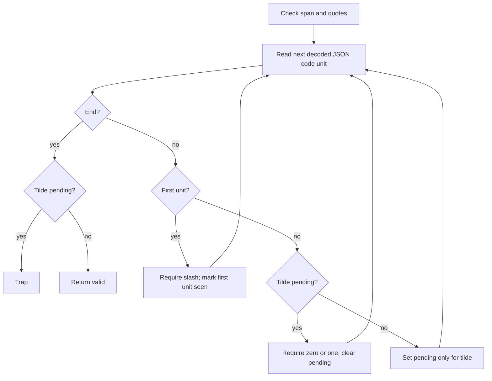

# JSON Pointer validation and descendant paths

This read-only helper supplies the path checks for the JSON Patch pair.
It is not another counted transformation and does not look up a document.
Both functions receive spans of JSON-quoted strings, including the quotes.
They share the four-page memory and the decoded-code-unit iterator from
[JSON string keys](00-json-string-keys.md). Neither writes memory.

- `pointer(start, end)`: validate one complete JSON-quoted pointer.
- `descendant(fromStart, fromEnd, pathStart, pathEnd) -> 0 or 1`: validate
  both pointers, then determine whether `path` is strictly below `from`.
  Equal paths are not descendants. Invalid pointers trap, even if an early
  difference could otherwise decide the comparison.

Spans must be ordered, lie within `0..0x40000`, and contain both quotes.
Ends are exclusive. There is no sentinel byte, allocation or global cursor.
The complete input is checked, including UTF-8 and JSON escapes. As in the
shared string iterator, escaped lone surrogates remain UTF-16 code units.

## Two escaping layers, but only one needs decoding here

[JSON Pointer](https://www.rfc-editor.org/rfc/rfc6901.html#section-3) permits
an empty root pointer or slash-prefixed reference tokens. Within a token,
tilde must be followed by `0` or `1`. The helper validates those pairs after
decoding JSON escapes. It does not interpret percent escapes or URI fragments.

Array bounds, target existence and whether a token denotes an object key or
an array index depend on the target document. They cannot be established here.
Thus `/01`, `/-` and `/a` are all valid pointer syntax. No Unicode normalization
or case folding is performed.

Examples below are JSON strings, not already-decoded path values:

| Input | Interpretation |
| --- | --- |
| `""` | Whole document |
| `"/"` | Empty key at the root |
| `"/a~1b"` | One token whose decoded key contains a slash |
| `"/a/b"` | Two tokens |
| `"/m~0n"` | Tilde within a token |
| `"/m~01"` | Token ending with the two characters tilde and one |
| `"\u002fa\u007e1b"` | Same pointer as `"/a~1b"` |
| `"#/a"` | Rejected: URI-fragment form is not used in JSON Patch |
| `"/a~2"` | Rejected: invalid tilde escape |

### Inside pointer: pending tilde is a state, not a replacement pass

The first decoded unit must be slash, unless the string ends immediately.
After that, one bit records whether a tilde requires its following digit.
Consuming that digit clears the bit; the digit is never reinterpreted as the
beginning of another escape. This handles `~01` without turning it into `/`.

The JSON iterator has its own separate pending low-surrogate word. That word
is passed back on the next call even if its byte cursor has reached the end.
It must not be confused with the pointer parser's pending-tilde bit.

## Inside descendant: stop at a token boundary, not an arbitrary prefix

[JSON Patch move](https://www.rfc-editor.org/rfc/rfc6902.html#section-4.4)
forbids moving a location into its child. Comparing raw JSON bytes would miss
equivalent escaped spellings. Comparing ordinary decoded string prefixes
alone would incorrectly reject `/a` to `/ab`.

After validating both complete inputs, advance two decoded JSON iterators in
lockstep. If a pair differs, return false. When `from` ends, return true only
if the next unit in `path` is slash. This also covers root to any non-root
path, because every non-root path begins with slash. Equal paths end together
and return false.

There is no need to decode the tilde pairs for this comparison. Their valid
encoding is unique, and only a literal slash separates tokens. An encoded
slash, `~1`, remains within its token. JSON escape spellings are not unique,
which is why the JSON iterator is still necessary.

| From | Path | Descendant? |
| --- | --- | --- |
| `""` | `"/a"` | Yes |
| `"/a"` | `"/a/b"` | Yes |
| `"/a"` | `"/ab"` | No |
| `"/a"` | `"/a~1b"` | No |
| `"/a~1b"` | `"/a~1b/c"` | Yes |
| `"/a"` | `"\u002fa/b"` | Yes |
| `"/"` | `"//x"` | Yes |
| `"/a"` | `"/a"` | No |

Each pass is linear in the input spans. Validation before comparison is
intentional: a malformed suffix cannot hide behind a mismatching prefix.
The functions retain no state after returning or trapping.

## Module

Import `k.next` as function 0 and `k.memory`. Defined functions: pointer 1,
descendant 2 and span/quote check 3. The iterator returns unit, cursor and
pending surrogate in that order; local sets consume them in reverse order.

`[microwasm]`

- jp-header: `0061736d 01000000`
- jp-type-section: `01 {{size:jp-types}}`
  - jp-types: `03 60 03 7f 7f 7f 03 7f 7f 7f 60 02 7f 7f 00 60 04 7f 7f 7f 7f 01 7f`
- jp-import-section: `02 {{size:jp-imports}}`
  - jp-imports: `02 01 6b 04 6e657874 00 00 01 6b 06 6d656d6f7279 02 01 04 04`
- jp-function-section: `03 {{size:jp-functions}}`
  - jp-functions: `03 01 02 01`
- jp-export-section: `07 {{size:jp-exports}}`
  - jp-exports: `03 07 706f696e746572 00 01 0a 64657363656e64616e74 00 02 06 6d656d6f7279 02 00`
- jp-code-section: `0a {{size:jp-code}}`
  - jp-code: `03`
    - jp-pointer-record: `{{size:jp-pointer-body}}`
      - jp-pointer-body: `01 04 7f`
        - jp-pointer-span: `20 00 20 01 10 03 20 00 41 01 6a 21 00 20 01 41 01 6b 21 01`
        - jp-pointer-loop: `03 40 20 00 20 01 20 03 10 00 21 03 21 00 21 02`
        - jp-pointer-end: `20 02 41 7f 46 04 40 20 05 04 40 00 0b 0f 0b`
        - jp-pointer-first: `20 04 45 04 40 20 02 41 2f 47 04 40 00 0b 41 01 21 04 05`
        - jp-pointer-escape: `20 05 04 40 20 02 41 30 47 20 02 41 31 47 71 04 40 00 0b 41 00 21 05 05 20 02 41 fe00 46 21 05 0b 0b`
        - jp-pointer-next: `0c 00 0b 0b`
    - jp-descendant-record: `{{size:jp-descendant-body}}`
      - jp-descendant-body: `01 04 7f`
        - jp-descendant-validate: `20 00 20 01 10 01 20 02 20 03 10 01`
        - jp-descendant-interiors: `20 00 41 01 6a 21 00 20 01 41 01 6b 21 01 20 02 41 01 6a 21 02 20 03 41 01 6b 21 03`
        - jp-descendant-loop: `03 40 20 00 20 01 20 05 10 00 21 05 21 00 21 04 20 02 20 03 20 07 10 00 21 07 21 02 21 06`
        - jp-descendant-boundary: `20 04 41 7f 46 04 40 20 06 41 2f 46 0f 0b`
        - jp-descendant-difference: `20 04 20 06 47 04 40 41 00 0f 0b 0c 00 0b 00 0b`
    - jp-span-record: `{{size:jp-span-body}}`
      - jp-span-body: `00 20 00 20 01 4b 20 01 41 808010 4b 72 04 40 00 0b 20 01 20 00 6b 41 02 49 04 40 00 0b 20 00 2d 00 00 41 22 47 20 01 41 01 6b 2d 00 00 41 22 47 72 04 40 00 0b 0b`
