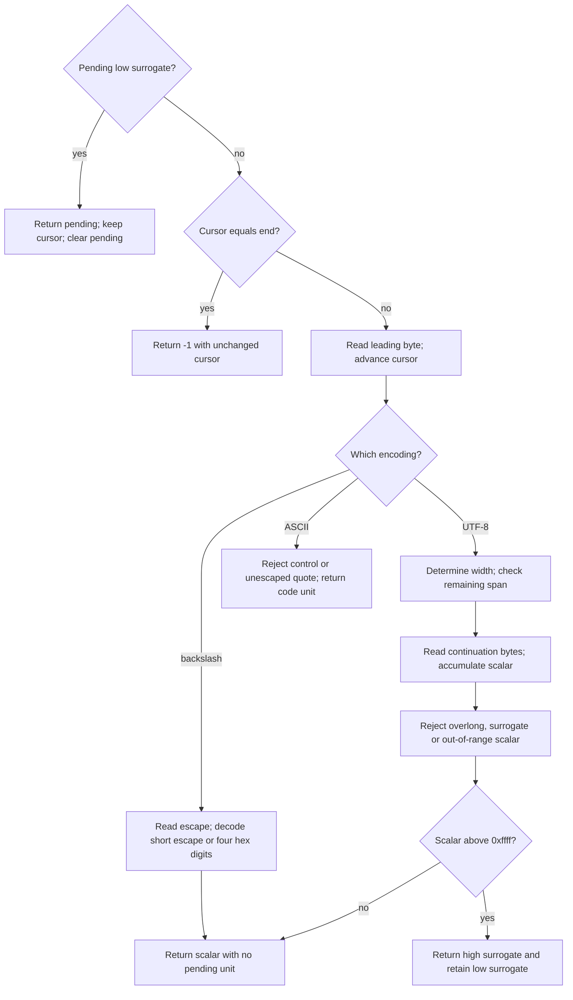
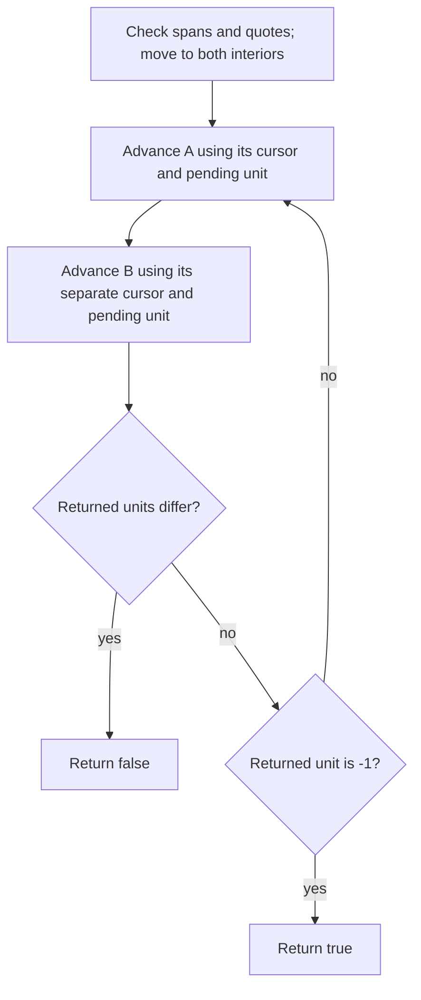

# Comparing JSON keys without allocating strings

Object-to-table conversion needs a union of property names, not a union of
their source spellings. `"name"` and `"\u006eame"` name the same property.
Likewise a literal supplementary character and its escaped surrogate pair
are equal. Comparing UTF-8 source bytes would incorrectly create duplicate
columns. Case folding or Unicode normalization would also be wrong: `"A"`
and `"a"`, and composed/decomposed accented text, remain different keys.

This shared pattern page is executable Microwasm, not an additional tool in
the fifty-tool count. `equal(aStart, aEnd, bStart, bEnd)` compares two already
validated, JSON-quoted UTF-8 strings in shared memory. Ends are exclusive and
include the closing quote. It returns 1 or 0, comparing decoded UTF-16 code
units just as JavaScript string equality does. Empty strings and escaped lone
surrogates are supported; no host string decoding or allocation is involved.

```text
"name"          equals "\u006eame"
"a/b"           equals "a\/b"
"😀"            equals "\uD83D\uDE00"
"\uD800"        equals "\ud800"
"é"             differs from "e\u0301"
"A"             differs from "a"
```

## Pattern: a cursor and one pending code unit

Each iterator keeps a byte cursor and, for a raw four-byte UTF-8 character,
one pending low surrogate. A `\u` escape already represents one UTF-16 code
unit, so adjacent escaped surrogates need no special combination rule.
The raw and escaped forms naturally yield the same two iterator results.

```text
next(cursor, end, pending):
    if pending exists: return pending, cursor, no pending
    if cursor == end: return end marker, cursor, no pending
    read a JSON escape, ASCII byte, or UTF-8 scalar
    if scalar exceeds 0xFFFF:
        return high surrogate, next cursor, pending low surrogate
    return code unit, next cursor, no pending

equal(a, b):
    check both spans and outer quotes; skip those quotes
    repeat:
        advance each iterator
        if units differ: return false
        if both are at end: return true
```

End is `-1`, not zero: an escaped NUL is a legitimate code unit. The pending
unit uses zero as its empty state because a low surrogate cannot be zero.
The comparison performs no writes, retains no globals and needs no scratch
table. It can stop at the first difference, rather than decoding entire keys.

Both input strings must have been validated, for example by the
[shared JSON parser](02-json-to-list.md). This is deliberately not a full
validation API: a differing prefix can return before an invalid suffix is
visited. It does check its memory spans, quoting, and the escapes/UTF-8 it
actually reads. Empty/reversed/out-of-memory spans, incomplete escapes, bad
continuations and invalid scalar encodings trap when encountered. Escaped
surrogates are valid JSON code units; raw UTF-8 encodings of surrogates are not.

## Inside `next-unit`: pending output comes before the source bound



The groups `jk-next-pending` and `jk-next-end` must stay in that order.
After reading a four-byte scalar at the very end, the byte cursor is already
at end but one UTF-16 unit remains to be returned. Checking end first would
silently lose that unit. A pending-only call reads no input bytes.

The escape branch consumes `\` and its following escape letter. A short
escape returns immediately through `short-escape`; `\u` checks room for four
digits and calls `hex-four`. Escaped high and low surrogates are returned
individually, including lone surrogates. They do not use the pending slot.

### Inside the UTF-8 continuation loop

`jk-utf8-two`, `jk-utf8-three` and `jk-utf8-four` select the width and mask
the payload bits from the leading byte. The remaining count is width minus
one. The span check happens before the first continuation load.

- Every iteration checks `(byte & 0xc0) == 0x80`.
- Accumulation is `scalar = (scalar << 6) | (byte & 0x3f)`.
- The cursor increases and the remaining count decreases together.
  A zero remaining count exits; no sentinel byte is read.
- The decoded value must reach the minimum for its width: `0x80`, `0x800`
  or `0x10000`. This rejects overlong encodings even when all continuation
  bytes have the correct shape.
- Reject a value above `0x10ffff` or in `0xd800..0xdfff`. Only then turn a
  supplementary scalar into high/low UTF-16 surrogates.

These correspond to `jk-utf8-loop`, `jk-utf8-minimum`, `jk-utf8-scalar` and
`jk-utf8-pair`. The loop never expands a string in memory. At most two code
units represent the scalar, one returned now and one in the result tuple.

## Inside `equal`: pair the results, not the source positions



One string may consume more bytes per iteration than the other. There is no
test for equal source lengths or equal cursor movement. `jk-equal-a` stores
three Wasm results in reverse stack order: pending, cursor, then code unit;
`jk-equal-b` does the same in its own locals. `jk-equal-difference` runs
before the end test, so ending only one string returns false.

### Trace: raw supplementary character versus two escapes

Offsets below are relative to each string's interior, excluding quotes.
The left interior is the four UTF-8 bytes of `😀`; the right is the twelve
ASCII bytes of `\uD83D\uDE00`. Pending starts at zero on both sides.

| Call | Left result `(unit, cursor, pending)` | Right result `(unit, cursor, pending)` |
| --- | --- | --- |
| First | `(0xd83d, 4, 0xde00)` | `(0xd83d, 6, 0)` |
| Second | `(0xde00, 4, 0)` | `(0xde00, 12, 0)` |
| Third | `(-1, 4, 0)` | `(-1, 12, 0)` |

All three unit pairs agree. Notice the left cursor stays at 4 on its second
call: progress here means either consuming source bytes or draining pending
output, not necessarily increasing the cursor every time.

The short helpers have narrower responsibilities. `check-span` verifies
bounds and outer quotes, not the string interior. `hex-four` runs exactly
four iterations, shifting its accumulator four bits per digit and accepting
both hex cases. `bounded-next`, the exported iterator wrapper, checks its
span and pending-unit range before entering `next-unit`. None changes the
input or shares iteration state with another caller.

## Module

Import `n.memory`, a fixed four-page memory such as the number scanner's.
The input spans may lie anywhere in that memory. Exports are `equal`,
`next`, and `memory`. Functions: next-unit 0, equal 1, hex-four 2, check-span 3,
short-escape 4, bounded-next 5. The iterator returns three i32 values directly
on the Wasm stack; there are no result buffers, calls into JavaScript, or globals.

`next(cursor, end, pending)` exposes that pattern to string emitters. It reads
inside an already validated JSON string, excluding its surrounding quotes.
It returns `(codeUnit, nextCursor, pendingLowSurrogate)`. The caller starts
with pending zero and carries the returned pending value into the next call.
At end it returns `(-1, cursor, 0)`, after yielding any pending low surrogate.
The public wrapper checks the memory span and requires pending to be zero or
a low surrogate. As with `equal`, this is not whole-string validation.

`[microwasm]`

- jk-header: `0061736d 01000000`
- jk-type-section: `01 {{size:jk-types}}`
  - jk-types: `04 60 03 7f 7f 7f 03 7f 7f 7f 60 04 7f 7f 7f 7f 01 7f 60 01 7f 01 7f 60 02 7f 7f 00`
- jk-import-section: `02 {{size:jk-imports}}`
  - jk-imports: `01 01 6e 06 6d656d6f7279 02 01 04 04`
- jk-function-section: `03 {{size:jk-functions}}`
  - jk-functions: `06 00 01 02 03 02 00`
- jk-export-section: `07 {{size:jk-exports}}`
  - jk-exports: `03 05 657175616c 00 01 06 6d656d6f7279 02 00 04 6e657874 00 05`
- jk-code-section: `0a {{size:jk-code}}`
  - jk-code: `06`
    - jk-next-record: `{{size:jk-next-body}}`
      - jk-next-body: `01 05 7f`
        - jk-next-pending: `20 02 04 40 20 02 20 00 41 00 0f 0b`
        - jk-next-end: `20 00 20 01 46 04 40 41 7f 20 00 41 00 0f 0b`
        - jk-next-byte: `20 00 2d 00 00 21 03 20 00 41 01 6a 21 00`
        - jk-next-escape: `20 03 41 dc00 46 04 40`
          - jk-escape-bound: `20 00 20 01 4f 04 40 00 0b`
          - jk-escape-byte: `20 00 2d 00 00 21 03 20 00 41 01 6a 21 00`
          - jk-escape-unicode: `20 03 41 f500 46 04 40`
            - jk-escape-four-bound: `20 00 41 04 6a 20 01 4b 04 40 00 0b`
            - jk-escape-four: `20 00 10 02 20 00 41 04 6a 41 00 0f 0b`
          - jk-escape-short: `20 03 10 04 20 00 41 00 0f 0b`
        - jk-next-ascii: `20 03 41 8001 49 04 40`
          - jk-ascii-control: `20 03 41 20 49 20 03 41 22 46 72 04 40 00 0b`
          - jk-ascii-result: `20 03 20 00 41 00 0f 0b`
        - jk-utf8-leading: `20 03 41 c201 49 20 03 41 f401 4b 72 04 40 00 0b`
        - jk-utf8-two: `20 03 41 e001 49 04 40 41 02 21 04 20 03 41 1f 71 21 05`
          - jk-utf8-three: `05 20 03 41 f001 49 04 40 41 03 21 04 20 03 41 0f 71 21 05`
            - jk-utf8-four: `05 41 04 21 04 20 03 41 07 71 21 05 0b 0b`
        - jk-utf8-count: `20 04 41 01 6b 21 06`
        - jk-utf8-bound: `20 00 20 06 6a 20 01 4b 04 40 00 0b`
        - jk-utf8-loop: `03 40`
          - jk-utf8-byte: `20 00 2d 00 00 21 07`
          - jk-utf8-continuation: `20 07 41 c001 71 41 8001 47 04 40 00 0b`
          - jk-utf8-accumulate: `20 05 41 06 74 20 07 41 3f 71 72 21 05`
          - jk-utf8-next: `20 00 41 01 6a 21 00 20 06 41 01 6b 22 06 0d 00 0b`
        - jk-utf8-minimum: `20 05 20 04 41 02 46 04 7f 41 8001 05 20 04 41 03 46 04 7f 41 8010 05 41 808004 0b 0b 49 04 40 00 0b`
        - jk-utf8-scalar: `20 05 41 ffffc300 4b 20 05 41 80b003 6b 41 ff0f 4d 72 04 40 00 0b`
        - jk-utf8-pair: `20 05 41 808004 4f 04 40`
          - jk-utf8-high: `20 05 41 808004 6b 41 0a 76 41 80b003 6a`
          - jk-utf8-low: `20 00 20 05 41 ff07 71 41 80b803 6a 0f 0b`
        - jk-next-result: `20 05 20 00 41 00 0b`
    - jk-equal-record: `{{size:jk-equal-body}}`
      - jk-equal-body: `01 04 7f`
        - jk-equal-check: `20 00 20 01 10 03 20 02 20 03 10 03`
        - jk-equal-unquote: `20 00 41 01 6a 21 00 20 01 41 01 6b 21 01 20 02 41 01 6a 21 02 20 03 41 01 6b 21 03`
        - jk-equal-loop: `03 40`
          - jk-equal-a: `20 00 20 01 20 06 10 00 21 06 21 00 21 04`
          - jk-equal-b: `20 02 20 03 20 07 10 00 21 07 21 02 21 05`
          - jk-equal-difference: `20 04 20 05 47 04 40 41 00 0f 0b`
          - jk-equal-end: `20 04 41 7f 46 04 40 41 01 0f 0b`
          - jk-equal-next: `0c 00 0b 00 0b`
    - jk-hex-record: `{{size:jk-hex-body}}`
      - jk-hex-body: `01 04 7f`
        - jk-hex-loop: `03 40`
          - jk-hex-byte: `20 00 20 01 6a 2d 00 00 21 03`
          - jk-hex-digit: `20 03 41 30 6b 21 04`
          - jk-hex-letter: `20 04 41 09 4b 04 40 20 03 41 20 72 41 e100 6b 41 0a 6a 21 04`
            - jk-hex-letter-range: `20 04 41 0a 49 20 04 41 0f 4b 72 04 40 00 0b 0b`
          - jk-hex-accumulate: `20 02 41 04 74 20 04 72 21 02`
          - jk-hex-next: `20 01 41 01 6a 22 01 41 04 49 0d 00 0b`
        - jk-hex-result: `20 02 0b`
    - jk-check-record: `{{size:jk-check-body}}`
      - jk-check-body: `00`
        - jk-check-bound: `20 00 20 01 4f 20 01 41 808010 4b 72 04 40 00 0b`
        - jk-check-length: `20 01 20 00 6b 41 02 49 04 40 00 0b`
        - jk-check-quotes: `20 00 2d 00 00 41 22 47 20 01 41 01 6b 2d 00 00 41 22 47 72 04 40 00 0b 0b`
    - jk-short-record: `{{size:jk-short-body}}`
      - jk-short-body: `00`
        - jk-short-literal: `20 00 41 22 46 20 00 41 dc00 46 72 20 00 41 2f 46 72 04 40 20 00 0f 0b`
        - jk-short-backspace: `20 00 41 e200 46 04 40 41 08 0f 0b`
        - jk-short-formfeed: `20 00 41 e600 46 04 40 41 0c 0f 0b`
        - jk-short-newline: `20 00 41 ee00 46 04 40 41 0a 0f 0b`
        - jk-short-return: `20 00 41 f200 46 04 40 41 0d 0f 0b`
        - jk-short-tab: `20 00 41 f400 46 04 40 41 09 0f 0b`
        - jk-short-invalid: `00 0b`
    - jk-bounded-record: `{{size:jk-bounded-body}}`
      - jk-bounded-body: `00`
        - jk-bounded-span: `20 00 20 01 4b 20 01 41 808010 4b 72 04 40 00 0b`
        - jk-bounded-pending: `20 02 04 40 20 02 41 80b803 6b 41 ff07 4b 04 40 00 0b 0b`
        - jk-bounded-next: `20 00 20 01 20 02 10 00 0b`

Next-unit locals: cursor 0, end 1, pending 2, leading/escape byte 3, width 4,
scalar 5, remaining bytes 6, continuation byte 7. Equal locals: start/end
0/1 and 2/3, units 4/5, pending units 6/7. Hex-four locals: start 0, count 1,
value 2, byte 3, digit 4. Every reference to a string is a byte span, not a
zero-terminated address.
