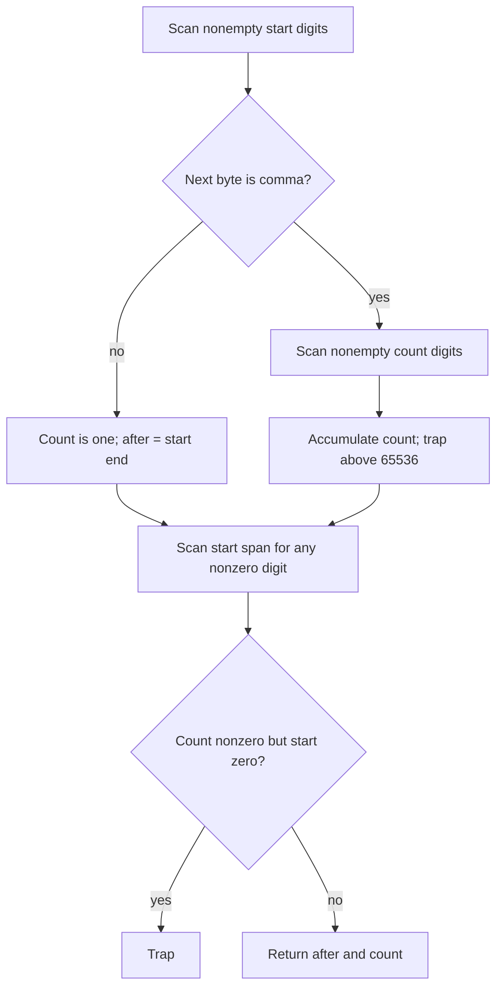

# Unified-diff physical lines and range counts

A read-only helper for the diff pair. It supplies two bounded operations,
not a patch interpreter. It imports `r.digits` and `r.memory` from the
[subtitle span reader](38-srt-to-cues.md); neither operation allocates or
writes memory. Input spans may end at `0x30000`.

- `line(start, end) -> (lineEnd, next)`: find LF, leaving it out of the line
  span. At EOF both results equal `end`. CR is content, not a second kind of
  separator: stripping it from a changed line could change the patched file.
- `range(start, end) -> (after, count)`: read decimal `start[,count]`, without
  the preceding `-` or `+`. An omitted count means one, not zero. Retain the
  digit spelling and return the position of the first unconsumed byte. A
  zero start is legal only with a zero count. Leading zeroes are retained.

The start position stays a decimal span; it is never narrowed to a machine
integer. The count is bounded to 65,536, since that many changed/context lines
cannot fit in a larger supported input anyway. This also prevents numeric
overflow before a hunk could be traversed. This helper does not establish
whether different hunks overlap or can apply to a particular target file.

## Inside range: distinguish absent count from explicit zero

First use `digits` to find the end of the nonempty start. Default the count
to one. Only a following comma enters the count branch, which requires
another nonempty digit span. Each digit updates `count * 10 + digit`, then
checks the small input-derived bound. The previous accumulator was at most
65,536, so this intermediate value cannot overflow an i32.

| Input span | After | Count | Meaning |
| --- | ---: | ---: | --- |
| `12 rest` | 2 | 1 | Singleton range |
| `12,0 rest` | 4 | 0 | Empty range after position 12 |
| `0,0` | 3 | 0 | Empty file side |
| `0007,002` | 8 | 2 | Spelling stays in the caller's source |
| `0` | trap | — | Cannot name line zero |

`line` advances one byte per iteration. It returns at LF without reading
the following byte. A final incomplete line and an empty span therefore have
no special memory requirements. Encoding validation belongs to the caller;
NUL, TAB and CR inside source lines are not silently removed here.

## Module

Import 0 is `digits`. Defined functions are line 1 and range 2. The first
function's bounds check is local; range inherits the same check from digits.

`[microwasm]`

- pl-header: `0061736d 01000000`
- pl-type-section: `01 {{size:pl-types}}`
  - pl-types: `02 60 02 7f 7f 01 7f 60 02 7f 7f 02 7f 7f`
- pl-import-section: `02 {{size:pl-imports}}`
  - pl-imports: `02 01 72 06 646967697473 00 00 01 72 06 6d656d6f7279 02 01 04 04`
- pl-function-section: `03 {{size:pl-functions}}`
  - pl-functions: `02 01 01`
- pl-export-section: `07 {{size:pl-exports}}`
  - pl-exports: `03 04 6c696e65 00 01 05 72616e6765 00 02 06 6d656d6f7279 02 00`
- pl-code-section: `0a {{size:pl-code}}`
  - pl-code: `02`
    - pl-line-record: `{{size:pl-line-body}}`
      - pl-line-body: `00 20 00 20 01 4b 20 01 41 80800c 4b 72 04 40 00 0b 02 40 03 40 20 00 20 01 4f 0d 01 20 00 2d 00 00 41 0a 46 04 40 20 00 20 00 41 01 6a 0f 0b 20 00 41 01 6a 21 00 0c 00 0b 0b 20 01 20 01 0b`
    - pl-range-record: `{{size:pl-range-body}}`
      - pl-range-body: `01 05 7f 20 00 20 01 10 00 22 02 21 03 41 01 21 04`
        - pl-range-comma: `20 03 20 01 49 04 40 20 03 2d 00 00 41 2c 46 04 40 20 03 41 01 6a 22 06 20 01 10 00 21 03 41 00 21 04`
          - pl-range-count: `02 40 03 40 20 06 20 03 4f 0d 01 20 04 41 0a 6c 20 06 2d 00 00 41 30 6b 6a 22 04 41 808004 4b 04 40 00 0b 20 06 41 01 6a 21 06 0c 00 0b 0b 0b 0b`
        - pl-range-zero: `20 00 21 06 02 40 03 40 20 06 20 02 4f 0d 01 20 06 2d 00 00 41 30 47 04 40 41 01 21 05 0c 02 0b 20 06 41 01 6a 21 06 0c 00 0b 0b 20 05 45 20 04 41 00 47 71 04 40 00 0b 20 03 20 04 0b`
