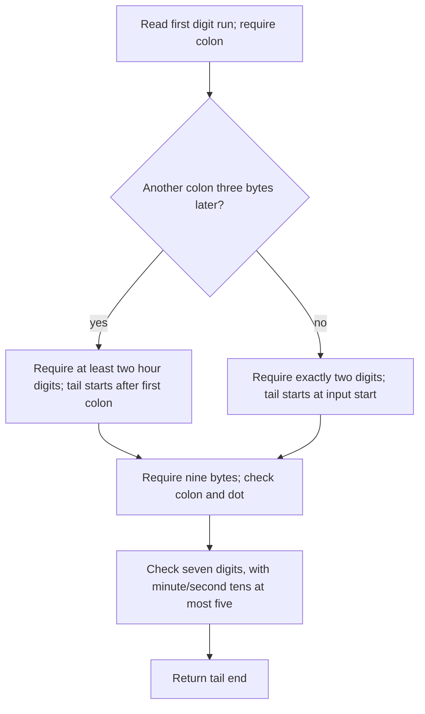
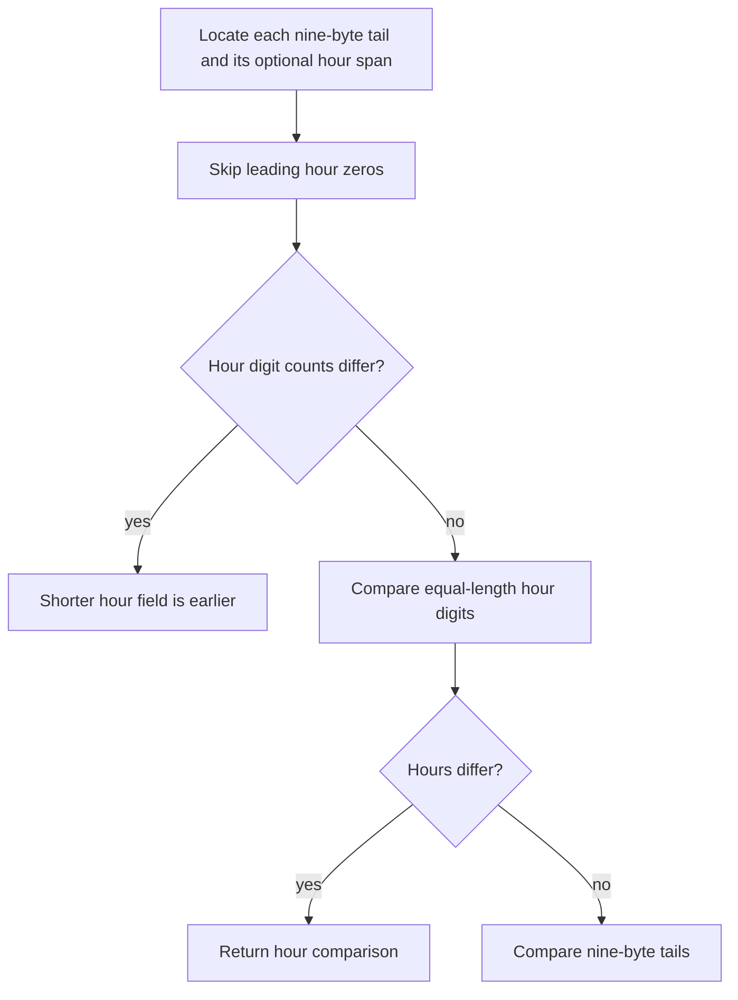

# WebVTT timestamp spans without numeric conversion

This read-only helper supports the WebVTT tools. It is not another counted
transformation. Both reader and writer need the same timestamp grammar and
ordering, including comparisons between timestamps with and without hours.

The [WebVTT timestamp grammar](https://www.w3.org/TR/2026/CRD-webvtt1-20260520/#webvtt-timestamp)
uses `mm:ss.mmm`, optionally preceded by at least two hour digits and a colon.
Minutes and seconds are in 00..59. All three millisecond digits are required.
This differs from SubRip's mandatory hours and comma separator.

## Timestamp: find the tail, then validate it once

`timestamp(start,end) -> next` scans the first digit run and requires a colon.
A second colon three bytes later identifies an hour field. Otherwise the
first run must be exactly two digits, and is the minute field. Both paths
converge on the same nine-byte minute/second/millisecond tail validator.
The returned offset follows the third millisecond digit. The caller decides
whether the next byte may be whitespace, a setting, or the end of its span.

| Form | First digit run | Tail |
| --- | --- | --- |
| `03:07.250` | `03` means minutes | `03:07.250` |
| `12:03:07.250` | `12` means hours | `03:07.250` |
| `0000:03:07.250` | Zero hours, spelling retained | `03:07.250` |
| `12345678901234567890:03:07.250` | Large hours remain a span | `03:07.250` |

## Compare: two independent fields, no synthetic prefix

`compare(aStart,aEnd,bStart,bEnd) -> order` takes two already validated,
complete timestamps and returns -1, 0 or 1. Each tail occupies the last nine
bytes. An omitted hour field is an empty span; a present one ends just before
the colon preceding the tail. Skip its leading zeros without changing memory.

Compare hour digit counts, then equal-width hour digits. Only equal hours
reach the final tail comparison. Tail delimiters occupy identical positions,
so byte ordering is chronological ordering. No integer overflow, binary64
rounding, temporary padded timestamp or allocation is involved.

Thus `59:59.999` precedes `01:00:00.000`, while `00:03:07.250` equals
`03:07.250`. Adding any number of leading hour zeros cannot change ordering.
The reader can use `< 0` for positive cue duration and `<= 0` for ordered
starts. Equality itself remains available to other callers.

Both exports check ordered spans within `0..0x30000`; `compare` also requires
at least nine bytes per span. It relies on its documented timestamp-validation
precondition rather than parsing every timestamp again. All helpers are
reentrant and leave memory unchanged, including on failure.

## Module

Import 0: the SubRip reader's bounded digit scanner, plus its four-page memory.
Functions: timestamp 1, compare 2, bounds 3, equal-width comparison 4.
There are no globals, data segments, scratch writes or host calls.

`[microwasm]`

- vt-header: `0061736d 01000000`
- vt-type-section: `01 {{size:vt-types}}`
  - vt-types: `04 60 02 7f 7f 01 7f 60 04 7f 7f 7f 7f 01 7f 60 02 7f 7f 00 60 03 7f 7f 7f 01 7f`
- vt-import-section: `02 {{size:vt-imports}}`
  - vt-imports: `02 01 72 06 646967697473 00 00 01 72 06 6d656d6f7279 02 01 04 04`
- vt-function-section: `03 {{size:vt-functions}}`
  - vt-functions: `04 00 01 02 03`
- vt-export-section: `07 {{size:vt-exports}}`
  - vt-exports: `03 09 74696d657374616d70 00 01 07 636f6d70617265 00 02 06 6d656d6f7279 02 00`
- vt-code-section: `0a {{size:vt-code}}`
  - vt-code: `04`
    - vt-timestamp-record: `{{size:vt-timestamp-body}}`
      - vt-timestamp-body: `01 04 7f 20 00 20 01 10 00 21 02 20 02 20 01 4f 04 40 00 0b 20 02 2d 00 00 41 3a 47 04 40 00 0b 20 00 21 03`
        - vt-time-hour-test: `20 02 41 03 6a 20 01 49 04 40 20 02 2d 00 03 41 3a 46 04 40 20 02 20 00 6b 41 02 49 04 40 00 0b 20 02 41 01 6a 21 03 0b 0b`
        - vt-time-short: `20 03 20 00 46 04 40 20 02 20 00 6b 41 02 47 04 40 00 0b 0b`
        - vt-time-tail: `20 01 20 03 6b 41 09 49 04 40 00 0b 20 03 2d 00 02 41 3a 47 20 03 2d 00 05 41 2e 47 72 04 40 00 0b`
        - vt-time-loop: `02 40 03 40 20 04 41 09 4f 0d 01 20 04 41 02 46 20 04 41 05 46 72 04 40 05 20 03 20 04 6a 2d 00 00 41 30 6b 21 05 20 05 41 09 4b 04 40 00 0b`
          - vt-time-tens: `20 04 45 20 04 41 03 46 72 20 05 41 05 4b 71 04 40 00 0b 0b 20 04 41 01 6a 21 04 0c 00 0b 0b 20 03 41 09 6a 0b`
    - vt-compare-record: `{{size:vt-compare-body}}`
      - vt-compare-body: `01 05 7f 20 00 20 01 10 03 20 02 20 03 10 03 20 01 20 00 6b 41 09 49 20 03 20 02 6b 41 09 49 72 04 40 00 0b`
        - vt-compare-tails: `20 01 41 09 6b 21 06 20 03 41 09 6b 21 07 20 00 21 04 20 02 21 05 20 06 20 00 4b 04 40 20 06 41 01 6b 21 04 0b 20 07 20 02 4b 04 40 20 07 41 01 6b 21 05 0b`
        - vt-compare-left: `02 40 03 40 20 00 20 04 4f 0d 01 20 00 2d 00 00 41 30 47 0d 01 20 00 41 01 6a 21 00 0c 00 0b 0b`
        - vt-compare-right: `02 40 03 40 20 02 20 05 4f 0d 01 20 02 2d 00 00 41 30 47 0d 01 20 02 41 01 6a 21 02 0c 00 0b 0b`
        - vt-compare-width: `20 04 20 00 6b 20 05 20 02 6b 47 04 40 20 04 20 00 6b 20 05 20 02 6b 49 04 7f 41 7f 05 41 01 0b 0f 0b`
        - vt-compare-hours: `20 00 20 04 20 02 10 04 22 08 04 40 20 08 0f 0b 20 06 20 01 20 07 10 04 0b`
    - vt-bounds-record: `{{size:vt-bounds-body}}`
      - vt-bounds-body: `00 20 00 20 01 4b 20 01 41 80800c 4b 72 04 40 00 0b 0b`
    - vt-lex-record: `{{size:vt-lex-body}}`
      - vt-lex-body: `01 02 7f 02 40 03 40 20 00 20 01 4f 0d 01 20 00 2d 00 00 21 03 20 02 2d 00 00 21 04 20 03 20 04 47 04 40 20 03 20 04 49 04 7f 41 7f 05 41 01 0b 0f 0b 20 00 41 01 6a 21 00 20 02 41 01 6a 21 02 0c 00 0b 0b 41 00 0b`
