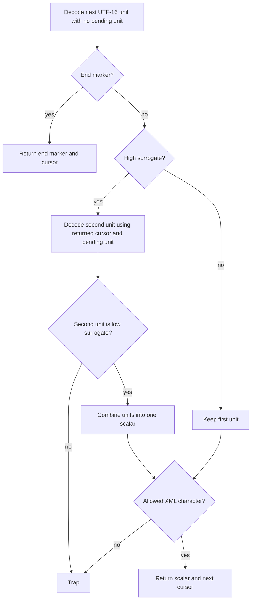
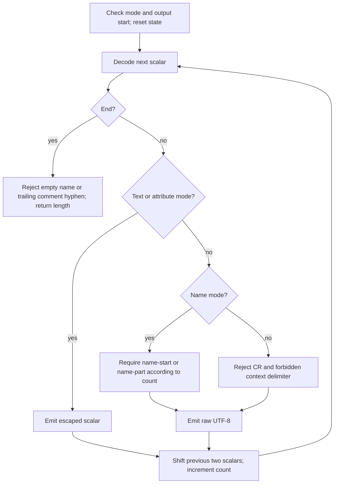

# Emitting XML from JSON string spans

This is a shared Wasm pattern for the XML writer, not another transformation.
It decodes validated JSON string interiors without allocating strings, checks
XML characters, and emits UTF-8 with the escaping appropriate to the context.
It shares the Unicode iterator and XML name/character predicates with the
reader. There are no data segments: the final memory page remains available
for the caller's compact JSON after the list compiler finishes.

## Interfaces and modes

- `scalar(start, end) -> (character, next)`: decode one scalar from a JSON
  string interior. Escaped surrogate pairs and raw astral UTF-8 give the same
  result. Lone surrogates and non-XML characters trap. End returns `-1` and
  the unchanged cursor; it is not confused with a NUL character, which is
  forbidden in XML anyway.
- `string(start, end, output, mode) -> length`: emit the decoded interior,
  without adding quotes or markup delimiters. All input must already be a
  validated JSON string, excluding its outer quotes. Ends are exclusive.

| Mode | Context | Escaping or additional checks |
| --- | --- | --- |
| 0 | Text | Escape ampersand, less-than and greater-than; reference CR. |
| 1 | Double-quoted attribute | Text escaping, plus double quote and references for TAB/LF/CR. |
| 2 | Literal span | No escaping; reject CR, which XML would normalize. |
| 3 | Name | Nonempty XML name; first and subsequent character classes differ. |
| 4 | Comment interior | Literal rules, no double hyphen or trailing hyphen. |
| 5 | CDATA interior | Literal rules, no closing CDATA sequence. |
| 6 | PI data | Literal rules, no PI close, no leading XML whitespace. |

PI separator whitespace belongs to the markup, not the reader's `data` field.
An edited data string beginning with whitespace therefore cannot round-trip
through that representation and is rejected. Empty PI data is allowed.
Comment/CDATA/PI boundaries are retained rather than silently splitting one
node into several to accommodate an otherwise unrepresentable string.

All modes reject forbidden XML characters, even ones written as JSON escapes.
Text CR becomes `&#13;`, and attribute TAB/LF/CR become numeric references:
emitting those characters literally would change the data on the next XML
parse. Literal-mode entities would stay literal, so they cannot solve that
problem. The caller must validate the document structure and supply delimiters.

Source spans can occupy any of the shared four memory pages. Output is bounded
to `0x10000..0x30000`; the caller keeps source and output disjoint. Each call
resets the output cursor and context state. Failed output must not be published.

## Inside `scalar`: consume a pair or reject it

The pending unit exists only for the iterator's decoding of raw four-byte
UTF-8. An escaped high surrogate instead requires reading the next escape.
Both paths finish with one scalar and no pending unit. Unlike the query
writer, XML output must reject a lone surrogate rather than replace it.
The XML predicate also rejects NUL, forbidden controls and U+FFFE/U+FFFF.

## Inside `string`: context checks before emission

| Local | State | Why it persists across iterations |
| --- | --- | --- |
| 0 | Next source cursor | Updated only by successful scalar decoding. |
| 1 | Source end | Fixed boundary, not an output limit. |
| 2 | Original output start | Subtracted from the final cursor for the return value. |
| 3 | Mode | Selects checks and escaping. |
| 4 | Current scalar | Validated before output. |
| 5, 6 | Previous and second-previous scalar | Detect `--`, `?>` and `]]>` without a string buffer. |
| 7 | Scalar count | First-name-character and leading-PI-space checks; empty-name rejection. |

The look-behind values start at zero, which cannot occur as a legal XML
character. They are updated after emission, so checks see the preceding
characters, not the current one twice. Only comment mode checks the final
character again: a trailing hyphen would combine with the closing delimiter.

`escaped` handles context, `utf8` handles scalar encoding, and `emit` alone
does memory stores. `reference` is intentionally small: its callers pass only
9, 10 or 13, so it needs at most two decimal digits. No general number formatter
or persistent entity table is needed for these three fixed cases.

## Module

Imports: `k.next` 0, `x.character` 1, `x.nameStart` 2, `x.namePart` 3.
Definitions: scalar 4, string 5, emit 6, UTF-8 7, escaped 8, reference 9.
Memory is `x.memory`, the same memory used by `k`. Global 0 is the output cursor.

`[microwasm]`

- xo-header: `0061736d 01000000`
- xo-type-section: `01 {{size:xo-types}}`
  - xo-types: `06 60 03 7f 7f 7f 03 7f 7f 7f 60 01 7f 01 7f 60 02 7f 7f 02 7f 7f 60 04 7f 7f 7f 7f 01 7f 60 01 7f 00 60 02 7f 7f 00`
- xo-import-section: `02 {{size:xo-imports}}`
  - xo-imports: `05 01 6b 04 6e657874 00 00 01 78 09 636861726163746572 00 01 01 78 09 6e616d655374617274 00 01 01 78 08 6e616d6550617274 00 01 01 78 06 6d656d6f7279 02 01 04 04`
- xo-function-section: `03 {{size:xo-functions}}`
  - xo-functions: `06 02 03 04 04 05 04`
- xo-global-section: `06 {{size:xo-globals}}`
  - xo-globals: `01 7f 01 41 00 0b`
- xo-export-section: `07 {{size:xo-exports}}`
  - xo-exports: `03 06 7363616c6172 00 04 06 737472696e67 00 05 06 6d656d6f7279 02 00`
- xo-code-section: `0a {{size:xo-code}}`
  - xo-code: `06`
    - xo-scalar-record: `{{size:xo-scalar-body}}`
      - xo-scalar-body: `01 04 7f`
        - xo-scalar-first: `20 00 20 01 41 00 10 00 21 02 21 04 21 03`
        - xo-scalar-end: `20 03 41 7f 46 04 40 20 03 20 04 0f 0b`
        - xo-scalar-high: `20 03 41 80b003 6b 41 ff07 4d 04 40`
          - xo-scalar-second: `20 04 20 01 20 02 10 00 21 02 21 04 21 05`
          - xo-scalar-low-required: `20 05 41 80b803 6b 41 ff07 4b 04 40 00 0b`
          - xo-scalar-combine: `20 03 41 80b003 6b 41 0a 74 20 05 41 80b803 6b 6a 41 808004 6a 21 03 0b`
        - xo-scalar-valid: `20 03 10 01 45 04 40 00 0b 20 03 20 04 0b`
    - xo-string-record: `{{size:xo-string-body}}`
      - xo-string-body: `01 04 7f`
        - xo-string-mode: `20 03 41 06 4b 04 40 00 0b`
        - xo-string-output: `20 02 41 808004 49 20 02 41 80800c 4b 72 04 40 00 0b 20 02 24 00`
        - xo-string-exit: `02 40`
          - xo-string-loop: `03 40`
            - xo-string-next: `20 00 20 01 10 04 21 00 21 04 20 04 41 7f 46 0d 01`
            - xo-string-escaped: `20 03 41 01 4d 04 40 20 04 20 03 10 08`
            - xo-string-name: `05 20 03 41 03 46 04 40 20 07 45 04 7f 20 04 10 02 05 20 04 10 03 0b 45 04 40 00 0b`
            - xo-string-literal: `05 20 04 41 0d 46 04 40 00 0b`
              - xo-string-comment: `20 03 41 04 46 20 04 41 2d 46 71 20 05 41 2d 46 71 04 40 00 0b`
              - xo-string-cdata: `20 03 41 05 46 20 04 41 3e 46 71 20 05 41 dd00 46 71 20 06 41 dd00 46 71 04 40 00 0b`
              - xo-string-pi: `20 03 41 06 46 04 40`
                - xo-string-pi-close: `20 04 41 3e 46 20 05 41 3f 46 71 04 40 00 0b`
                - xo-string-pi-first: `20 07 45 04 40 20 04 41 20 46 20 04 41 09 46 72 20 04 41 0a 46 72 04 40 00 0b 0b 0b 0b`
            - xo-string-utf8: `20 04 10 07 0b`
            - xo-string-state: `20 05 21 06 20 04 21 05 20 07 41 01 6a 21 07 0c 00 0b`
          - xo-string-loop-end: `0b`
        - xo-string-empty-name: `20 03 41 03 46 20 07 45 71 04 40 00 0b`
        - xo-string-comment-end: `20 03 41 04 46 20 05 41 2d 46 71 04 40 00 0b`
        - xo-string-result: `23 00 20 02 6b 0b`
    - xo-emit-record: `{{size:xo-emit-body}}`
      - xo-emit-body: `00 23 00 41 80800c 4f 04 40 00 0b 23 00 20 00 3a 00 00 23 00 41 01 6a 24 00 0b`
    - xo-utf8-record: `{{size:xo-utf8-body}}`
      - xo-utf8-body: `00`
        - xo-utf8-ascii: `20 00 41 8001 49 04 40 20 00 10 06 0f 0b`
        - xo-utf8-two: `20 00 41 8010 49 04 40 20 00 41 06 76 41 c001 72 10 06`
          - xo-utf8-more: `05 20 00 41 808004 49 04 40 20 00 41 0c 76 41 e001 72 10 06`
            - xo-utf8-four: `05 20 00 41 12 76 41 f001 72 10 06 20 00 41 0c 76 41 3f 71 41 8001 72 10 06 0b`
          - xo-utf8-middle: `20 00 41 06 76 41 3f 71 41 8001 72 10 06 0b`
        - xo-utf8-last: `20 00 41 3f 71 41 8001 72 10 06 0b`
    - xo-escaped-record: `{{size:xo-escaped-body}}`
      - xo-escaped-body: `00`
        - xo-escape-amp: `20 00 41 26 46 04 40 41 26 10 06 41 e100 10 06 41 ed00 10 06 41 f000 10 06 41 3b 10 06 0f 0b`
        - xo-escape-less: `20 00 41 3c 46 04 40 41 26 10 06 41 ec00 10 06 41 f400 10 06 41 3b 10 06 0f 0b`
        - xo-escape-greater: `20 00 41 3e 46 04 40 41 26 10 06 41 e700 10 06 41 f400 10 06 41 3b 10 06 0f 0b`
        - xo-escape-quote: `20 01 20 00 41 22 46 71 04 40 41 26 10 06 41 f100 10 06 41 f500 10 06 41 ef00 10 06 41 f400 10 06 41 3b 10 06 0f 0b`
        - xo-escape-whitespace: `20 00 41 0d 46 20 01 20 00 41 09 46 20 00 41 0a 46 72 71 72 04 40 20 00 10 09 0f 0b`
        - xo-escape-plain: `20 00 10 07 0b`
    - xo-reference-record: `{{size:xo-reference-body}}`
      - xo-reference-body: `00`
        - xo-reference-open: `41 26 10 06 41 23 10 06`
        - xo-reference-tens: `20 00 41 09 4b 04 40 41 31 10 06 20 00 41 0a 6b 21 00 0b`
        - xo-reference-last: `20 00 41 30 6a 10 06 41 3b 10 06 0b`
