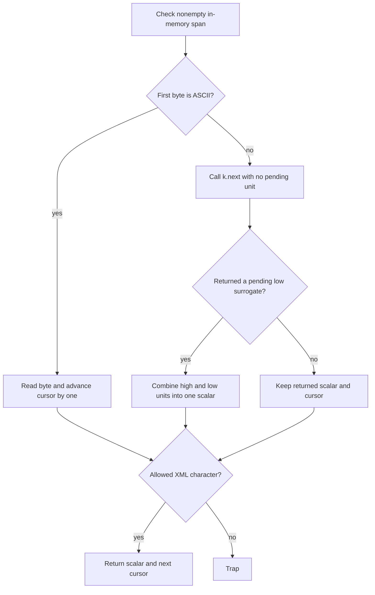
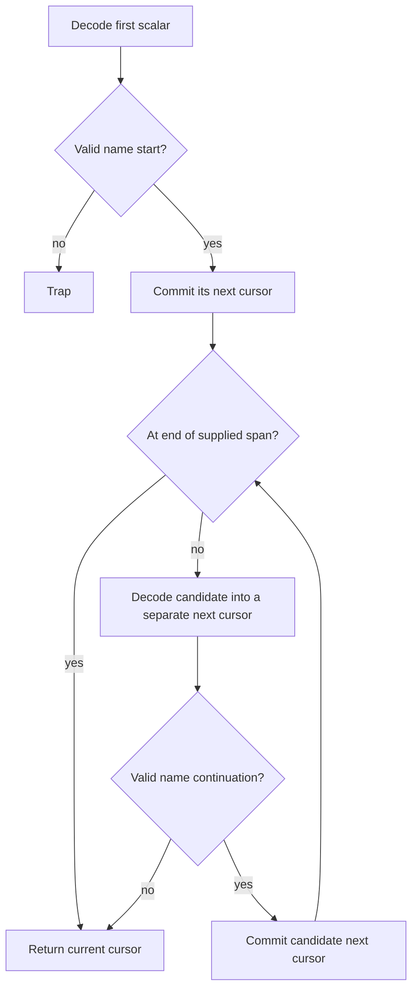
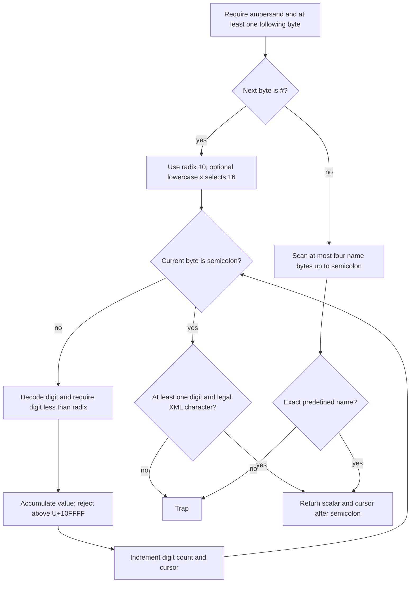
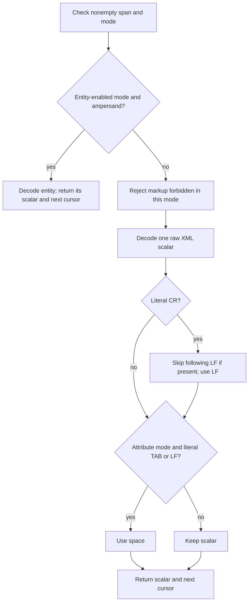

# XML characters, names and decoded strings

This is a shared executable pattern for the XML reader and writer, not an
additional tool in the fifty-tool count. It implements XML 1.0 Fifth Edition
[characters and names](https://www.w3.org/TR/xml/#sec-common-syn), the five
predefined entities and decimal/hexadecimal character references.
There is no DTD, entity declaration, external resource or namespace resolver.
Names are lexical XML names, including Unicode and colons; namespace binding
checks belong to a namespace-aware consumer, not this helper.

## Interfaces

- `character(scalar) -> boolean`: whether an integer is an XML character.
- `nameStart(scalar) -> boolean`, `namePart(scalar) -> boolean`: the XML name
  productions, including their exact Unicode intervals, not locale classes.
- `scalar(start, end) -> (scalar, next)`: decode one raw UTF-8 XML character.
  Backslashes remain ordinary characters. Malformed UTF-8 and forbidden XML
  characters trap. Spans may use any of the shared memory's four pages.
- `nameEnd(start, end) -> next`: require one name and scan to its first
  non-name character. A digit or combining mark cannot begin a name.
- `entity(start, end) -> (scalar, next)`: require an `&` reference and consume
  it through `;`. Named references are case-sensitive. Hexadecimal references
  use lowercase `x`, with either case for their digits. A numeric reference
  must contain digits and resolve to an allowed XML character.
- `next(start, end, mode) -> (scalar, next)`: decode one XML text, attribute
  or literal character using modes 0, 1 and 2 below. It handles references
  and line-ending/attribute normalization, but writes nothing. The span must
  be nonempty; callers stop when their cursor reaches end. This lets a format
  converter consume decoded XML without constructing JSON strings first.
- `string(start, end, output, mode) -> length`: emit a JSON-quoted string,
  including both quotes. Mode 0 decodes text, 1 decodes an attribute value,
  and 2 handles literal content such as CDATA or comments. The caller removes
  markup/attribute delimiters first. Each resulting string fits on one physical
  Markdown list line; quote, backslash, tab, LF and CR are escaped.

Mode 0 rejects raw `<` and `]]>`; mode 1 rejects raw `<`. Mode 2 does not
expand entities or interpret markup. Its caller still checks the enclosing
construct's syntax, such as forbidden `--` inside a comment.

## Pattern: distinguish raw whitespace from character references

XML normalizes literal CRLF and lone CR to LF. In attribute values, literal
tab, LF and CR become spaces. A numeric character reference to one of those
characters preserves it instead. This helper keeps those two paths separate.
It treats attributes as CDATA-valued, without DTD-dependent token collapsing.
See [attribute normalization](https://www.w3.org/TR/xml/#AVNormalize) and
[end-of-line handling](https://www.w3.org/TR/xml/#sec-line-ends).

```text
for each input character:
  entity-enabled mode and '&': decode one reference, retaining its character
  otherwise:
    decode a raw XML character
    normalize CRLF or CR to LF
    attribute mode: change literal tab/LF to space
  emit the character as JSON string data
```

The raw decoder handles ASCII directly, then uses the existing JSON-string
iterator only for non-ASCII UTF-8. Thus its JSON escape behavior never sees
an XML backslash. The iterator's pending surrogate, when present, reconstructs
one astral scalar immediately. This reuses tested UTF-8 validation without
copying strings or asking a host parser to do the work.

Numeric references accumulate with an upper bound of U+10FFFF after every
digit. Leading zeros are allowed, but overflow cannot wrap around into a
valid scalar. Named references use direct comparisons, not a mutable entity
table. All state is scalar locals except the string output cursor, reset
on every string call. There are no data segments to be overwritten when the
list compiler later reuses scratch memory.

Input spans are bounded by the fixed four-page memory. String output must
start in `0x10000..0x30000` and stores stop before `0x30000`. The caller keeps
input and output disjoint. Input bytes are never changed. Failed output may
be partial and must not be published; the next call resets the output cursor.

## Inside the functions

These walkthroughs use the byte-list labels below. They explain the decisions
inside the routines, not just which routine calls which. The Mermaid source
is intentionally visible in the current lightweight Markdown renderer.

### `scalar`: decode first, then check XML legality



- `xs-scalar-bound` prevents an empty span or out-of-memory read. The UTF-8
  iterator performs the continuation and scalar-encoding checks on its path.
- `xs-scalar-ascii` reads a backslash as byte 92. It deliberately bypasses
  the JSON iterator's escape handling, so XML `\n` stays two characters.
- `xs-scalar-astral` consumes the iterator's already-decoded pending unit;
  it does not read another character from memory. The cursor already points
  after the four UTF-8 bytes.
- `xs-scalar-xml` rejects otherwise valid UTF-8 such as NUL or U+FFFE.
  Valid UTF-8 is necessary, but not sufficient, for XML character data.

### `character`, `nameStart`, `namePart`: ranges, not a scanner

These predicates never read memory or advance a cursor. Each interval test
uses unsigned `(value - lower) <= (upper - lower)`. A value below the interval
wraps to a large unsigned difference and fails the same comparison.

| Predicate portion | Accepted values | Why it is separate |
| --- | --- | --- |
| `character` whitespace | TAB, LF, CR | Other characters below U+0020 are forbidden. |
| `character` BMP | U+0020–D7FF, U+E000–FFFD | Surrogates and the final two BMP noncharacters are excluded. |
| `character` astral | U+10000–10FFFF | XML's character range is broader than its name range. |
| `nameStart` ASCII fast path | Letters, colon, underscore | Common names return without testing the Unicode intervals. |
| `nameStart` Unicode path | The XML production's explicit intervals | Not every legal XML character can start a name. |
| `namePart` additions | Digits, hyphen, dot, U+00B7, U+0300–036F, U+203F–2040 | These may follow, but not replace, the initial name character. |

The non-ASCII `nameStart` expression is grouped into these byte-list sections.
Each row contributes more alternatives to the same Boolean result; it does
not require matching every interval in that row.

| Byte-list group | Inclusive code-point intervals |
| --- | --- |
| `xs-name-start-latin` | 00C0–00D6, 00D8–00F6, 00F8–02FF |
| `xs-name-start-greek` | 0370–037D, 037F–1FFF |
| `xs-name-start-middle` | 200C–200D, 2070–218F, 2C00–2FEF, 3001–D7FF |
| `xs-name-start-high` | F900–FDCF, FDF0–FFFD, 10000–EFFFF |

### `nameEnd`: look ahead without swallowing a delimiter



`xs-name-end-first` requires at least one character; an empty name is not a
successful zero-length token. In `xs-name-end-loop`, local 2 holds the
candidate cursor while local 0 still points at the candidate's first byte.
If the candidate is `=`, `>` or whitespace, the routine returns local 0.
The document parser can then consume that delimiter itself. A malformed
UTF-8 candidate still traps: it is not treated as an innocent delimiter.

### `entity`: two bounded paths with different termination rules



- `xs-entity-bound` checks the opening `&`. Both loops check their bounds
  before reading, so a missing semicolon cannot read beyond the supplied span.
- `xs-entity-digit-value` rejects a failed hex conversion using an unsigned
  comparison. The `-1` sentinel is larger than either accepted radix.
- `xs-entity-accumulate` checks after every digit, not only at the end. With
  the prior value capped at U+10FFFF, multiplying by at most 16 cannot wrap
  an i32 before this check. Leading zeros still count as digits.
- `xs-entity-two`, `-three`, and `-four` select `lt`/`gt`, `amp`, and
  `quot`/`apos`. Length alone is never enough: every name byte is compared.
- The terminating semicolon is consumed in the returned cursor. Following
  text remains unread. No recursive entity substitution takes place.

### `next` and `string`: references bypass literal-space normalization



The early return at `xs-next-entity` is the important semantic boundary: `&#13;`
in an attribute must remain a CR, while a literal CR becomes a space. The
entity branch bypasses both `xs-next-cr` and `xs-next-attribute-space`.

`xs-next-cdata-close` checks the raw bytes for `]]>` before decoding. Thus
`]]&gt;` is allowed in text even though it produces the same decoded characters.
Literal mode skips both markup checks and entity decoding, but still checks
XML characters and normalizes line endings.

`next` uses only locals and returns two integers. It never updates the string
output cursor or changes memory. A raw CRLF consumes two source bytes while
returning one LF (or space in attribute mode). `&#13;` consumes its full
reference and returns CR in either mode. An escaped less-than character is
data; a raw less-than character traps in text/attribute modes.

`string` is now the bounded output loop around this iterator: emit the opening
quote, call `next` while the input cursor is below end, JSON-escape each returned
scalar, then emit the closing quote. Store the returned cursor before calling
the output helper. Empty strings never call `next`, but still emit two quotes.
This keeps the normalization decisions in one implementation for both APIs.

### `emit` and `JSON-scalar`: storage versus representation

`emit` checks capacity before each store and advances the shared output cursor
only after the store. A later failure does not roll back earlier bytes; the
caller must withhold the partial result. Every new `string` call resets that
cursor from its explicit output argument.

`JSON-scalar` receives an already validated XML scalar. Its branch order is:

1. TAB, LF or CR: emit a backslash and the short escape letter, then return.
2. Quote or backslash: emit a backslash prefix, then continue to ASCII output.
3. ASCII: emit one byte and return.
4. Below U+0800: emit a two-byte UTF-8 prefix, then the common final byte.
5. Below U+10000: emit a three-byte prefix, then the common lower two bytes.
6. Otherwise: emit the first two bytes of a four-byte sequence, then the same
   lower two bytes. The bit masks prevent bits from neighboring groups leaking.

The small `hex-value` routine used by `entity` tries decimal digits first,
then folds ASCII case for A–F, and returns `-1` for anything else. It does
not itself decide whether hexadecimal digits are allowed in the current radix.

## Module

Import the JSON iterator as `k.next` (function 0) and `k.memory`. Definitions:
scalar 1, character 2, name-start 3, name-part 4, name-end 5, entity 6,
string 7, emit 8, JSON-scalar 9, hex-value 10, next 11.
Global 0 is the output cursor.

`[microwasm]`

- xs-header: `0061736d 01000000`
- xs-type-section: `01 {{size:xs-types}}`
  - xs-types: `07 60 03 7f 7f 7f 03 7f 7f 7f 60 02 7f 7f 02 7f 7f 60 01 7f 01 7f 60 02 7f 7f 01 7f 60 04 7f 7f 7f 7f 01 7f 60 01 7f 00 60 03 7f 7f 7f 02 7f 7f`
- xs-import-section: `02 {{size:xs-imports}}`
  - xs-imports: `02 01 6b 04 6e657874 00 00 01 6b 06 6d656d6f7279 02 01 04 04`
- xs-function-section: `03 {{size:xs-functions}}`
  - xs-functions: `0b 01 02 02 02 03 01 04 05 05 02 06`
- xs-global-section: `06 {{size:xs-globals}}`
  - xs-globals: `01 7f 01 41 00 0b`
- xs-export-section: `07 {{size:xs-exports}}`
  - xs-exports: `09 06 7363616c6172 00 01 09 636861726163746572 00 02 09 6e616d655374617274 00 03 08 6e616d6550617274 00 04 07 6e616d65456e64 00 05 06 656e74697479 00 06 06 737472696e67 00 07 06 6d656d6f7279 02 00 04 6e657874 00 0b`
- xs-code-section: `0a {{size:xs-code}}`
  - xs-code: `0b`
    - xs-scalar-record: `{{size:xs-scalar-body}}`
      - xs-scalar-body: `01 02 7f`
        - xs-scalar-bound: `20 00 20 01 4f 20 01 41 808010 4b 72 04 40 00 0b` — Require start before end and end within memory.
        - xs-scalar-ascii: `20 00 2d 00 00 22 02 41 8001 49 04 40 20 00 41 01 6a 21 00`
        - xs-scalar-utf8: `05 20 00 20 01 41 00 10 00 21 03 21 00 21 02`
          - xs-scalar-astral: `20 03 04 40 20 02 41 80b003 6b 41 0a 74 20 03 41 80b803 6b 6a 41 808004 6a 21 02 0b 0b` — Combine the iterator's high and pending low units; no extra input read.
        - xs-scalar-xml: `20 02 10 02 45 04 40 00 0b 20 02 20 00 0b`
    - xs-character-record: `{{size:xs-character-body}}`
      - xs-character-body: `00 20 00 41 09 46 20 00 41 0a 46 72 20 00 41 0d 46 72 20 00 41 20 6b 41 dfaf03 4d 72 20 00 41 80c003 6b 41 fd3f 4d 72 20 00 41 808004 6b 41 ffff3f 4d 72 0b`
    - xs-name-start-record: `{{size:xs-name-start-body}}`
      - xs-name-start-body: `00`
        - xs-name-start-ascii: `20 00 41 8001 49 04 40 20 00 41 c100 6b 41 19 4d 20 00 41 e100 6b 41 19 4d 72 20 00 41 3a 46 72 20 00 41 df00 46 72 0f 0b`
        - xs-name-start-latin: `20 00 41 c001 6b 41 16 4d 20 00 41 d801 6b 41 1e 4d 72 20 00 41 f801 6b 41 8704 4d 72`
        - xs-name-start-greek: `20 00 41 f006 6b 41 0d 4d 72 20 00 41 ff06 6b 41 8039 4d 72`
        - xs-name-start-middle: `20 00 41 8cc000 6b 41 01 4d 72 20 00 41 f0c000 6b 41 9f02 4d 72 20 00 41 80d800 6b 41 ef07 4d 72 20 00 41 81e000 6b 41 fecf02 4d 72`
        - xs-name-start-high: `20 00 41 80f203 6b 41 cf09 4d 72 20 00 41 f0fb03 6b 41 8d04 4d 72 20 00 41 808004 6b 41 ffff37 4d 72 0b`
    - xs-name-part-record: `{{size:xs-name-part-body}}`
      - xs-name-part-body: `00 20 00 10 03 20 00 41 2d 46 72 20 00 41 2e 46 72 20 00 41 30 6b 41 09 4d 72 20 00 41 b701 46 72 20 00 41 8006 6b 41 ef00 4d 72 20 00 41 bfc000 6b 41 01 4d 72 0b`
    - xs-name-end-record: `{{size:xs-name-end-body}}`
      - xs-name-end-body: `01 01 7f`
        - xs-name-end-first: `20 00 20 01 10 01 21 00 10 03 45 04 40 00 0b`
        - xs-name-end-loop: `02 40 03 40`
          - xs-name-end-at-end: `20 00 20 01 4f 0d 01` — Leave the loop without reading at end.
          - xs-name-end-candidate: `20 00 20 01 10 01 21 02` — Keep the candidate cursor separate from the committed cursor.
          - xs-name-end-delimiter: `10 04 45 0d 01` — Return before the candidate if it is not a name continuation.
          - xs-name-end-commit: `20 02 21 00 0c 00 0b 0b 20 00 0b` — Commit and repeat, or return the retained cursor after leaving the loop.
    - xs-entity-record: `{{size:xs-entity-body}}`
      - xs-entity-body: `01 06 7f`
        - xs-entity-bound: `20 00 20 01 4f 20 01 41 808010 4b 72 04 40 00 0b 20 00 2d 00 00 41 26 47 04 40 00 0b 20 00 41 01 6a 21 00 20 00 20 01 4f 04 40 00 0b`
        - xs-entity-numeric: `20 00 2d 00 00 41 23 46 04 40 20 00 41 01 6a 21 00 41 0a 21 03`
          - xs-entity-hex-prefix: `20 00 20 01 49 04 40 20 00 2d 00 00 41 f800 46 04 40 41 10 21 03 20 00 41 01 6a 21 00 0b 0b`
          - xs-entity-digits: `03 40`
            - xs-entity-digit-bound: `20 00 20 01 4f 04 40 00 0b` — Reaching end before the semicolon is an error.
            - xs-entity-digit-byte: `20 00 2d 00 00 22 04 41 3b 46 04 40` — A semicolon takes the terminating branch.
              - xs-entity-digit-required: `20 05 45 04 40 00 0b` — Reject a reference with no digits.
              - xs-entity-character-required: `20 02 10 02 45 04 40 00 0b` — Reject forbidden XML scalars even when their numeric spelling is valid.
              - xs-entity-digit-return: `20 02 20 00 41 01 6a 0f 0b` — Return the scalar and consume the semicolon.
            - xs-entity-digit-value: `20 04 10 0a 22 04 20 03 4f 04 40 00 0b`
            - xs-entity-accumulate: `20 02 20 03 6c 20 04 6a 22 02 41 ffffc300 4b 04 40 00 0b` — Multiply, add the digit, and enforce the scalar upper bound immediately.
            - xs-entity-digit-next: `20 05 41 01 6a 21 05 20 00 41 01 6a 21 00 0c 00 0b 0b` — Count the digit, advance and repeat; close the numeric branch after the loop.
        - xs-entity-name-start: `20 00 21 06`
        - xs-entity-name-loop: `02 40 03 40 20 00 20 01 4f 04 40 00 0b 20 00 2d 00 00 41 3b 46 0d 01 20 00 20 06 6b 41 04 4f 04 40 00 0b 20 00 41 01 6a 21 00 0c 00 0b 0b 20 00 20 06 6b 21 07`
        - xs-entity-two: `20 07 41 02 46 04 40 20 06 41 01 6a 2d 00 00 41 f400 47 04 40 00 0b 20 06 2d 00 00 41 ec00 46 04 40 41 3c 21 02 05 20 06 2d 00 00 41 e700 47 04 40 00 0b 41 3e 21 02 0b`
        - xs-entity-three: `05 20 07 41 03 46 04 40 20 06 2d 00 00 41 e100 47 20 06 41 01 6a 2d 00 00 41 ed00 47 72 20 06 41 02 6a 2d 00 00 41 f000 47 72 04 40 00 0b 41 26 21 02`
        - xs-entity-four: `05 20 07 41 04 47 04 40 00 0b 20 06 2d 00 00 41 f100 46 04 40`
          - xs-entity-quot: `20 06 41 01 6a 2d 00 00 41 f500 47 20 06 41 02 6a 2d 00 00 41 ef00 47 72 20 06 41 03 6a 2d 00 00 41 f400 47 72 04 40 00 0b 41 22 21 02`
          - xs-entity-apos: `05 20 06 2d 00 00 41 e100 47 20 06 41 01 6a 2d 00 00 41 f000 47 72 20 06 41 02 6a 2d 00 00 41 ef00 47 72 20 06 41 03 6a 2d 00 00 41 f300 47 72 04 40 00 0b 41 27 21 02 0b 0b 0b`
        - xs-entity-result: `20 02 20 00 41 01 6a 0b`
    - xs-string-record: `{{size:xs-string-body}}`
      - xs-string-body: `00`
        - xs-string-bound: `20 00 20 01 4b 20 01 41 808010 4b 72 20 02 41 808004 49 72 20 02 41 80800c 4b 72 20 03 41 02 4b 72 04 40 00 0b 20 02 24 00 41 22 10 08`
        - xs-string-loop: `02 40 03 40 20 00 20 01 4f 0d 01`
          - xs-string-next: `20 00 20 01 20 03 10 0b 21 00` — Retain the returned scalar on the operand stack while committing its next cursor.
          - xs-string-output: `10 09 0c 00 0b 0b 41 22 10 08 23 00 20 02 6b 0b`
    - xs-emit-record: `{{size:xs-emit-body}}`
      - xs-emit-body: `00 23 00 41 80800c 4f 04 40 00 0b 23 00 20 00 3a 00 00 23 00 41 01 6a 24 00 0b`
    - xs-json-scalar-record: `{{size:xs-json-scalar-body}}`
      - xs-json-scalar-body: `01 01 7f`
        - xs-json-short: `20 00 41 09 46 04 40 41 f400 21 01 0b 20 00 41 0a 46 04 40 41 ee00 21 01 0b 20 00 41 0d 46 04 40 41 f200 21 01 0b 20 01 04 40 41 dc00 10 08 20 01 10 08 0f 0b`
        - xs-json-escape: `20 00 41 22 46 20 00 41 dc00 46 72 04 40 41 dc00 10 08 0b`
        - xs-json-ascii: `20 00 41 8001 49 04 40 20 00 10 08 0f 0b`
        - xs-json-two: `20 00 41 8010 49 04 40 20 00 41 06 76 41 c001 72 10 08`
          - xs-json-more: `05 20 00 41 808004 49 04 40 20 00 41 0c 76 41 e001 72 10 08`
            - xs-json-four: `05 20 00 41 12 76 41 f001 72 10 08 20 00 41 0c 76 41 3f 71 41 8001 72 10 08 0b`
          - xs-json-middle: `20 00 41 06 76 41 3f 71 41 8001 72 10 08 0b`
        - xs-json-last: `20 00 41 3f 71 41 8001 72 10 08 0b`
    - xs-hex-record: `{{size:xs-hex-body}}`
      - xs-hex-body: `00 20 00 41 30 6b 41 09 4d 04 40 20 00 41 30 6b 0f 0b 20 00 41 20 72 41 e100 6b 41 05 4d 04 40 20 00 41 20 72 41 d700 6b 0f 0b 41 7f 0b`
    - xs-next-record: `{{size:xs-next-body}}`
      - xs-next-body: `01 01 7f`
        - xs-next-bound: `20 00 20 01 4f 20 01 41 808010 4b 72 20 02 41 02 4b 72 04 40 00 0b` — Require one source character and a recognized context.
        - xs-next-entity: `20 02 41 02 49 20 00 2d 00 00 41 26 46 71 04 40 20 00 20 01 10 06 0f 0b` — Return references before raw whitespace normalization.
        - xs-next-less: `20 02 41 02 49 20 00 2d 00 00 41 3c 46 71 04 40 00 0b`
        - xs-next-cdata-close: `20 02 45 20 00 41 02 6a 20 01 49 71 04 40 20 00 2d 00 00 41 dd00 46 20 00 41 01 6a 2d 00 00 41 dd00 46 71 20 00 41 02 6a 2d 00 00 41 3e 46 71 04 40 00 0b 0b`
        - xs-next-scalar: `20 00 20 01 10 01 21 00 21 03`
        - xs-next-cr: `20 03 41 0d 46 04 40`
          - xs-next-crlf: `20 00 20 01 49 04 40 20 00 2d 00 00 41 0a 46 04 40 20 00 41 01 6a 21 00 0b 0b` — Consume a following LF only on the literal CR path.
          - xs-next-cr-normalized: `41 0a 21 03 0b`
        - xs-next-attribute-space: `20 02 41 01 46 20 03 41 09 46 20 03 41 0a 46 72 71 04 40 41 20 21 03 0b`
        - xs-next-result: `20 03 20 00 0b`

Scalar locals: start/end 0/1, scalar 2, pending surrogate 3. Name scanner:
cursor/end 0/1, candidate next cursor 2. Entity decoder:
cursor/end 0/1, value 2, radix 3, digit 4, digit count 5, name start 6,
name length 7. String decoder: start/end/output/mode 0..3.
Decoded iterator: start/end/mode 0..2, scalar 3.
