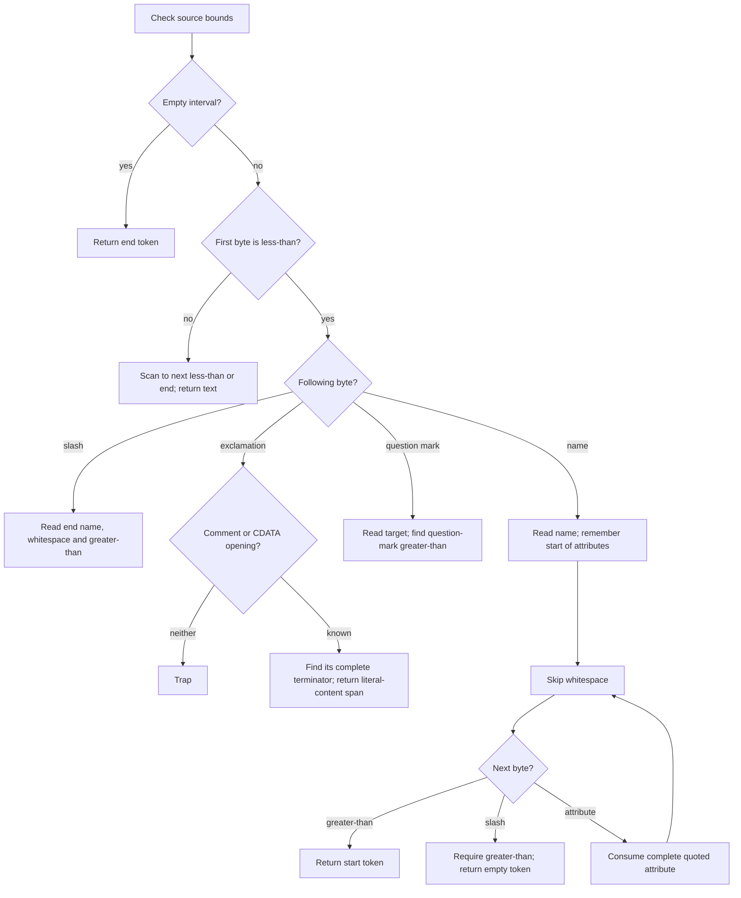
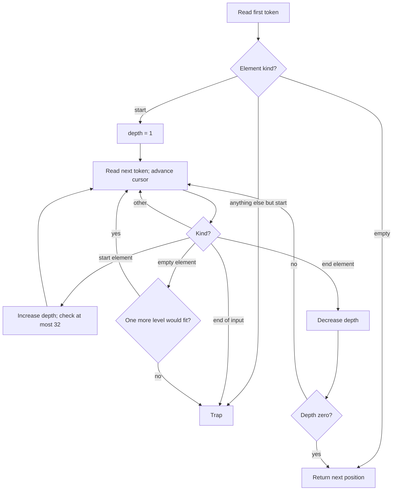

# Walk validated XML without copying its tree

This shared pattern supports the RSS transformations. It is not another tool
in the fifty-tool count. The [XML reader](26-xml-to-list.md) must validate the
whole document first. This cursor then walks the original bytes and returns
spans: no allocated nodes, decoded temporary strings, or writes to memory.
Consumers decode selected spans with [XML characters](00-xml-strings.md).

## Interface and ownership

All positions are byte offsets within the first 64 KiB. An interval is
half-open, `[start, end)`. Bad intervals and missing delimiters trap; an empty
interval returns an end token. This is not a second XML validator: matching
names, duplicate attributes, whitespace between attributes, legal comments,
UTF-8, declarations and entity syntax belong to the first pass.

`next(start, end)` returns six i32 values:

- kind;
- name start and end;
- value start and end;
- next unread position.

| Kind | Name span | Value span | Next position |
| --- | --- | --- | --- |
| 0: end | Zero/zero | Zero/zero | end |
| 1: start element | Element name | Raw attributes, including separator whitespace | After `>` |
| 2: end element | Element name | Zero/zero | After `>` |
| 3: empty element | Element name | Raw attributes, including separator whitespace | After `/>` |
| 4: text | Zero/zero | Original character data | At the next `<`, or end |
| 5: CDATA | Zero/zero | Between the CDATA delimiters | After `]]>` |
| 6: comment | Zero/zero | Between the comment delimiters | After `-->` |
| 7: processing instruction | Target | Data after separator whitespace | After `?>` |

`attribute(start, end)` walks a start token's raw attribute span. It returns
name start/end, value start/end, and next position. Whitespace at the end
returns four zeros and next=end. Quotes and equals signs are consumed, not
included. A value remains raw XML; choose attribute mode when decoding it.

`skip(start, end)` requires an element at start and returns the position after
its complete subtree. An empty element returns immediately. It counts nested
starts and ends rather than recursively calling itself; the 32-element limit
matches the first-pass validator. Comments and CDATA cannot affect that count.

The memory is imported from the character helper. This module initializes
short literal records at `0x30800`, clear of the validator's table at
`0x30000`. Execution writes neither region. Callers may keep spans across
later calls, provided they do not replace the input bytes themselves.

## Inside next: choose the delimiter grammar before scanning

The attribute loop is the important distinction from searching for `>`.
That character is legal inside a quoted attribute value. `attribute` owns
the quote-delimited scan and returns after the closing quote; only then may
`next` interpret a greater-than as a tag delimiter. A slash inside the quotes
cannot turn a start tag into an empty tag either.

`find` compares a fixed, short literal at each byte. It returns end when none
exists. Text accepts that result; comments, CDATA and processing instructions
require their terminator and trap instead. The scans are linear because each
literal has a fixed length of at most nine bytes, not an input-sized pattern.

## Inside skip: count only structural tokens

For `<a><b x="/>"/><c><![CDATA[</a>]]></c></a>`:

| Token | Depth after token | Why |
| --- | --- | --- |
| Start a | 1 | Establish the subtree being skipped |
| Empty b | 1 | Complete element; the attribute is not markup |
| Start c | 2 | One more open element |
| CDATA containing `</a>` | 2 | Literal data, not an end token |
| End c | 1 | Close one element |
| End a | 0 | Return without consuming the following sibling |

No name stack is needed here because the first pass has already checked
matching ends. Calling this helper on unvalidated input is not an alternative
way to accept malformed XML. In particular, its token walk alone may traverse
mismatched tag names or duplicate attributes.

## Module

Imported function 0 is `x.nameEnd`. Definitions are next 1, attribute 2,
skip 3, spaces 4, take 5, find 6, match 7, bounds 8. No globals are needed.

`[microwasm]`

- xw-header: `0061736d 01000000`
- xw-types-section: `01 {{size:xw-types}}`
  - xw-types: `05 60 02 7f 7f 01 7f 60 02 7f 7f 06 7f 7f 7f 7f 7f 7f 60 02 7f 7f 05 7f 7f 7f 7f 7f 60 03 7f 7f 7f 01 7f 60 02 7f 7f 00`
- xw-import-section: `02 {{size:xw-imports}}`
  - xw-imports: `02 01 78 07 6e616d65456e64 00 00 01 78 06 6d656d6f7279 02 01 04 04`
- xw-functions-section: `03 {{size:xw-functions}}`
  - xw-functions: `08 01 02 00 00 03 03 03 04`
- xw-exports-section: `07 {{size:xw-exports}}`
  - xw-exports: `04 04 6e657874 00 01 09 617474726962757465 00 02 04 736b6970 00 03 06 6d656d6f7279 02 00`
- xw-code-section: `0a {{size:xw-code}}`
  - xw-code: `08`
    - xw-next-record: `{{size:xw-next-body}}`
      - xw-next-body: `01 08 7f 20 00 20 01 10 08`
        - xw-next-empty: `20 00 20 01 46 04 40 41 00 41 00 41 00 41 00 41 00 20 01 0f 0b`
        - xw-next-text: `20 00 2d 00 00 41 3c 47 04 40 20 00 20 01 41 80900c 10 06 21 02 41 04 41 00 41 00 20 00 20 02 20 02 0f 0b`
        - xw-next-markup: `20 00 41 01 6a 22 02 20 01 4f 04 40 00 0b 20 02 2d 00 00 21 07`
        - xw-next-endtag: `20 07 41 2f 46 04 40 20 02 41 01 6a 22 03 20 01 10 00 22 04 20 01 10 04 20 01 41 3e 10 05 21 02 41 02 20 03 20 04 41 00 41 00 20 02 0f 0b`
        - xw-next-bang: `20 07 41 21 46 04 40`
          - xw-next-comment: `20 00 20 01 41 82900c 10 07 04 40 41 06 21 08 20 00 41 04 6a 21 05 41 87900c 21 09`
          - xw-next-cdata: `05 20 00 20 01 41 8b900c 10 07 45 04 40 00 0b 41 05 21 08 20 00 41 09 6a 21 05 41 95900c 21 09 0b`
          - xw-next-literal-end: `20 05 20 01 20 09 10 06 22 06 20 01 46 04 40 00 0b 20 08 41 00 41 00 20 05 20 06 20 06 41 03 6a 0f 0b`
        - xw-next-pi: `20 07 41 3f 46 04 40 20 02 41 01 6a 22 03 20 01 10 00 22 04 20 01 10 04 22 05 20 01 41 99900c 10 06 22 06 20 01 46 04 40 00 0b 41 07 20 03 20 04 20 05 20 06 20 06 41 02 6a 0f 0b`
        - xw-next-name: `20 02 21 03 20 02 20 01 10 00 22 04 21 05 20 04 21 02`
        - xw-next-attributes: `02 40 03 40 20 02 20 01 10 04 22 02 20 01 4f 04 40 00 0b 20 02 2d 00 00 21 07`
          - xw-next-start-close: `20 07 41 3e 46 04 40 41 01 21 08 20 02 21 06 20 02 41 01 6a 21 02 0c 02 0b`
          - xw-next-empty-close: `20 07 41 2f 46 04 40 41 03 21 08 20 02 21 06 20 02 41 01 6a 20 01 41 3e 10 05 21 02 0c 02 0b`
          - xw-next-attribute: `20 02 20 01 10 02 21 02 1a 1a 1a 1a 0c 00 0b 0b`
        - xw-next-result: `20 08 20 03 20 04 20 05 20 06 20 02 0b`
    - xw-attribute-record: `{{size:xw-attribute-body}}`
      - xw-attribute-body: `01 06 7f 20 00 20 01 10 08 20 00 20 01 10 04 21 02`
        - xw-attribute-empty: `20 02 20 01 46 04 40 41 00 41 00 41 00 41 00 20 01 0f 0b`
        - xw-attribute-name: `20 02 21 03 20 02 20 01 10 00 22 04 20 01 10 04 20 01 41 3d 10 05 20 01 10 04 21 02`
        - xw-attribute-quote: `20 02 20 01 4f 04 40 00 0b 20 02 2d 00 00 22 07 41 22 47 20 07 41 27 47 71 04 40 00 0b 20 02 41 01 6a 22 05 21 02`
        - xw-attribute-scan: `02 40 03 40 20 02 20 01 4f 04 40 00 0b 20 02 2d 00 00 20 07 46 0d 01 20 02 41 01 6a 21 02 0c 00 0b 0b`
        - xw-attribute-result: `20 03 20 04 20 05 20 02 20 02 41 01 6a 0b`
    - xw-skip-record: `{{size:xw-skip-body}}`
      - xw-skip-body: `01 02 7f 20 00 20 01 10 01 21 00 1a 1a 1a 1a 21 02`
        - xw-skip-empty: `20 02 41 03 46 04 40 20 00 0f 0b 20 02 41 01 47 04 40 00 0b 41 01 21 03`
        - xw-skip-loop: `02 40 03 40 20 00 20 01 10 01 21 00 1a 1a 1a 1a 21 02 20 02 45 04 40 00 0b`
          - xw-skip-open: `20 02 41 01 46 04 40 20 03 41 01 6a 22 03 41 20 4b 04 40 00 0b 0b`
          - xw-skip-empty-depth: `20 02 41 03 46 20 03 41 20 4f 71 04 40 00 0b`
          - xw-skip-close: `20 02 41 02 46 04 40 20 03 41 01 6b 22 03 45 0d 02 0b 0c 00 0b 0b 20 00 0b`
    - xw-spaces-record: `{{size:xw-spaces-body}}`
      - xw-spaces-body: `01 01 7f 02 40 03 40 20 00 20 01 4f 0d 01 20 00 2d 00 00 21 02 20 02 41 20 46 20 02 41 09 46 72 20 02 41 0a 46 72 20 02 41 0d 46 72 45 0d 01 20 00 41 01 6a 21 00 0c 00 0b 0b 20 00 0b`
    - xw-take-record: `{{size:xw-take-body}}`
      - xw-take-body: `00 20 00 20 01 4f 04 40 00 0b 20 00 2d 00 00 20 02 47 04 40 00 0b 20 00 41 01 6a 0b`
    - xw-find-record: `{{size:xw-find-body}}`
      - xw-find-body: `00 02 40 03 40 20 00 20 01 4f 0d 01 20 00 20 01 20 02 10 07 0d 01 20 00 41 01 6a 21 00 0c 00 0b 0b 20 00 0b`
    - xw-match-record: `{{size:xw-match-body}}`
      - xw-match-body: `01 02 7f 20 02 2d 00 00 21 03 20 01 20 00 6b 20 03 49 04 40 41 00 0f 0b 20 02 41 01 6a 21 02 02 40 03 40 20 04 20 03 4f 0d 01 20 00 20 04 6a 2d 00 00 20 02 20 04 6a 2d 00 00 47 04 40 41 00 0f 0b 20 04 41 01 6a 21 04 0c 00 0b 0b 41 01 0b`
    - xw-bounds-record: `{{size:xw-bounds-body}}`
      - xw-bounds-body: `00 20 00 20 01 4b 20 01 41 808004 4b 72 04 40 00 0b 0b`
- xw-data-section: `0b {{size:xw-data}}`
  - xw-data: `01 00 41 80900c 0b {{size:xw-literals}}`
    - xw-literals:
      - xw-less-than: `013c`
      - xw-comment: `043c212d2d`
      - xw-comment-end: `032d2d3e`
      - xw-cdata: `093c215b43444154415b`
      - xw-cdata-end: `035d5d3e`
      - xw-pi-end: `023f3e`
