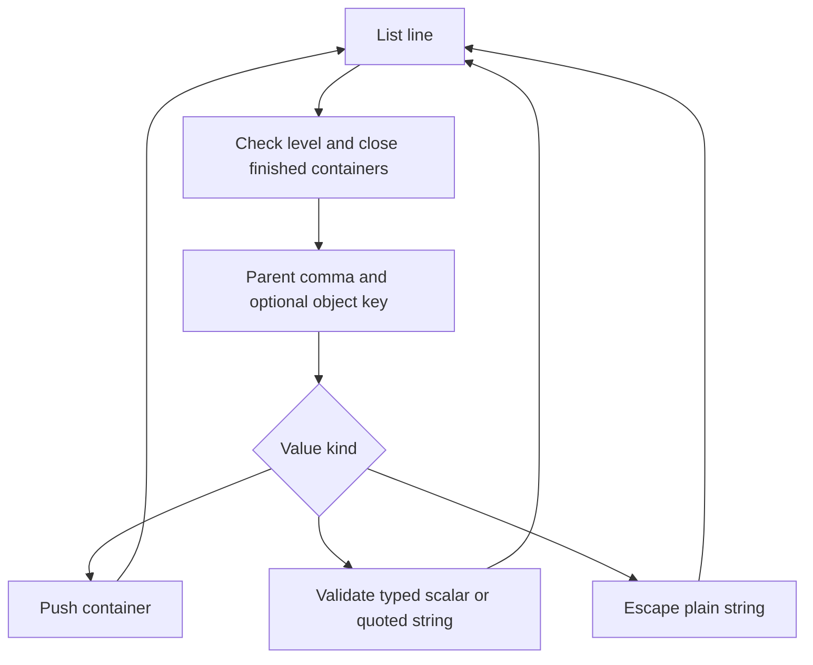
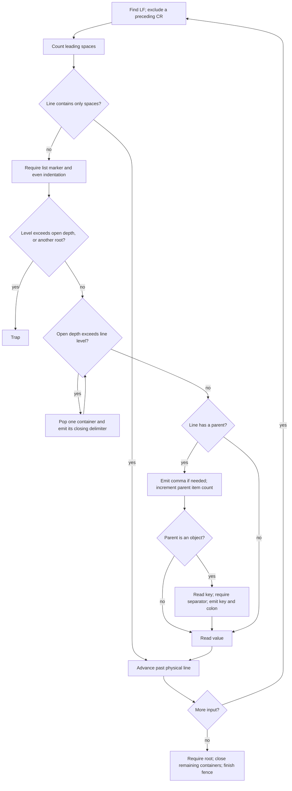
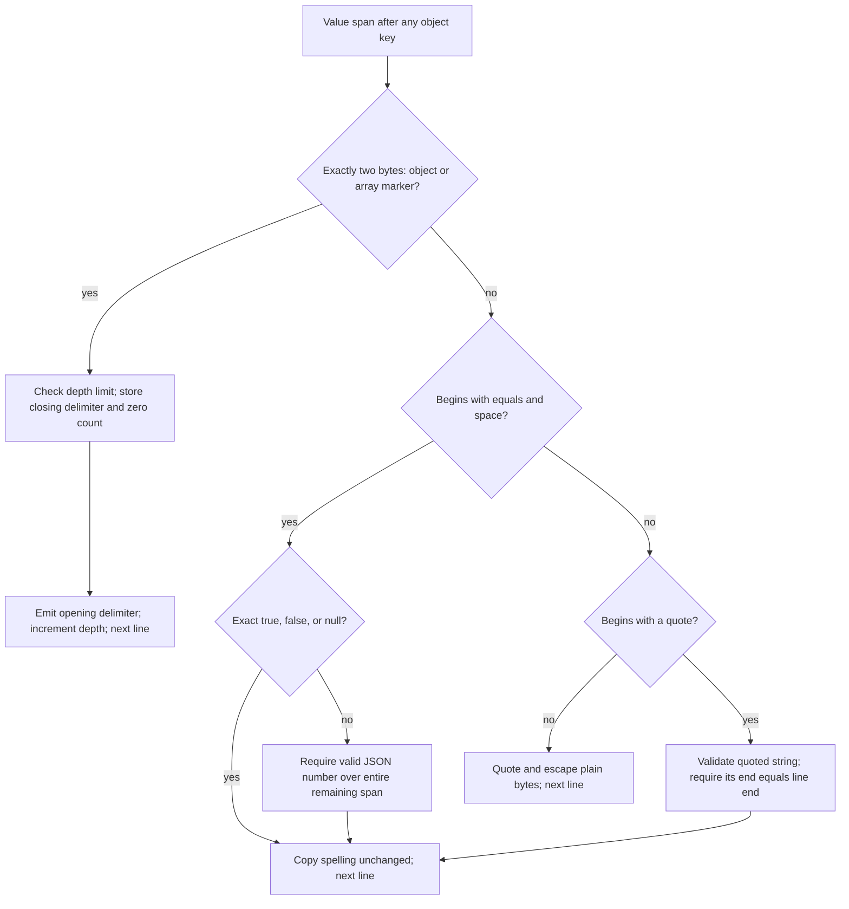
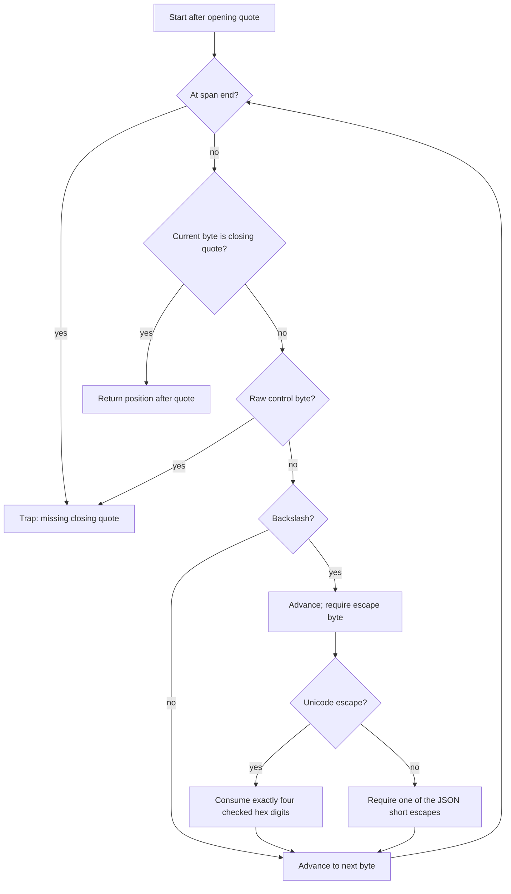

# Hierarchical Markdown data to fenced JSON

The indentation is the structure. `{}` opens an object and `[]` opens an
array. Object items contain a key followed by one space and their value;
array items contain just a value. Indentation grows by two spaces per level.
The first item is the root. Its container may be empty.

```text
- {}
  - name Ben
  - location {}
    - city Phoenix
    - state AZ
```

This becomes a JSON fence containing
`{"name":"Ben","location":{"city":"Phoenix","state":"AZ"}}`.
Unquoted leaves are strings. Prefix a scalar with `= ` for a JSON number,
`true`, `false` or `null`. Use a JSON-quoted string for special cases, including
keys with spaces, empty strings, literal `{}`/`[]`, or escaped newlines.

```text
- {}
  - "full name" "Ben Atkin"
  - enabled = true
  - balance = -12.50e+2
  - tags []
    - wasm
    - "{}"
  - empty ""
```

Numbers retain their exact source spelling. The imported
[JSON number scanner](../numbers/02-json-number.md) validates their grammar;
there is no binary64 conversion or host JSON serializer involved. Quoted
strings are validated, including escapes and four-digit Unicode escapes,
then copied unchanged. Plain text is JSON-escaped by the quote helper.

Duplicate object keys are preserved, as with JSON text. Key names and values
are UTF-8. Input is at most 64 KiB, output at most 128 KiB, and nesting at most
128 containers. Blank lines and CRLF are accepted. Missing keys, malformed
typed values, skipped levels, multiple roots and invalid escapes trap.

## Pattern: a container stack, not a full tree

Each stack entry is a closing delimiter and an item count, two i32 words.
Moving to a shallower level closes containers first. The parent's count says
whether a comma is needed. Opening a child increments that count immediately.
There is no node allocation and values remain spans into the input.

```text
for each nonblank list line:
    level = indentation / 2
    require level <= depth, and only the first item has level 0
    while depth > level: emit and pop the closing delimiter
    if level > 0:
        emit comma if the parent already has an item
        if parent is object: validate and emit the key, then ':'
    if value is {} or []:
        emit opening delimiter; push closing delimiter and zero count
    else if value starts '= ':
        validate JSON scalar; copy its bytes
    else if value starts '"': validate and copy JSON string
    else: quote and escape the plain string
close remaining containers and finish the JSON fence
```



## Inside `run`: indentation changes the open-container stack

The overview above hides an important distinction: a line's level is not the
number of containers open when that line begins. The previous line may have
opened a container, or several ancestors may need closing first.



`lj-list-level` rejects skipped levels **before** the closing loop changes the
stack. `lj-close-pop` then decrements depth before indexing the record to pop.
The address is `0x30000 + depth * 8`: four bytes for the closing delimiter,
then four for the child count. Once the stack matches the line level,
`lj-parent-record` indexes `level - 1`, the still-open parent.

Here is the stack evolution for the first example, with one extra sibling:

| Incoming line | Level | Action before value | Stack after value, outermost first |
| --- | --- | --- | --- |
| `- {}` | 0 | No parent | Object, count 0 |
| `  - name Ben` | 1 | First root child; no comma | Object, count 1 |
| `  - location {}` | 1 | Root comma; count the child immediately | Object, count 2 → object, count 0 |
| `    - city Phoenix` | 2 | First location child; no comma | Object, count 2 → object, count 1 |
| `    - state AZ` | 2 | Location comma | Object, count 2 → object, count 2 |
| `  - active = true` | 1 | Close location, then emit root comma | Object, count 3 |
| End of input | — | Close root | Empty |

Opening `location` counts it once in its parent. Closing it does not count it
again. A scalar never pushes a record, so indenting beneath `name Ben` would
fail the level check. An empty container is still pushed: the following
sibling, or the final closing loop, supplies its closing delimiter.

### Value dispatch: exact markers, then progressively broader cases



The order matters. `"{}"` is a string, while bare `{}` opens a container.
An invalid typed value does not fall through to plain text. Likewise,
`"hello" junk` traps rather than silently discarding the suffix.
`lj-container-next`, `lj-typed-copy`, and `lj-string-value-copy` all advance
the physical-line cursor and branch back to the same outer line loop. Their
branch depths differ because their surrounding `if` blocks differ.

| State | Storage | Meaning during a line |
| --- | --- | --- |
| Physical line start / LF position | Locals 1 / 16 | Local 16 is retained even when CR is excluded from content. |
| Content end / first non-space byte | Locals 2 / 3 | Bounds for marker, key and value reads. |
| Space count / line level | Locals 4 / 5 | Even space count divided by two gives level. |
| Open depth / root seen | Locals 6 / 7 | Distinguishes a new child from a skipped level or second root. |
| Value start | Local 8 | Moves past the key and separator only for object children. |
| Stack-record address | Local 11 | Reused for parent counting and a newly opened container. |
| Output cursor | Global 0 | Advanced only by the bounded byte emitter. |

## Inside the string helpers: validate versus escape

`string` and `quote` solve different problems. The former locates and validates
an already-quoted JSON string; the latter creates one from plain input.



`lj-string-close` returns before consuming anything after the quote. A key's
caller checks that a space follows; a value's caller requires the returned
position to be the line end. The same scanner therefore serves both contexts
without deciding their separators itself. The four-digit loop validates
escape syntax; it does not combine surrogate pairs or rewrite their spelling.

`quote` emits an opening quote, then handles each byte in this order:

- Quote or backslash: emit a backslash and the original byte.
- Byte below `0x20`: use the short-escape table when available; otherwise
  emit `\u00` and two hexadecimal digits.
- Any other byte: copy it, leaving multibyte UTF-8 sequences unchanged.
- At the span end: emit the closing quote.

`copy` and `find` are bounded forward scans: `copy` emits bytes in `[start,
end)`, while `find` returns the matching position or `end`. Neither constructs
a string object. Every output path eventually calls `emit`, which checks
the output limit before its one-byte store. A trap can leave partial output;
the caller must publish only a successful return, not that partial buffer.

## Module and imports

`n.valid` is function 0; `n.memory` is memory 0. They come from the number
scanner's actual Wasm exports. The browser connects them without wrapping the
function in JavaScript. Functions 1..7 are emit, copy, hex digit, quote,
quoted-string end, find, and run. Only `run(length)` and memory are exported.
The output cursor is global 0 and starts at `0x10000`.

`[microwasm]`

- lj-header: `0061736d 01000000`
- lj-type-section: `01 {{size:lj-types}}`
  - lj-types: `05 60 02 7f 7f 01 7f 60 01 7f 00 60 02 7f 7f 00 60 03 7f 7f 7f 01 7f 60 01 7f 01 7f`
- lj-import-section: `02 {{size:lj-imports}}`
  - lj-imports: `02 01 6e 05 76616c6964 00 00 01 6e 06 6d656d6f7279 02 01 04 04`
- lj-function-section: `03 {{size:lj-functions}}`
  - lj-functions: `07 01 02 01 02 00 03 04`
- lj-global-section: `06 {{size:lj-globals}}`
  - lj-globals: `01 7f 01 41 808004 0b`
- lj-export-section: `07 {{size:lj-exports}}`
  - lj-exports: `02 03 72756e 00 07 06 6d656d6f7279 02 00`
- lj-code-section: `0a {{size:lj-code}}`
  - lj-code: `07`
    - lj-emit-record: `{{size:lj-emit-body}}`
      - lj-emit-body: `00`
        - lj-emit-bound: `23 00 41 80800c 4f 04 40 00 0b`
        - lj-emit-byte: `23 00 20 00 3a 00 00`
        - lj-emit-next: `23 00 41 01 6a 24 00 0b`
    - lj-copy-record: `{{size:lj-copy-body}}`
      - lj-copy-body: `00`
        - lj-copy-exit: `02 40`
          - lj-copy-loop: `03 40`
            - lj-copy-bound: `20 00 20 01 4f 0d 01`
            - lj-copy-byte: `20 00 2d 00 00 10 01`
            - lj-copy-next: `20 00 41 01 6a 21 00 0c 00 0b`
          - lj-copy-done: `0b 0b`
    - lj-hex-record: `{{size:lj-hex-body}}`
      - lj-hex-body: `00`
        - lj-hex-ascii: `20 00 41 0a 49 04 7f 20 00 41 30 6a 05 20 00 41 d700 6a 0b 10 01 0b`
    - lj-quote-record: `{{size:lj-quote-body}}`
      - lj-quote-body: `01 02 7f`
        - lj-quote-open: `41 22 10 01`
        - lj-quote-exit: `02 40`
          - lj-quote-loop: `03 40`
            - lj-quote-bound: `20 00 20 01 4f 0d 01`
            - lj-quote-byte: `20 00 2d 00 00 21 02`
            - lj-quote-slash-or-quote: `20 02 41 22 46 20 02 41 dc00 46 72 04 40 41 dc00 10 01 20 02 10 01`
            - lj-quote-control: `05 20 02 41 20 49 04 40`
              - lj-quote-short: `41 80880c 20 02 6a 2d 00 00 21 03 41 dc00 10 01`
              - lj-quote-short-found: `20 03 04 40 20 03 10 01`
              - lj-quote-long: `05 41 f500 10 01 41 30 10 01 41 30 10 01 20 02 41 04 76 10 03 20 02 41 0f 71 10 03 0b`
              - lj-quote-ordinary: `05 20 02 10 01 0b 0b`
            - lj-quote-next: `20 00 41 01 6a 21 00 0c 00 0b`
          - lj-quote-end: `0b`
        - lj-quote-close: `41 22 10 01 0b`
    - lj-string-record: `{{size:lj-string-body}}`
      - lj-string-body: `01 03 7f`
        - lj-string-start: `20 00 41 01 6a 21 02`
        - lj-string-loop: `03 40`
          - lj-string-bound: `20 02 20 01 4f 04 40 00 0b`
          - lj-string-byte: `20 02 2d 00 00 21 03`
          - lj-string-close: `20 03 41 22 46 04 40 20 02 41 01 6a 0f 0b`
          - lj-string-control: `20 03 41 20 49 04 40 00 0b`
          - lj-string-escape: `20 03 41 dc00 46 04 40`
            - lj-string-escape-next: `20 02 41 01 6a 21 02`
            - lj-string-escape-bound: `20 02 20 01 4f 04 40 00 0b`
            - lj-string-escape-byte: `20 02 2d 00 00 21 03`
            - lj-string-unicode: `20 03 41 f500 46 04 40 41 00 21 04`
              - lj-string-hex-loop: `03 40`
                - lj-string-hex-next: `20 02 41 01 6a 21 02`
                - lj-string-hex-bound: `20 02 20 01 4f 04 40 00 0b`
                - lj-string-hex-byte: `20 02 2d 00 00 21 03`
                - lj-string-hex-invalid: `20 03 41 30 6b 41 09 4d 20 03 41 20 72 41 e100 6b 41 05 4d 72 45 04 40 00 0b`
                - lj-string-hex-repeat: `20 04 41 01 6a 22 04 41 04 49 0d 00 0b`
              - lj-string-short-escape: `05`
              - lj-string-short-valid: `20 03 41 22 46 20 03 41 dc00 46 72 20 03 41 2f 46 72 20 03 41 e200 46 72 20 03 41 e600 46 72 20 03 41 ee00 46 72 20 03 41 f200 46 72 20 03 41 f400 46 72 45 04 40 00 0b 0b 0b`
          - lj-string-next: `20 02 41 01 6a 21 02 0c 00 0b`
        - lj-string-unreachable: `00 0b`
    - lj-find-record: `{{size:lj-find-body}}`
      - lj-find-body: `00`
        - lj-find-exit: `02 40`
          - lj-find-loop: `03 40`
            - lj-find-bound: `20 00 20 01 4f 0d 01`
            - lj-find-match: `20 00 2d 00 00 20 02 46 04 40 20 00 0f 0b`
            - lj-find-next: `20 00 41 01 6a 21 00 0c 00 0b`
          - lj-find-end: `0b`
        - lj-find-result: `20 01 0b`
    - lj-run-record: `{{size:lj-run-body}}`
      - lj-run-body: `01 10 7f`
        - lj-run-bound: `20 00 41 808004 4b 04 40 00 0b`
        - lj-run-reset: `41 808004 24 00`
        - lj-run-fence: `41 e000 10 01 41 e000 10 01 41 e000 10 01 41 ea00 10 01 41 f300 10 01 41 ef00 10 01 41 ee00 10 01 41 0a 10 01`
        - lj-lines-exit: `02 40`
          - lj-lines-loop: `03 40`
            - lj-lines-bound: `20 01 20 00 4f 0d 01`
            - lj-lines-end: `20 01 20 00 41 0a 10 06 22 10 21 02`
            - lj-lines-cr-room: `20 02 20 01 4b 04 40`
              - lj-lines-cr: `20 02 41 01 6b 2d 00 00 41 0d 46 04 40 20 02 41 01 6b 21 02 0b 0b`
            - lj-indent-start: `20 01 21 03 41 00 21 04`
            - lj-indent-exit: `02 40`
              - lj-indent-loop: `03 40`
                - lj-indent-bound: `20 03 20 02 4f 0d 01`
                - lj-indent-space: `20 03 2d 00 00 41 20 47 0d 01`
                - lj-indent-next: `20 03 41 01 6a 21 03 20 04 41 01 6a 21 04 0c 00 0b`
              - lj-indent-end: `0b`
            - lj-lines-blank: `20 03 20 02 46 04 40 20 10 41 01 6a 21 01 0c 01 0b`
            - lj-list-room: `20 02 20 03 6b 41 02 49 04 40 00 0b`
            - lj-list-marker: `20 03 2d 00 00 41 2d 47 20 03 2d 00 01 41 20 47 72 04 40 00 0b`
            - lj-list-indent: `20 04 41 01 71 04 40 00 0b 20 04 41 01 76 21 05`
            - lj-list-level: `20 05 20 06 4b 04 40 00 0b`
            - lj-list-root: `20 07 20 05 45 71 04 40 00 0b 41 01 21 07`
            - lj-close-exit: `02 40`
              - lj-close-loop: `03 40`
                - lj-close-bound: `20 06 20 05 4d 0d 01`
                - lj-close-pop: `20 06 41 01 6b 22 06 41 03 74 41 80800c 6a 28 02 00 10 01 0c 00 0b`
              - lj-close-end: `0b`
            - lj-value-start: `20 03 41 02 6a 21 08`
            - lj-parent: `20 05 04 40`
              - lj-parent-record: `20 05 41 01 6b 41 03 74 41 80800c 6a 21 0b`
              - lj-parent-comma: `20 0b 28 02 04 04 40 41 2c 10 01 0b`
              - lj-parent-count: `20 0b 20 0b 28 02 04 41 01 6a 36 02 04`
              - lj-parent-object: `20 0b 28 02 00 41 fd00 46 04 40`
                - lj-key-start: `20 08 21 09 20 08 20 02 4f 04 40 00 0b`
                - lj-key-quoted: `20 08 2d 00 00 41 22 46 22 0f 04 40 20 08 20 02 10 05 21 0a`
                - lj-key-unquoted: `05 20 08 20 02 41 20 10 06 21 0a 0b`
                - lj-key-length: `20 0a 20 09 46 20 0a 20 02 4f 72 04 40 00 0b`
                - lj-key-separator: `20 0a 2d 00 00 41 20 47 04 40 00 0b`
                - lj-key-write: `20 0f 04 40 20 09 20 0a 10 02 05 20 09 20 0a 10 04 0b`
                - lj-key-colon: `41 3a 10 01 20 0a 41 01 6a 21 08 0b 0b`
            - lj-kind-reset: `41 00 21 0c`
            - lj-kind-room: `20 02 20 08 6b 41 02 46 04 40`
              - lj-kind-object: `20 08 2d 00 00 41 fb00 46 20 08 2d 00 01 41 fd00 46 71 04 40 41 fd00 21 0c 0b`
              - lj-kind-array: `20 08 2d 00 00 41 db00 46 20 08 2d 00 01 41 dd00 46 71 04 40 41 dd00 21 0c 0b 0b`
            - lj-container: `20 0c 04 40`
              - lj-container-bound: `20 06 41 8001 4f 04 40 00 0b`
              - lj-container-record: `20 06 41 03 74 41 80800c 6a 21 0b`
              - lj-container-store: `20 0b 20 0c 36 02 00 20 0b 41 00 36 02 04`
              - lj-container-open: `20 0c 41 02 6b 10 01 20 06 41 01 6a 21 06`
              - lj-container-next: `20 10 41 01 6a 21 01 0c 01 0b`
            - lj-typed-room: `20 02 20 08 6b 41 02 4f 04 40`
              - lj-typed-prefix: `20 08 2d 00 00 41 3d 46 20 08 2d 00 01 41 20 46 71 04 40`
                - lj-typed-start: `20 08 41 02 6a 21 08 41 00 21 0d`
                - lj-typed-four: `20 02 20 08 6b 41 04 46 04 40`
                  - lj-typed-true-null: `20 08 28 00 00 22 0e 41 f4e4d5ab06 46 20 0e 41 eeeab1e306 46 72 21 0d 0b`
                - lj-typed-five: `20 02 20 08 6b 41 05 46 04 40`
                  - lj-typed-false: `20 08 28 00 00 41 e6c2b19b07 46 20 08 2d 00 04 41 e500 46 71 21 0d 0b`
                - lj-typed-number: `20 0d 45 04 40 20 08 20 02 10 00 45 04 40 00 0b 0b`
                - lj-typed-copy: `20 08 20 02 10 02 20 10 41 01 6a 21 01 0c 02 0b 0b`
            - lj-string-room: `20 08 20 02 49 04 40`
              - lj-string-value: `20 08 2d 00 00 41 22 46 04 40`
                - lj-string-value-end: `20 08 20 02 10 05 20 02 47 04 40 00 0b`
                - lj-string-value-copy: `20 08 20 02 10 02 20 10 41 01 6a 21 01 0c 02 0b 0b`
            - lj-plain-value: `20 08 20 02 10 04`
            - lj-lines-next: `20 10 41 01 6a 21 01 0c 00 0b`
          - lj-lines-end-block: `0b`
        - lj-root-required: `20 07 45 04 40 00 0b`
        - lj-finish-exit: `02 40`
          - lj-finish-loop: `03 40`
            - lj-finish-bound: `20 06 45 0d 01`
            - lj-finish-pop: `20 06 41 01 6b 22 06 41 03 74 41 80800c 6a 28 02 00 10 01 0c 00 0b`
          - lj-finish-end: `0b`
        - lj-close-fence: `41 0a 10 01 41 e000 10 01 41 e000 10 01 41 e000 10 01 41 0a 10 01`
        - lj-result: `23 00 41 808004 6b 0b`

## Short-escape table

This is a fixed 32-byte lookup array indexed by the input control byte, not
a terminated string. Nonzero entries are the ASCII letters for `\b`, `\t`,
`\n`, `\f`, and `\r`. Other controls use `\u00xx`. It starts immediately
after the 128 stack records, at `0x30400`.

`[microwasm]`

- lj-data-section: `0b {{size:lj-data}}`
  - lj-data: `01 00 41 80880c 0b {{size:lj-short-escapes}}`
    - lj-short-escapes: `0000000000000000 62746e0066720000 0000000000000000 0000000000000000`

Run locals are input length 0, line position 1, line end 2, content start 3,
indent 4, level 5, depth 6, root seen 7, value start 8, key start/end 9/10,
record 11, container kind 12, scalar-valid flag 13, temporary word 14,
quoted-key flag 15, and next newline 16. All are i32.
