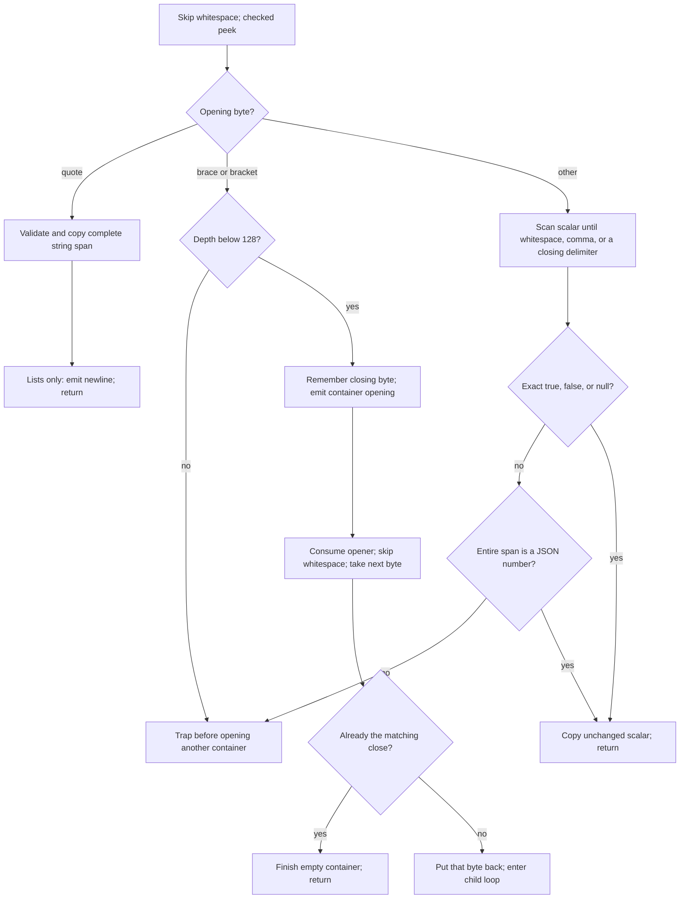
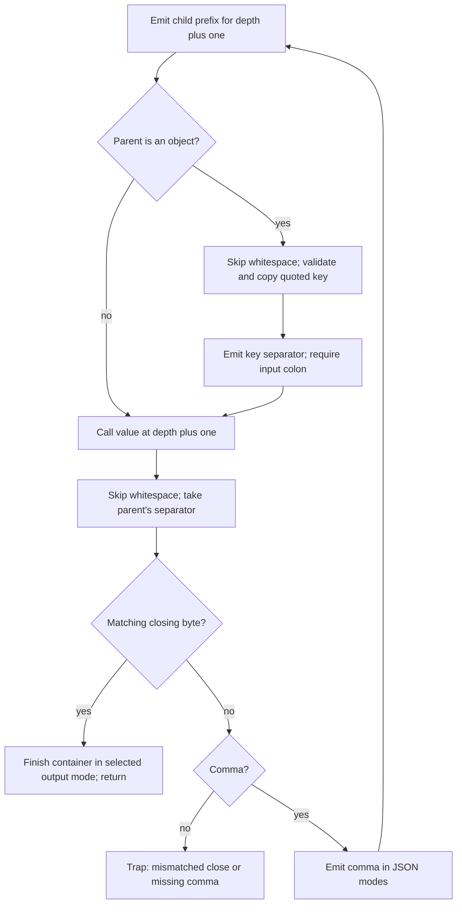
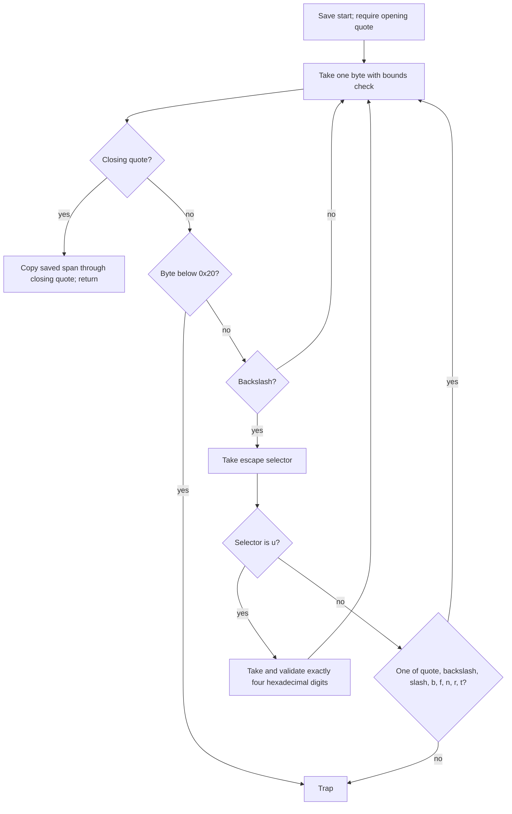

# Fenced JSON to hierarchical Markdown data

Read one `json` fence and emit the list notation used by the
[reverse converter](01-list-to-json.md). Objects become `{}`, arrays become
`[]`, strings remain JSON-quoted, and other scalars start with `= `.
Object keys are always quoted. This keeps empty keys, spaces, escapes and
strings that look like container markers unambiguous.

```json
{"name":"Ben","location":{"city":"Phoenix","state":"AZ"}}
```

becomes:

```text
- {}
  - "name" "Ben"
  - "location" {}
    - "city" "Phoenix"
    - "state" "AZ"
```

The input must contain only a triple-backtick `json` fence, its JSON value,
and surrounding whitespace. Opening and closing fences occupy their own
lines; LF and CRLF work. JSON whitespace is space, tab, CR or LF, not every
Unicode space. All JSON value kinds work, including a scalar at the root.
Duplicate keys, numeric spellings and string escapes are preserved exactly.
This is a structural conversion, not a parse into JavaScript objects.

Input is UTF-8 supplied by the caller, at most 64 KiB. Output is at most
128 KiB and nesting is at most 128 containers. Invalid syntax or capacity
traps; the next call resets parser state. As with the other tools, callers
publish output only after a successful return.

## Pattern: recursive descent without building a tree

Three cursor globals describe input position, input end and output position.
Each recursive call owns only a depth, closing delimiter and a few temporary
spans. It writes a container's list line before visiting its children. Nothing
needs to retain a node after its subtree has been emitted.

### Inside `value`: dispatch without consuming the first byte

`jl-value-peek` calls `skip`, then `take`, then backs the input cursor up by
one. This is a checked peek: an absent value traps in `take`, while each
selected branch still receives its opening byte. A recursive child consumes
its own value, **not** its parent's comma or closing delimiter.



The closing byte is the opener plus two: `[` becomes `]`, `{` becomes `}`.
It lives in value-local 2, so descending into a nested container cannot
overwrite the parent's expected close. Only the input/output cursors are
shared across recursive calls. Scalar-local 4 begins at zero on each call;
an exact keyword match sets it, otherwise the imported number validator must
accept the whole span. This rejects both an empty scalar and `truex`.

### Inside the child loop: delimiter ownership



After a comma there is no special empty-child case. The next iteration must
read a key/value, which is why a trailing comma fails instead of being treated
as an empty member. An array's `]` encountered there reaches the scalar branch
as a zero-length token and fails validation. An object's `}` fails the quoted
key check. A missing colon fails before the value call.

For `{"a":[1,2],"b":3}`, the nested array returns just after `]`. The outer
object then consumes the comma before `"b"`. When `3` returns, its cursor is
still **on** `}`; the outer object consumes that close and returns. This is the
same ownership rule for every nesting level, with no saved token queue.

| Decision point | Lists: mode 0 | Pretty JSON: mode 1 | Compact JSON: mode 2 |
| --- | --- | --- | --- |
| Prefix | Two spaces per depth, then `- ` | Two spaces per depth | Nothing |
| Container opening | Emit `{}` or `[]`, then LF | Emit opener only | Emit opener only |
| Before a nonempty child | Prefix only | LF, then prefix | Nothing |
| After an object key | Space | Colon and space | Colon |
| After a scalar/string | LF; scalar also has `= ` prefix | Nothing | Nothing |
| Between children | No comma | Comma | Comma |
| Nonempty container close | Nothing: marker already emitted | LF, parent indentation, close | Close |

Validation branches do not depend on the output mode. A change to indentation
must not change which input delimiter a child consumes.

### Inside `string`: validate first, copy once

The start cursor is saved before consuming the required opening quote. The
loop advances only through `take`, so truncated escapes and missing closing
quotes share its input-bound check. Ordinary bytes are not copied as they are
scanned; the final `copy(start, position)` includes both quotes and preserves
the original escape spelling.



This is byte-oriented syntax validation, not a UTF-8 decoder. The input's
UTF-8 validity is a caller precondition; raw multibyte text passes through.
The four-digit loop does not turn `\u` escapes into characters or combine
surrogates. In particular, the slash in an escape is not a structural token.

### Entry points and the failure boundary

`run`, `pretty` and `compact` select a mode, then use the same fenced-document
reader. It bounds and resets input/output, checks the opening label and line
ending, reads exactly one value, and checks the closing fence and trailing
whitespace. Output can already contain a prefix when a later check fails;
success is the returned length, not the presence of bytes in memory.

`compactSpan` skips only the fence handling. It checks disjoint input/output
regions and depth, resets the same globals, reads one value, skips JSON
whitespace, then requires the cursor to equal the supplied end. An accepted
prefix followed by another value is therefore an error in both entry paths.

The [JSON number scanner](../numbers/02-json-number.md) is imported directly
as Wasm, with its four-page memory. The host does no JSON parsing. Strings are
checked for controls and the JSON escape grammar, including four hexadecimal
digits after `\u`. Escaped surrogate code units are retained, not decoded or
combined. Duplicate keys likewise remain distinct list entries.

## Module

Import `n.validMemory` as function 0 and `n.memory`. Functions: emit 1, copy 2,
take 3, skip 4, string 5, prefix 6, value 7, run 8, expect 9. Globals:
output 0, input position 1, input end 2, output mode 3. Output starts at
`0x10000` and stops before the fence literals at `0x30000`.

The same descent also powers the [pretty printer](12-json-pretty.md) and
[compactor](13-json-compact.md). The three public entry points reset the mode
before calling the shared fenced-document reader 10: run 8 chooses lists,
pretty 11 chooses two-space JSON, and compact 12 chooses unspaced JSON.
Formatting changes only the punctuation/indentation emissions; strings and
scalars use exactly the same validation and span-copying code in every mode.
No intermediate list, JSON object tree, or host conversion is involved.

`compactSpan(start, end, output, depth)` is function 13, a lower-level entry
used by the [JSON Lines pair](14-json-lines-to-array.md). It validates one
complete unfenced value and writes compact JSON directly at the requested
output cursor, returning the byte length. Input must lie entirely within
`0..0x10000` or the scratch region `0x3000c..0x40000`; output must lie in
`0x10000..0x30000`, and the starting depth in `0..128`. Passing depth
1 reserves room for a surrounding array within the same 128-container limit.
It resets all parser globals; callers can append many independent records
without copying them into temporary input buffers. Its input/output regions
cannot overlap, nor can input touch the parser's literals. Partial writes on
a trap must still not be published. The typed-table reader uses scratch input
to validate each decoded cell, avoiding copies back over the source document.

`[microwasm]`

- jl-header: `0061736d 01000000`
- jl-type-section: `01 {{size:jl-types}}`
  - jl-types: `07 60 02 7f 7f 01 7f 60 01 7f 00 60 00 00 60 00 01 7f 60 01 7f 01 7f 60 02 7f 7f 00 60 04 7f 7f 7f 7f 01 7f`
- jl-import-section: `02 {{size:jl-imports}}`
  - jl-imports: `02 01 6e 0b 76616c69644d656d6f7279 00 00 01 6e 06 6d656d6f7279 02 01 04 04`
- jl-function-section: `03 {{size:jl-functions}}`
  - jl-functions: `0d 01 05 03 02 02 01 01 04 01 04 04 04 06`
- jl-global-section: `06 {{size:jl-globals}}`
  - jl-globals: `04 7f 01 41 00 0b 7f 01 41 00 0b 7f 01 41 00 0b 7f 01 41 00 0b`
- jl-export-section: `07 {{size:jl-exports}}`
  - jl-exports: `05 03 72756e 00 08 06 707265747479 00 0b 07 636f6d70616374 00 0c 06 6d656d6f7279 02 00 0b 636f6d706163745370616e 00 0d`
- jl-code-section: `0a {{size:jl-code}}`
  - jl-code: `0d`
    - jl-emit-record: `{{size:jl-emit-body}}`
      - jl-emit-body: `00`
        - jl-emit-bound: `23 00 41 80800c 4f 04 40 00 0b`
        - jl-emit-byte: `23 00 20 00 3a 00 00 23 00 41 01 6a 24 00 0b`
    - jl-copy-record: `{{size:jl-copy-body}}`
      - jl-copy-body: `00`
        - jl-copy-exit: `02 40`
          - jl-copy-loop: `03 40`
            - jl-copy-bound: `20 00 20 01 4f 0d 01`
            - jl-copy-byte: `20 00 2d 00 00 10 01`
            - jl-copy-next: `20 00 41 01 6a 21 00 0c 00 0b`
          - jl-copy-end: `0b 0b`
    - jl-take-record: `{{size:jl-take-body}}`
      - jl-take-body: `00`
        - jl-take-bound: `23 01 23 02 4f 04 40 00 0b`
        - jl-take-byte: `23 01 2d 00 00`
        - jl-take-next: `23 01 41 01 6a 24 01 0b`
    - jl-skip-record: `{{size:jl-skip-body}}`
      - jl-skip-body: `01 01 7f`
        - jl-skip-exit: `02 40`
          - jl-skip-loop: `03 40`
            - jl-skip-bound: `23 01 23 02 4f 0d 01`
            - jl-skip-byte: `23 01 2d 00 00 21 00`
            - jl-skip-space: `20 00 41 20 46 20 00 41 09 46 72 20 00 41 0a 46 72 20 00 41 0d 46 72 45 0d 01`
            - jl-skip-next: `23 01 41 01 6a 24 01 0c 00 0b`
          - jl-skip-end: `0b 0b`
    - jl-string-record: `{{size:jl-string-body}}`
      - jl-string-body: `01 03 7f`
        - jl-string-start: `23 01 21 00 10 03 41 22 47 04 40 00 0b`
        - jl-string-exit: `02 40`
          - jl-string-loop: `03 40`
            - jl-string-byte: `10 03 21 01`
            - jl-string-close: `20 01 41 22 46 0d 01`
            - jl-string-control: `20 01 41 20 49 04 40 00 0b`
            - jl-string-escape: `20 01 41 dc00 46 04 40 10 03 21 01`
              - jl-string-unicode: `20 01 41 f500 46 04 40 41 00 21 02`
                - jl-string-hex-loop: `03 40`
                  - jl-string-hex-byte: `10 03 21 01`
                  - jl-string-hex-valid: `20 01 41 30 6b 41 09 4d 20 01 41 20 72 41 e100 6b 41 05 4d 72 45 04 40 00 0b`
                  - jl-string-hex-next: `20 02 41 01 6a 22 02 41 04 49 0d 00 0b`
                - jl-string-short: `05`
                - jl-string-short-valid: `20 01 41 22 46 20 01 41 dc00 46 72 20 01 41 2f 46 72 20 01 41 e200 46 72 20 01 41 e600 46 72 20 01 41 ee00 46 72 20 01 41 f200 46 72 20 01 41 f400 46 72 45 04 40 00 0b 0b 0b`
            - jl-string-next: `0c 00 0b`
          - jl-string-end: `0b`
        - jl-string-copy: `20 00 23 01 10 02 0b`
    - jl-prefix-record: `{{size:jl-prefix-body}}`
      - jl-prefix-body: `00`
        - jl-prefix-compact: `23 03 41 02 46 04 40 0f 0b`
        - jl-prefix-exit: `02 40`
          - jl-prefix-loop: `03 40`
            - jl-prefix-bound: `20 00 45 0d 01`
            - jl-prefix-spaces: `41 20 10 01 41 20 10 01`
            - jl-prefix-next: `20 00 41 01 6b 21 00 0c 00 0b`
          - jl-prefix-end: `0b`
        - jl-prefix-marker: `23 03 45 04 40 41 2d 10 01 41 20 10 01 0b 0b`
    - jl-value-record: `{{size:jl-value-body}}`
      - jl-value-body: `01 05 7f`
        - jl-value-peek: `10 04 10 03 21 01 23 01 41 01 6b 24 01`
        - jl-value-string: `20 01 41 22 46 04 40 10 05 23 03 45 04 40 41 0a 10 01 0b 0f 0b`
        - jl-value-container: `20 01 41 fb00 46 20 01 41 db00 46 72 04 40`
          - jl-value-depth: `20 00 41 8001 4f 04 40 00 0b`
          - jl-value-close-byte: `20 01 41 02 6a 21 02`
          - jl-value-marker: `20 01 10 01 23 03 45 04 40 20 02 10 01 41 0a 10 01 0b`
          - jl-value-open: `23 01 41 01 6a 24 01 10 04`
          - jl-value-empty: `10 03 20 02 46 04 40 23 03 04 40 20 02 10 01 0b 0f 0b 23 01 41 01 6b 24 01`
          - jl-child-loop: `03 40`
            - jl-child-newline: `23 03 41 01 46 04 40 41 0a 10 01 0b`
            - jl-child-prefix: `20 00 41 01 6a 10 06`
            - jl-child-key: `20 01 41 fb00 46 04 40 10 04 10 05`
              - jl-key-colon: `23 03 04 40 41 3a 10 01 0b`
              - jl-key-space: `23 03 41 02 47 04 40 41 20 10 01 0b`
              - jl-key-input-colon: `10 04 10 03 41 3a 47 04 40 00 0b 0b`
            - jl-child-value: `20 00 41 01 6a 10 07`
            - jl-child-separator: `10 04 10 03 22 03 20 02 46 04 40`
              - jl-child-close-indent: `23 03 41 01 46 04 40 41 0a 10 01 20 00 10 06 0b`
              - jl-child-close-json: `23 03 04 40 20 02 10 01 0b 0f 0b`
            - jl-child-comma: `20 03 41 2c 47 04 40 00 0b`
            - jl-child-comma-json: `23 03 04 40 41 2c 10 01 0b`
            - jl-child-next: `0c 00 0b 0b`
        - jl-scalar-start: `23 01 21 03`
        - jl-scalar-exit: `02 40`
          - jl-scalar-loop: `03 40`
            - jl-scalar-bound: `23 01 23 02 4f 0d 01`
            - jl-scalar-byte: `23 01 2d 00 00 21 01`
            - jl-scalar-separator: `20 01 41 20 46 20 01 41 09 46 72 20 01 41 0a 46 72 20 01 41 0d 46 72 20 01 41 2c 46 72 20 01 41 dd00 46 72 20 01 41 fd00 46 72 0d 01`
            - jl-scalar-next: `23 01 41 01 6a 24 01 0c 00 0b`
          - jl-scalar-end: `0b`
        - jl-scalar-four: `23 01 20 03 6b 41 04 46 04 40`
          - jl-scalar-true-null: `20 03 28 00 00 22 05 41 f4e4d5ab06 46 20 05 41 eeeab1e306 46 72 21 04 0b`
        - jl-scalar-five: `23 01 20 03 6b 41 05 46 04 40`
          - jl-scalar-false: `20 03 28 00 00 41 e6c2b19b07 46 20 03 2d 00 04 41 e500 46 71 21 04 0b`
        - jl-scalar-number: `20 04 45 04 40 20 03 23 01 10 00 45 04 40 00 0b 0b`
        - jl-scalar-marker: `23 03 45 04 40 41 3d 10 01 41 20 10 01 0b`
        - jl-scalar-copy: `20 03 23 01 10 02 23 03 45 04 40 41 0a 10 01 0b 0b`
    - jl-run-record: `{{size:jl-run-body}}`
      - jl-run-body: `00 41 00 24 03 20 00 10 0a 0b`
    - jl-expect-record: `{{size:jl-expect-body}}`
      - jl-expect-body: `01 01 7f`
        - jl-expect-end: `20 00 20 00 2d 00 00 6a 41 01 6a 21 01 20 00 41 01 6a 21 00`
        - jl-expect-exit: `02 40`
          - jl-expect-loop: `03 40`
            - jl-expect-bound: `20 00 20 01 4f 0d 01`
            - jl-expect-byte: `10 03 20 00 2d 00 00 47 04 40 00 0b`
            - jl-expect-next: `20 00 41 01 6a 21 00 0c 00 0b`
          - jl-expect-done: `0b 0b`
    - jl-document-record: `{{size:jl-document-body}}`
      - jl-document-body: `01 01 7f`
        - jl-run-bound: `20 00 41 808004 4b 04 40 00 0b`
        - jl-run-reset: `20 00 24 02 41 00 24 01 41 808004 24 00`
        - jl-run-open: `10 04 41 80800c 10 09`
        - jl-run-cr: `10 03 22 01 41 0d 46 04 40 10 03 21 01 0b`
        - jl-run-lf: `20 01 41 0a 47 04 40 00 0b`
        - jl-run-output-fence: `23 03 04 40 41 81800c 41 88800c 10 02 41 0a 10 01 0b`
        - jl-run-value: `41 00 10 06 41 00 10 07 10 04`
        - jl-run-close-line: `23 01 41 01 6b 2d 00 00 41 0a 47 04 40 00 0b`
        - jl-run-close: `41 88800c 10 09 10 04`
        - jl-run-trailing: `23 01 23 02 47 04 40 00 0b`
        - jl-run-output-close: `23 03 04 40 41 0a 10 01 41 89800c 41 8c800c 10 02 41 0a 10 01 0b`
        - jl-run-result: `23 00 41 808004 6b 0b`
    - jl-pretty-record: `{{size:jl-pretty-body}}`
      - jl-pretty-body: `00 41 01 24 03 20 00 10 0a 0b`
    - jl-compact-record: `{{size:jl-compact-body}}`
      - jl-compact-body: `00 41 02 24 03 20 00 10 0a 0b`
    - jl-span-record: `{{size:jl-span-body}}`
      - jl-span-body: `00`
        - jl-span-input-bound: `20 00 20 01 4b 20 01 41 808010 4b 72 04 40 00 0b`
        - jl-span-input-region: `20 01 41 808004 4d 20 00 41 8c800c 4f 72 45 04 40 00 0b`
        - jl-span-output-bound: `20 02 41 808004 49 20 02 41 80800c 4b 72 04 40 00 0b`
        - jl-span-depth-bound: `20 03 41 8001 4b 04 40 00 0b`
        - jl-span-reset: `20 00 24 01 20 01 24 02 20 02 24 00 41 02 24 03`
        - jl-span-value: `20 03 10 07 10 04`
        - jl-span-trailing: `23 01 23 02 47 04 40 00 0b`
        - jl-span-result: `23 00 20 02 6b 0b`
- jl-data-section: `0b {{size:jl-data}}`
  - jl-data: `01 00 41 80800c 0b {{size:jl-literals}}`
    - jl-literals: `07 6060606a736f6e 03 606060`

String locals: start 0, byte 1, Unicode digit count 2. Value locals: depth 0,
opening byte 1, closing byte 2, span start/separator 3, scalar-valid flag 4,
temporary word 5. Short fence literals use a one-byte length, not a terminator.
