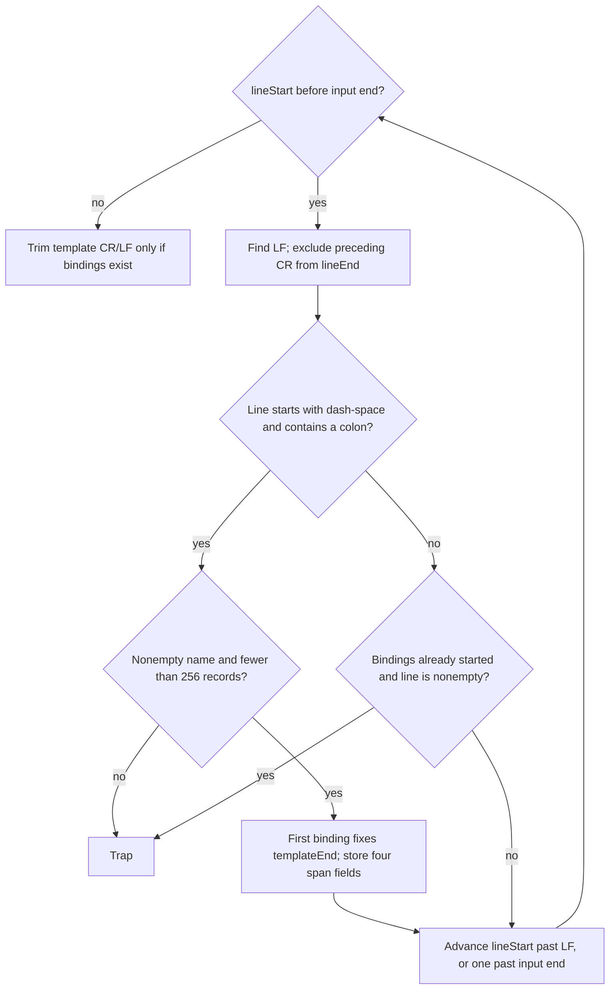
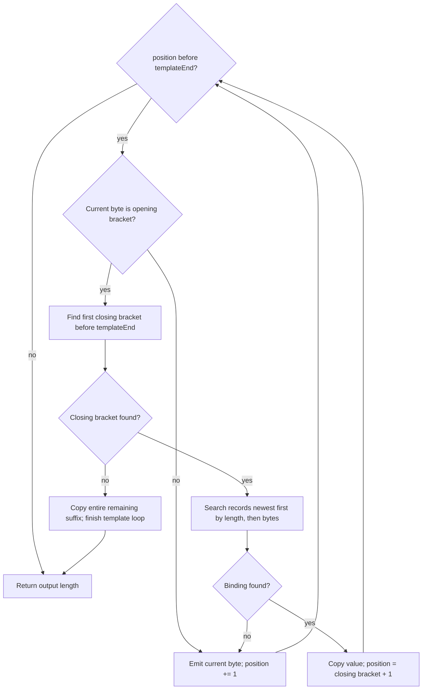

# Mad libs: bindings to Markdown

Replace `[name]` in the template using a final Markdown list of `- name: value`
bindings. The first such list item starts the bindings; the preceding text is
the template, with its trailing CR/LF separators removed. Subsequent nonempty
lines must be bindings. One space after the colon is optional. Names are
matched byte-for-byte, unknown names stay unchanged, and the last duplicate
binding wins. Values are literal: no recursive expansion or spelling changes.

```text
My [pet] went to the [place] [time]!

- pet: dog
- place: park
- time: yesterday
```

The result is `My dog went to the park yesterday!`. Using `yesterdy` as the
binding instead would preserve that spelling. A template with no binding list
is returned unchanged. Empty values are allowed. The input is UTF-8 and byte
comparisons preserve Unicode without decoding it to characters.

## Memory and shared patterns

Input occupies `[0, 0x10000)`. Output occupies `[0x10000, 0x30000)`.
Up to 256 binding records at `0x30000` hold four i32 values: name start, name
length, value start, value end. All refer to immutable input bytes; names and
values are not copied into a dictionary. Memory is fixed at four pages.
Invalid binding lines or capacity overflow trap, preserving the UI's previous
successful output. The host only supplies bytes and reads the returned length.

The `find`, bounded `emit`, and span `copy` loops follow the same patterns as
the Markdown renderer. Unlike an HTML renderer, copy does not escape Markdown.
Lookup scans at most 256 records in reverse and compares only equal-length
names. This trades a small bounded scan for hash-table code and allocations.
An unmatched opening bracket consumes the rest literally, avoiding repeated
searches over the same unterminated suffix.

```text
run(length):
    scan lines, recording the final binding list as offset/length tuples
    trim CR/LF between the template and bindings
    for each template byte:
        if '[' begins a complete placeholder:
            search bindings, newest first
            if found: copy the value; skip the placeholder
        copy the original byte otherwise
    return output_length
```

## Inside `run`: finding where the template stops

The first loop is over physical lines, not placeholders. `lineStart` points
at the next unread line; `lineEnd` excludes its LF and optional preceding CR.
`templateEnd` initially equals the input length. Only the first successfully
parsed binding changes it, to that binding's line start.



The byte groups `ml-lines-*` find line boundaries. `ml-binding-*` recognizes
and stores a binding. `ml-binding-invalid` rejects nonempty trailing prose
after bindings have begun; a line of spaces is nonempty too. Before the first
binding, an ordinary line is still template text. A dash-space line with a
colon but an empty name traps even there. No whitespace is trimmed from names.

Each record is 16 bytes: name start, name length, value start, value end.
`record = 0x30000 + (bindingCount << 4)`. Skipping the optional single space
after `:` changes only value start. A blank value needs no special record.
The input stays untouched, so later records and template reads cannot
invalidate earlier spans. `ml-trim-*` then removes only CR/LF immediately
before the binding list, not spaces belonging to the template.

## Inside `run`: consuming a placeholder or preserving its source



`ml-template-*` owns the template position. `ml-placeholder-*` locates the
candidate name, while `ml-lookup-*` searches records without changing that
position. The lookup starts at `bindingCount`, decrements before reading,
and stops on its first equal name. That is why the last duplicate wins.
Length mismatches skip the byte comparison entirely.

A successful replacement skips both brackets, even if its value is empty.
Value bytes go directly to output: `[other]` inside a value is not rescanned.
On a miss, only the opening bracket is copied at that iteration; following
bytes return through the normal loop. Thus nested-looking input such as
`[outer[pet]` can still substitute the inner `[pet]` after the outer lookup
misses. This is bracket scanning, not a nested-placeholder grammar.

An opening bracket with no later close is different: `ml-placeholder-missing`
copies the whole suffix and exits. This avoids rescanning every remaining
opening bracket in an unterminated suffix. It does not make every possible
input linear: many opening brackets sharing a later close can repeat scans.
The binding search is bounded to 256 records, but name comparisons still
depend on the names' lengths.

### Trace: duplicate bindings, an unknown name, and an empty value

For template `[pet] [missing] [empty]`, let the records be `pet: cat`, then
`pet: dog`, then `empty:`. The position is a byte offset into that template.

| Position | Decision | Output added | Next position |
| --- | --- | --- | --- |
| 0 | Reverse lookup finds the second `pet` | `dog` | 5 |
| 5 | Ordinary space | one space | 6 |
| 6 | No `missing` record; preserve opening bracket | `[` | 7 |
| 7–14 | Ordinary bytes, including the closing bracket | `missing]` | 15 |
| 15 | Ordinary space | one space | 16 |
| 16 | `empty` matches a zero-length value | nothing | 23 |

The result ends with a space: `dog [missing] `. The source, not the output,
determines where the next lookup begins.

## Small helpers: who advances which cursor?

- `find(start, end, byte)` advances its local start until a match or end,
  returning an offset. It does not consume the matching byte for its caller.
- `equal(a, b, length)` stops on the first mismatch; otherwise both local
  pointers advance together while the remaining length decreases to zero.
  An empty comparison succeeds without reading memory.
- `copy(start, end)` advances its own source pointer, calling `emit` once per
  byte. It does not mutate any of `run`'s source cursors.
- `emit(byte)` checks the output limit before storing and then advances the
  sole global cursor. Even a large replacement cannot overwrite the records.

These are the `ml-find-*`, `ml-equal-*`, `ml-copy-*` and `ml-emit-*` groups
below. Their loops either advance an input pointer or decrease a counter;
their exit blocks are separate from the loops so `br_if 1` can finish them.

## Module

Functions are emit 0, copy 1, find 2, equal 3, run 4. The only global is the
output cursor. `run(length)` returns the number of bytes at `0x10000`.

`[microwasm]`

- ml-header: `0061736d 01000000`
- ml-type-section: `01 {{size:ml-types}}`
  - ml-types: `04 60 01 7f 00 60 02 7f 7f 00 60 03 7f 7f 7f 01 7f 60 01 7f 01 7f`
- ml-function-section: `03 {{size:ml-functions}}`
  - ml-functions: `05 00 01 02 02 03`
- ml-memory-section: `05 {{size:ml-memories}}`
  - ml-memories: `01 01 04 04`
- ml-global-section: `06 {{size:ml-globals}}`
  - ml-globals: `01 7f 01 41 808004 0b`
- ml-export-section: `07 {{size:ml-exports}}`
  - ml-exports: `02 03 72756e 00 04 06 6d656d6f7279 02 00`
- ml-code-section: `0a {{size:ml-code}}`
  - ml-code: `05`
    - ml-emit-record: `{{size:ml-emit-body}}`
      - ml-emit-body: `00`
        - ml-emit-bound: `23 00 41 80800c 4f 04 40 00 0b`
        - ml-emit-byte: `23 00 20 00 3a 00 00`
        - ml-emit-next: `23 00 41 01 6a 24 00 0b`
    - ml-copy-record: `{{size:ml-copy-body}}`
      - ml-copy-body: `00`
        - ml-copy-exit: `02 40`
          - ml-copy-loop: `03 40`
            - ml-copy-bound: `20 00 20 01 4f 0d 01`
            - ml-copy-byte: `20 00 2d 00 00 10 00`
            - ml-copy-next: `20 00 41 01 6a 21 00 0c 00 0b`
          - ml-copy-done: `0b 0b`
    - ml-find-record: `{{size:ml-find-body}}`
      - ml-find-body: `00`
        - ml-find-exit: `02 40`
          - ml-find-loop: `03 40`
            - ml-find-bound: `20 00 20 01 4f 0d 01`
            - ml-find-match: `20 00 2d 00 00 20 02 46 04 40 20 00 0f 0b`
            - ml-find-next: `20 00 41 01 6a 21 00 0c 00 0b`
          - ml-find-end: `0b`
        - ml-find-result: `20 01 0b`
    - ml-equal-record: `{{size:ml-equal-body}}`
      - ml-equal-body: `00`
        - ml-equal-exit: `02 40`
          - ml-equal-loop: `03 40`
            - ml-equal-bound: `20 02 45 0d 01`
            - ml-equal-compare: `20 00 2d 00 00 20 01 2d 00 00 47 04 40 41 00 0f 0b`
            - ml-equal-next: `20 00 41 01 6a 21 00 20 01 41 01 6a 21 01 20 02 41 01 6b 21 02 0c 00 0b`
          - ml-equal-end: `0b`
        - ml-equal-result: `41 01 0b`
    - ml-run-record: `{{size:ml-run-body}}`
      - ml-run-body: `01 0e 7f`
        - ml-run-bound: `20 00 41 808004 4b 04 40 00 0b`
        - ml-run-reset: `41 808004 24 00 20 00 21 03`
        - ml-lines-exit: `02 40`
          - ml-lines-loop: `03 40`
            - ml-lines-finished: `20 01 20 00 4f 0d 01`
            - ml-lines-end: `20 01 20 00 41 0a 10 02 22 02 21 0c`
            - ml-lines-cr-room: `20 0c 20 01 4b 04 40`
              - ml-lines-cr: `20 0c 41 01 6b 2d 00 00 41 0d 46 04 40 20 0c 41 01 6b 21 0c 0b 0b`
            - ml-binding-room: `20 0c 20 01 6b 41 02 4f 04 40`
              - ml-binding-marker: `20 01 2d 00 00 41 2d 46 20 01 2d 00 01 41 20 46 71 04 40`
                - ml-binding-name: `20 01 41 02 6a 21 06`
                - ml-binding-colon: `20 06 20 0c 41 3a 10 02 21 05`
                - ml-binding-has-colon: `20 05 20 0c 49 04 40`
                  - ml-binding-name-length: `20 05 20 06 6b 22 07 45 04 40 00 0b`
                  - ml-binding-first: `20 04 45 04 40 20 01 21 03 0b`
                  - ml-binding-capacity: `20 04 41 8002 4f 04 40 00 0b`
                  - ml-binding-value: `20 05 41 01 6a 21 08`
                  - ml-binding-space-room: `20 08 20 0c 49 04 40`
                    - ml-binding-space: `20 08 2d 00 00 41 20 46 04 40 20 08 41 01 6a 21 08 0b 0b`
                  - ml-binding-record: `41 80800c 20 04 41 04 74 6a 21 09`
                  - ml-binding-store-name: `20 09 20 06 36 02 00 20 09 20 07 36 02 04`
                  - ml-binding-store-value: `20 09 20 08 36 02 08 20 09 20 0c 36 02 0c`
                  - ml-binding-count: `20 04 41 01 6a 21 04`
                  - ml-binding-next: `20 02 41 01 6a 21 01 0c 03 0b`
                - ml-binding-marker-end: `0b`
              - ml-binding-room-end: `0b`
            - ml-binding-invalid: `20 04 45 45 20 01 20 0c 47 71 04 40 00 0b`
            - ml-lines-next: `20 02 41 01 6a 21 01 0c 00 0b`
          - ml-lines-end-block: `0b`
        - ml-trim-if-bindings: `20 04 04 40`
          - ml-trim-exit: `02 40`
            - ml-trim-loop: `03 40`
              - ml-trim-empty: `20 03 45 0d 01`
              - ml-trim-byte: `20 03 41 01 6b 2d 00 00 21 05`
              - ml-trim-not-newline: `20 05 41 0a 47 20 05 41 0d 47 71 0d 01`
              - ml-trim-next: `20 03 41 01 6b 21 03 0c 00 0b`
            - ml-trim-end: `0b 0b`
        - ml-template-start: `41 00 21 0a`
        - ml-template-exit: `02 40`
          - ml-template-loop: `03 40`
            - ml-template-bound: `20 0a 20 03 4f 0d 01`
            - ml-placeholder-open: `20 0a 2d 00 00 41 db00 46 04 40`
              - ml-placeholder-close: `20 0a 41 01 6a 20 03 41 dd00 10 02 21 0d`
              - ml-placeholder-missing: `20 0d 20 03 46 04 40 20 0a 20 03 10 01 0c 03 0b`
              - ml-placeholder-length: `20 0d 20 0a 6b 41 01 6b 21 07`
              - ml-lookup-start: `20 04 21 0b 41 00 21 0e`
              - ml-lookup-exit: `02 40`
                - ml-lookup-loop: `03 40`
                  - ml-lookup-bound: `20 0b 45 0d 01`
                  - ml-lookup-record: `20 0b 41 01 6b 22 0b 41 04 74 41 80800c 6a 21 09`
                  - ml-lookup-length: `20 09 28 02 04 20 07 46 04 40`
                    - ml-lookup-name: `20 0a 41 01 6a 20 09 28 02 00 20 07 10 03 04 40`
                      - ml-lookup-copy: `20 09 28 02 08 20 09 28 02 0c 10 01`
                      - ml-lookup-found: `41 01 21 0e 0c 03 0b 0b`
                  - ml-lookup-next: `0c 00 0b`
                - ml-lookup-end: `0b`
              - ml-placeholder-used: `20 0e 04 40 20 0d 41 01 6a 21 0a 0c 02 0b 0b`
            - ml-template-byte: `20 0a 2d 00 00 10 00`
            - ml-template-next: `20 0a 41 01 6a 21 0a 0c 00 0b`
          - ml-template-end: `0b`
        - ml-run-result: `23 00 41 808004 6b 0b`

Run locals: length 0, line start 1, LF position 2, template end 3, binding
count 4, colon/temporary byte 5, name start 6, name length 7, value start 8,
record pointer 9, template position 10, binding index 11, CR-trimmed line end
12, closing bracket 13, found flag 14.
