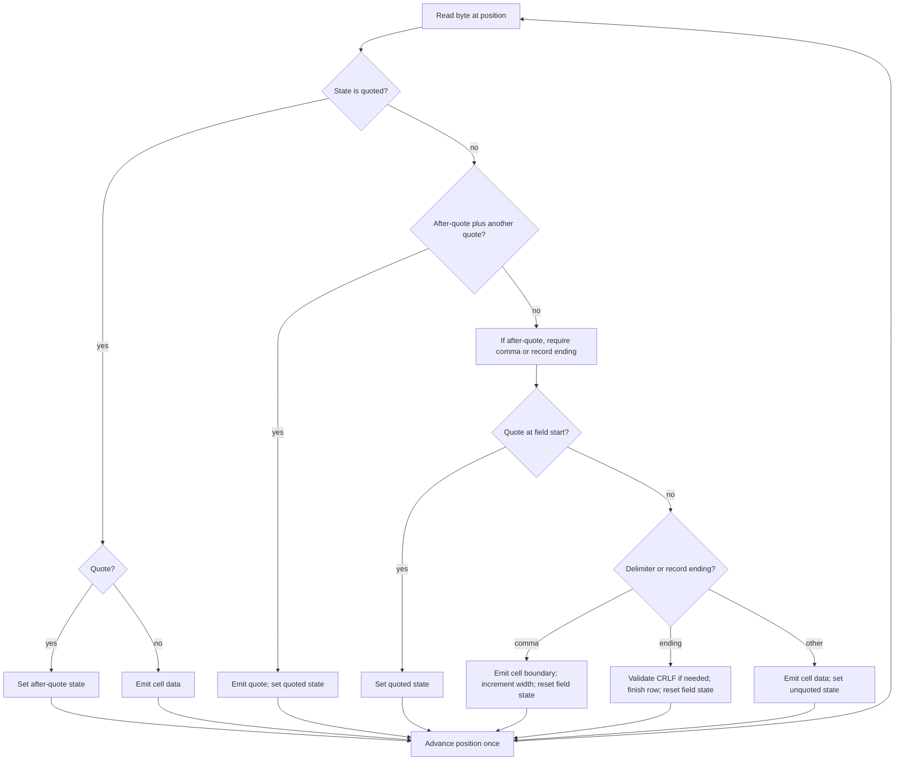
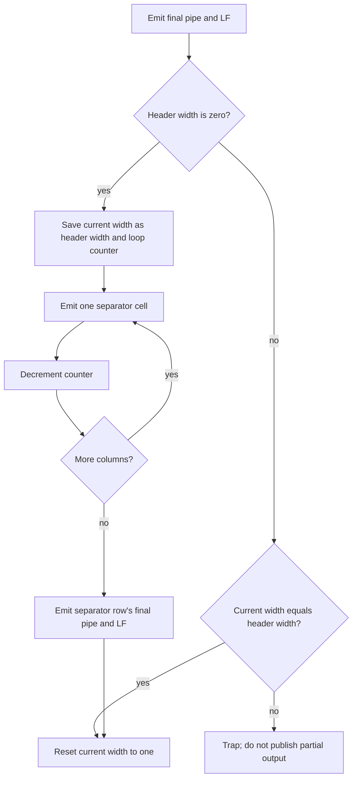

# Fenced CSV to a Markdown table

The first CSV record becomes the header. Later records must have the same
number of fields. No values are trimmed or interpreted as numbers. Empty
fields, quoted commas, doubled quotes and embedded LF/CRLF inside quoted
fields are supported. Outside quotes, record endings are LF or CRLF; bare CR,
quotes in unquoted fields and text after a closing quote are errors.

```csv
name,city,note
Ben,Phoenix,"hello, world"
Ada,London,"said ""hi"""
```

becomes:

```text
| name | city | note |
| --- | --- | --- |
| Ben | Phoenix | hello,&#32;world |
| Ada | London | said&#32;"hi" |
```

Require one backtick `csv` fence starting at the beginning of input, with at
least three backticks and the same number on the closing fence.
Fence lines use LF or CRLF. The closing fence is on its own line, followed
only by ASCII space, tab, CR or LF. There must be at least one CSV record;
a blank record is a header containing one empty field. The line ending before
the closing fence belongs to CSV and does not create an additional record.

## Pattern: field state and byte escaping are separate

Four states suffice: field start, unquoted, quoted, after quote. Delimiters
matter only outside a quoted field. Finishing a record checks its width; the
first record also emits a Markdown header separator. There is no stored row
array and no host CSV parser.

### Inside `convert`: the field-state transition table

Local 3 is the field state. It starts at zero because Wasm initializes locals;
commas and record endings explicitly restore zero. In this table, “data” means
calling `cell-byte`, which may reject a control character or expand it into a
Markdown-safe reference. It does not interpret CSV delimiters.

| State before byte | Quote | Comma | LF or CR | Other byte |
| --- | --- | --- | --- | --- |
| 0: field start | Enter 2; emit nothing | End empty field; stay 0 | Finish record; stay 0 | Emit data; enter 1 |
| 1: unquoted | Trap | End field; enter 0 | Finish record; enter 0 | Emit data; stay 1 |
| 2: quoted | Enter 3; emit nothing | Emit data; stay 2 | Emit data; stay 2 | Emit data; stay 2 |
| 3: after quote | Emit one quote; return to 2 | End field; enter 0 | Finish record; enter 0 | Trap |

State 3 means “the last quote may have closed the field”; it is not yet a
committed record boundary. A second quote makes the pair data. For example,
`"a""b",c` follows states `0 → 2 → 2 → 3 → 2 → 2 → 3 → 0 → 1`.
The two adjacent quotes emit only one quote, and the comma increments the
field count only after the closing quote.



The transition table supplies the error edges omitted from this diagram:
a quote in an unquoted field and a nonseparator after a closing quote trap.
The actual byte groups `ct-quoted`, `ct-doubled`, `ct-after-valid`,
`ct-opening`, `ct-comma` and `ct-newline` follow this decision order. Checking
quoted state first is what prevents a quoted comma or newline from reaching
the row machinery.

In TSV mode the opening-quote branch is disabled and the delimiter comparison
uses tab instead of comma. States 2 and 3 are consequently unreachable;
quotes and commas are ordinary data. The rest of the width and row handling
is shared, not a separate TSV parser.

### Record endings: when position advances twice

Outside quotes, LF finishes a row directly. CR first requires another byte
inside the content region, advances onto it and requires LF. The common
bottom-of-loop increment then advances past that LF. Inside quotes, CR and
LF each go through `cell-byte` separately, preserving both as data rather
than normalizing them.

After finishing a row, `ct-more` checks whether another content byte remains.
If so it opens the next Markdown row. Otherwise it sets local 4, the
ended-row flag. The post-loop `ct-final-row` calls `finish-row` only when that
flag is unset. Thus a trailing record ending is not counted twice. The flag
is not a general “currently at line start” flag: it is set only at the final
record ending.

### Inside `finish-row`: first record establishes width



Current width starts at one, even for a blank record, and only delimiters
increment it. This makes zero an unambiguous “header not seen” sentinel.
`finish-row` resets the width, while its caller resets the field state and
decides whether to open another output row. Those responsibilities are
separate: this function never advances the input cursor.

### Inside `cell-byte`: encode data without creating table syntax

First reject C0 controls other than TAB, LF and CR. Then classify the byte as
ordinary or Markdown-sensitive. Ordinary bytes are emitted directly. For a
sensitive byte, emit `&#`, optional hundreds, optional tens, mandatory ones,
then `;`. The numeric value here is an unsigned byte, so three decimal digits
always suffice; no general number formatter or scratch buffer is needed.

For a pipe (124), division yields `1`, `2`, `4`, producing `&#124;`. A tab (9)
skips both optional digits and produces `&#9;`. Every emitted byte goes through
`emit`'s capacity check, including bytes introduced by escaping. Output size
is not bounded by the source size alone.

### Fence scanning is separate from the CSV state machine

Before parsing fields, `convert` trims allowed whitespace after the document,
counts the opening backticks, locates the equal-length closing run, and checks
its preceding LF. The closing-fence offset becomes local 5, content end.
The opening label and LF/CRLF are consumed before the first field begins.
The record ending just before the closing fence remains in the content span.
This keeps fence recognition out of the hot field loop; that loop sees only
CSV bytes and an exclusive end offset.

The cell writer uses decimal HTML character references for `&`, `<`, `>`,
`|`, backslash, backtick, `*`, `_`, `[` and `]`, plus spaces and the three
supported whitespace controls. This keeps inline Markdown inert and preserves
leading/trailing spaces in the table source. In particular an embedded pipe
is `&#124;`, not a separator. Other C0 controls are rejected because Markdown
tables do not reliably preserve them. UTF-8 validity is a caller precondition.

Input is at zero, at most 64 KiB. Output starts at `0x10000`, capped at
128 KiB. The four-page memory is fixed; memory from `0x30000` onward cannot be
overwritten by output. Invalid syntax, width or capacity traps. Every run
resets state, and only a successful return publishes the output.

## Module

Functions: convert 0, emit 1, cell-byte 2, finish-row 3, CSV entry 4, TSV entry
5. Globals: output cursor 0, header width 1, current width 2, TSV mode 3.
The exported `run` selects CSV; `tsv` selects the tab-separated dialect used
by [TSV to table](06-tsv-to-table.md). Both entries reset mode before calling
the shared converter. TSV never enters quoted-field state: quotes are data,
tabs are delimiters and LF/CRLF end records. The first row establishes
the width, so a separate first-row flag is unnecessary.

`[microwasm]`

- ct-header: `0061736d 01000000`
- ct-type-section: `01 {{size:ct-types}}`
  - ct-types: `03 60 01 7f 01 7f 60 01 7f 00 60 00 00`
- ct-function-section: `03 {{size:ct-functions}}`
  - ct-functions: `06 00 01 01 02 00 00`
- ct-memory-section: `05 {{size:ct-memories}}`
  - ct-memories: `01 01 04 04`
- ct-global-section: `06 {{size:ct-globals}}`
  - ct-globals: `04 7f 01 41 00 0b 7f 01 41 00 0b 7f 01 41 00 0b 7f 01 41 00 0b`
- ct-export-section: `07 {{size:ct-exports}}`
  - ct-exports: `03 03 72756e 00 04 03 747376 00 05 06 6d656d6f7279 02 00`
- ct-code-section: `0a {{size:ct-code}}`
  - ct-code: `06`
    - ct-run-record: `{{size:ct-run-body}}`
      - ct-run-body: `01 07 7f`
        - ct-bound: `20 00 41 808004 4b 20 00 41 0b 49 72 04 40 00 0b`
        - ct-reset: `41 808004 24 00 41 00 24 01 41 01 24 02`
        - ct-trim-start: `20 00 21 05`
        - ct-trim-exit: `02 40`
          - ct-trim-loop: `03 40`
            - ct-trim-bound: `20 05 45 0d 01`
            - ct-trim-byte: `20 05 41 01 6b 2d 00 00 21 02`
            - ct-trim-space: `20 02 41 20 46 20 02 41 09 46 72 20 02 41 0a 46 72 20 02 41 0d 46 72 45 0d 01`
            - ct-trim-next: `20 05 41 01 6b 21 05 0c 00 0b`
          - ct-trim-end: `0b`
        - ct-open-exit: `02 40`
          - ct-open-loop: `03 40`
            - ct-open-bound: `20 01 20 05 4f 0d 01`
            - ct-open-tick: `20 01 2d 00 00 41 e000 47 0d 01`
            - ct-open-next: `20 01 41 01 6a 21 01 0c 00 0b`
          - ct-open-end: `0b`
        - ct-open-count: `20 01 22 06 41 03 49 04 40 00 0b`
        - ct-close-room: `20 05 20 06 41 01 74 41 05 6a 49 04 40 00 0b`
        - ct-close-position: `20 05 20 06 6b 21 05`
        - ct-close-loop: `03 40`
          - ct-close-byte: `20 05 20 07 6a 2d 00 00 41 e000 47 04 40 00 0b`
          - ct-close-next: `20 07 41 01 6a 22 07 20 06 49 0d 00 0b`
        - ct-close-newline: `20 05 41 01 6b 2d 00 00 41 0a 47 04 40 00 0b`
        - ct-open-label: `20 01 2d 00 00 23 03 04 7f 41 f400 05 41 e300 0b 47 20 01 2d 00 01 41 f300 47 72 20 01 2d 00 02 41 f600 47 72 04 40 00 0b 20 01 41 03 6a 21 01`
        - ct-open-ending: `20 01 2d 00 00 41 0d 46 04 40 20 01 41 01 6a 21 01 0b`
        - ct-open-lf: `20 01 2d 00 00 41 0a 47 04 40 00 0b 20 01 41 01 6a 21 01`
        - ct-empty-input: `20 01 20 05 4f 04 40 00 0b`
        - ct-first-field: `41 fc00 10 01 41 20 10 01`
        - ct-input-exit: `02 40`
          - ct-input-loop: `03 40`
            - ct-input-bound: `20 01 20 05 4f 0d 01`
            - ct-input-byte: `20 01 2d 00 00 21 02`
            - ct-quoted: `20 03 41 02 46 04 40`
              - ct-quoted-quote: `20 02 41 22 46 04 40 41 03 21 03`
              - ct-quoted-data: `05 20 02 10 02 0b`
              - ct-outside: `05`
              - ct-doubled: `20 03 41 03 46 20 02 41 22 46 71 04 40 20 02 10 02 41 02 21 03`
                - ct-delimiter: `05`
                - ct-after-quote: `20 03 41 03 46 04 40`
                  - ct-after-valid: `20 02 41 2c 46 20 02 41 0a 46 72 20 02 41 0d 46 72 45 04 40 00 0b 0b`
                - ct-opening: `20 02 41 22 46 23 03 45 71 04 40 20 03 04 40 00 0b 41 02 21 03`
                  - ct-other: `05`
                  - ct-comma: `20 02 23 03 04 7f 41 09 05 41 2c 0b 46 04 40`
                    - ct-next-field: `41 20 10 01 41 fc00 10 01 41 20 10 01 23 02 41 01 6a 24 02 41 00 21 03`
                    - ct-not-comma: `05`
                    - ct-newline: `20 02 41 0a 46 20 02 41 0d 46 72 04 40`
                      - ct-cr: `20 02 41 0d 46 04 40`
                        - ct-cr-bound: `20 01 41 01 6a 20 05 4f 04 40 00 0b`
                        - ct-cr-lf: `20 01 41 01 6a 22 01 2d 00 00 41 0a 47 04 40 00 0b 0b`
                      - ct-finish: `10 03`
                      - ct-more: `20 01 41 01 6a 20 05 49 04 40 41 fc00 10 01 41 20 10 01 05 41 01 21 04 0b`
                      - ct-reset-state: `41 00 21 03`
                      - ct-ordinary: `05 20 02 10 02 41 01 21 03 0b 0b 0b 0b 0b`
            - ct-input-next: `20 01 41 01 6a 21 01 0c 00 0b`
          - ct-input-end: `0b`
        - ct-unclosed: `20 03 41 02 46 04 40 00 0b`
        - ct-final-row: `20 04 45 04 40 10 03 0b`
        - ct-result: `23 00 41 808004 6b 0b`
    - ct-emit-record: `{{size:ct-emit-body}}`
      - ct-emit-body: `00`
        - ct-emit-bound: `23 00 41 80800c 4f 04 40 00 0b`
        - ct-emit-byte: `23 00 20 00 3a 00 00 23 00 41 01 6a 24 00 0b`
    - ct-cell-record: `{{size:ct-cell-body}}`
      - ct-cell-body: `00`
        - ct-cell-control: `20 00 41 20 49 20 00 41 09 47 71 20 00 41 0a 47 71 20 00 41 0d 47 71 04 40 00 0b`
        - ct-cell-special: `20 00 41 20 4d 20 00 41 26 46 72 20 00 41 3c 46 72 20 00 41 3e 46 72 20 00 41 fc00 46 72 20 00 41 dc00 46 72 20 00 41 e000 46 72 20 00 41 2a 46 72 20 00 41 df00 46 72 20 00 41 db00 46 72 20 00 41 dd00 46 72 04 40`
          - ct-cell-entity: `41 26 10 01 41 23 10 01`
          - ct-cell-hundreds: `20 00 41 e400 4f 04 40 20 00 41 e400 6e 41 30 6a 10 01 0b`
          - ct-cell-tens: `20 00 41 0a 4f 04 40 20 00 41 0a 6e 41 0a 70 41 30 6a 10 01 0b`
          - ct-cell-ones: `20 00 41 0a 70 41 30 6a 10 01 41 3b 10 01`
          - ct-cell-plain: `05 20 00 10 01 0b 0b`
    - ct-row-record: `{{size:ct-row-body}}`
      - ct-row-body: `01 01 7f`
        - ct-row-close: `41 20 10 01 41 fc00 10 01 41 0a 10 01`
        - ct-row-header: `23 01 45 04 40 23 02 24 01 23 02 21 00`
          - ct-rule-loop: `03 40`
            - ct-rule-cell: `41 fc00 10 01 41 20 10 01 41 2d 10 01 41 2d 10 01 41 2d 10 01 41 20 10 01`
            - ct-rule-next: `20 00 41 01 6b 22 00 0d 00 0b`
          - ct-rule-end: `41 fc00 10 01 41 0a 10 01`
          - ct-row-width: `05 23 01 23 02 47 04 40 00 0b 0b`
        - ct-row-reset: `41 01 24 02 0b`
    - ct-csv-record: `{{size:ct-csv-body}}`
      - ct-csv-body: `00 41 00 24 03 20 00 10 00 0b`
    - ct-tsv-record: `{{size:ct-tsv-body}}`
      - ct-tsv-body: `00 41 01 24 03 20 00 10 00 0b`
Run locals: input length 0, position 1, byte 2, field state 3, ended-row flag
4, content end 5, fence length 6, fence scan 7. Cell escaping computes decimal
digits directly. The CSV label is three byte comparisons; no string table or
terminator is needed.
