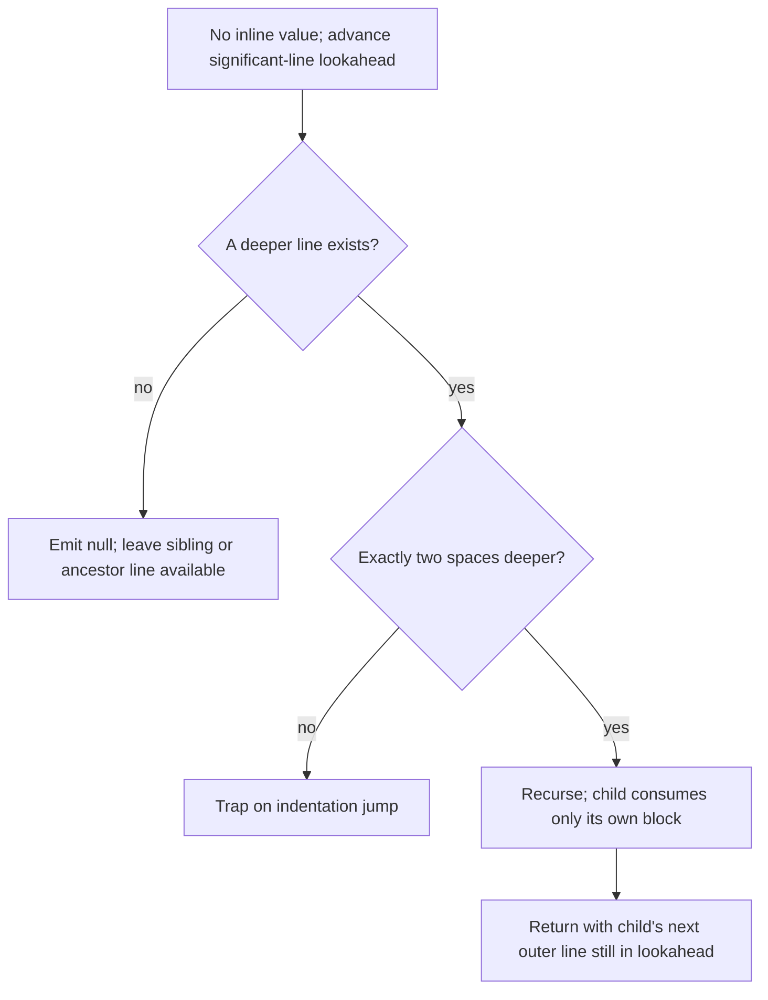

# Block YAML to a hierarchical Markdown list

Tool 17 reads a `yaml` fenced block and emits the same list notation as the
JSON tools: `{}` and `[]` introduce collections, JSON quotes preserve strings,
and `= ` identifies numbers, Booleans and null. The conversion executes in
Wasm; JavaScript only supplies input bytes and displays the returned bytes.

## Accepted data

- Block mappings and sequences use two spaces per nested level.
- Mapping keys may be plain strings or quoted strings. Duplicate decoded keys
  are errors, including differently escaped spellings of the same name.
- A `? key` line followed by `: value` at the same indentation supports long
  explicit keys. Implicit keys are restricted to fewer than 1024 source bytes.
- A value on the next indented line can be another mapping or sequence.
  A missing value with no nested block becomes null.
- Empty `{}` and `[]`, scalar roots, comments and blank lines are supported.
- The [scalar pattern](./00-yaml-scalars.md) documents quoting, Unicode and
  numeric classification. Numeric spelling is retained, not rounded by JS.

This is a block-data subset, not a complete YAML processor. Compact mappings
such as `- name: Ben`, nonempty flow collections, anchors, tags and multiline
scalars are rejected. Use `-` on its own line before a nested mapping. This
accepts the structure emitted by the companion YAML writer without guessing
the meaning of unsupported syntax. The fence is exactly three backticks and
`yaml`; LF and CRLF line endings work. No prose surrounds the fenced input.

## Pattern: one lookahead line, no tree allocation

The physical-line scanner skips blank and comment lines and retains one
lookahead line. A recursive block consumes siblings at its indentation and
returns with the next outer line still available. Scalar and value readers
advance that same cursor, so there is no rescan from the start on each child.

For duplicate mapping keys, scan previously emitted direct-child lines of
that mapping. Their keys are already validated JSON strings. The shared Wasm
string comparator checks their decoded values without allocating a key table.
Nested child lines have different indentation and are skipped.

```text
read the next significant physical line
write the root list prefix
block(depth, indentation):
  determine mapping, sequence, or scalar from the first line
  scalar: decode, write newline, advance lookahead, return
  collection: write its marker and newline
  while lookahead is a sibling at this indentation:
    write its list prefix, and its key if a mapping
    value on the line: decode it and advance
    no value: advance; recurse into an indented block, otherwise write null
```

Input occupies the first 64 KiB, output the following 128 KiB. The last page
contains only fixed literals. There are at most 128 nested collections.
Bounds are checked before stores; input remains unchanged. A failed run may
leave partial output, which must not be displayed; a later run resets state.

## Inside value: advancing lookahead does not mean consuming a sibling

`yl-value-analyze` separates scalar content from comments and rejects a
mapping delimiter where a scalar is required. When the remaining span is
empty, `yl-value-nested` advances to the next significant line. Its indentation
decides whether this value owns that line:



At the top of `yl-block-loop`, a shallower line returns without advancing
again; an equal indentation is another sibling; an unexpected greater
indentation traps. After an inline scalar, `yl-value-continuation` rejects
a deeper line instead of attaching it to an already complete value.
This distinguishes a missing value followed by a nested collection from a
scalar followed by unsupported continuation text, without a rewind buffer.

## Module

Imports: scalar 0, analyze 1, quote-end 2 from `s`, equal 3 from `k`, and
`s.memory`. Defined functions: run 4, emit 5, prefix 6, next-line 7, block 8,
value 9, duplicate-check 10, marker 11, whitespace 12.

Globals: output 0, next physical line 1, body end 2, content start 3,
content end 4, indentation 5, lookahead present 6.

`[microwasm]`

- yl-header: `0061736d 01000000`
- yl-type-section: `01 {{size:yl-types}}`
  - yl-types: `0a 60 04 7f 7f 7f 7f 01 7f 60 02 7f 7f 02 7f 7f 60 02 7f 7f 01 7f 60 01 7f 01 7f 60 01 7f 00 60 00 00 60 02 7f 7f 00 60 04 7f 7f 7f 7f 00 60 05 7f 7f 7f 7f 7f 00 60 03 7f 7f 7f 01 7f`
- yl-import-section: `02 {{size:yl-imports}}`
  - yl-imports: `05 01 73 06 7363616c6172 00 00 01 73 07 616e616c797a65 00 01 01 73 08 71756f7465456e64 00 02 01 6b 05 657175616c 00 00 01 73 06 6d656d6f7279 02 01 04 04`
- yl-function-section: `03 {{size:yl-functions}}`
  - yl-functions: `09 03 04 04 05 06 07 08 09 03`
- yl-global-section: `06 {{size:yl-globals}}`
  - yl-globals: `07 7f 01 41 00 0b 7f 01 41 00 0b 7f 01 41 00 0b 7f 01 41 00 0b 7f 01 41 00 0b 7f 01 41 00 0b 7f 01 41 00 0b`
- yl-export-section: `07 {{size:yl-exports}}`
  - yl-exports: `02 03 72756e 00 04 06 6d656d6f7279 02 00`
- yl-code-section: `0a {{size:yl-code}}`
  - yl-code: `09`
    - yl-run-record: `{{size:yl-run-body}}`
      - yl-run-body: `01 02 7f`
        - yl-run-bound: `20 00 41 0b 49 20 00 41 808004 4b 72 04 40 00 0b`
        - yl-run-prefix-loop: `03 40 20 01 2d 00 00 20 01 41 81820c 6a 2d 00 00 47 04 40 00 0b 20 01 41 01 6a 22 01 41 07 49 0d 00 0b`
        - yl-run-opening: `41 07 24 01 41 07 2d 00 00 41 0d 46 04 40 41 08 24 01 0b 23 01 2d 00 00 41 0a 47 04 40 00 0b 23 01 41 01 6a 24 01`
        - yl-run-trim-start: `20 00 21 01`
        - yl-run-trim-exit: `02 40 03 40 20 01 45 0d 01 20 01 41 01 6b 2d 00 00 10 0c 45 0d 01 20 01 41 01 6b 21 01 0c 00 0b 0b`
        - yl-run-closing-bound: `20 01 23 01 41 03 6a 49 04 40 00 0b 20 01 41 03 6b 24 02`
        - yl-run-closing-loop: `03 40 23 02 20 02 6a 2d 00 00 41 e000 47 04 40 00 0b 20 02 41 01 6a 22 02 41 03 49 0d 00 0b`
        - yl-run-closing-line: `23 02 23 01 47 04 40 23 02 41 01 6b 2d 00 00 41 0a 47 04 40 00 0b 0b`
        - yl-run-reset: `41 808004 24 00 10 07 41 00 10 06`
        - yl-run-root: `23 06 04 40 23 05 04 40 00 0b 41 00 41 00 10 08`
          - yl-run-empty: `05 41 00 41 00 23 00 41 00 10 00 24 00 41 0a 10 05 0b`
        - yl-run-complete: `23 06 04 40 00 0b 23 00 41 808004 6b 0b`
    - yl-emit-record: `{{size:yl-emit-body}}`
      - yl-emit-body: `00 23 00 41 80800c 4f 04 40 00 0b 23 00 20 00 3a 00 00 23 00 41 01 6a 24 00 0b`
    - yl-prefix-record: `{{size:yl-prefix-body}}`
      - yl-prefix-body: `00 02 40 03 40 20 00 45 0d 01 41 20 10 05 41 20 10 05 20 00 41 01 6b 21 00 0c 00 0b 0b 41 2d 10 05 41 20 10 05 0b`
    - yl-next-record: `{{size:yl-next-body}}`
      - yl-next-body: `01 02 7f`
        - yl-next-clear: `41 00 24 06`
        - yl-next-loop: `03 40`
          - yl-next-bound: `23 01 23 02 4f 04 40 0f 0b`
          - yl-next-start: `23 01 21 00 23 01 24 03`
          - yl-next-scan: `02 40 03 40 20 00 23 02 4f 0d 01 20 00 2d 00 00 41 0a 46 0d 01 20 00 41 01 6a 21 00 0c 00 0b 0b`
          - yl-next-advance: `20 00 20 00 23 02 49 6a 24 01`
          - yl-next-cr: `20 00 23 03 4b 04 40 20 00 41 01 6b 2d 00 00 41 0d 46 04 40 20 00 41 01 6b 21 00 0b 0b`
          - yl-next-indent-start: `23 03 21 01`
          - yl-next-indent: `02 40 03 40 23 03 20 00 4f 0d 01 23 03 2d 00 00 41 20 47 0d 01 23 03 41 01 6a 24 03 0c 00 0b 0b`
          - yl-next-empty: `23 03 20 00 46 0d 00`
          - yl-next-tab: `23 03 2d 00 00 41 09 46 04 40 00 0b`
          - yl-next-comment: `23 03 2d 00 00 41 23 46 0d 00`
          - yl-next-indentation: `23 03 20 01 6b 24 05`
          - yl-next-trim: `02 40 03 40 20 00 23 03 4d 0d 01 20 00 41 01 6b 2d 00 00 22 01 41 20 46 20 01 41 09 46 72 45 0d 01 20 00 41 01 6b 21 00 0c 00 0b 0b`
          - yl-next-result: `20 00 24 04 41 01 24 06 0f 0b 0b`
    - yl-block-record: `{{size:yl-block-body}}`
      - yl-block-body: `01 0a 7f`
        - yl-block-sequence: `23 03 23 04 41 2d 10 0b 04 40 41 01 21 02`
          - yl-block-map-test: `05 23 03 23 04 10 01 21 03 1a 20 03 23 03 23 04 41 3f 10 0b 72 04 40 41 02 21 02 0b 0b`
        - yl-block-scalar: `20 02 45 04 40`
          - yl-block-empty-depth: `20 00 41 8001 4f 04 40 23 03 2d 00 00 41 db00 46 23 03 2d 00 00 41 fb00 46 72 04 40 00 0b 0b`
          - yl-block-scalar-value: `23 03 23 04 23 00 41 00 10 00 24 00 41 0a 10 05 10 07 0f 0b`
        - yl-block-depth: `20 00 41 8001 4f 04 40 00 0b`
        - yl-block-marker: `20 02 41 01 46 04 40 41 db00 10 05 41 dd00 10 05 05 41 fb00 10 05 41 fd00 10 05 0b 41 0a 10 05 23 00 21 04`
        - yl-block-exit: `02 40`
          - yl-block-loop: `03 40`
            - yl-block-bound: `23 06 45 0d 01 23 05 20 01 49 0d 01 23 05 20 01 47 04 40 00 0b`
            - yl-block-seq-child: `20 02 41 01 46 04 40`
              - yl-block-seq-marker: `23 03 23 04 41 2d 10 0b 45 04 40 00 0b`
              - yl-block-seq-prefix: `20 00 41 01 6a 10 06`
              - yl-block-seq-value: `23 03 41 01 6a 23 04 20 00 41 01 6a 20 01 10 09`
              - yl-block-map-child: `05`
              - yl-block-explicit: `23 03 23 04 41 3f 10 0b 04 40`
                - yl-explicit-key: `23 03 41 01 6a 21 08 23 04 21 09 10 07`
                - yl-explicit-value-line: `23 06 45 23 05 20 01 47 72 04 40 00 0b 23 03 23 04 41 3a 10 0b 45 04 40 00 0b`
                - yl-explicit-value: `23 03 41 01 6a 21 0a 23 04 21 0b`
                - yl-implicit-key: `05 23 03 23 04 10 01 21 03 1a 20 03 45 04 40 00 0b 23 03 21 08 20 03 41 01 6b 21 09`
                - yl-implicit-limit: `20 09 20 08 6b 41 8008 4f 04 40 00 0b 20 03 21 0a 23 04 21 0b 0b`
              - yl-map-prefix: `23 00 21 05 20 00 41 01 6a 10 06 23 00 21 06`
              - yl-map-key: `20 08 20 09 23 00 41 01 10 00 22 07 24 00`
              - yl-map-duplicate: `20 04 20 05 20 06 20 07 20 00 41 01 6a 10 0a`
              - yl-map-value: `41 20 10 05 20 0a 20 0b 20 00 41 01 6a 20 01 10 09 0b`
            - yl-block-again: `0c 00 0b 0b 0b`
    - yl-value-record: `{{size:yl-value-body}}`
      - yl-value-body: `01 01 7f`
        - yl-value-trim: `02 40 03 40 20 00 20 01 4f 0d 01 20 00 2d 00 00 22 04 41 20 46 20 04 41 09 46 72 45 0d 01 20 00 41 01 6a 21 00 0c 00 0b 0b`
        - yl-value-analyze: `20 00 20 01 10 01 21 04 21 01 20 04 04 40 00 0b`
        - yl-value-nested: `20 00 20 01 46 04 40 10 07 23 06 23 05 20 03 4b 71 04 40`
          - yl-value-indent: `23 05 20 03 41 02 6a 47 04 40 00 0b 20 02 20 03 41 02 6a 10 08 0f 0b`
          - yl-value-null: `41 00 41 00 23 00 41 00 10 00 24 00 41 0a 10 05 0f 0b`
        - yl-value-empty-depth: `20 02 41 8001 4f 04 40 20 00 2d 00 00 41 db00 46 20 00 2d 00 00 41 fb00 46 72 04 40 00 0b 0b`
        - yl-value-inline: `20 00 20 01 23 00 41 00 10 00 24 00 41 0a 10 05 10 07`
        - yl-value-continuation: `23 06 23 05 20 03 4b 71 04 40 00 0b 0b`
    - yl-duplicate-record: `{{size:yl-duplicate-body}}`
      - yl-duplicate-body: `01 03 7f`
        - yl-duplicate-exit: `02 40`
          - yl-duplicate-loop: `03 40`
            - yl-duplicate-bound: `20 00 20 01 4f 0d 01 20 00 21 05`
            - yl-duplicate-line: `03 40 20 05 2d 00 00 41 0a 46 04 40 05 20 05 41 01 6a 21 05 0c 01 0b 0b`
            - yl-duplicate-indent-start: `20 00 21 06`
            - yl-duplicate-indent: `02 40 03 40 20 06 20 05 4f 0d 01 20 06 2d 00 00 41 20 47 0d 01 20 06 41 01 6a 21 06 0c 00 0b 0b`
            - yl-duplicate-child: `20 06 20 00 6b 20 04 41 02 6c 46 04 40`
              - yl-duplicate-key: `20 06 41 02 6a 22 06 20 05 10 02 21 07`
              - yl-duplicate-compare: `20 06 20 07 20 02 20 03 10 03 04 40 00 0b 0b`
            - yl-duplicate-next: `20 05 41 01 6a 21 00 0c 00 0b 0b 0b`
    - yl-marker-record: `{{size:yl-marker-body}}`
      - yl-marker-body: `00 20 00 20 01 4f 04 40 41 00 0f 0b 20 00 2d 00 00 20 02 47 04 40 41 00 0f 0b 20 00 41 01 6a 20 01 46 04 40 41 01 0f 0b 20 00 2d 00 01 41 20 46 20 00 2d 00 01 41 09 46 72 0b`
    - yl-whitespace-record: `{{size:yl-whitespace-body}}`
      - yl-whitespace-body: `00 20 00 41 20 46 20 00 41 09 46 72 20 00 41 0a 46 72 20 00 41 0d 46 72 0b`
- yl-data-section: `0b {{size:yl-data}}`
  - yl-data: `01 00 41 80820c 0b {{size:yl-literals}}`
    - yl-literals: `07 60606079616d6c`

Block locals: depth 0, indentation 1, kind 2, after-colon 3, mapping output
start 4, sibling line start 5, emitted key start/end 6/7, source key start/end
8/9, source value start/end 10/11. Duplicate-check locals: mapping output
start 0, stop 1, new key start/end 2/3, child depth 4, line end 5, key start 6,
key end 7. Next-line locals: physical end 0, original start/trim byte 1.
