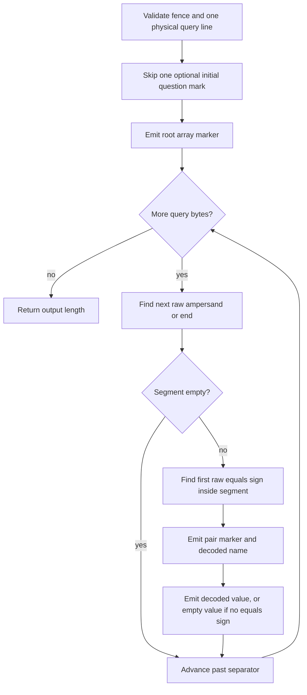
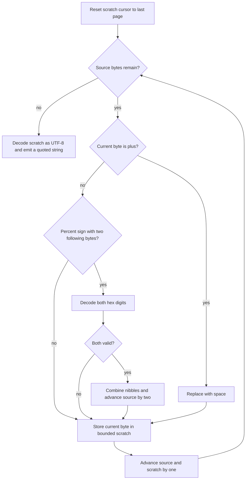
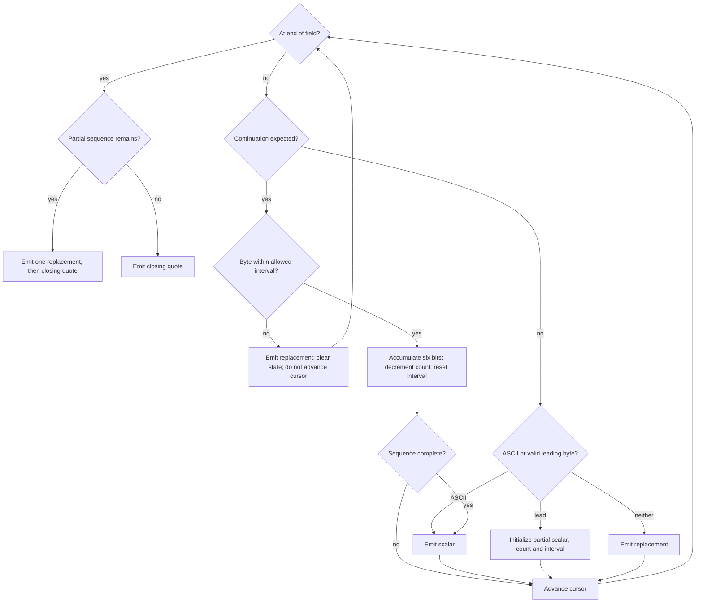

# URL query strings to ordered Markdown pairs

Tool 24 converts a `query` fenced block to an array of two-string arrays.
Each child contains its name, then its value. Unlike an object, this layout
preserves repeated names, empty names and pair order without special rules.

```query
?name=Ben+Atkin&tag=wasm&tag=Markdown&flag&city=Phoenix
```

becomes:

```text
- []
  - []
    - "name"
    - "Ben Atkin"
  - []
    - "tag"
    - "wasm"
  - []
    - "tag"
    - "Markdown"
  - []
    - "flag"
    - ""
  - []
    - "city"
    - "Phoenix"
```

## Match query decoding, including its recovery rules

This follows the [URL Standard's form-url-encoded parser](https://url.spec.whatwg.org/#concept-urlencoded-parser).
Split on `&`, ignore empty segments and split each remaining segment at its
first `=`. A missing equals sign means an empty value. Replace `+` with space,
decode valid percent triplets, then decode the resulting bytes as UTF-8.
An optional initial `?` is removed, as by the `URLSearchParams` constructor.
This accepts the query text itself, not a full URL; `#` is ordinary data here.

Bad percent triplets remain literal. Invalid UTF-8 is replaced using the
[Encoding Standard's decoder](https://encoding.spec.whatwg.org/#utf-8-decoder),
including reprocessing a byte that interrupts a multibyte sequence. A leading
UTF-8 BOM remains a character in the decoded field. There is no legacy charset
selection, `_charset_` special case, nesting convention or type inference.
Malformed byte sequences are intentionally not traps: recovery is part of
the format's semantics. JSON quoting represents decoded controls and line
breaks on a single physical Markdown list line.

The query occupies one physical line in a three-backtick `query` fence.
The framing newline may be LF or CRLF; spaces in the query are data, not
trimmed. Use percent encoding for line breaks inside a name/value. Empty
query text produces `- []`. No request or navigation occurs.
If the query itself would be a Markdown closing-fence line, percent-encode
one of its backticks. Such a line is rejected, not silently read as query data
after a generic Markdown renderer would already have closed the block.

## Pattern: split before decoding, reuse one scratch span

```text
validate the fence; remove its framing newline and optional initial '?'
emit the root array marker
for each nonempty '&'-separated segment:
  split at the first '='
  emit a pair-array marker
  for each of its two fields:
    percent-decode bytes into the reusable scratch page
    UTF-8 decode with replacement and emit a JSON-quoted string
```

Splitting before decoding ensures `%26` and `%3D` become data, not separators.
The decoder retains a scalar accumulator, a remaining-byte count and the
allowed continuation interval. On an invalid continuation it emits U+FFFD
and retries that same byte as a new leading byte. End-of-input with a partial
sequence emits one replacement character. This extends the visible pattern
in [UTF-8 validation](../examples/14-utf8-validation.md), not a host decoder.

The module has no imports. Input occupies the first 64 KiB, output the next
128 KiB, and a single field's decoded bytes reuse the last 64 KiB. The fixed
four-page memory has no data segment or heap. Input remains unchanged; every
store is bounded. Dense empty pairs or replacement characters can exhaust
output before input. A failed call may leave partial output, which the UI
must not publish. Another call resets output and field-local state.

## Inside the functions

### `run`: find structure before interpreting field data



`ql-run-segment` and `ql-run-equals` operate on original bytes. They cannot
mistake `%26` for a pair separator or `%3D` for the name/value separator.
`ql-run-value` adds one to the equals position only when an equals sign was
actually found. Otherwise the value span begins and ends at the segment end.
`ql-run-empty` skips empty segments but never skips an empty *name*: `=` is a
nonempty segment and produces a pair of two empty strings.

The fence checks happen before any transformation output. `ql-run-one-line`
rejects embedded physical line breaks; decoded `%0A` remains allowed later.
The `ql-run-fence-*` checks prevent a query line from also being a Markdown
closing fence. An encoded backtick is data and does not trigger those checks.

### `field`: one scratch store for each decoded byte



The plus branch runs before percent decoding. `%2B` therefore becomes a
literal plus, not a space. On an invalid triplet, the percent sign alone is
copied on this iteration; the following characters are still visited normally.
For `%%41`, that produces `%A`. Only a valid triplet advances by the extra two
bytes. The final increment is shared by all paths.

### `quoted UTF-8`: retry invalid continuations, not valid ones

The state is a partial scalar, a remaining-continuation count, and the allowed
interval for the next byte. The interval tightens for the first continuation
of certain lead bytes, then resets to `80..BF` after an accepted continuation.

| Lead byte | First continuation | Reason |
| --- | --- | --- |
| E0 | A0–BF | Exclude overlong three-byte encodings. |
| ED | 80–9F | Exclude surrogate scalars. |
| F0 | 90–BF | Exclude overlong four-byte encodings. |
| F4 | 80–8F | Stop at U+10FFFF. |



`ql-string-invalid-continuation` branches directly back to the loop, bypassing
`ql-string-next`. For bytes `E2 82 41`, the incomplete sequence becomes one
replacement and `41` is retried as `A`. Advancing there would lose the `A`.
For `ED A0 80`, the restricted interval rejects `A0`; it and `80` are then
individually invalid leading bytes, producing three replacements in total.

`ql-string-truncated` emits only one replacement for a partial sequence at
the field end. Each field gets a fresh set of locals, so state cannot leak
from a name into its value or into the next pair.

### `scalar`, `prefix`, and `emit`: rendering without another parser

- `scalar` emits JSON short escapes first, then `\u00xx` for other controls
  below space. It prefixes quote/backslash with a backslash; other ASCII is
  direct. Non-ASCII scalars use the two/three/four-byte UTF-8 branches and their
  shared continuation-byte tails. Its input is already a decoded scalar.
- `prefix(depth)` repeats two spaces per depth, then emits `- `. The caller
  chooses depth 0 for the root, 1 for a pair and 2 for each string leaf.
- `emit` enforces the output region on every byte. Scratch writes have their
  own bound in `field`; reaching one region's limit cannot spill into another.
- `hex-value` and `hex-digit` have opposite roles: the former accepts either
  case and returns `-1` on failure; the latter writes one lowercase hex digit
  for a JSON control escape. Their callers supply the surrounding syntax.

## Module

Functions: run 0, emit 1, prefix 2, field 3, quoted UTF-8 4, scalar 5,
hex-value 6, hex-digit 7, whitespace 8. Global 0 is the output cursor.

`[microwasm]`

- ql-header: `0061736d 01000000`
- ql-type-section: `01 {{size:ql-types}}`
  - ql-types: `03 60 01 7f 01 7f 60 01 7f 00 60 02 7f 7f 00`
- ql-function-section: `03 {{size:ql-functions}}`
  - ql-functions: `09 00 01 01 02 02 01 00 01 00`
- ql-memory-section: `05 04 01 01 04 04`
- ql-global-section: `06 {{size:ql-globals}}`
  - ql-globals: `01 7f 01 41 00 0b`
- ql-export-section: `07 {{size:ql-exports}}`
  - ql-exports: `02 03 72756e 00 00 06 6d656d6f7279 02 00`
- ql-code-section: `0a {{size:ql-code}}`
  - ql-code: `09`
    - ql-run-record: `{{size:ql-run-body}}`
      - ql-run-body: `01 07 7f`
        - ql-run-bound: `20 00 41 0c 49 20 00 41 808004 4b 72 04 40 00 0b`
        - ql-run-ticks: `03 40 20 02 2d 00 00 41 e000 47 04 40 00 0b 20 02 41 01 6a 22 02 41 03 49 0d 00 0b`
        - ql-run-label: `41 03 2d 00 00 41 f100 47 41 04 2d 00 00 41 f500 47 72 41 05 2d 00 00 41 e500 47 72 41 06 2d 00 00 41 f200 47 72 41 07 2d 00 00 41 f900 47 72 04 40 00 0b`
        - ql-run-opening: `41 08 21 03 20 03 2d 00 00 41 0d 46 04 40 41 09 21 03 0b 20 03 2d 00 00 41 0a 47 04 40 00 0b 20 03 41 01 6a 21 03 20 00 21 01`
        - ql-run-trim: `02 40 03 40 20 01 45 0d 01 20 01 41 01 6b 2d 00 00 10 08 45 0d 01 20 01 41 01 6b 21 01 0c 00 0b 0b`
        - ql-run-closing-bound: `20 01 20 03 41 03 6a 49 04 40 00 0b 20 01 41 03 6b 21 04 41 00 21 02`
        - ql-run-closing: `03 40 20 04 20 02 6a 2d 00 00 41 e000 47 04 40 00 0b 20 02 41 01 6a 22 02 41 03 49 0d 00 0b`
        - ql-run-framing: `20 04 20 03 4b 04 40 20 04 41 01 6b 22 04 2d 00 00 41 0a 47 04 40 00 0b 20 04 20 03 4b 04 40 20 04 41 01 6b 2d 00 00 41 0d 46 04 40 20 04 41 01 6b 21 04 0b 0b 0b`
        - ql-run-one-line: `20 03 21 02 02 40 03 40 20 02 20 04 4f 0d 01 20 02 2d 00 00 22 06 41 0a 46 20 06 41 0d 46 72 04 40 00 0b 20 02 41 01 6a 21 02 0c 00 0b 0b`
        - ql-run-fence-indent: `20 03 21 02 02 40 03 40 20 02 20 04 4f 0d 01 20 02 20 03 6b 41 03 4f 0d 01 20 02 2d 00 00 41 20 47 0d 01 20 02 41 01 6a 21 02 0c 00 0b 0b 41 00 21 06`
        - ql-run-fence-ticks: `02 40 03 40 20 02 20 04 4f 0d 01 20 02 2d 00 00 41 e000 47 0d 01 20 02 41 01 6a 21 02 20 06 41 01 6a 21 06 0c 00 0b 0b`
        - ql-run-fence-tail: `20 06 41 03 4f 04 40 02 40 03 40 20 02 20 04 4f 0d 01 20 02 2d 00 00 10 08 45 0d 01 20 02 41 01 6a 21 02 0c 00 0b 0b 20 02 20 04 46 04 40 00 0b 0b`
        - ql-run-question: `20 03 20 04 49 04 40 20 03 2d 00 00 41 3f 46 04 40 20 03 41 01 6a 21 03 0b 0b`
        - ql-run-root: `41 808004 24 00 41 00 10 02 41 db00 10 01 41 dd00 10 01 41 0a 10 01`
        - ql-run-pairs: `02 40 03 40 20 03 20 04 4f 0d 01 20 03 21 07`
          - ql-run-segment: `02 40 03 40 20 07 20 04 4f 0d 01 20 07 2d 00 00 41 26 46 0d 01 20 07 41 01 6a 21 07 0c 00 0b 0b`
          - ql-run-empty: `20 07 20 03 46 04 40 20 07 41 01 6a 21 03 0c 01 0b`
          - ql-run-equals-start: `20 03 21 05`
          - ql-run-equals: `02 40 03 40 20 05 20 07 4f 0d 01 20 05 2d 00 00 41 3d 46 0d 01 20 05 41 01 6a 21 05 0c 00 0b 0b`
          - ql-run-pair: `41 01 10 02 41 db00 10 01 41 dd00 10 01 41 0a 10 01`
          - ql-run-name: `41 02 10 02 20 03 20 05 10 03 41 0a 10 01`
          - ql-run-value: `41 02 10 02 20 05 20 05 20 07 49 6a 20 07 10 03 41 0a 10 01`
          - ql-run-next: `20 07 41 01 6a 21 03 0c 00 0b 0b`
        - ql-run-result: `23 00 41 808004 6b 0b`
    - ql-emit-record: `{{size:ql-emit-body}}`
      - ql-emit-body: `00 23 00 41 80800c 4f 04 40 00 0b 23 00 20 00 3a 00 00 23 00 41 01 6a 24 00 0b`
    - ql-prefix-record: `{{size:ql-prefix-body}}`
      - ql-prefix-body: `00 02 40 03 40 20 00 45 0d 01 41 20 10 01 41 20 10 01 20 00 41 01 6b 21 00 0c 00 0b 0b 41 2d 10 01 41 20 10 01 0b`
    - ql-field-record: `{{size:ql-field-body}}`
      - ql-field-body: `01 04 7f 41 80800c 21 02`
        - ql-field-loop: `02 40 03 40 20 00 20 01 4f 0d 01 20 00 2d 00 00 21 03`
          - ql-field-plus: `20 03 41 2b 46 04 40 41 20 21 03`
            - ql-field-percent: `05 20 03 41 25 46 20 00 41 02 6a 20 01 49 71 04 40`
              - ql-field-hex: `20 00 41 01 6a 2d 00 00 10 06 21 04 20 00 41 02 6a 2d 00 00 10 06 21 05`
              - ql-field-valid: `20 04 41 00 4e 20 05 41 00 4e 71 04 40` — Only two valid hex digits take the decoding branch.
                - ql-field-combine: `20 04 41 04 74 20 05 72 21 03` — High nibble times sixteen, combined with the low nibble.
                - ql-field-consume-triplet: `20 00 41 02 6a 21 00 0b 0b 0b` — Consume the extra two bytes only on success; every path still takes the common final increment.
          - ql-field-store: `20 02 41 808010 4f 04 40 00 0b 20 02 20 03 3a 00 00 20 02 41 01 6a 21 02`
          - ql-field-next: `20 00 41 01 6a 21 00 0c 00 0b 0b 41 80800c 20 02 10 04 0b`
    - ql-string-record: `{{size:ql-string-body}}`
      - ql-string-body: `01 05 7f 41 8001 21 05 41 bf01 21 06 41 22 10 01`
        - ql-string-loop: `02 40 03 40 20 00 20 01 4f 0d 01 20 00 2d 00 00 21 02`
          - ql-string-continuation: `20 04 04 40`
            - ql-string-invalid-continuation: `20 02 20 05 49 20 02 20 06 4b 72 04 40` — Outside the current continuation interval.
              - ql-string-replace-partial: `41 fdff03 10 05` — Replace the unfinished sequence, not the current byte.
              - ql-string-reset-partial: `41 00 21 04 41 8001 21 05 41 bf01 21 06` — Clear the remaining count and restore the ordinary continuation bounds.
              - ql-string-retry-byte: `0c 02 0b` — Branch past both if blocks to the loop without advancing the cursor.
            - ql-string-accumulate: `20 03 41 06 74 20 02 41 3f 71 72 21 03 20 04 41 01 6b 21 04 41 8001 21 05 41 bf01 21 06`
            - ql-string-complete: `20 04 45 04 40 20 03 10 05 0b`
          - ql-string-leading: `05`
            - ql-string-ascii: `20 02 41 8001 49 04 40 20 02 10 05`
              - ql-string-two: `05 20 02 41 c201 6b 41 1d 4d 04 40 41 01 21 04 20 02 41 1f 71 21 03`
                - ql-string-three: `05 20 02 41 e001 6b 41 0f 4d 04 40 41 02 21 04 20 02 41 0f 71 21 03`
                  - ql-string-three-low: `20 02 41 e001 46 04 40 41 a001 21 05 0b`
                  - ql-string-three-high: `20 02 41 ed01 46 04 40 41 9f01 21 06 0b`
                  - ql-string-four: `05 20 02 41 f001 6b 41 04 4d 04 40 41 03 21 04 20 02 41 07 71 21 03`
                    - ql-string-four-low: `20 02 41 f001 46 04 40 41 9001 21 05 0b`
                    - ql-string-four-high: `20 02 41 f401 46 04 40 41 8f01 21 06 0b`
                    - ql-string-invalid-lead: `05 41 fdff03 10 05 0b 0b 0b 0b 0b`
          - ql-string-next: `20 00 41 01 6a 21 00 0c 00 0b 0b`
        - ql-string-truncated: `20 04 04 40 41 fdff03 10 05 0b 41 22 10 01 0b`
    - ql-scalar-record: `{{size:ql-scalar-body}}`
      - ql-scalar-body: `01 01 7f`
        - ql-scalar-short: `20 00 41 08 46 04 40 41 e200 21 01 0b 20 00 41 09 46 04 40 41 f400 21 01 0b 20 00 41 0a 46 04 40 41 ee00 21 01 0b 20 00 41 0c 46 04 40 41 e600 21 01 0b 20 00 41 0d 46 04 40 41 f200 21 01 0b`
        - ql-scalar-short-output: `20 01 04 40 41 dc00 10 01 20 01 10 01 0f 0b`
        - ql-scalar-control: `20 00 41 20 49 04 40 41 dc00 10 01 41 f500 10 01 41 30 10 01 41 30 10 01 20 00 41 04 76 10 07 20 00 41 0f 71 10 07 0f 0b`
        - ql-scalar-escape: `20 00 41 22 46 20 00 41 dc00 46 72 04 40 41 dc00 10 01 0b`
        - ql-scalar-ascii: `20 00 41 8001 49 04 40 20 00 10 01 0f 0b`
        - ql-scalar-two: `20 00 41 8010 49 04 40 20 00 41 06 76 41 c001 72 10 01`
          - ql-scalar-more: `05 20 00 41 808004 49 04 40 20 00 41 0c 76 41 e001 72 10 01`
            - ql-scalar-four: `05 20 00 41 12 76 41 f001 72 10 01 20 00 41 0c 76 41 3f 71 41 8001 72 10 01 0b`
          - ql-scalar-middle: `20 00 41 06 76 41 3f 71 41 8001 72 10 01 0b`
        - ql-scalar-last: `20 00 41 3f 71 41 8001 72 10 01 0b`
    - ql-hex-record: `{{size:ql-hex-body}}`
      - ql-hex-body: `00 20 00 41 30 6b 41 09 4d 04 40 20 00 41 30 6b 0f 0b 20 00 41 20 72 41 e100 6b 41 05 4d 04 40 20 00 41 20 72 41 d700 6b 0f 0b 41 7f 0b`
    - ql-digit-record: `{{size:ql-digit-body}}`
      - ql-digit-body: `00 20 00 20 00 41 0a 49 04 7f 41 30 05 41 d700 0b 6a 10 01 0b`
    - ql-whitespace-record: `{{size:ql-whitespace-body}}`
      - ql-whitespace-body: `00 20 00 41 20 46 20 00 41 09 46 72 20 00 41 0a 46 72 20 00 41 0d 46 72 0b`

Run locals: length 0, trimmed fence end 1, index 2, query cursor 3, query end 4,
equals position 5, byte 6, segment end 7. Field locals: source start/end 0/1,
scratch cursor 2, byte 3, high/low nibbles 4/5. String locals: scratch
cursor/end 0/1, byte 2, scalar 3, remaining 4, lower/upper bounds 5/6.
